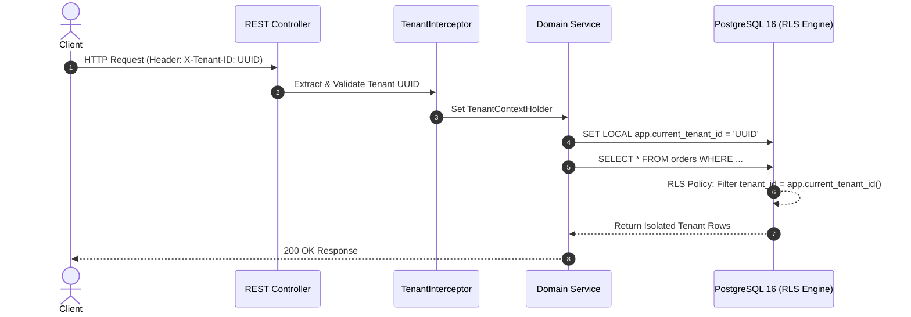

# Phân hệ 07: Row-Level Security (RLS) & Phân Vùng Dữ Liệu
## Ordera Multi-Tenant Loyalty & Ordering Platform

> **Chiến Lược Cách Ly Đa Thuê Thuần CSDL (PostgreSQL RLS) & Phân Vùng Sổ Cái (Declarative Range Partitioning)**  
> **File Migration:** `V4__create_points_ledger.sql`, `V9__enable_rls_security_policies.sql`

---

## 1. Kiến Trúc Cách Ly Dữ Liệu Row-Level Security (RLS)

### 1.1 Cơ chế Session Variable & Hibernate Interceptor
Để kích hoạt RLS tự động cho mọi kết nối DB trong Spring Boot:
1. Khi request đi qua `TenantInterceptor`, backend trích xuất `tenant_id` từ Header `X-Tenant-ID` hoặc JWT Claims.
2. Hibernate/JPA Session mở transaction và thiết lập biến cục bộ phiên kết nối:
   ```sql
   SET LOCAL app.current_tenant_id = 'a0eebc99-9c0b-4ef8-bb6d-6bb9bd380a11';
   ```
3. PostgreSQL tự động áp dụng chính sách bảo mật: các truy vấn `SELECT`, `UPDATE`, `DELETE` chỉ nhìn thấy dữ liệu có `tenant_id = app.current_tenant_id`.



---

### 1.2 SQL Script Kích Hoạt RLS Trên Toàn Bộ Bảng Nghiệp Vụ

```sql
-- 1. Hàm tiện ích lấy Tenant ID an toàn
CREATE OR REPLACE FUNCTION current_app_tenant_id() RETURNS UUID AS $$
BEGIN
    RETURN NULLIF(current_setting('app.current_tenant_id', true), '')::UUID;
EXCEPTION
    WHEN OTHERS THEN RETURN NULL;
END;
$$ LANGUAGE plpgsql STABLE;

-- 2. Kích hoạt RLS trên các bảng nghiệp vụ
ALTER TABLE stores ENABLE ROW LEVEL SECURITY;
ALTER TABLE store_tables ENABLE ROW LEVEL SECURITY;
ALTER TABLE users ENABLE ROW LEVEL SECURITY;
ALTER TABLE member_profiles ENABLE ROW LEVEL SECURITY;
ALTER TABLE tier_definitions ENABLE ROW LEVEL SECURITY;
ALTER TABLE points_ledger ENABLE ROW LEVEL SECURITY;
ALTER TABLE categories ENABLE ROW LEVEL SECURITY;
ALTER TABLE products ENABLE ROW LEVEL SECURITY;
ALTER TABLE vouchers ENABLE ROW LEVEL SECURITY;
ALTER TABLE user_vouchers ENABLE ROW LEVEL SECURITY;
ALTER TABLE loyalty_gifts ENABLE ROW LEVEL SECURITY;
ALTER TABLE user_gift_redemptions ENABLE ROW LEVEL SECURITY;
ALTER TABLE orders ENABLE ROW LEVEL SECURITY;
ALTER TABLE support_claims ENABLE ROW LEVEL SECURITY;

-- 3. Chính sách cách ly trên bảng orders (Ví dụ mẫu)
CREATE POLICY tenant_isolation_orders ON orders
    FOR ALL
    USING (tenant_id = current_app_tenant_id())
    WITH CHECK (tenant_id = current_app_tenant_id());

-- 4. Chính sách cách ly trên bảng points_ledger
CREATE POLICY tenant_isolation_points_ledger ON points_ledger
    FOR ALL
    USING (tenant_id = current_app_tenant_id())
    WITH CHECK (tenant_id = current_app_tenant_id());
```

---

## 2. Chiến Lược Phân Vùng Dữ Liệu Sổ Cái (Partitioning Strategy)

Theo quy định đánh giá tải của Skill `database-design`:
- Các bảng tĩnh như `tenants`, `stores`, `categories`, `tier_definitions` có dung lượng nhỏ (< 100k dòng): **Không phân vùng**.
- **2 Bảng có tốc độ tăng trưởng cực nhanh:**
  1. `points_ledger`: Mỗi đơn hàng, mỗi lượt đổi voucher, mỗi hoạt động admin đều sinh 1 dòng. Với chuỗi nhà hàng lớn có thể đạt hàng triệu giao dịch mỗi tháng.
  2. `orders`: Tăng trưởng liên tục theo từng ngày hoạt động.

### 2.1 Định nghĩa Bảng Phân vùng RANGE theo `created_at`
Bảng `points_ledger` sử dụng **PostgreSQL Declarative RANGE Partitioning theo `created_at` (Hàng năm)**:

```sql
-- Bảng mẹ phân vùng
CREATE TABLE points_ledger (
    id UUID NOT NULL,
    created_at TIMESTAMPTZ NOT NULL DEFAULT now(),
    tenant_id UUID NOT NULL REFERENCES tenants(id),
    member_id UUID NOT NULL REFERENCES member_profiles(id),
    transaction_type VARCHAR(32) NOT NULL,
    points_delta INT NOT NULL,
    balance_after INT NOT NULL,
    reference_type VARCHAR(32),
    reference_id VARCHAR(64),
    description VARCHAR(255) NOT NULL,
    PRIMARY KEY (id, created_at)
) PARTITION BY RANGE (created_at);

-- Phân vùng cho năm 2025
CREATE TABLE points_ledger_y2025 PARTITION OF points_ledger
    FOR VALUES FROM ('2025-01-01 00:00:00+00') TO ('2026-01-01 00:00:00+00');

-- Phân vùng cho năm 2026
CREATE TABLE points_ledger_y2026 PARTITION OF points_ledger
    FOR VALUES FROM ('2026-01-01 00:00:00+00') TO ('2027-01-01 00:00:00+00');

-- Phân vùng cho năm 2027
CREATE TABLE points_ledger_y2027 PARTITION OF points_ledger
    FOR VALUES FROM ('2027-01-01 00:00:00+00') TO ('2028-01-01 00:00:00+00');
```

---

### 2.2 Lợi Ích & Bảo Trì Dữ Liệu Lịch Sử (Data Archiving)

1. **Partition Pruning:** Khi truy vấn `WHERE created_at >= '2026-01-01'`, PostgreSQL chỉ quét partition `points_ledger_y2026`, bỏ qua hoàn toàn các phân vùng năm cũ $\rightarrow$ Tốc độ truy vấn tăng gấp **5-10 lần**.
2. **Không phân mảnh Index:** Mỗi phân vùng có một cây B-Tree Index riêng, giữ kích thước Index vừa vặn trong RAM bộ nhớ đệm (Buffer Pool).
3. **Lưu trữ dữ liệu cũ (Cold Storage):** Sau 3-5 năm, có thể tách dữ liệu cũ ra lưu trữ mà không ảnh hưởng bảng chính:
   ```sql
   ALTER TABLE points_ledger DETACH PARTITION points_ledger_y2025;
   ```

