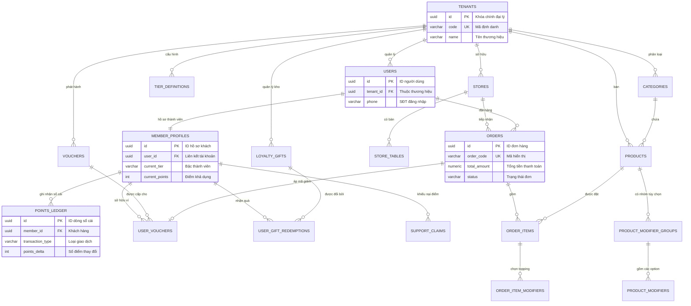

# Database Detailed Design Specification
## Ordera Multi-Tenant Loyalty & Ordering Platform

> **Trung tâm Thiết kế Chi tiết Cơ sở Dữ liệu (Database Detailed Design - DDD Blueprint)**  
> **Hệ quản trị CSDL:** PostgreSQL 16 (Hỗ trợ JSONB, RLS, UUID, Range Partitioning)  
> **Framework ORM & Migration:** Spring Data JPA 3.x, Hibernate 6, Flyway 10  
> **Kiến trúc Cô lập:** Multi-Tenant Shared Database, Shared Schema với Row-Level Security (RLS)  
> **Mục tiêu:** Cung cấp tài liệu kỹ thuật chuẩn xác, định nghĩa toàn diện 18 bảng dữ liệu, ràng buộc toàn vẹn, chiến lược index, cơ chế sổ cái bất biến và phân vùng dữ liệu để làm base triển khai code backend.

---

## 1. Tổng quan Kiến trúc Dữ liệu & Nguyên tắc Cốt lõi (Core Principles)

1. **Multi-Tenant Native (RLS):** Mọi bảng dữ liệu nghiệp vụ đều bắt buộc có cột `tenant_id UUID NOT NULL`. PostgreSQL Row-Level Security được kích hoạt để tự động lọc dữ liệu dựa trên session setting `app.current_tenant_id`, ngăn chặn 100% lỗi lộ dữ liệu chéo đại lý (IDOR).
2. **Sổ cái Điểm Bất biến (Immutable Double-Entry Ledger):** Điểm thưởng của khách hàng là dữ liệu nhạy cảm tương tự tiền tệ. Tuyệt đối không cập nhật trực tiếp điểm bằng `UPDATE member_profiles SET current_points = ...`. Mọi biến động cộng/trừ đều phải sinh ra dòng giao dịch bất biến trong `points_ledger`.
3. **Độ chính xác Tiền tệ (Zero Precision Loss):** Tuyệt đối không dùng kiểu dữ liệu dấu phẩy động (`FLOAT`, `DOUBLE`, `REAL`) cho giá cả, thuế, tips, chiết khấu và tổng đơn. Sử dụng `NUMERIC(12,2)` cho toàn bộ các trường tài chính.
4. **Múi giờ Chuẩn hóa (Timestamp Consistency):** Tất cả các cột thời gian đều sử dụng `TIMESTAMPTZ` (Timestamp with Time Zone), lưu trữ chuẩn UTC tại tầng CSDL và chỉ convert sang giờ địa phương (`Europe/Oslo` hoặc `Asia/Ho_Chi_Minh`) khi hiển thị tại Presentation Layer.
5. **Khóa Chính (Primary Key Strategy):** Sử dụng `UUID` sinh bằng hàm `gen_random_uuid()` làm khóa chính nhằm hỗ trợ tạo ID phân tán, không để lộ số lượng bản ghi và triệt tiêu xung đột dữ liệu. Riêng bảng phân vùng `points_ledger` sử dụng khóa chính kết hợp `(id, created_at)`.
6. **Mô tả Chi tiết Bắt buộc (Mandatory Column Remarks):** 100% các cột đều có chú thích ngữ nghĩa nghiệp vụ rõ ràng bằng tiếng Việt.

---

## 2. Sơ đồ Quan hệ Thực thể Tổng thể (Master ERD)



---

## 3. Mục lục Phân hệ Thiết kế Cơ sở Dữ liệu

Tài liệu được tách thành các file chi tiết tương ứng với từng Domain module:

1. 🏬 [`01-tenants-and-stores-db.md`](./01-tenants-and-stores-db.md) — Bảng `tenants`, `stores`, `store_tables`.
2. 🔐 [`02-users-and-identity-db.md`](./02-users-and-identity-db.md) — Bảng `users`, `otp_audit_logs`.
3. 🎖️ [`03-loyalty-and-points-ledger-db.md`](./03-loyalty-and-points-ledger-db.md) — Bảng `tier_definitions`, `member_profiles`, `points_ledger` (Partitioned), `support_claims`.
4. 🍣 [`04-catalog-and-menu-db.md`](./04-catalog-and-menu-db.md) — Bảng `categories`, `products`, `product_modifier_groups`, `product_modifiers`.
5. 🎁 [`05-rewards-and-vouchers-db.md`](./05-rewards-and-vouchers-db.md) — Bảng `vouchers`, `user_vouchers`, `loyalty_gifts`, `user_gift_redemptions`.
6. 🛒 [`06-orders-and-checkout-db.md`](./06-orders-and-checkout-db.md) — Bảng `orders`, `order_items`, `order_item_modifiers`.
7. 🛡️ [`07-rls-and-partitioning.md`](./07-rls-and-partitioning.md) — Chiến lược Row-Level Security, Hibernate Interceptor & Phân vùng dữ liệu RANGE theo năm.

---

## 4. Kế hoạch Database Migrations (Flyway Roadmap)

Bộ migration SQL được đặt tại thư mục `backend/src/main/resources/db/migration/`:

```tree
db/migration/
├── V1__create_tenants_and_stores.sql      # Bảng tenants, stores, store_tables
├── V2__create_users_and_identity.sql      # Bảng users, otp_audit_logs
├── V3__create_loyalty_and_tiers.sql       # Bảng tier_definitions, member_profiles, support_claims
├── V4__create_points_ledger.sql           # Bảng points_ledger (Partitioned)
├── V5__create_catalog_and_modifiers.sql   # Bảng categories, products, product_modifiers
├── V6__create_vouchers_and_rewards.sql    # Bảng vouchers, user_vouchers, loyalty_gifts, user_gift_redemptions
├── V7__create_orders_and_checkout.sql     # Bảng orders, order_items, order_item_modifiers
├── V8__enable_rls_security_policies.sql   # Script kích hoạt RLS & Policies
└── V9__seed_demo_data_linn_sushi.sql      # Dữ liệu mẫu ban đầu khớp với Figma
```

---

## 5. Dữ liệu Mẫu Khởi tạo Chuẩn Figma (Seed Data Mapping)

File `V9__seed_demo_data_linn_sushi.sql` nạp sẵn bộ dữ liệu mẫu khớp 100% với các màn hình Figma:

1. **Thương hiệu & Cửa hàng (Nhóm 01):**
   - Tenant: `Agency Name` (Mã: `linn_sushi`, Màu: `#F5B800`).
   - Cửa hàng: `Linn Sushi Sentrum` (`Prinsens gate 10C, 0153 Oslo`).
2. **Khách hàng Mẫu (Nhóm 04 & 05):**
   - Tài khoản: `David Nguyen`, SĐT `+4797362748`, Email `info@ordera.no`, Ngày sinh `23/08/2000`.
   - Cấp bậc: `Silver` (Cần 100 điểm để lên `Gold`).
   - Điểm khả dụng: `120 Points` | Điểm trọn đời: `300 Points`.
3. **Thực đơn Món ăn (Nhóm 01 & 06):**
   - `Aurora` (89.00 Kr, Size L +15 Kr, Mango Popping +10 Kr).
   - `Tuna Maki` (89.00 Kr).
4. **Voucher & Quà tặng (Nhóm 07):**
   - Voucher 1: `Voucher Name` (Giảm `100.00` NOK, Đơn tối thiểu `250.00` NOK, Đổi bằng `100 Points`).
   - Voucher 2: `Voucher Name` (Giảm `30%`, Đơn tối thiểu `0.00` NOK, Đổi bằng `1000 Points`).
   - Quà tặng: `Gift Name` (Cốc Tumbler màu hồng, Đổi bằng `100 Points`, Tồn kho `10 Pieces`).

