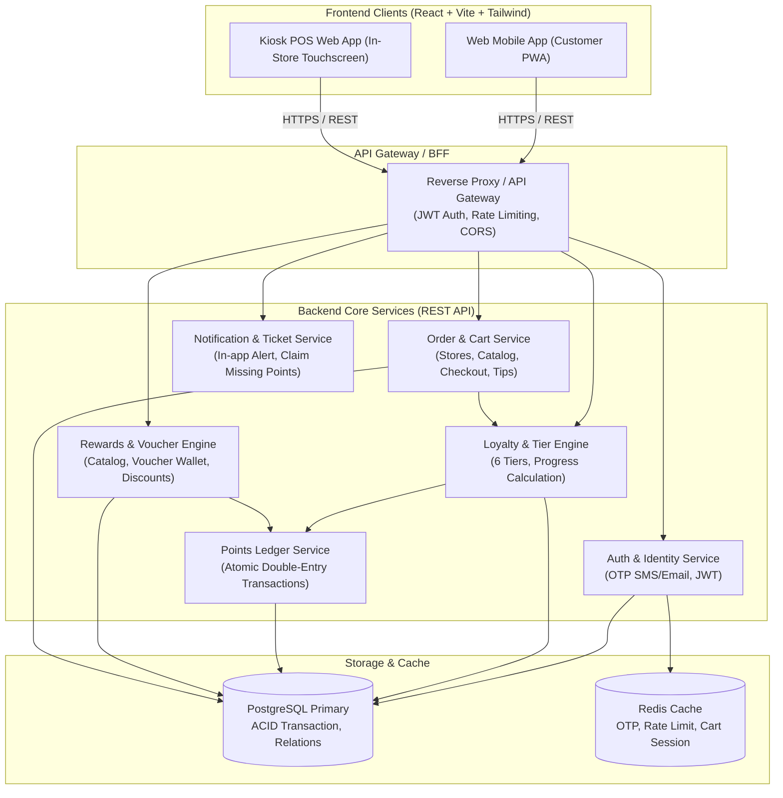
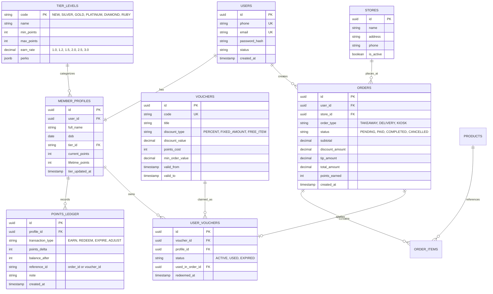
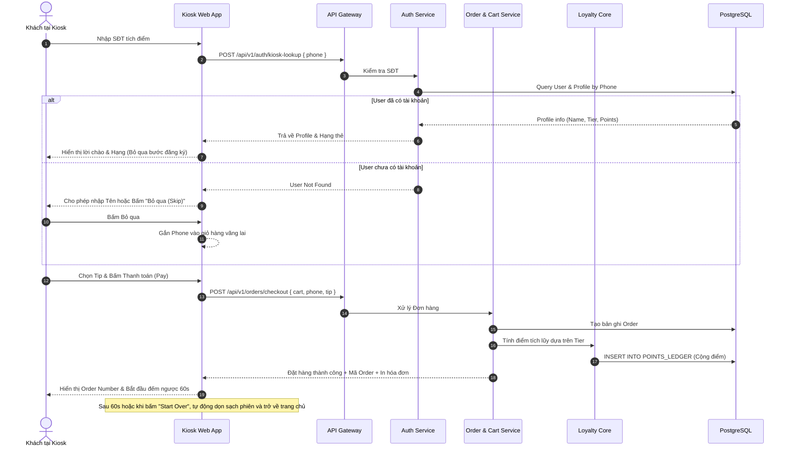
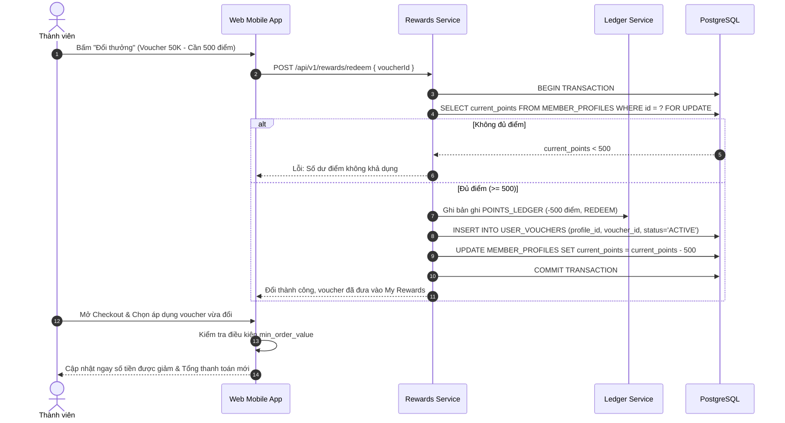

Started at:  2026/11/03 23:33:00
Finished at: 2026/11/03 23:37:00
Total time: 4 minutes
---

# Architecture: Ordera Loyalty Program 2.0

## Source
- **Vision:** [2026-11-03-vision.md](file:///d:/vibe-code/orderaapp/docs/designs/ordera-loyalty/2026-11-03-vision.md)
- **Requirements:** [2026-11-03-requirements.md](file:///d:/vibe-code/orderaapp/docs/designs/ordera-loyalty/2026-11-03-requirements.md)

---

## 1. High-Level Component Architecture

Hệ thống được thiết kế theo mô hình **Modular Architecture (Headless Loyalty & Ordering)**, tách bạch hoàn toàn giữa tầng Trải nghiệm Người dùng (Frontend Clients) và tầng Dịch vụ Xử lý Nghiệp vụ lõi (Backend Loyalty Core).

### Chi tiết các thành phần (Components)

| Thành phần | Trách nhiệm chính | Công nghệ đề xuất | Giao thức |
|---|---|---|---|
| **Web Mobile App** | Trải nghiệm khách hàng di động (8 module Figma: Cửa hàng, Hạng thẻ, Đổi quà, Giỏ hàng) | React 19, Vite, Tailwind CSS, TypeScript, Lucide Icons | HTTPS / REST |
| **Kiosk Web App** | Giao diện màn hình cảm ứng tại cửa hàng (Tích điểm nhanh SĐT, Chọn tip, Tự hủy phiên 60s) | React 19, Vite, Tailwind CSS (Tối ưu giao diện cảm ứng lớn) | HTTPS / REST |
| **API Gateway / BFF** | Định tuyến, kiểm tra xác thực JWT, giải phóng tải tĩnh, chống brute-force OTP | Express / Fastify / Nginx Gateway | HTTPS / REST |
| **Auth Service** | Quản lý người dùng, sinh/kiểm tra OTP 6 số qua SMS/Email, cấp phát Access/Refresh Token | Node.js / TypeScript | REST + Redis |
| **Loyalty & Tier Engine** | Quản lý 6 cấp bậc thành viên (New -> Ruby), tính toán thăng/giáng hạng và tỷ lệ tích điểm | Node.js / TypeScript | REST + PostgreSQL |
| **Points Ledger Service** | Ghi nhận biến động điểm (Audit log), đảm bảo giao dịch nguyên tử, chống gian lận điểm | Node.js / TypeScript | PostgreSQL Transactions |
| **Rewards & Voucher Engine** | Quản lý kho voucher, xử lý trừ điểm đổi quà, kiểm tra điều kiện áp mã trong giỏ hàng | Node.js / TypeScript | REST + PostgreSQL |
| **Order & Cart Service** | Quản lý danh mục món ăn, cửa hàng, giỏ hàng, áp mã ưu đãi và chốt đơn hàng | Node.js / TypeScript | REST + PostgreSQL |

---

## 2. Data Architecture (Kiến trúc Dữ liệu)

### 2.1 Entity Relationship Diagram (ERD)

### 2.2 Chiến lược Dữ liệu (Database Decisions)

| Hạng mục | Quyết định | Lý do & Lợi ích |
|---|---|---|
| **Hệ quản trị CSDL** | **PostgreSQL 16+** | Hỗ trợ chuẩn ACID nghiêm ngặt cho giao dịch điểm, hỗ trợ kiểu dữ liệu JSONB cho cấu hình linh hoạt (Perks, Voucher conditions), index phong phú. |
| **Chiến lược sinh ID (ID Strategy)** | **UUID v7** | Kết hợp giữa tính ngẫu nhiên (chống lộ số lượng đơn/khách hàng) và tính sắp xếp theo thời gian (Time-ordered), giúp tối ưu hiệu năng B-Tree Index vượt trội so với UUID v4. |
| **Cơ chế Sổ cái Điểm (Ledger Mechanism)** | **Append-Only Ledger (Bất biến)** | Số dư `current_points` trên Profile chỉ là bản sao tổng hợp (Materialized View / Cached column). Nguồn dữ liệu chân thực (Single Source of Truth) là bảng `POINTS_LEDGER`. Mọi thao tác đều dùng `SELECT ... FOR UPDATE` khi giao dịch. |
| **Caching Layer** | **Redis 7+** | Lưu mã OTP (TTL 3 phút), rate-limit counters theo IP/SĐT, và phiên Kiosk tạm thời. |

---

## 3. Sequence Diagrams cho các luồng nghiệp vụ trọng yếu

### 3.1 Luồng Tích điểm & Checkout tại quầy Kiosk

### 3.2 Luồng Đổi Voucher và Áp dụng trong Giỏ hàng

---

## 4. Architecture Decision Records (ADRs)

| # | Quyết định (Decision) | Phương án thay thế | Lý do lựa chọn (Rationale) |
|---|---|---|---|
| **ADR-1** | Cấu trúc **Frontend Single-Page App (React + Vite)** cho cả Web Mobile và Kiosk | Next.js Server-Side Rendering (SSR) | Web Mobile và Kiosk là ứng dụng nội bộ/khách hàng tương tác sau khi scan QR/tại quầy, không yêu cầu SEO công cộng phức tạp. Vite mang lại tốc độ phản hồi cực nhanh, bundle siêu gọn và chạy mượt trên mọi màn hình cảm ứng di động/kiosk. |
| **ADR-2** | Dùng **UUID v7** làm Khóa chính (Primary Key) | Auto-increment INT hoặc UUID v4 | Chống lại việc dự đoán mã đơn hàng hoặc tổng số lượng thành viên (Security/Business privacy), đồng thời giữ trật tự theo thời gian để tối ưu hóa việc phân trang và ghi đĩa trên PostgreSQL. |
| **ADR-3** | Mô hình **Points Ledger (Audit Trail bất biến)** | Cột `user.points` đơn thuần | Đảm bảo 100% tính kiểm toán tài chính, truy vết nguồn gốc từng điểm số được sinh ra hoặc tiêu thụ, giải quyết triệt để vấn đề gian lận hoặc khiếu nại thiếu điểm. |
| **ADR-4** | UI Component Architecture theo **shadcn/ui + Tailwind CSS** | Ant Design / Material UI | Cực kỳ nhẹ, dễ dàng tùy biến 100% theo đúng design tokens của Figma (màu thẻ Silver, Gold, Platinum, Ruby, bo góc, bóng mờ drop-shadow), không bị phụ thuộc vào thư viện bên thứ 3 cồng kềnh. |

---

## 5. Domain Skills Referenced
- **`api-design`:** Phân tách rõ ràng giữa Public Client API và Internal Service contracts.
- **`database-design`:** Chuẩn hóa lược đồ quan hệ 3NF, cơ chế khóa bản ghi bi-directional cho Points Ledger, chiến lược phân chỉ mục (Index) trên `user_id`, `profile_id`, `created_at`.
- **`log-processing`:** Định nghĩa các sự kiện kiểm toán trọng yếu để phục vụ giám sát hệ thống.

