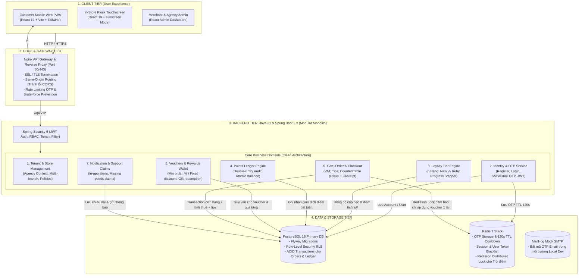
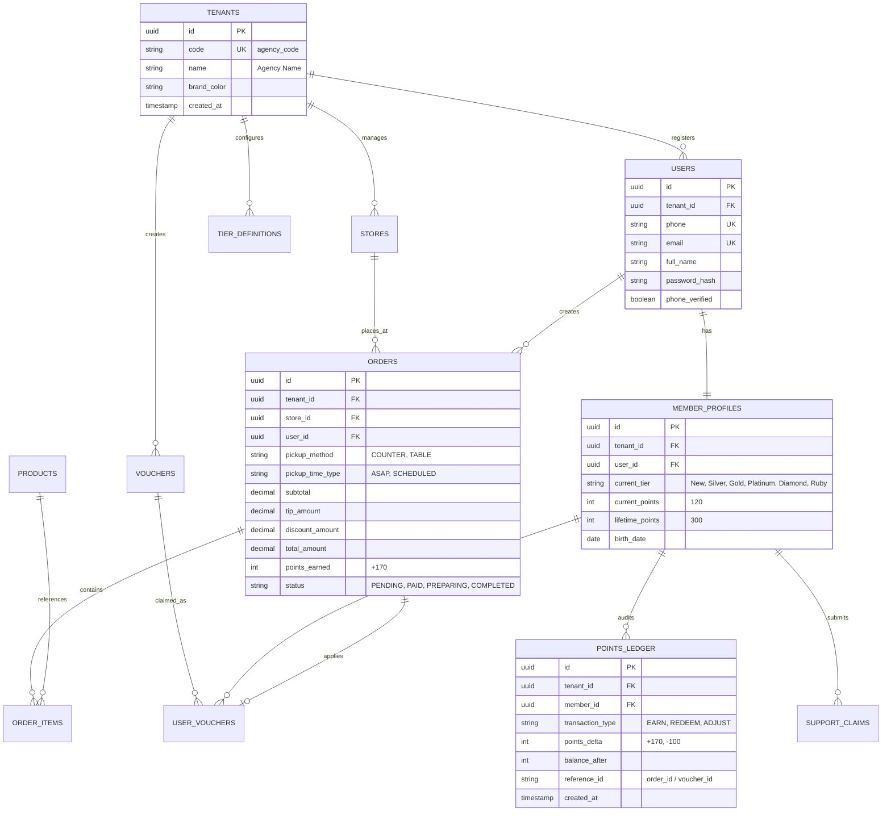

Started at:  2026/11/04 23:12:00
Finished at: 2026/11/04 23:25:00
Total time: 13 minutes
---

# Enterprise Full-Stack System Architecture Blueprint
## Ordera Multi-Tenant Loyalty & Ordering Platform (Java Spring Boot 3.x Edition)

> **Tài liệu Kiến trúc Chuẩn (System Architecture Document - SAD)**  
> **Tác giả:** Principal Solutions Architect  
> **Dự án:** Ordera Platform  
> **Tech Stack phê duyệt:**  
> - **Frontend:** React 19, TypeScript, Vite, Tailwind CSS, Lucide Icons  
> - **Backend:** Java 21 LTS, Spring Boot 3.x (Spring Security, Spring Data JPA, Flyway, MapStruct, Redisson)  
> - **Kiến trúc Backend:** Modular Monolith (Clean / Hexagonal Architecture / DDD-lite)  
> - **Cơ sở dữ liệu & Cache:** PostgreSQL 16 (Multi-tenant with RLS) + Redis 7 (Cache, Rate-limit, Distributed Lock)  
> - **Infra & DevOps:** Docker, Docker Compose, Nginx Gateway, GitHub Actions CI/CD  

---

## 1. Tầm nhìn Kiến trúc & Định hình Hệ thống (System Architecture Vision)

### 1.1 Khắc phục triệt để tình trạng "Frontend chiếm trọn khung"
Hiện tại, thư mục gốc của repository đang bị bao phủ hoàn toàn bởi source code Vite React. Khi mở rộng sang một sản phẩm phần mềm thương mại hoàn chỉnh, dự án cần được chia tách làm 4 khối rõ ràng:
1. **Frontend Tier (`frontend/` hoặc `apps/`):** Gồm Mobile Web PWA cho khách hàng, Kiosk màn hình quầy và Web Admin.
2. **Backend Tier (`backend/`):** Ứng dụng **Java Spring Boot 3.x** thiết kế theo mô hình **Modular Monolith**, phân chia chặt chẽ theo các Domain nghiệp vụ lõi.
3. **Infrastructure as Code (`infra/`):** Chứa Docker Compose, Nginx reverse proxy, các kịch bản script khởi tạo và cấu hình database.
4. **CI/CD & Security Pipelines (`.github/`):** Tự động hóa kiểm tra chất lượng mã nguồn, kiểm thử tự động, quét lỗ hổng bảo mật và đóng gói container.



---

## 2. Tổ chức Thư mục Chuẩn Enterprise (Repository Layout)

Cấu trúc phân tầng rõ ràng, tách bạch giữa Frontend (Node.js/Vite) và Backend (Java/Maven hoặc Gradle):

```tree
ordera-platform/
├── .github/                           # CI/CD Workflows
│   └── workflows/
│       ├── backend-ci.yml             # Maven build, JDK 21, Checkstyle, Semgrep, Unit Test
│       ├── frontend-ci.yml            # Lint, Type-check, Vite build
│       └── docker-build.yml           # Đóng gói Docker image Backend & Frontend
│
├── frontend/                          # [TOÀN BỘ CODE FRONTEND HIỆN TẠI DI CHUYỂN VÀO ĐÂY]
│   ├── src/                           # Components, Pages, Mock, Types, Contexts
│   ├── public/
│   ├── package.json
│   ├── tsconfig.json
│   └── vite.config.ts
│
├── backend/                           # [DỰ ÁN JAVA 21 & SPRING BOOT 3.X MỚI]
│   ├── pom.xml                        # Maven Parent POM (hoặc Gradle multi-project)
│   ├── mvnw / mvnw.cmd                # Maven Wrapper
│   └── src/
│       ├── main/
│       │   ├── java/com/ordera/
│       │   │   ├── OrderaApplication.java
│       │   │   ├── common/            # BaseEntity, GlobalExceptionHandler, ApiResponse<T>, TenantContext
│       │   │   ├── config/            # SecurityConfig, RedisConfig, OpenApiSwaggerConfig, JpaAuditingConfig
│       │   │   └── modules/           # 6 Domain Modules
│       │   │       ├── tenant/        # Controller, Service, Repository, Entity cho Agency/Store
│       │   │       ├── auth/          # Đăng ký, OTP, JWT Token Provider, Refresh Token
│       │   │       ├── loyalty/       # 6 Hạng thẻ (New->Ruby), Tier Calculator
│       │   │       ├── ledger/        # PointsLedger (Sổ cái điểm kép bất biến)
│       │   │       ├── reward/        # VoucherCatalog, UserVoucher, Gift
│       │   │       ├── order/         # Cart, OrderItem, Checkout, Tip, E-Receipt
│       │   │       └── notification/  # In-app notifications, Claim missing points
│       │   └── resources/
│       │       ├── application.yml
│       │       ├── application-dev.yml
│       │       ├── application-prod.yml
│       │       └── db/migration/      # Flyway SQL Scripts (V1__init.sql, V2__loyalty.sql,...)
│       └── test/                      # Unit & Integration Tests (Testcontainers + JUnit 5)
│
├── infra/                             # Hạ tầng & DevOps
│   ├── docker/
│   │   ├── docker-compose.yml         # Môi trường chạy full-stack cục bộ
│   │   ├── Dockerfile.backend         # Multi-stage Docker build cho Spring Boot (Eclipse Temurin 21)
│   │   ├── Dockerfile.frontend        # Multi-stage Docker build cho React (Node 22 -> Nginx static)
│   │   └── nginx/
│   │       ├── nginx.conf             # API Gateway Reverse Proxy
│   │       └── default.conf
│   └── scripts/
│       ├── init-database.sql          # Khởi tạo database ordera_db và extensions
│       └── wait-for-it.sh
│
├── docs/                              # Tài liệu kỹ thuật
│   └── designs/ordera-loyalty/        # Bản vẽ kiến trúc, ERD, API specs
├── Makefile                           # Phím tắt dev: make up, make down, make build, make test
├── .gitignore
└── README.md
```

---

## 3. Kiến trúc Chi tiết Backend Java Spring Boot (Clean Architecture & Modular Monolith)

Mỗi Module nghiệp vụ trong Backend được tổ chức theo **Clean Architecture (3 phân lớp)** để đảm bảo logic độc lập, dễ test và dễ bảo trì:

```tree
src/main/java/com/ordera/modules/loyalty/
├── presentation/                      # Lớp Controller & Giao tiếp (Inbound)
│   ├── LoyaltyController.java         # GET /api/v1/loyalty/status, GET /api/v1/loyalty/tiers
│   └── dto/                           # Request / Response DTOs
│       ├── MemberStatusResponse.java
│       └── TierUpgradeProgressResponse.java
│
├── application/                       # Lớp Use Cases & Điều phối dịch vụ (Service Layer)
│   ├── usecase/
│   │   ├── CalculateTierProgressUseCase.java
│   │   └── ProcessOrderPointsAccrualUseCase.java
│   └── service/
│       └── LoyaltyDomainService.java
│
├── domain/                            # Lớp Nghiệp vụ lõi & Thực thể (Entities & Rules)
│   ├── model/
│   │   ├── MemberTier.java            # Enum 6 bậc: NEW, SILVER, GOLD, PLATINUM, DIAMOND, RUBY
│   │   └── TierBenefit.java           # Tỷ lệ tích điểm: 10 NOK = 1 điểm, v.v.
│   └── exception/
│       └── InvalidTierTransitionException.java
│
└── infrastructure/                    # Lớp Kết nối Cơ sở dữ liệu & Third-party (Outbound)
    ├── persistence/
    │   ├── entity/
    │   │   ├── MemberProfileJpaEntity.java
    │   │   └── TierHistoryJpaEntity.java
    │   └── repository/
    │       └── MemberProfileRepository.java
    └── mapper/
        └── LoyaltyDtoMapper.java       # MapStruct biến đổi Entity <-> DTO
```

### 3.1 Thiết kế Sổ cái Điểm thưởng Kép (Points Ledger - Immutable Accounting)
Để đảm bảo chống gian lận và có thể kiểm toán bất cứ lúc nào, điểm thành viên **không bao giờ cập nhật trực tiếp** bằng `UPDATE profile SET points = points + 10`. Thay vào đó:
1. Mọi biến động điểm đều sinh ra một dòng trong bảng `points_ledger`:
   - `id`: UUID (hoặc TSID/ULID tăng dần theo thời gian)
   - `tenant_id`: Định danh thương hiệu/đại lý
   - `member_id`: ID khách hàng
   - `transaction_type`: `EARN_ORDER`, `REDEEM_VOUCHER`, `REDEEM_GIFT`, `ADMIN_ADJUST`, `MANUAL_CLAIM`
   - `points_delta`: Số nguyên dương (cộng điểm) hoặc âm (trừ điểm)
   - `balance_after`: Điểm khả dụng sau giao dịch
   - `reference_id`: Mã đơn hàng (`order_id`) hoặc mã voucher (`voucher_id`)
   - `created_at`: Dấu thời gian bất biến
2. **Redisson Distributed Lock**: Khi khách hàng thực hiện đổi điểm (ví dụ đổi 100 điểm lấy Voucher 100 NOK), hệ thống sử dụng khóa phân tán `RLock lock = redissonClient.getLock("lock:member:points:" + memberId);` với timeout 3 giây. Đảm bảo nếu người dùng bấm liên tục không thể bị trừ điểm âm hoặc nhận đúp 2 voucher.

---

## 4. Kiến trúc Multi-Tenant & Bảo mật Cấp Doanh nghiệp (Multi-Tenancy Security)

Theo quy định bắt buộc trong dự án: **Bảo mật Multi-Tenant luôn được bật mặc định**.

### 4.1 Cơ chế Phân lập Dữ liệu (PostgreSQL Row-Level Security - RLS)
- Tất cả các bảng nghiệp vụ (`orders`, `member_profiles`, `points_ledger`, `vouchers`, `store_outlets`) đều bắt buộc có cột `tenant_id UUID NOT NULL`.
- Mỗi Request từ Frontend gửi lên Gateway đều mang thông tin đại lý qua Header `X-Tenant-ID: <agency-uuid>` hoặc được giải mã từ `JWT Token Claim (tenant_id)`.
- Backend Spring Boot sử dụng `TenantFilter` kết hợp `TenantContextHolder (ThreadLocal)`:
  ```java
  public class TenantContextHolder {
      private static final ThreadLocal<UUID> CURRENT_TENANT = new ThreadLocal<>();
      public static void setTenantId(UUID tenantId) { CURRENT_TENANT.set(tenantId); }
      public static UUID getTenantId() { return CURRENT_TENANT.get(); }
      public static void clear() { CURRENT_TENANT.remove(); }
  }
  ```
- Trước khi thực hiện query database qua JPA / Hibernate, một Session interceptor sẽ tự động thực thi:
  ```sql
  SET LOCAL app.current_tenant_id = 'c1234567-89ab-cdef-0123-456789abcdef';
  ```
- Postgres RLS Policy sẽ tự động ngăn chặn hoàn toàn việc người dùng đại lý A xem hoặc sửa đơn hàng của đại lý B (loại bỏ 100% lỗi **IDOR**).

---

## 5. Thiết kế Cơ sở Dữ liệu Quan hệ (PostgreSQL ERD)



---

## 6. Môi trường Hạ tầng Cục bộ (Local Development Stack)

Toàn bộ hệ thống có thể khởi động trên máy lập trình bằng một file `infra/docker/docker-compose.yml`:

```yaml
version: '3.8'

services:
  # 1. Reverse Proxy & API Gateway
  gateway:
    image: nginx:1.27-alpine
    container_name: ordera-gateway
    ports:
      - "80:80"
    volumes:
      - ./nginx/nginx.conf:/etc/nginx/conf.d/default.conf:ro
    depends_on:
      - backend
      - frontend

  # 2. Backend Java 21 Spring Boot
  backend:
    build:
      context: ../../backend
      dockerfile: ../infra/docker/Dockerfile.backend
    container_name: ordera-backend-api
    environment:
      - SPRING_PROFILES_ACTIVE=dev
      - SPRING_DATASOURCE_URL=jdbc:postgresql://postgres:5432/ordera_db
      - SPRING_DATASOURCE_USERNAME=ordera_user
      - SPRING_DATASOURCE_PASSWORD=ordera_secret
      - SPRING_DATA_REDIS_HOST=redis
      - SPRING_DATA_REDIS_PORT=6379
      - SPRING_MAIL_HOST=mailhog
      - SPRING_MAIL_PORT=1025
    ports:
      - "8080:8080"
    depends_on:
      postgres:
        condition: service_healthy
      redis:
        condition: service_started

  # 3. Frontend React 19 Vite (Dev Mode)
  frontend:
    build:
      context: ../../frontend
      dockerfile: ../infra/docker/Dockerfile.frontend.dev
    container_name: ordera-frontend
    ports:
      - "5173:5173"
    environment:
      - VITE_API_URL=/api/v1
    volumes:
      - ../../frontend:/app
      - /app/node_modules

  # 4. PostgreSQL 16 Database
  postgres:
    image: postgres:16-alpine
    container_name: ordera-postgres
    environment:
      - POSTGRES_DB=ordera_db
      - POSTGRES_USER=ordera_user
      - POSTGRES_PASSWORD=ordera_secret
    ports:
      - "5432:5432"
    volumes:
      - postgres_data:/var/lib/postgresql/data
      - ../scripts/init-database.sql:/docker-entrypoint-initdb.d/init.sql
    healthcheck:
      test: ["CMD-SHELL", "pg_isready -U ordera_user -d ordera_db"]
      interval: 5s
      timeout: 5s
      retries: 5

  # 5. Redis 7 Cache & Locks
  redis:
    image: redis:7-alpine
    container_name: ordera-redis
    ports:
      - "6379:6379"
    volumes:
      - redis_data:/data

  # 6. MailHog để kiểm tra OTP email cục bộ
  mailhog:
    image: mailhog/mailhog:latest
    container_name: ordera-mailhog
    ports:
      - "8025:8025" # Web UI xem email OTP
      - "1025:1025" # SMTP Port

volumes:
  postgres_data:
  redis_data:
```

---

## 7. Quy trình CI/CD Pipeline Chuẩn Doanh nghiệp (GitHub Actions)

Mọi thay đổi code đều trải qua 2 workflow tự động độc lập:

### 7.1 Backend CI Workflow (`.github/workflows/backend-ci.yml`)
1. **Setup JDK 21** (Eclipse Temurin) + Cache Maven dependencies.
2. **Code Quality:** Chạy `mvn checkstyle:check` và `spotbugs:check`.
3. **Security Scan:** Chạy `semgrep` quét lỗ hổng SAST (SQLi, XSS, insecure deserialization) và `gitleaks` chống lọt mật khẩu/token.
4. **Automated Testing:** Khởi chạy `Testcontainers` (PostgreSQL & Redis tạm thời trong container) để chạy kiểm thử Unit & Integration test với `mvn test`.
5. **Artifact Build:** Build file JAR tối ưu hóa bộ nhớ (`ordera-api.jar`).

### 7.2 Frontend CI Workflow (`.github/workflows/frontend-ci.yml`)
1. **Setup Node.js 22** + Cache pnpm/npm.
2. **Linter & Type-check:** `npm run lint` và `tsc -b`.
3. **Vite Production Build:** `npm run build` xác nhận không có bundle crash hoặc CSS breaking.

---

## 8. Lộ trình Triển khai Chuyển đổi Dự án (Phased Migration Plan)

Để dự án chuyển đổi mượt mà mà **không gây gián đoạn code Frontend hiện tại**:

| Giai đoạn | Nhiệm vụ chính | Kết quả đầu ra |
|---|---|---|
| **Phase 1: Dọn dẹp & Phân tầng Thư mục** | - Di chuyển code frontend hiện tại từ root vào thư mục `frontend/`<br>- Cập nhật script root để `npm run dev` từ root vẫn chạy trơn tru<br>- Tạo thư mục `backend/` và `infra/` | Thư mục root sạch sẽ, sẵn sàng chứa đa nền tảng |
| **Phase 2: Khởi tạo Backend Skeleton (Spring Boot 3)** | - Tạo project Spring Boot 3.3.x với Java 21<br>- Khởi tạo các dependencies: Spring Web, Spring Security, JPA, Flyway, Postgres, Redis, MapStruct, Lombok, Validation<br>- Cấu hình `application-dev.yml` | Project backend chạy được cổng 8080, log khởi động thành công |
| **Phase 3: Dựng Hạ tầng Cục bộ (Docker Compose)** | - Viết file `docker-compose.yml` cho Postgres 16, Redis 7, Nginx Gateway, Mailhog<br>- Viết file Nginx reverse proxy định tuyến `/api` $\rightarrow$ Backend, `/` $\rightarrow$ Frontend<br>- Chạy `docker compose up -d` kiểm tra kết nối | 1 lệnh chạy được trọn vẹn toàn bộ hệ sinh thái |
| **Phase 4: Hiện thực hoá các API Lõi & Kết nối Frontend** | - Viết Flyway migration khởi tạo schema 6 bảng lõi<br>- Triển khai Auth (OTP SMS/Email + JWT)<br>- Triển khai Loyalty (6 bậc thẻ New $\rightarrow$ Ruby + Sổ cái tích điểm)<br>- Triển khai Voucher (kho voucher + đổi quà + áp mã)<br>- Thay thế Mock data ở frontend bằng Axios/Fetch gọi API thật | App hoạt động với dữ liệu thực tế lưu trữ tại PostgreSQL |
| **Phase 5: Thiết lập CI/CD & Bảo mật** | - Viết `.github/workflows/backend-ci.yml` và `frontend-ci.yml`<br>- Thêm cấu hình quét Semgrep & Gitleaks | Pipeline tự động hóa 100% |

---

## 9. Phê duyệt & Kích hoạt Thực thi (Sign-off & Activation)

- **Trạng thái:** KIẾN TRÚC HOÀN THIỆN ĐÃ ĐƯỢC CẬP NHẬT THEO CÔNG NGHỆ CHỌN LỌC.
- **Tài liệu tham chiếu:**
  - `docs/designs/ordera-loyalty/2026-11-04-enterprise-architecture.md`
  - Frontend code: Nhóm 01 - Nhóm 08 (Figma 2.0)
