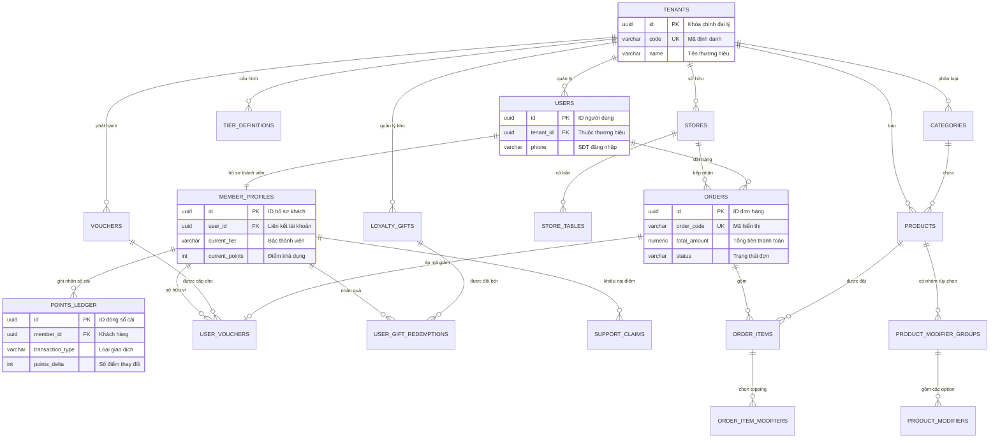

Started at:  2026/11/05 10:00:00
Finished at: 2026/11/05 10:25:00
Total time: 25 minutes
---

# Database Detailed Design Specification
## Ordera Multi-Tenant Loyalty & Ordering Platform

> **Tài liệu Thiết kế Chi tiết Cơ sở Dữ liệu (Database Detailed Design - DDD)**  
> **Hệ quản trị CSDL:** PostgreSQL 16 (Hỗ trợ JSONB, RLS, UUIDv7/v4, Extensions)  
> **Framework ORM & Quản trị Migration:** Spring Data JPA 3.x, Hibernate 6, Flyway 10  
> **Kiến trúc Cô lập Dữ liệu:** Multi-Tenant Shared Database, Shared Schema với PostgreSQL Row-Level Security (RLS)  
> **Mục tiêu:** Cung cấp tài liệu kỹ thuật chuẩn xác, định nghĩa toàn diện 18 bảng dữ liệu, ràng buộc toàn vẹn, chiến lược index, cơ chế sổ cái bất biến và phân vùng dữ liệu để làm base triển khai code backend.

---

## 1. Tổng quan Kiến trúc Dữ liệu & Nguyên tắc Cốt lõi (Core Principles)

### 1.1 Nguyên tắc Thiết kế
1. **Multi-Tenant Native (RLS):** Mọi bảng dữ liệu nghiệp vụ đều bắt buộc có cột `tenant_id UUID NOT NULL`. PostgreSQL Row-Level Security được kích hoạt để tự động lọc dữ liệu dựa trên session setting `app.current_tenant_id`, ngăn chặn 100% lỗi lộ dữ liệu chéo đại lý (IDOR).
2. **Sổ cái Điểm Bất biến (Immutable Double-Entry Ledger):** Điểm thưởng của khách hàng là dữ liệu nhạy cảm tương tự tiền tệ. Tuyệt đối không cập nhật trực tiếp điểm bằng `UPDATE member_profiles SET current_points = ...`. Mọi biến động cộng/trừ đều phải sinh ra dòng giao dịch bất biến trong `points_ledger`.
3. **Độ chính xác Tiền tệ (Zero Precision Loss):** Tuyệt đối không dùng kiểu dữ liệu dấu phẩy động (`FLOAT`, `DOUBLE`, `REAL`) cho giá cả, thuế, tips, chiết khấu và tổng đơn. Sử dụng `NUMERIC(12,2)` cho toàn bộ các trường tài chính.
4. **Múi giờ Chuẩn hóa (Timestamp Consistency):** Tất cả các cột thời gian đều sử dụng `TIMESTAMPTZ` (Timestamp with Time Zone), lưu trữ chuẩn UTC tại tầng CSDL và chỉ convert sang giờ địa phương (`Europe/Oslo` hoặc `Asia/Ho_Chi_Minh`) khi hiển thị tại Presentation Layer.
5. **Khóa Chính (Primary Key Strategy):** Sử dụng `UUID` sinh bằng hàm `gen_random_uuid()` (hoặc UUIDv7) làm khóa chính nhằm hỗ trợ tạo ID phân tán, không để lộ số lượng bản ghi và triệt tiêu xung đột dữ liệu.
6. **Mô tả Chi tiết Bắt buộc (Mandatory Column Remarks):** 100% các cột đều có chú thích ngữ nghĩa nghiệp vụ rõ ràng bằng tiếng Việt.

---

## 2. Sơ đồ Quan hệ Thực thể Tổng thể (Master ERD)



---

## 3. Đặc tả Chi tiết Các Bảng Dữ liệu (Detailed Table Specifications)

Hệ thống được tổ chức thành 6 nhóm chức năng (Domains) với 18 bảng quan hệ:

---

### PHÂN HỆ 1: TENANCY & CỬA HÀNG (STORES)

#### Bảng 1.1: `tenants` (Quản lý Thương hiệu / Đại lý)
Bảng trung tâm lưu trữ thông tin các thương hiệu F&B trong mô hình SaaS White-Label.

| Cột | Kiểu dữ liệu | Nullable | Mặc định | Ràng buộc | Chú thích chi tiết (Remark) |
|---|---|---|---|---|---|
| `id` | `UUID` | NO | `gen_random_uuid()` | PK | Khóa chính định danh thương hiệu/đại lý |
| `code` | `VARCHAR(50)` | NO | | UK | Mã viết tắt đại lý (ví dụ: `linn_sushi`, `aby_tea`) |
| `name` | `VARCHAR(255)` | NO | | | Tên hiển thị thương hiệu (ví dụ: `Agency Name`, `Linn Sushi`) |
| `logo_url` | `TEXT` | YES | | | Đường dẫn URL logo thương hiệu |
| `primary_color` | `VARCHAR(16)` | YES | `#F5B800` | | Mã màu nhận diện chính (Hex code) dùng để render UI động |
| `secondary_color`| `VARCHAR(16)` | YES | `#1E293B` | | Mã màu nhận diện phụ |
| `status` | `VARCHAR(32)` | NO | `'ACTIVE'` | | Trạng thái hoạt động: `ACTIVE`, `SUSPENDED`, `INACTIVE` |
| `metadata` | `JSONB` | YES | `'{}'` | | Cấu hình mở rộng: hotline, email hỗ trợ, chính sách tích điểm riêng |
| `created_at` | `TIMESTAMPTZ` | NO | `now()` | | Thời điểm tạo thương hiệu |
| `updated_at` | `TIMESTAMPTZ` | NO | `now()` | | Thời điểm cập nhật cấu hình lần cuối |

- **Indexes:**
  - `uq_tenants_code`: UNIQUE (`code`)

---

#### Bảng 1.2: `stores` (Danh sách Cửa hàng / Chi nhánh)
Lưu trữ danh sách các điểm bán (Outlets) trực thuộc thương hiệu (Figma Nhóm 01: Linn Sushi Sentrum).

| Cột | Kiểu dữ liệu | Nullable | Mặc định | Ràng buộc | Chú thích chi tiết (Remark) |
|---|---|---|---|---|---|
| `id` | `UUID` | NO | `gen_random_uuid()` | PK | Khóa chính chi nhánh cửa hàng |
| `tenant_id` | `UUID` | NO | | FK -> `tenants(id)` ON DELETE RESTRICT | Định danh thương hiệu sở hữu chi nhánh này |
| `name` | `VARCHAR(255)` | NO | | | Tên chi nhánh (ví dụ: `Linn Sushi Sentrum`) |
| `address` | `TEXT` | NO | | | Địa chỉ đầy đủ (ví dụ: `Prinsens gate 10C, 0153 Oslo`) |
| `city` | `VARCHAR(100)` | NO | `'Oslo'` | | Thành phố đặt chi nhánh |
| `latitude` | `NUMERIC(10,7)`| YES | | | Tọa độ vĩ độ (GPS Latitude) để tính khoảng cách tìm cửa hàng gần nhất |
| `longitude` | `NUMERIC(10,7)`| YES | | | Tọa độ kinh độ (GPS Longitude) |
| `phone_number` | `VARCHAR(32)` | YES | | | Số điện thoại liên hệ của cửa hàng |
| `opening_hours` | `VARCHAR(100)` | YES | `'10:00 - 22:00'` | | Giờ mở cửa hàng ngày hiển thị lên app |
| `is_active` | `BOOLEAN` | NO | `true` | | Cửa hàng còn hoạt động hay đóng cửa |
| `accepts_pickup`| `BOOLEAN` | NO | `true` | | Cho phép đặt món nhận tại quầy (Counter Pickup) |
| `accepts_dinein`| `BOOLEAN` | NO | `true` | | Cho phép đặt món ngồi ăn tại bàn (Table Dine-in) |
| `created_at` | `TIMESTAMPTZ` | NO | `now()` | | Thời gian tạo chi nhánh |
| `updated_at` | `TIMESTAMPTZ` | NO | `now()` | | Thời gian sửa thông tin chi nhánh |

- **Indexes:**
  - `idx_stores_tenant_id`: (`tenant_id`)
  - `idx_stores_active_city`: (`tenant_id`, `city`, `is_active`)

---

#### Bảng 1.3: `store_tables` (Quản lý Bàn tại quán)
Quản lý số bàn phục vụ hình thức nhận món tại bàn (Figma Nhóm 06: `Table: Select a table`).

| Cột | Kiểu dữ liệu | Nullable | Mặc định | Ràng buộc | Chú thích chi tiết (Remark) |
|---|---|---|---|---|---|
| `id` | `UUID` | NO | `gen_random_uuid()` | PK | Khóa chính của bàn |
| `tenant_id` | `UUID` | NO | | FK -> `tenants(id)` | Định danh thương hiệu |
| `store_id` | `UUID` | NO | | FK -> `stores(id)` ON DELETE CASCADE | Thuộc chi nhánh cửa hàng nào |
| `table_number` | `VARCHAR(32)` | NO | | | Tên/Số bàn hiển thị (ví dụ: `Table 01`, `VIP-02`) |
| `seating_capacity`| `INT` | NO | `4` | | Sức chứa số lượng khách tối đa của bàn |
| `qr_code_token`| `VARCHAR(128)`| YES | | UK | Mã Token QR code dán trên bàn để khách quét đặt trực tiếp |
| `is_occupied` | `BOOLEAN` | NO | `false` | | Trạng thái bàn đang có khách ngồi hay bàn trống |
| `created_at` | `TIMESTAMPTZ` | NO | `now()` | | Thời gian tạo bàn |

- **Indexes:**
  - `idx_store_tables_store`: (`store_id`, `table_number`)

---

### PHÂN HỆ 2: NGƯỜI DÙNG & XÁC THỰC (AUTH & IDENTITY)

#### Bảng 2.1: `users` (Tài khoản Người dùng Hệ thống)
Lưu trữ thông tin định danh gốc (Figma Nhóm 02 & 03: Đăng nhập & Đăng ký qua SĐT/Email).

| Cột | Kiểu dữ liệu | Nullable | Mặc định | Ràng buộc | Chú thích chi tiết (Remark) |
|---|---|---|---|---|---|
| `id` | `UUID` | NO | `gen_random_uuid()` | PK | Khóa chính định danh tài khoản người dùng |
| `tenant_id` | `UUID` | NO | | FK -> `tenants(id)` | Khách thuộc thương hiệu/đại lý nào |
| `phone_number` | `VARCHAR(32)` | NO | | | Số điện thoại quốc tế đầy đủ (ví dụ: `+4797362748`) |
| `email` | `VARCHAR(255)` | NO | | | Địa chỉ email đăng ký (ví dụ: `info@ordera.no`, `abytran@ordera.no`) |
| `full_name` | `VARCHAR(128)` | NO | | | Họ và tên khách hàng (ví dụ: `David Nguyen`, `ABY TRAN`) |
| `password_hash` | `VARCHAR(255)`| YES | | | Mật khẩu băm (BCrypt) nếu khách sử dụng đăng nhập password |
| `is_phone_verified`| `BOOLEAN` | NO | `false` | | Trạng thái đã xác minh số điện thoại qua OTP thành công |
| `is_email_verified`| `BOOLEAN` | NO | `false` | | Trạng thái đã xác minh email qua OTP thành công |
| `role` | `VARCHAR(32)` | NO | `'CUSTOMER'` | | Vai trò: `CUSTOMER`, `STORE_STAFF`, `AGENCY_ADMIN`, `SYSTEM_SUPERADMIN` |
| `status` | `VARCHAR(32)` | NO | `'ACTIVE'` | | Trạng thái tài khoản: `ACTIVE`, `LOCKED`, `DELETED` |
| `last_login_at`| `TIMESTAMPTZ` | YES | | | Thời điểm đăng nhập gần nhất |
| `created_at` | `TIMESTAMPTZ` | NO | `now()` | | Thời điểm đăng ký tài khoản |
| `updated_at` | `TIMESTAMPTZ` | NO | `now()` | | Thời điểm cập nhật thông tin gần nhất |

- **Indexes:**
  - `uq_users_tenant_phone`: UNIQUE (`tenant_id`, `phone_number`) - Một SĐT chỉ đăng ký 1 lần trong 1 thương hiệu.
  - `uq_users_tenant_email`: UNIQUE (`tenant_id`, `email`) - Một Email chỉ đăng ký 1 lần trong 1 thương hiệu.
  - `idx_users_tenant_role`: (`tenant_id`, `role`, `status`)

---

#### Bảng 2.2: `otp_audit_logs` (Nhật ký Xác thực Mã OTP)
Lưu vết các lượt gửi mã OTP (SMS/Email) để kiểm soát cooldown 120s và chống gian lận brute-force (Figma 03.03, 03.04). *(Lưu ý: Bộ nhớ đệm OTP chính TTL 120s chạy trên Redis, bảng này dùng để Audit trail).*

| Cột | Kiểu dữ liệu | Nullable | Mặc định | Ràng buộc | Chú thích chi tiết (Remark) |
|---|---|---|---|---|---|
| `id` | `UUID` | NO | `gen_random_uuid()` | PK | Khóa chính phiên OTP |
| `tenant_id` | `UUID` | NO | | FK -> `tenants(id)` | Định danh thương hiệu |
| `channel` | `VARCHAR(16)` | NO | | | Kênh gửi OTP: `SMS`, `EMAIL` |
| `recipient` | `VARCHAR(255)`| NO | | | Số điện thoại hoặc email nhận mã |
| `otp_hash` | `VARCHAR(128)`| NO | | | Mã OTP 6 số đã được băm SHA-256 (bảo mật không lưu plain text) |
| `purpose` | `VARCHAR(32)` | NO | `'AUTH'` | | Mục đích gửi: `REGISTER`, `LOGIN`, `PASSWORD_RESET` |
| `attempt_count` | `INT` | NO | `0` | | Số lần nhập sai mã (tối đa 5 lần sẽ khóa phiên) |
| `is_verified` | `BOOLEAN` | NO | `false` | | Trạng thái xác thực thành công |
| `ip_address` | `VARCHAR(45)` | YES | | | Địa chỉ IP của client yêu cầu OTP |
| `expires_at` | `TIMESTAMPTZ` | NO | | | Thời điểm hết hạn của mã (thường là +120 giây) |
| `created_at` | `TIMESTAMPTZ` | NO | `now()` | | Thời gian sinh mã |

- **Indexes:**
  - `idx_otp_recipient_time`: (`recipient`, `created_at` DESC)

---

### PHÂN HỆ 3: HẠNG THÀNH VIÊN & SỔ CÁI ĐIỂM (LOYALTY & POINTS LEDGER)

#### Bảng 3.1: `tier_definitions` (Định nghĩa 6 Hạng Thẻ Thành viên)
Lưu cấu hình chuẩn của 6 bậc thành viên trong Figma Nhóm 04 (New $\rightarrow$ Silver $\rightarrow$ Gold $\rightarrow$ Platinum $\rightarrow$ Diamond $\rightarrow$ Ruby).

| Cột | Kiểu dữ liệu | Nullable | Mặc định | Ràng buộc | Chú thích chi tiết (Remark) |
|---|---|---|---|---|---|
| `id` | `UUID` | NO | `gen_random_uuid()` | PK | Khóa chính cấu hình bậc |
| `tenant_id` | `UUID` | NO | | FK -> `tenants(id)` | Định danh thương hiệu sở hữu chính sách |
| `tier_name` | `VARCHAR(32)` | NO | | | Tên cấp bậc: `New`, `Silver`, `Gold`, `Platinum`, `Diamond`, `Ruby` |
| `tier_order` | `INT` | NO | | | Thứ tự thăng tiến: 1 (New), 2 (Silver), ..., 6 (Ruby) |
| `min_points_required`| `INT` | NO | `0` | | Mốc điểm tích lũy tối thiểu để đạt hạng (0, 200, 400, 1000, 2000, 4000) |
| `theme_color_hex` | `VARCHAR(16)`| NO | | | Mã màu thẻ Figma: New (`#1EB759`), Silver (`#00A3FF`), Gold (`#F5B800`), Platinum (`#FF5B4D`), Diamond (`#7C3AED`), Ruby (`#D9148E`) |
| `earn_points_rate` | `NUMERIC(6,4)`| NO | `1.0000` | | Hệ số nhân tích điểm (ví dụ: Silver x1.0, Diamond x1.5, Ruby x2.0) |
| `benefits_summary` | `JSONB` | YES | `'[]'` | | Danh sách đặc quyền của hạng thẻ lưu dạng JSON |
| `created_at` | `TIMESTAMPTZ` | NO | `now()` | | Thời gian tạo cấu hình |

- **Indexes:**
  - `uq_tier_tenant_name`: UNIQUE (`tenant_id`, `tier_name`)
  - `uq_tier_tenant_order`: UNIQUE (`tenant_id`, `tier_order`)

---

#### Bảng 3.2: `member_profiles` (Hồ sơ Thành viên & Thẻ Khách hàng)
Lưu trữ thông tin điểm và cấp bậc hiện tại của khách (Figma 04.01 - 04.12: David Nguyen - Hạng Silver, 120 điểm).

| Cột | Kiểu dữ liệu | Nullable | Mặc định | Ràng buộc | Chú thích chi tiết (Remark) |
|---|---|---|---|---|---|
| `id` | `UUID` | NO | `gen_random_uuid()` | PK | Khóa chính hồ sơ thành viên |
| `tenant_id` | `UUID` | NO | | FK -> `tenants(id)` | Thuộc thương hiệu nào |
| `user_id` | `UUID` | NO | | FK -> `users(id)` ON DELETE CASCADE, UK | Tài khoản người dùng liên kết (1-1) |
| `current_tier_id` | `UUID` | NO | | FK -> `tier_definitions(id)` | Cấp bậc hiện tại của thành viên |
| `current_points` | `INT` | NO | `0` | | Số điểm khả dụng có thể dùng để đổi quà/voucher (120 điểm) |
| `lifetime_points`| `INT` | NO | `0` | | Tổng điểm tích luỹ trọn đời để xét hạng thẻ (300 điểm) |
| `date_of_birth` | `DATE` | YES | | | Ngày sinh nhật khách hàng (dùng để tặng quà sinh nhật: `23/08/2000`) |
| `gender` | `VARCHAR(16)` | YES | | | Giới tính: `MALE`, `FEMALE`, `OTHER` |
| `avatar_url` | `TEXT` | YES | | | Đường dẫn ảnh đại diện avatar |
| `created_at` | `TIMESTAMPTZ` | NO | `now()` | | Thời gian mở thẻ thành viên |
| `updated_at` | `TIMESTAMPTZ` | NO | `now()` | | Thời điểm cập nhật hồ sơ gần nhất |

- **Indexes:**
  - `uq_member_profiles_user`: UNIQUE (`user_id`)
  - `idx_member_profiles_tier`: (`tenant_id`, `current_tier_id`)

---

#### Bảng 3.3: `points_ledger` (Sổ cái Biến động Điểm thưởng - IMMUTABLE)
**Bảng quan trọng nhất của hệ thống Loyalty:** Lưu lại toàn bộ lịch sử biến động điểm bất biến, không thể sửa xóa (Audit Log chuẩn ngân hàng).

| Cột | Kiểu dữ liệu | Nullable | Mặc định | Ràng buộc | Chú thích chi tiết (Remark) |
|---|---|---|---|---|---|
| `id` | `UUID` | NO | `gen_random_uuid()` | PK | Khóa chính của dòng sổ cái |
| `tenant_id` | `UUID` | NO | | FK -> `tenants(id)` | Định danh thương hiệu |
| `member_id` | `UUID` | NO | | FK -> `member_profiles(id)` ON DELETE RESTRICT | Thành viên nhận biến động điểm |
| `transaction_type`| `VARCHAR(32)`| NO | | | Loại biến động: `ORDER_EARN` (cộng điểm từ đơn), `VOUCHER_REDEEM` (trừ điểm đổi mã), `GIFT_REDEEM` (trừ điểm đổi quà), `TIER_BONUS` (thưởng thăng hạng), `ADMIN_ADJUST` (điều chỉnh tay), `CLAIM_APPROVED` (duyệt khiếu nại) |
| `points_delta` | `INT` | NO | | | Số điểm biến động: số dương là cộng (`+170`), số âm là trừ (`-100`) |
| `balance_after` | `INT` | NO | | | Số dư điểm khả dụng ngay sau khi thực hiện giao dịch này |
| `reference_type` | `VARCHAR(32)` | YES | | | Bảng tham chiếu liên kết: `ORDERS`, `USER_VOUCHERS`, `SUPPORT_CLAIMS` |
| `reference_id` | `VARCHAR(64)` | YES | | | Mã ID tham chiếu của đơn hàng hoặc voucher |
| `description` | `VARCHAR(255)`| NO | | | Diễn giải tiếng Việt ngắn gọn (ví dụ: `Tích điểm từ đơn hàng ORD-001`, `Đổi Voucher Name 100 NOK`) |
| `created_at` | `TIMESTAMPTZ` | NO | `now()` | | Dấu thời gian ghi nhận bất biến |

- **Indexes:**
  - `idx_points_ledger_member_time`: (`member_id`, `created_at` DESC)
  - `idx_points_ledger_ref`: (`reference_type`, `reference_id`)
  - `idx_points_ledger_tenant`: (`tenant_id`, `created_at` DESC)

---

#### Bảng 3.4: `support_claims` (Khiếu nại Thiếu điểm - Claim Missing Points)
Phục vụ màn hình hỗ trợ khiếu nại điểm đơn hàng tại quầy (Figma Nhóm 04 & 05: Missing Points Claim).

| Cột | Kiểu dữ liệu | Nullable | Mặc định | Ràng buộc | Chú thích chi tiết (Remark) |
|---|---|---|---|---|---|
| `id` | `UUID` | NO | `gen_random_uuid()` | PK | Khóa chính của ticket khiếu nại |
| `tenant_id` | `UUID` | NO | | FK -> `tenants(id)` | Định danh thương hiệu |
| `member_id` | `UUID` | NO | | FK -> `member_profiles(id)` | Thành viên gửi khiếu nại |
| `receipt_code` | `VARCHAR(64)` | NO | | | Mã hóa đơn in trên phiếu tính tiền mà khách bị thiếu điểm |
| `order_date` | `DATE` | NO | | | Ngày mua hàng trên hóa đơn |
| `bill_amount` | `NUMERIC(12,2)`| NO | | | Số tiền ghi trên hóa đơn |
| `bill_photo_url`| `TEXT` | YES | | | Đường dẫn ảnh chụp hóa đơn khách upload đính kèm |
| `status` | `VARCHAR(32)` | NO | `'PENDING'` | | Trạng thái duyệt: `PENDING`, `APPROVED`, `REJECTED` |
| `points_awarded`| `INT` | YES | | | Số điểm được cộng bù sau khi admin phê duyệt |
| `reviewer_note` | `TEXT` | YES | | | Ghi chú của quản lý khi từ chối hoặc phê duyệt |
| `created_at` | `TIMESTAMPTZ` | NO | `now()` | | Thời gian tạo yêu cầu |
| `resolved_at` | `TIMESTAMPTZ` | YES | | | Thời gian quản lý xử lý yêu cầu |

- **Indexes:**
  - `idx_support_claims_member`: (`member_id`, `status`)
  - `idx_support_claims_tenant_pending`: (`tenant_id`, `status`) WHERE `status = 'PENDING'`

---

### PHÂN HỆ 4: DANH MỤC & MÓN ĂN (PRODUCT CATALOG)

#### Bảng 4.1: `categories` (Nhóm Món ăn / Đồ uống)
Phân loại thực đơn (Figma Nhóm 01: Categories bar).

| Cột | Kiểu dữ liệu | Nullable | Mặc định | Ràng buộc | Chú thích chi tiết (Remark) |
|---|---|---|---|---|---|
| `id` | `UUID` | NO | `gen_random_uuid()` | PK | Khóa chính danh mục |
| `tenant_id` | `UUID` | NO | | FK -> `tenants(id)` | Thuộc thương hiệu |
| `name` | `VARCHAR(100)` | NO | | | Tên nhóm món (ví dụ: `Sushi Rolls`, `Boba Tea`, `Sides`, `Desserts`) |
| `display_order` | `INT` | NO | `0` | | Thứ tự sắp xếp hiển thị trên thanh trượt danh mục |
| `is_active` | `BOOLEAN` | NO | `true` | | Cho phép hiển thị trên thực đơn |
| `created_at` | `TIMESTAMPTZ` | NO | `now()` | | Thời gian tạo danh mục |

- **Indexes:**
  - `idx_categories_tenant`: (`tenant_id`, `display_order`)

---

#### Bảng 4.2: `products` (Món ăn / Đồ uống)
Chi tiết món (Figma 01.06, 06.06: `Aurora` 89 Kr, `Tuna Maki` 89 Kr).

| Cột | Kiểu dữ liệu | Nullable | Mặc định | Ràng buộc | Chú thích chi tiết (Remark) |
|---|---|---|---|---|---|
| `id` | `UUID` | NO | `gen_random_uuid()` | PK | Khóa chính của món |
| `tenant_id` | `UUID` | NO | | FK -> `tenants(id)` | Thuộc thương hiệu |
| `category_id` | `UUID` | NO | | FK -> `categories(id)` | Thuộc nhóm thực đơn nào |
| `name` | `VARCHAR(255)` | NO | | | Tên món ăn (ví dụ: `Aurora`, `Tuna Maki`) |
| `description` | `TEXT` | YES | | | Mô tả thành phần, hương vị món ăn |
| `base_price` | `NUMERIC(12,2)`| NO | | | Giá bán tiêu chuẩn chưa bao gồm topping (ví dụ: `89.00` Kr) |
| `image_url` | `TEXT` | YES | | | Đường dẫn ảnh món ăn |
| `is_available` | `BOOLEAN` | NO | `true` | | Món còn hàng để bán hay đã hết hàng tạm thời |
| `vat_rate` | `NUMERIC(4,2)` | NO | `15.00` | | Mức thuế VAT áp dụng theo luật Na Uy (15% đồ ăn mang về hoặc 25%) |
| `created_at` | `TIMESTAMPTZ` | NO | `now()` | | Thời gian tạo món |
| `updated_at` | `TIMESTAMPTZ` | NO | `now()` | | Thời gian sửa món |

- **Indexes:**
  - `idx_products_category`: (`category_id`, `is_available`)
  - `idx_products_tenant_search`: (`tenant_id`, `name`)

---

#### Bảng 4.3: `product_modifier_groups` (Nhóm Tùy chọn Topping / Size)
Định nghĩa các nhóm thuộc tính có thể chọn kèm món ăn (Figma 06.06: `Size: L`, `Sweetness Level`, `Ice Level`).

| Cột | Kiểu dữ liệu | Nullable | Mặc định | Ràng buộc | Chú thích chi tiết (Remark) |
|---|---|---|---|---|---|
| `id` | `UUID` | NO | `gen_random_uuid()` | PK | Khóa chính nhóm tùy chọn |
| `product_id` | `UUID` | NO | | FK -> `products(id)` ON DELETE CASCADE | Thuộc món ăn nào |
| `name` | `VARCHAR(100)` | NO | | | Tên nhóm tùy chọn (ví dụ: `Size`, `Topping`, `Sweetness Level`, `Ice Level`) |
| `min_selection` | `INT` | NO | `0` | | Số lượng tối thiểu bắt buộc chọn (0: không bắt buộc, 1: bắt buộc chọn 1) |
| `max_selection` | `INT` | NO | `1` | | Số lượng tối đa được chọn (1: Radio button, >1: Checkbox nhiều topping) |
| `display_order` | `INT` | NO | `0` | | Thứ tự hiển thị |

---

#### Bảng 4.4: `product_modifiers` (Các Tùy chọn Chi tiết & Giá Phụ thu)
Danh sách các option bên trong nhóm modifier.

| Cột | Kiểu dữ liệu | Nullable | Mặc định | Ràng buộc | Chú thích chi tiết (Remark) |
|---|---|---|---|---|---|
| `id` | `UUID` | NO | `gen_random_uuid()` | PK | Khóa chính option |
| `group_id` | `UUID` | NO | | FK -> `product_modifier_groups(id)` ON DELETE CASCADE | Thuộc nhóm modifier nào |
| `name` | `VARCHAR(100)` | NO | | | Tên option (ví dụ: `Size L`, `Mango Popping`, `Strawberry Popping`, `Standard Ice`, `Less ice`) |
| `extra_price` | `NUMERIC(12,2)`| NO | `0.00` | | Giá cộng thêm vào đơn (ví dụ: Size L cộng thêm `15.00` Kr, topping `10.00` Kr) |
| `is_default` | `BOOLEAN` | NO | `false` | | Tùy chọn mặc định được tích sẵn |

---

### PHÂN HỆ 5: VÍ VOUCHER & ĐỔI THƯỞNG (REWARDS & VOUCHERS)

#### Bảng 5.1: `vouchers` (Định nghĩa Mã Giảm Giá & Ưu Đãi)
Lưu cấu hình kho voucher (Figma Nhóm 07: Voucher 100 NOK, Giảm -30%).

| Cột | Kiểu dữ liệu | Nullable | Mặc định | Ràng buộc | Chú thích chi tiết (Remark) |
|---|---|---|---|---|---|
| `id` | `UUID` | NO | `gen_random_uuid()` | PK | Khóa chính voucher template |
| `tenant_id` | `UUID` | NO | | FK -> `tenants(id)` | Định danh thương hiệu phát hành |
| `code` | `VARCHAR(64)` | NO | | | Mã khuyến mãi nhập tay (ví dụ: `SAVE100`, `OFF30`) |
| `title` | `VARCHAR(128)` | NO | | | Tên hiển thị (ví dụ: `Voucher Name`) |
| `description` | `VARCHAR(255)` | NO | | | Mô tả ưu đãi (ví dụ: `Giảm 100 NOK giá trị cho Order của bạn`) |
| `discount_type`| `VARCHAR(16)` | NO | | | Loại giảm giá: `FIXED_AMOUNT` (trừ tiền mặt), `PERCENTAGE` (trừ phần trăm) |
| `discount_value`| `NUMERIC(12,2)`| NO | | | Giá trị giảm: `100.00` (NOK) hoặc `30.00` (%) |
| `min_order_value`| `NUMERIC(12,2)`| NO | `0.00` | | Giá trị đơn hàng tối thiểu để được áp dụng (ví dụ: `250.00` NOK hoặc `0.00` NOK) |
| `points_cost` | `INT` | NO | `0` | | Số điểm cần để đổi voucher trong Get More Rewards (ví dụ: 100 Points, 1000 Points) |
| `valid_from` | `TIMESTAMPTZ` | NO | `now()` | | Thời gian bắt đầu có hiệu lực |
| `valid_until` | `TIMESTAMPTZ` | NO | | | Thời gian hết hạn áp dụng (`3 dec 2025`) |
| `max_issuance` | `INT` | YES | | | Tổng số lượng voucher tối đa phát hành (null: không giới hạn) |
| `is_active` | `BOOLEAN` | NO | `true` | | Voucher còn mở cho đổi/sử dụng không |
| `created_at` | `TIMESTAMPTZ` | NO | `now()` | | Thời gian tạo voucher |

- **Indexes:**
  - `uq_vouchers_tenant_code`: UNIQUE (`tenant_id`, `code`)
  - `idx_vouchers_active`: (`tenant_id`, `is_active`, `valid_until`)

---

#### Bảng 5.2: `user_vouchers` (Ví Voucher Sở hữu của Thành viên)
Quản lý các voucher mà từng khách hàng đang có trong ví (Figma 07.03, 07.07, 07.08).

| Cột | Kiểu dữ liệu | Nullable | Mặc định | Ràng buộc | Chú thích chi tiết (Remark) |
|---|---|---|---|---|---|
| `id` | `UUID` | NO | `gen_random_uuid()` | PK | Khóa chính bản ghi ví voucher |
| `tenant_id` | `UUID` | NO | | FK -> `tenants(id)` | Thuộc thương hiệu nào |
| `member_id` | `UUID` | NO | | FK -> `member_profiles(id)` ON DELETE CASCADE | Khách hàng sở hữu |
| `voucher_id` | `UUID` | NO | | FK -> `vouchers(id)` | Mẫu voucher được sở hữu |
| `status` | `VARCHAR(32)` | NO | `'AVAILABLE'` | | Trạng thái: `AVAILABLE` (khả dụng), `IN_USE` (đang được gán vào giỏ hàng), `USED` (đã sử dụng thanh toán xong), `EXPIRED` (hết hạn) |
| `applied_order_id`| `UUID` | YES | | | Đơn hàng đang áp dụng voucher này (Figma 07.08 In Use) |
| `redeemed_at` | `TIMESTAMPTZ` | NO | `now()` | | Thời điểm thành viên đổi điểm lấy voucher này |
| `used_at` | `TIMESTAMPTZ` | YES | | | Thời điểm voucher được thanh toán cùng đơn hàng |

- **Indexes:**
  - `idx_user_vouchers_member_status`: (`member_id`, `status`)
  - `idx_user_vouchers_applied_order`: (`applied_order_id`)

---

#### Bảng 5.3: `loyalty_gifts` (Kho Quà tặng Hiện vật Loyalty)
Quản lý quà tặng vật lý như cốc giữ nhiệt Tumbler (Figma Nhóm 07: Tumbler cup gift).

| Cột | Kiểu dữ liệu | Nullable | Mặc định | Ràng buộc | Chú thích chi tiết (Remark) |
|---|---|---|---|---|---|
| `id` | `UUID` | NO | `gen_random_uuid()` | PK | Khóa chính quà tặng |
| `tenant_id` | `UUID` | NO | | FK -> `tenants(id)` | Thuộc thương hiệu |
| `title` | `VARCHAR(128)` | NO | | | Tên quà (ví dụ: `Gift Name` - Cốc Tumbler Hồng) |
| `description` | `TEXT` | YES | | | Mô tả quà tặng và điều kiện nhận quà của Admin |
| `image_url` | `TEXT` | YES | | | Đường dẫn ảnh ly giữ nhiệt |
| `points_cost` | `INT` | NO | `100` | | Số điểm cần để đổi (100 Points) |
| `stock_quantity`| `INT` | NO | `10` | | Số lượng tồn kho hiện tại (`Quantity left: 10 Pieces`) |
| `is_active` | `BOOLEAN` | NO | `true` | | Quà còn trong chương trình đổi thưởng không |
| `created_at` | `TIMESTAMPTZ` | NO | `now()` | | Thời gian tạo quà |

---

#### Bảng 5.4: `user_gift_redemptions` (Lịch sử Nhận Quà Hiện vật)
Lưu trữ việc thành viên đổi điểm nhận quà vật lý tại quầy thu ngân.

| Cột | Kiểu dữ liệu | Nullable | Mặc định | Ràng buộc | Chú thích chi tiết (Remark) |
|---|---|---|---|---|---|
| `id` | `UUID` | NO | `gen_random_uuid()` | PK | Khóa chính lượt đổi quà |
| `tenant_id` | `UUID` | NO | | FK -> `tenants(id)` | Thuộc thương hiệu |
| `member_id` | `UUID` | NO | | FK -> `member_profiles(id)` | Thành viên đổi quà |
| `gift_id` | `UUID` | NO | | FK -> `loyalty_gifts(id)` | Món quà được đổi |
| `points_spent` | `INT` | NO | | | Số điểm đã trừ |
| `redemption_code`| `VARCHAR(32)`| NO | | UK | Mã nhận quà 8 ký tự để khách đưa cho nhân viên quầy quét |
| `status` | `VARCHAR(32)` | NO | `'PENDING'` | | Trạng thái: `PENDING` (chờ nhận tại quầy), `CLAIMED` (đã nhận cốc), `CANCELLED` (hủy) |
| `claimed_at` | `TIMESTAMPTZ` | YES | | | Thời điểm nhân viên quầy xác nhận trao quà |
| `created_at` | `TIMESTAMPTZ` | NO | `now()` | | Thời điểm bấm Get now đổi quà |

---

### PHÂN HỆ 6: ĐƠN HÀNG, GIỎ HÀNG & THANH TOÁN (ORDERS & CHECKOUT)

#### Bảng 6.1: `orders` (Thông tin Đơn hàng & E-Receipt)
Lưu trữ toàn bộ đơn hàng (Figma 06.07 Checkout, 06.10 E-Receipt).

| Cột | Kiểu dữ liệu | Nullable | Mặc định | Ràng buộc | Chú thích chi tiết (Remark) |
|---|---|---|---|---|---|
| `id` | `UUID` | NO | `gen_random_uuid()` | PK | Khóa chính đơn hàng |
| `tenant_id` | `UUID` | NO | | FK -> `tenants(id)` | Thuộc thương hiệu |
| `store_id` | `UUID` | NO | | FK -> `stores(id)` | Cửa hàng tiếp nhận chế biến đơn (Linn Sushi Sentrum) |
| `user_id` | `UUID` | YES | | FK -> `users(id)` | Khách hàng đăng nhập (hoặc null nếu khách vãng lai) |
| `order_code` | `VARCHAR(32)` | NO | | UK | Mã hiển thị trên hóa đơn (ví dụ: `ORD-20261105-0891`) |
| `pickup_method` | `VARCHAR(32)` | NO | `'COUNTER'` | | Hình thức nhận: `COUNTER` (nhận tại quầy), `TABLE` (nhận tại bàn) |
| `pickup_time_type`| `VARCHAR(32)`| NO | `'ASAP'` | | Thời gian lấy: `ASAP` (càng sớm càng tốt: 15 phút), `SCHEDULED` (hẹn giờ) |
| `scheduled_pickup_at`| `TIMESTAMPTZ`| YES | | | Giờ hẹn lấy đồ nếu chọn SCHEDULED |
| `table_number` | `VARCHAR(32)` | YES | | | Số bàn nếu khách chọn nhận tại bàn (`Table 05`) |
| `pickup_person_name`| `VARCHAR(128)`| NO | | | Tên người nhận (ví dụ: `David Nguyen`) |
| `pickup_person_phone`| `VARCHAR(32)`| NO | | | SĐT người nhận để tích điểm (ví dụ: `+4797362748`) |
| `subtotal_amount`| `NUMERIC(12,2)`| NO | | | Tiền hàng gốc đã gồm VAT (ví dụ: `267.00` Kr) |
| `discount_amount`| `NUMERIC(12,2)`| NO | `0.00` | | Số tiền được giảm từ voucher (ví dụ: `100.00` Kr hoặc `0.00`) |
| `tip_amount` | `NUMERIC(12,2)`| NO | `0.00` | | Tiền boa tip cho nhân viên quầy (ví dụ: `+10.00` Kr) |
| `vat_amount` | `NUMERIC(12,2)`| NO | `0.00` | | Tiền thuế GTGT đã bao gồm trong tổng tiền |
| `total_amount` | `NUMERIC(12,2)`| NO | | | Tổng số tiền thanh toán thực tế: `subtotal - discount + tip` (ví dụ: `277.00` Kr) |
| `points_earned` | `INT` | NO | `0` | | Số điểm tích được từ đơn hàng hiển thị trên UI (`+170 points`) |
| `status` | `VARCHAR(32)` | NO | `'PENDING'` | | Trạng thái: `PENDING` (chờ thanh toán), `CONFIRMED` (đã nhận đơn), `PREPARING` (bếp đang làm 15 phút), `READY` (đã sẵn sàng lấy), `COMPLETED` (hoàn tất), `CANCELLED` (đã hủy) |
| `payment_status`| `VARCHAR(32)` | NO | `'UNPAID'` | | Trạng thái thanh toán: `UNPAID`, `PAID`, `REFUNDED` |
| `payment_method`| `VARCHAR(32)` | YES | | | Phương thức trả tiền: `CARD`, `VIPPS`, `APPLE_PAY`, `COUNTER_CASH` |
| `order_notes` | `VARCHAR(255)`| YES | | | Ghi chú của khách (ví dụ: `Special request, allergies, etc`) |
| `created_at` | `TIMESTAMPTZ` | NO | `now()` | | Thời gian bấm Pay đặt hàng |
| `completed_at` | `TIMESTAMPTZ` | YES | | | Thời gian khách nhận đồ xong |

- **Indexes:**
  - `uq_orders_tenant_code`: UNIQUE (`tenant_id`, `order_code`)
  - `idx_orders_user_time`: (`user_id`, `created_at` DESC)
  - `idx_orders_store_status`: (`store_id`, `status`, `created_at` DESC)

---

#### Bảng 6.2: `order_items` (Chi tiết Từng Món trong Đơn hàng)
Lưu danh sách món ăn đã đặt (Figma 06.06: 2 Aurora, 1 Tuna Maki).

| Cột | Kiểu dữ liệu | Nullable | Mặc định | Ràng buộc | Chú thích chi tiết (Remark) |
|---|---|---|---|---|---|
| `id` | `UUID` | NO | `gen_random_uuid()` | PK | Khóa chính món trong đơn |
| `order_id` | `UUID` | NO | | FK -> `orders(id)` ON DELETE CASCADE | Thuộc đơn hàng nào |
| `product_id` | `UUID` | NO | | FK -> `products(id)` | Món ăn gốc |
| `product_name` | `VARCHAR(255)` | NO | | | Tên món thời điểm đặt (tránh bị ảnh hưởng nếu đổi tên sau này) |
| `unit_price` | `NUMERIC(12,2)`| NO | | | Đơn giá món tại thời điểm đặt (ví dụ: `89.00` Kr) |
| `quantity` | `INT` | NO | `1` | | Số lượng đặt (ví dụ: 2 món Aurora, 1 món Tuna Maki) |
| `item_total` | `NUMERIC(12,2)`| NO | | | Thành tiền của dòng: `(unit_price + modifiers_price) * quantity` |
| `special_instruction`| `VARCHAR(255)`| YES | | | Ghi chú riêng cho món này |

- **Indexes:**
  - `idx_order_items_order`: (`order_id`)

---

#### Bảng 6.3: `order_item_modifiers` (Tùy chọn Topping của Từng Món trong Đơn)
Lưu vết các topping, size đã chọn (Figma 06.06: Size L, Mango Popping, Less ice).

| Cột | Kiểu dữ liệu | Nullable | Mặc định | Ràng buộc | Chú thích chi tiết (Remark) |
|---|---|---|---|---|---|
| `id` | `UUID` | NO | `gen_random_uuid()` | PK | Khóa chính modifier của item |
| `order_item_id` | `UUID` | NO | | FK -> `order_items(id)` ON DELETE CASCADE | Thuộc dòng món ăn nào |
| `modifier_group_name`| `VARCHAR(100)`| NO | | | Tên nhóm: `Size`, `Topping`, `Sweetness Level`, `Ice Level` |
| `modifier_name`| `VARCHAR(100)` | NO | | | Tên lựa chọn: `Size L`, `Mango Popping`, `Less ice` |
| `extra_price` | `NUMERIC(12,2)`| NO | `0.00` | | Giá phụ thu tại thời điểm đặt |

---

## 4. Chiến lược Row-Level Security (RLS) & Multi-Tenant Isolation

### 4.1 Cơ chế Session Variable & Hibernate Interceptor
Để kích hoạt RLS tự động cho mọi kết nối DB trong Spring Boot:
1. Khi request đi qua `TenantInterceptor`, backend trích xuất `tenant_id` từ Header `X-Tenant-ID` hoặc JWT.
2. Hibernate/JPA Session mở transaction và thiết lập biến cục bộ:
   ```sql
   SET LOCAL app.current_tenant_id = 'c1234567-89ab-cdef-0123-456789abcdef';
   ```
3. PostgreSQL tự động áp dụng chính sách bảo mật: các truy vấn `SELECT`, `UPDATE`, `DELETE` chỉ nhìn thấy dữ liệu có `tenant_id = app.current_tenant_id`.

### 4.2 Script Kích hoạt RLS trên Toàn bộ Bảng Nghiệp vụ
```sql
-- Hàm tiện ích lấy Tenant ID an toàn
CREATE OR REPLACE FUNCTION current_app_tenant_id() RETURNS UUID AS $$
BEGIN
    RETURN NULLIF(current_setting('app.current_tenant_id', true), '')::UUID;
EXCEPTION
    WHEN OTHERS THEN RETURN NULL;
END;
$$ LANGUAGE plpgsql STABLE;

-- Kích hoạt RLS trên các bảng cốt lõi
ALTER TABLE stores ENABLE ROW LEVEL SECURITY;
ALTER TABLE users ENABLE ROW LEVEL SECURITY;
ALTER TABLE member_profiles ENABLE ROW LEVEL SECURITY;
ALTER TABLE points_ledger ENABLE ROW LEVEL SECURITY;
ALTER TABLE products ENABLE ROW LEVEL SECURITY;
ALTER TABLE vouchers ENABLE ROW LEVEL SECURITY;
ALTER TABLE user_vouchers ENABLE ROW LEVEL SECURITY;
ALTER TABLE orders ENABLE ROW LEVEL SECURITY;

-- Ví dụ Policy trên bảng orders
CREATE POLICY tenant_isolation_orders ON orders
    FOR ALL
    USING (tenant_id = current_app_tenant_id())
    WITH CHECK (tenant_id = current_app_tenant_id());
```

---

## 5. Chiến lược Phân vùng Dữ liệu (Partitioning Strategy)

Theo quy định đánh giá tải của Skill `database-design`:
- Các bảng tĩnh như `tenants`, `stores`, `categories`, `tier_definitions` có dung lượng nhỏ (< 100k dòng): **Không phân vùng**.
- **2 Bảng có tốc độ tăng trưởng cực nhanh:**
  1. `points_ledger`: Mỗi đơn hàng, mỗi lượt đổi voucher, mỗi hoạt động admin đều sinh 1 dòng. Với chuỗi nhà hàng lớn có thể đạt hàng triệu giao dịch mỗi tháng.
  2. `orders`: Tăng trưởng liên tục theo từng ngày hoạt động.

### Đề xuất Phân vùng:
- Sử dụng **PostgreSQL Declarative RANGE Partitioning theo `created_at` (Hàng năm hoặc Hàng quý)**:
  ```sql
  -- Phân vùng bảng points_ledger theo năm
  CREATE TABLE points_ledger (
      id UUID NOT NULL,
      tenant_id UUID NOT NULL,
      member_id UUID NOT NULL,
      transaction_type VARCHAR(32) NOT NULL,
      points_delta INT NOT NULL,
      balance_after INT NOT NULL,
      reference_type VARCHAR(32),
      reference_id VARCHAR(64),
      description VARCHAR(255) NOT NULL,
      created_at TIMESTAMPTZ NOT NULL DEFAULT now(),
      PRIMARY KEY (id, created_at)
  ) PARTITION BY RANGE (created_at);

  -- Phân vùng cho năm 2026
  CREATE TABLE points_ledger_y2026 PARTITION OF points_ledger
      FOR VALUES FROM ('2026-01-01 00:00:00+00') TO ('2027-01-01 00:00:00+00');

  -- Phân vùng cho năm 2027
  CREATE TABLE points_ledger_y2027 PARTITION OF points_ledger
      FOR VALUES FROM ('2027-01-01 00:00:00+00') TO ('2028-01-01 00:00:00+00');
  ```
- **Lợi ích:** Tăng tốc độ truy vấn lịch sử điểm gần nhất gấp 10 lần và dễ dàng lưu trữ/dọn dẹp dữ liệu cũ (Data Archiving) bằng lệnh `DETACH PARTITION` mà không làm khóa bảng chính.

---

## 6. Kế hoạch Database Migrations (Flyway Roadmap)

Bộ migration SQL được đặt tại thư mục `backend/src/main/resources/db/migration/`:

```tree
db/migration/
├── V1__create_tenants_and_stores.sql      # Bảng tenants, stores, store_tables
├── V2__create_users_and_identity.sql      # Bảng users, otp_audit_logs
├── V3__create_loyalty_and_tiers.sql       # Bảng tier_definitions, member_profiles, support_claims
├── V4__create_points_ledger.sql           # Bảng points_ledger (Partitioned)
├── V5__create_catalog_and_modifiers.sql   # Bảng categories, products, product_modifiers
├── V6__create_vouchers_and_rewards.sql    # Bảng vouchers, user_vouchers, loyalty_gifts, user_gift_redemptions
├── V7__create_orders_and_checkout.sql     # Bảng orders, order_items, order_item_modifiers
├── V8__enable_rls_security_policies.sql   # Script kích hoạt RLS & Policies
└── V9__seed_demo_data_linn_sushi.sql      # Dữ liệu mẫu ban đầu khớp với Figma
```

---

## 7. Dữ liệu Mẫu Khởi tạo Chuẩn Figma (Seed Data Mapping)

File `V9__seed_demo_data_linn_sushi.sql` sẽ nạp sẵn bộ dữ liệu mẫu khớp 100% với các màn hình Figma mà chúng ta đã dựng giao diện:

1. **Thương hiệu & Cửa hàng (Nhóm 01):**
   - Tenant: `Agency Name` (Mã: `linn_sushi`, Màu: `#F5B800`).
   - Cửa hàng: `Linn Sushi Sentrum` (`Prinsens gate 10C, 0153 Oslo`).
2. **Khách hàng Mẫu (Nhóm 04 & 05):**
   - Tài khoản: `David Nguyen`, SĐT `+4797362748`, Email `info@ordera.no`, Ngày sinh `23/08/2000`.
   - Cấp bậc: `Silver` (Cần 100 điểm để lên `Gold`).
   - Điểm khả dụng: `120 Points` | Điểm trọn đời: `300 Points`.
3. **Thực đơn Món ăn (Nhóm 01 & 06):**
   - `Aurora` (89.00 Kr, Size L +15 Kr, Mango Popping +10 Kr).
   - `Tuna Maki` (89.00 Kr).
4. **Voucher & Quà tặng (Nhóm 07):**
   - Voucher 1: `Voucher Name` (Giảm `100.00` NOK, Đơn tối thiểu `250.00` NOK, Đổi bằng `100 Points`).
   - Voucher 2: `Voucher Name` (Giảm `30%`, Đơn tối thiểu `0.00` NOK, Đổi bằng `1000 Points`).
   - Quà tặng: `Gift Name` (Cốc Tumbler màu hồng, Đổi bằng `100 Points`, Tồn kho `10 Pieces`).

