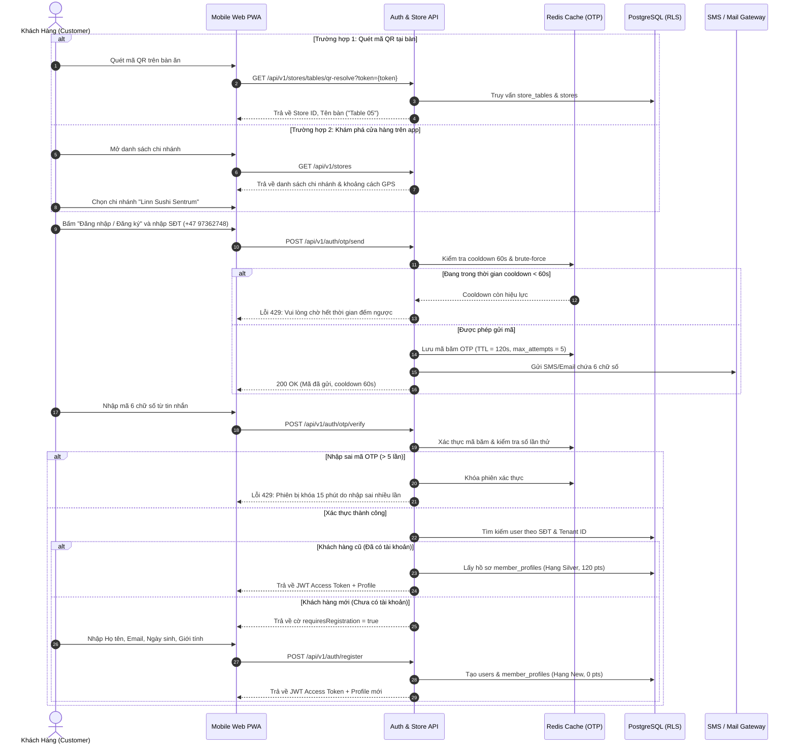

# BF-01: Onboarding, Khám Phá Cửa Hàng & Xác Thực OTP Thành Viên
## Ordera Multi-Tenant Loyalty & Ordering Platform

> **Phân Hệ Nghiệp Vụ:** Cửa hàng & Xác thực Định danh (Store Discovery & Identity Authentication)  
> **Ánh xạ Màn hình Figma:** Nhóm 01 (Store Discovery `01.01` - `01.03`), Nhóm 02 & 03 (Đăng nhập / Đăng ký `02.01` - `03.04`)  
> **API Contracts Liên Quan:** `01-tenant-and-store-api.md`, `03-auth-and-identity-api.md`  
> **CSDL Liên Quan:** `tenants`, `stores`, `store_tables`, `users`, `otp_audit_logs`, `member_profiles`

---

## 1. Thông Tin Định Nghĩa Nghiệp Vụ

| Thuộc Tính | Mô Tả Chi Tiết |
|:---|:---|
| **Mã Luồng (ID)** | `BF-01` |
| **Mục Tiêu Nghiệp Vụ** | Giúp khách hàng truy cập ứng dụng PWA, chọn đúng chi nhánh (Linn Sushi Sentrum) hoặc quét mã QR tại bàn, xác thực số điện thoại/email qua OTP an toàn và nhận diện hạng thành viên. |
| **Trigger (Kích hoạt)** | Khách hàng mở trình duyệt truy cập domain PWA hoặc dùng Camera điện thoại quét mã QR dán tại bàn ăn. |
| **Tác Nhân (Actors)** | Khách hàng (Member / Guest), Frontend Mobile PWA, Backend Auth Service, Redis Cooldown Cache, SMS/Email Gateway. |
| **Tiền Điều Kiện** | 1. Cửa hàng đang ở trạng thái hoạt động (`is_active = true`). 2. Cụm Redis vận hành bình thường để lưu trữ cache OTP. |
| **Kết Quả Đạt Được** | 1. Khách hàng được định danh với JWT Token hợp lệ lưu tại client storage. 2. Ứng dụng tải đúng thực đơn và thông tin chi nhánh đã chọn. 3. Thành viên cũ hiển thị đúng hạng thẻ (`Silver`), số điểm khả dụng (`120 pts`); khách mới được tạo hồ sơ `New Member`. |

---

## 2. Sơ Đồ Luồng Nghiệp Vụ (Business Workflow Diagram)

---

## 3. Bảng Phân Tích Chi Tiết Từng Bước Nghiệp Vụ

| Bước | Tác Nhân (Actor) | Hành Động & Mô Tả Chi Tiết | Hệ Thống / Thành Phần | Mã Tính Năng | Quy Tắc Nghiệp Vụ (Business Rules) | Xử Lý Ngoại Lệ & Rủi Ro |
|:---:|:---|:---|:---|:---:|:---|:---|
| **1** | Khách hàng | Khách mở ứng dụng hoặc quét tem QR gắn trên mặt bàn. | Trình duyệt di động / Camera | `STR-01`, `STR-02` | Quét mã QR sẽ tự động ghim số bàn (ví dụ `Table 05`) vào bộ nhớ phiên, khách không thể tự ý sửa số bàn trừ khi quét lại bàn khác. | Nếu mã QR bị mờ hoặc không hợp lệ: Hệ thống chuyển hướng khách về màn hình danh sách chi nhánh mặc định. |
| **2** | Khách hàng | Chọn hình thức phục vụ: Nhận tại quầy (Takeaway) hoặc Dùng tại bàn (Dine-in). | Frontend PWA | `STR-01` | Cửa hàng phải có cờ `accepts_pickup = true` hoặc `accepts_dinein = true` tương ứng thì mới cho chọn. | Nếu cửa hàng tạm ngưng nhận khách: Hiển thị thông báo "Cửa hàng hiện đóng cửa" và khóa nút đặt hàng. |
| **3** | Khách hàng | Bấm vào biểu tượng Tài khoản hoặc nút "Đăng nhập để tích điểm". Nhập SĐT quốc tế (ví dụ: `+4797362748`). | Frontend PWA | `AUTH-01` | SĐT phải chuẩn hóa theo chuẩn quốc tế E.164. Tự động thêm mã quốc gia nếu người dùng chỉ nhập số nội địa Na Uy (8 số). | Nếu chuỗi nhập chứa chữ cái hoặc không đủ độ dài: Báo lỗi validation đỏ ngay tại input field. |
| **4** | Hệ thống | Kiểm tra giới hạn gửi lại mã (Rate limiting & Cooldown). | Backend API, Redis | `AUTH-01` | **BR-OTP-01:** Thời gian chờ giữa 2 lần bấm gửi lại OTP tối thiểu là **60 giây**. Mã OTP có hiệu lực tối đa trong **120 giây** (TTL). | Nếu khách bấm liên tục: Backend từ chối ngay tại tầng Redis, trả mã lỗi `429 OTP_COOLDOWN_ACTIVE`. |
| **5** | Gateway | Tạo chuỗi ngẫu nhiên 6 chữ số mật mã (Secure Random) và gửi tin nhắn SMS tới điện thoại khách. | SMS Service (Twilio / AWS SNS / Mock MailHog) | `AUTH-01` | Tuyệt đối không lưu plain-text OTP vào cơ sở dữ liệu. Chỉ lưu mã băm SHA-256 vào Redis để đối chiếu. | Nếu gateway SMS mất kết nối hoặc hết quota: Trả lỗi `503 SMS_SERVICE_UNAVAILABLE` và ghi log cảnh báo Sentry. |
| **6** | Khách hàng | Khách xem tin nhắn và nhập 6 chữ số vào 6 ô input trên màn hình PWA (`03.04`). | Frontend PWA | `AUTH-02` | Tự động focus sang ô tiếp theo khi nhập đủ từng số. Tự động gọi API verify khi điền đủ 6 số. | Khách nhập sai: Ô input rung nhẹ (shake animation) kèm dòng báo đỏ "Mã OTP không chính xác". |
| **7** | Hệ thống | Kiểm tra khớp mã OTP và đếm số lần thử. | Backend Auth, Redis | `AUTH-02` | **BR-OTP-02:** Cho phép nhập sai tối đa **5 lần**. Vượt quá 5 lần, phiên xác thực bị hủy và số điện thoại bị khóa xác thực trong 15 phút. | Nếu quá 5 lần: Xóa key OTP trên Redis, trả lỗi `429 OTP_MAX_ATTEMPTS_EXCEEDED`. |
| **8a** | Hệ thống | **Trường hợp Thành viên cũ:** Tìm thấy hồ sơ trong database. Cấp JWT token và nạp dữ liệu thẻ. | Backend Auth, PostgreSQL RLS | `AUTH-04`, `LOY-02` | Access Token có TTL 15 phút, Refresh Token có TTL 7 ngày lưu trong `HttpOnly` Secure Cookie để chống tấn công XSS. | Nếu tài khoản đang bị khóa (`status = 'LOCKED'`): Từ chối cấp token, báo lỗi `403 ACCOUNT_SUSPENDED`. |
| **8b** | Hệ thống | **Trường hợp Khách mới:** Chưa tồn tại SĐT trong database của Tenant này. | Backend Auth | `AUTH-03` | Chuyển hướng sang màn hình Đăng ký (`RegisterPage.tsx`). Bắt buộc nhập Họ tên, Email, Ngày sinh nhật. | Nếu email nhập vào đã bị trùng với tài khoản khác trong cùng thương hiệu: Yêu cầu đổi email khác. |
| **9** | Khách hàng | Điền thông tin cá nhân và tích chọn "Tôi đồng ý với điều khoản sử dụng". | Frontend PWA | `AUTH-03` | Ngày sinh được dùng để kích hoạt chiến dịch tự động tặng voucher sinh nhật hằng năm. | Nếu bỏ trống các trường bắt buộc: Nút "Hoàn tất đăng ký" bị vô hiệu hóa (disabled). |
| **10** | Hệ thống | Tạo bản ghi `users` và hồ sơ khởi tạo `member_profiles` với cấp bậc ban đầu `New Member` (0 điểm). | Backend, PostgreSQL | `AUTH-03`, `LOY-02` | Cấp phát JWT và tự động kích hoạt phiên đăng nhập đầu tiên cho khách hàng. | Đảm bảo tính toàn vẹn dữ liệu qua Transaction: Nếu lỗi tạo profile, rollback toàn bộ thao tác tạo user. |
