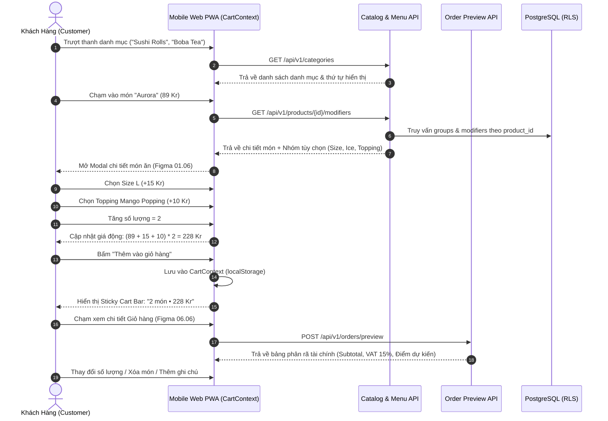

# BF-02: Khám Phá Thực Đơn, Tùy Biến Topping & Quản Lý Giỏ Hàng
## Ordera Multi-Tenant Loyalty & Ordering Platform

> **Phân Hệ Nghiệp Vụ:** Thực đơn, Tùy chọn Món ăn & Giỏ hàng (Catalog, Modifiers & Dynamic Cart)  
> **Ánh xạ Màn hình Figma:** Nhóm 01 (`01.04` Categories Bar, `01.05` Product Card, `01.06` Product Detail Modal), Nhóm 06 (`06.01` - `06.06` ReorderCartView)  
> **API Contracts Liên Quan:** `02-catalog-and-menu-api.md`, `06-order-and-checkout-api.md`  
> **CSDL Liên Quan:** `categories`, `products`, `product_modifier_groups`, `product_modifiers`

---

## 1. Thông Tin Định Nghĩa Nghiệp Vụ

| Thuộc Tính | Mô Tả Chi Tiết |
|:---|:---|
| **Mã Luồng (ID)** | `BF-02` |
| **Mục Tiêu Nghiệp Vụ** | Giúp khách hàng duyệt danh mục món ăn trực quan, cấu hình linh hoạt các tùy chọn (Size, đá, đường, topping kèm phụ thu), kiểm tra tình trạng còn/hết hàng và quản lý giỏ hàng tạm thời với độ chính xác tài chính 100%. |
| **Trigger (Kích hoạt)** | Khách hàng bấm xem danh mục, bấm vào thẻ món ăn trên trang chủ hoặc bấm vào icon Giỏ hàng. |
| **Tác Nhân (Actors)** | Khách hàng (Member / Guest), Frontend Mobile PWA, Backend Catalog Service, CSDL Menu PostgreSQL. |
| **Tiền Điều Kiện** | 1. Chi nhánh đã chọn có danh mục món ăn đang kích hoạt (`is_active = true`). 2. Sản phẩm hiển thị đang ở trạng thái còn hàng (`is_available = true`). |
| **Kết Quả Đạt Được** | 1. Món ăn cùng các tùy chọn đã chọn được thêm vào Giỏ hàng với số lượng và thành tiền chính xác. 2. Giỏ hàng hiển thị thanh sticky bottom bar cập nhật tổng tiền (`267.00 Kr`) và số lượng món. |

---

## 2. Sơ Đồ Luồng Nghiệp Vụ (Business Workflow Diagram)

---

## 3. Bảng Phân Tích Chi Tiết Từng Bước Nghiệp Vụ

| Bước | Tác Nhân (Actor) | Hành Động & Mô Tả Chi Tiết | Hệ Thống / Thành Phần | Mã Tính Năng | Quy Tắc Nghiệp Vụ (Business Rules) | Xử Lý Ngoại Lệ & Rủi Ro |
|:---:|:---|:---|:---|:---:|:---|:---|
| **1** | Khách hàng | Khách hàng xem danh mục món ăn bằng cách cuộn ngang thanh Categories Bar (Figma 01.04). | Frontend PWA | `CAT-01` | Danh mục hiển thị theo thứ tự `display_order` tăng dần. Danh mục đầu tiên được chọn mặc định. | Nếu danh mục không có món ăn nào khả dụng: Tự động ẩn tab danh mục đó trên giao diện người dùng. |
| **2** | Khách hàng | Duyệt danh sách thẻ món ăn (Product Cards) hiển thị ảnh, tên món, giá khởi điểm và nhãn khuyến mãi. | Frontend PWA | `CAT-01` | Món ăn có cờ `is_available = false` hiển thị nhãn mờ xám "Hết món hôm nay" và không cho bấm đặt. | Nếu ảnh món bị lỗi tải (Broken URL): Tự động hiển thị ảnh placeholder đồ ăn mặc định của thương hiệu. |
| **3** | Khách hàng | Bấm vào thẻ món (ví dụ: *Aurora - 89.00 Kr*) để mở Bottom Sheet chi tiết (Figma 01.06). | Frontend PWA | `CAT-01`, `CAT-02` | Modal tải đầy đủ các nhóm Modifier: Nhóm bắt buộc (`min_selection = 1`) và Nhóm tùy chọn (`min_selection = 0`). | Nếu mạng chậm: Hiển thị hiệu ứng Skeleton loading trước khi render nội dung chi tiết. |
| **4** | Khách hàng | Chọn kích cỡ món ăn trong nhóm "Size": Mặc định là *Regular (0 Kr)*, khách chọn *Large (+15 Kr)*. | Frontend PWA | `CAT-02` | **BR-MOD-01:** Nhóm có `max_selection = 1` hoạt động như Radio Button: chỉ được chọn duy nhất 1 lựa chọn tại một thời điểm. | Nếu khách chưa chọn lựa chọn bắt buộc: Nút "Thêm vào giỏ" bị khóa kèm dòng cảnh báo đỏ tại nhóm đó. |
| **5** | Khách hàng | Chọn mức độ ngọt / mức đá: *Standard Ice*, *Less ice (50%)*, *No ice*. Phụ thu: 0 Kr. | Frontend PWA | `CAT-02` | Lựa chọn có cờ `is_default = true` sẽ được tích sẵn khi mở modal để rút ngắn thao tác của khách. | Không có ngoại lệ. |
| **6** | Khách hàng | Chọn danh sách Topping thêm: Tích chọn *Mango Popping (+10 Kr)* và *Strawberry Popping (+10 Kr)*. | Frontend PWA | `CAT-02` | **BR-MOD-02:** Nhóm có `max_selection > 1` hoạt động như Checkbox: cho phép tích nhiều món, cộng dồn giá tiền phụ thu. | Nếu khách chọn vượt quá `max_selection`: Tự động khóa không cho tích thêm lựa chọn khác (disable các ô còn lại). |
| **7** | Khách hàng | Bấm nút tăng số lượng món: Từ 1 lên 2 món. | Frontend PWA | `ORD-01` | Giới hạn số lượng tối đa cho 1 dòng món là **20 món** để phòng tránh việc khách vô tình nhập nhầm số lượng khổng lồ. | Nếu số lượng = 1 và khách bấm nút trừ: Giữ nguyên số lượng = 1 (muốn xóa phải thao tác trong giỏ hàng). |
| **8** | Hệ thống | Tính toán giá tiền trực tiếp trên giao diện người dùng theo công thức toán học thời gian thực: | Frontend PWA (Client logic) | `ORD-01` | **Công thức Thành tiền:**  
$$\text{LineTotal} = (\text{BasePrice} + \sum \text{ExtraPrice}) \times \text{Quantity}$$  
*(VD: $(89 + 15 + 10) \times 2 = 228.00\text{ Kr}$)* | Sử dụng số thực thập phân có làm tròn 2 chữ số thập phân (`scale = 2`), không dùng phép chia số thực gây sai số hiển thị. |
| **9** | Khách hàng | Bấm nút xác nhận "Add to Order • 228.00 Kr". | Frontend PWA | `ORD-01` | Lưu cấu trúc món ăn vào `CartContext`. Nếu cùng món nhưng khác danh sách tùy chọn modifier $\rightarrow$ Sinh dòng món mới riêng biệt. | Nếu bộ nhớ `localStorage` của trình duyệt bị đầy hoặc bị tắt: Lưu giỏ hàng tạm trong bộ nhớ RAM của ứng dụng React. |
| **10** | Khách hàng | Mở màn hình Giỏ hàng (`06.06 ReorderCartView`): Xem tóm tắt, điều chỉnh số lượng hoặc xóa bỏ món. | Frontend PWA | `ORD-01`, `ORD-02` | Cho phép nhập ghi chú riêng cho từng món (ví dụ: *"Không hành tây, dị ứng đậu phộng"* - tối đa 255 ký tự). | Khi khách xóa hết món trong giỏ: Hiển thị màn hình Giỏ hàng rỗng (Figma 07.05) kèm nút "Khám phá thực đơn ngay". |

