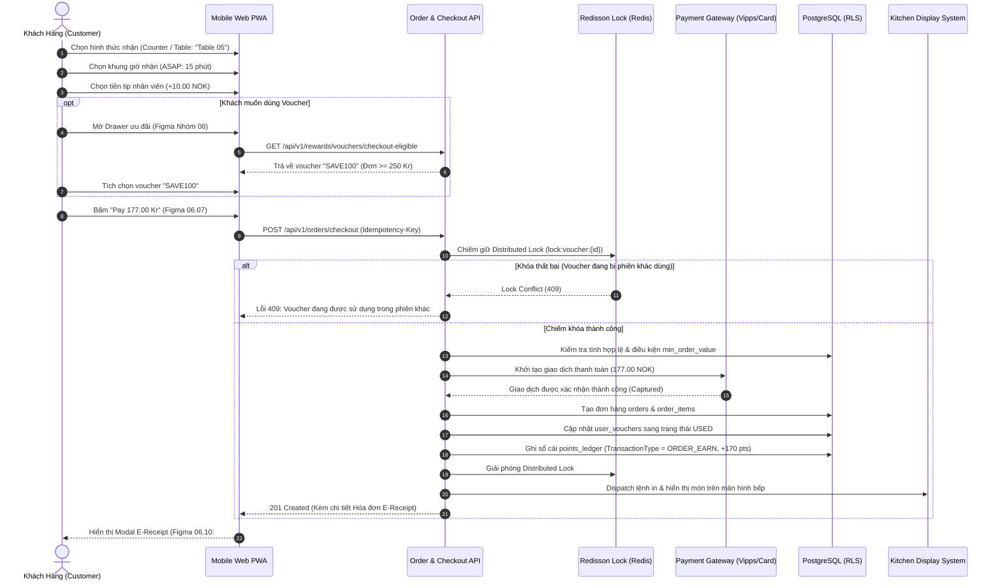

# BF-03: Quy Trình Đặt Món, Áp Mã Voucher & Thanh Toán Checkout
## Ordera Multi-Tenant Loyalty & Ordering Platform

> **Phân Hệ Nghiệp Vụ:** Đặt hàng, Khóa Voucher Ưu Đãi, Tính Thuế VAT & Thanh Toán (Checkout & E-Receipt)  
> **Ánh xạ Màn hình Figma:** Nhóm 06 (`06.07` Checkout View, `06.08` Tip Selector, `06.10` E-Receipt Modal), Nhóm 08 (Drawer Ưu Đãi Giảm Giá)  
> **API Contracts Liên Quan:** `06-order-and-checkout-api.md`, `05-reward-and-voucher-api.md`  
> **CSDL Liên Quan:** `orders`, `order_items`, `order_item_modifiers`, `user_vouchers`, `points_ledger`

---

## 1. Thông Tin Định Nghĩa Nghiệp Vụ

| Thuộc Tính | Mô Tả Chi Tiết |
|:---|:---|
| **Mã Luồng (ID)** | `BF-03` |
| **Mục Tiêu Nghiệp Vụ** | Xử lý quy trình chốt đơn hàng an toàn: lựa chọn hình thức phục vụ (Quầy/Bàn), chọn khung giờ nhận món, chọn tiền boa tip cho nhân viên, áp dụng voucher ưu đãi hợp lệ, khóa voucher chống Double-spending, tính đúng thuế VAT 15% Na Uy và thanh toán thành công. |
| **Trigger (Kích hoạt)** | Khách hàng bấm nút "Tiến hành thanh toán" từ Giỏ hàng hoặc bấm trực tiếp nút "Pay [Total] Kr". |
| **Tác Nhân (Actors)** | Khách hàng (Member / Guest), Backend Order Service, Cụm Khóa Phân Tán Redisson, Cổng Thanh toán (Card/Vipps/Apple Pay), CSDL PostgreSQL. |
| **Tiền Điều Kiện** | 1. Giỏ hàng có ít nhất 01 món ăn hợp lệ. 2. Cửa hàng tiếp nhận chế biến đang trong khung giờ mở cửa (`is_active = true`). |
| **Kết Quả Đạt Được** | 1. Đơn hàng được tạo thành công với trạng thái `PAID` và số thứ tự nhận món `#A-08`. 2. Voucher áp dụng chuyển từ `IN_USE` sang `USED`. 3. Điểm thưởng từ đơn hàng được ghi nhận vào sổ cái `points_ledger`. 4. Màn hình hóa đơn điện tử E-Receipt hiển thị đầy đủ thông tin thanh toán cho khách. |

---

## 2. Sơ Đồ Luồng Nghiệp Vụ (Business Workflow Diagram)

---

## 3. Bảng Phân Tích Chi Tiết Từng Bước Nghiệp Vụ

| Bước | Tác Nhân (Actor) | Hành Động & Mô Tả Chi Tiết | Hệ Thống / Thành Phần | Mã Tính Năng | Quy Tắc Nghiệp Vụ (Business Rules) | Xử Lý Ngoại Lệ & Rủi Ro |
|:---:|:---|:---|:---|:---:|:---|:---|
| **1** | Khách hàng | Khách mở màn hình Checkout (`06.07`), chọn hình thức nhận: Tại quầy (*Takeaway/Counter Pickup*) hoặc Tại bàn (*Dine-in Table*). | Frontend PWA | `STR-01`, `STR-02` | Nếu đã quét QR bàn ở Bước Onboarding: Tự động khóa chọn tại bàn với số bàn tương ứng (ví dụ: `Table 05`). | Nếu chọn ăn tại bàn nhưng chưa quét QR: Bắt buộc chọn số bàn từ danh sách bàn trống khả dụng. |
| **2** | Khách hàng | Chọn thời gian nhận đồ: *ASAP (Càng sớm càng tốt ~15 phút)* hoặc *Scheduled (Hẹn giờ cụ thể trong ngày)*. | Frontend PWA | `ORD-01` | Khung giờ hẹn Scheduled phải nằm trong giờ hoạt động của chi nhánh và cách thời điểm hiện tại tối thiểu 30 phút. | Nếu khách hẹn giờ quá giờ đóng cửa: Báo lỗi "Thời gian hẹn ngoài khung giờ phục vụ của chi nhánh". |
| **3** | Khách hàng | Chọn số tiền tip cảm ơn nhân viên quầy: Tùy chọn 0 NOK, 5 NOK, 10 NOK, 20 NOK hoặc Tùy chỉnh (Figma 06.08). | Frontend PWA | `ORD-02` | Tiền tip không chịu thuế VAT của món ăn và không được dùng để tính tích lũy điểm thưởng. | Khách nhập số âm hoặc số thập phân quá 2 chữ số: Tự động chặn và làm tròn về 0. |
| **4** | Khách hàng | Chạm vào mục "Add voucher / Offers" để mở Drawer chọn khuyến mãi (Figma Nhóm 08). | Frontend PWA | `REW-01` | Chỉ hiển thị các voucher đang ở trạng thái `AVAILABLE` và thuộc sở hữu của thành viên hiện tại trong thương hiệu này. | Khách vãng lai chưa đăng nhập: Hiển thị popup "Đăng nhập ngay để sử dụng kho voucher ưu đãi". |
| **5** | Hệ thống | Lọc và hiển thị danh sách voucher hợp lệ: Mã `SAVE100` (Giảm 100 NOK) và Mã `OFF30` (Giảm 30%). | Backend Reward Service | `REW-01`, `ORD-03` | **BR-VOU-01:** Kiểm tra điều kiện đơn tối thiểu `min_order_value`. Nếu đơn hàng 267 Kr $\ge$ 250 Kr: Mã hợp lệ; nếu nhỏ hơn: Mã bị làm mờ kèm dòng chữ "Cần thêm X Kr để áp dụng". | Nếu voucher đã quá hạn sử dụng: Tự động ẩn hoặc hiển thị nhãn đỏ "Expired". |
| **6** | Khách hàng | Chọn voucher `SAVE100`. Hệ thống thực hiện tính toán giá trị khấu trừ: | Frontend PWA, Order API | `ORD-02`, `ORD-03` | **BR-CALC-01 (Công thức Thanh toán):**  
$$\text{Subtotal} = 267.00\text{ Kr}$$  
$$\text{Discount} = 100.00\text{ Kr}$$  
$$\text{Tip} = 10.00\text{ Kr}$$  
$$\text{Total} = 267.00 - 100.00 + 10.00 = 177.00\text{ Kr}$$ | Số tiền giảm trừ tối đa bằng tổng tiền hàng (không bao giờ giảm vào tiền tip và không để tổng tiền âm). |
| **7** | Hệ thống | Phân tích và trích xuất tiền thuế VAT 15% Na Uy ẩn bên trong tổng tiền thanh toán: | Backend Order Service | `ORD-02` | **BR-VAT-01:**  
$$\text{VAT Amount} = 177.00 \times \frac{15}{115} \approx 23.09\text{ Kr}$$  
Hiển thị tách bạch trên hóa đơn để tuân thủ luật thuế Skatteetaten Na Uy. | Đảm bảo tính toán độc lập giữa giá trị tiền hàng chịu thuế và tiền tip không chịu thuế. |
| **8** | Khách hàng | Kiểm tra thông tin người nhận: Tên (*David Nguyen*), SĐT (*+47 97362748*), chọn phương thức thanh toán (*Card/Vipps*), bấm "Pay 177.00 Kr". | Frontend PWA | `ORD-04` | Yêu cầu gửi kèm Header `Idempotency-Key` (UUIDv4) để chống việc người dùng nhấn liên tiếp nhiều lần (Double-click/Double-tap). | Nếu cùng 1 Idempotency-Key được gửi trong 10 giây: Trả về ngay kết quả đơn hàng đang xử lý, không sinh đơn thứ hai. |
| **9** | Hệ thống | Chiếm giữ khóa phân tán **Redisson Distributed Lock** trên Redis đối với ID voucher: `lock:voucher:{voucherId}` (TTL 5s). | Backend Order Service, Redis | `ORD-03` | Ngăn chặn triệt để lỗi đua tranh (Race condition) khi 1 voucher được dùng đồng thời trên 2 thiết bị khác nhau cùng lúc. | Nếu không lấy được lock: Trả lỗi `409 CONCURRENT_TRANSACTION_LOCK` và yêu cầu khách thử lại. |
| **10** | Cổng thanh toán | Gửi yêu cầu trừ tiền tới cổng thanh toán thẻ hoặc Ví điện tử Vipps. | Payment Gateway API | `ORD-04` | Xử lý giao dịch 3D-Secure nếu ngân hàng phát hành thẻ yêu cầu xác thực sinh trắc học OTP. | Nếu thẻ hết hạn, không đủ số dư hoặc khách hủy giao dịch: Huỷ đơn hàng, mở lại trạng thái voucher `AVAILABLE`. |
| **11** | Hệ thống | Thanh toán thành công: Cập nhật đơn hàng `status = 'CONFIRMED'`, `payment_status = 'PAID'`, cập nhật voucher `status = 'USED'`. | Backend, PostgreSQL | `ORD-04`, `LOY-01` | Ghi nhận ngay lập tức điểm thưởng vào sổ cái `points_ledger` (TransactionType = `ORDER_EARN`, +170 pts). Sinh số thứ tự nhận món `#A-08`. | Bọc toàn bộ các thao tác DB trong 1 Transaction duy nhất: Lỗi bất kỳ bước nào sẽ Rollback hoàn toàn. |
| **12** | Khách hàng | Màn hình PWA tự động hiển thị Hóa đơn Điện tử E-Receipt (Figma 06.10): | Frontend PWA | `ORD-05` | Hiển thị mã đơn hàng, số thứ tự `#A-08`, chi tiết từng món ăn, tiền VAT đã thu, mã vạch biên nhận và số điểm vừa tích lũy (+170 pts). | Khách có thể chụp ảnh màn hình hoặc tải bản PDF biên nhận về máy điện thoại. |

