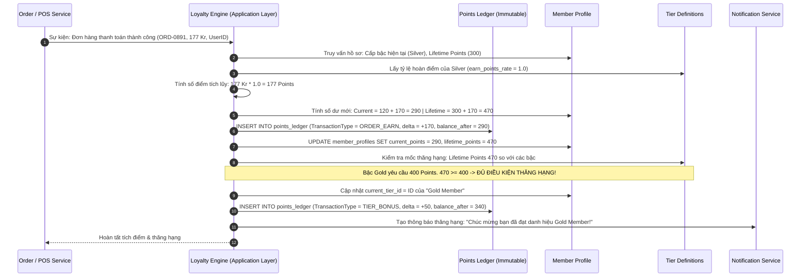

# BF-04: Tích Lũy Điểm Bất Biến & Tự Động Thăng Tiến 6 Cấp Bậc
## Ordera Multi-Tenant Loyalty & Ordering Platform

> **Phân Hệ Nghiệp Vụ:** Động Cơ Khách Hàng Thân Thiết, Kế Toán Sổ Cái Kép & Thăng Bậc Thẻ (Loyalty Tier Engine)  
> **Ánh xạ Màn hình Figma:** Nhóm 04 (`04.01` Profile Header, `04.05` - `04.12` Stepper 6 Hạng Thẻ: New $\rightarrow$ Silver $\rightarrow$ Gold $\rightarrow$ Platinum $\rightarrow$ Diamond $\rightarrow$ Ruby)  
> **API Contracts Liên Quan:** `04-loyalty-and-tier-api.md`  
> **CSDL Liên Quan:** `member_profiles`, `tier_definitions`, `points_ledger`

---

## 1. Thông Tin Định Nghĩa Nghiệp Vụ

| Thuộc Tính | Mô Tả Chi Tiết |
|:---|:---|
| **Mã Luồng (ID)** | `BF-04` |
| **Mục Tiêu Nghiệp Vụ** | Thực hiện tính toán điểm thưởng từ hóa đơn theo tỷ lệ hạng thẻ, ghi nhận bút toán bất biến vào sổ cái `points_ledger`, cập nhật đồng thời điểm khả dụng và điểm trọn đời, tự động kích hoạt nâng hạng thẻ thành viên khi đạt mốc và mở khóa các đặc quyền cao cấp hơn. |
| **Trigger (Kích hoạt)** | Đơn hàng hoàn tất thanh toán (`status = 'PAID'`) hoặc Quản lý chi nhánh phê duyệt phiếu khiếu nại điểm thành công. |
| **Tác Nhân (Actors)** | Hệ thống Loyalty Backend, PostgreSQL Database RLS, Thành viên (Member). |
| **Tiền Điều Kiện** | 1. Người dùng là thành viên đã có hồ sơ `member_profiles`. 2. Đơn hàng phát sinh giá trị thanh toán hợp lệ (`total_amount > 0`). |
| **Kết Quả Đạt Được** | 1. Dòng sổ cái mới được chèn vào `points_ledger` với số dư sau giao dịch (`balance_after`) chính xác. 2. Nếu đạt đủ mốc điểm, khách hàng được nâng hạng mới (ví dụ từ Silver lên Gold), màu thẻ và tỷ lệ hoàn điểm mới có hiệu lực ngay lập tức. 3. Thông báo chúc mừng thăng hạng xuất hiện trong Hộp thư thông báo. |

---

## 2. Sơ Đồ Luồng Nghiệp Vụ (Business Workflow Diagram)

---

## 3. Bảng Phân Tích Chi Tiết Từng Bước Nghiệp Vụ

| Bước | Tác Nhân (Actor) | Hành Động & Mô Tả Chi Tiết | Hệ Thống / Thành Phần | Mã Tính Năng | Quy Tắc Nghiệp Vụ (Business Rules) | Xử Lý Ngoại Lệ & Rủi Ro |
|:---:|:---|:---|:---|:---:|:---|:---|
| **1** | Hệ thống | Nhận sự kiện đơn hàng thanh toán thành công từ `BF-03` hoặc lệnh duyệt khiếu nại từ `BF-07`. | Backend Event Bus | `ORD-04`, `LOY-01` | Đảm bảo tính duy nhất của giao dịch: Kiểm tra `reference_id` (mã đơn hàng) chưa từng được ghi nhận tích điểm trước đó. | Nếu đơn hàng đã được tính điểm (Trùng lặp sự kiện): Bỏ qua giao dịch (Idempotent processing). |
| **2** | Hệ thống | Trích xuất thông tin thành viên: Lấy `current_points` (điểm khả dụng hiện tại), `lifetime_points` (điểm trọn đời) và `current_tier_id`. | Backend Loyalty Service | `LOY-02` | **BR-LOY-01 (Tách bạch 2 loại Điểm):**  
- `current_points`: Điểm dùng để đổi voucher và quà tặng (sẽ giảm đi khi đổi).  
- `lifetime_points`: Điểm cộng dồn vĩnh viễn, **chỉ tăng không giảm**, dùng làm căn cứ xét hạng thẻ. | Nếu không tìm thấy hồ sơ thành viên (khách vãng lai): Dừng quy trình, không tích điểm. |
| **3** | Hệ thống | Xác định hệ số hoàn điểm của hạng thẻ hiện tại: Hạng Silver có hệ số $1.0$. Tính toán số điểm được nhận: | Backend Loyalty Engine | `LOY-01` | **BR-LOY-02 (Tỷ lệ Hoàn Điểm):**  
$$\text{Points} = \lfloor \text{SubtotalAmount} \times \text{EarnRate} \rfloor$$  
*(Lưu ý: Tiền tip không được tính vào công thức tích điểm).* | Luôn làm tròn xuống số nguyên gần nhất (Floor rounding), không phát sinh điểm lẻ thập phân. |
| **4** | Hệ thống | Thực hiện bút toán ghi sổ cái kép bất biến `points_ledger`: | PostgreSQL Database | `LOY-01` | **BR-LEDGER-01 (Bất biến Tuyệt đối):**  
Tạo dòng mới với:  
- `transaction_type = 'ORDER_EARN'`  
- `points_delta = +170`  
- `balance_after = current_points + 170`  
- `reference_type = 'ORDERS'`, `reference_id = 'ORD-0891'` | Nghiêm cấm chạy lệnh `UPDATE` hoặc `DELETE` trên bảng `points_ledger`. Mọi sai sót chỉ được điều chỉnh bằng bút toán bù `ADMIN_ADJUST`. |
| **5** | Hệ thống | Cập nhật số dư trong bảng tổng hợp `member_profiles`: | PostgreSQL Database | `LOY-01`, `LOY-02` | `current_points = 290`, `lifetime_points = 470`. Thao tác diễn ra trong cùng 1 Database Transaction với Bước 4. | Nếu xung đột khóa dòng (Row lock timeout): Thử lại (retry) tối đa 3 lần với thuật toán Exponential Backoff. |
| **6** | Hệ thống | So khớp điểm trọn đời `lifetime_points = 470` với bảng cấu hình 6 hạng thẻ `tier_definitions`: | Backend Loyalty Engine | `LOY-02` | **BR-TIER-01 (Bảng Mốc Điểm Chuẩn):**  
1. `New Member`: 0 pts  
2. `Silver Member`: 200 pts  
3. `Gold Member`: 400 pts  
4. `Platinum Member`: 1,000 pts  
5. `Diamond Member`: 2,000 pts  
6. `Ruby Member`: 4,000 pts | Khách có 470 điểm $\ge$ 400 điểm của Gold nhưng chưa đạt 1,000 điểm của Platinum $\rightarrow$ Cấp bậc mục tiêu là **Gold Member**. |
| **7** | Hệ thống | Phát hiện thăng hạng: Cấp bậc cũ là *Silver (2)*, cấp bậc mới là *Gold (3)* $\rightarrow$ Kích hoạt quy trình Nâng hạng Thẻ. | Backend Loyalty Engine | `LOY-02` | Cập nhật `current_tier_id` trỏ sang bậc Gold. Tỷ lệ hoàn điểm nâng từ 1.0% lên 1.5%. | Nếu khách hàng đã ở bậc Ruby (Bậc tối đa): Giữ nguyên bậc cao nhất, tiếp tục cộng dồn điểm trọn đời. |
| **8** | Hệ thống | Tặng thưởng điểm thăng hạng (Tier Upgrade Bonus) nếu chính sách thương hiệu có quy định (ví dụ thưởng nóng +50 pts khi lên Gold). | Backend Loyalty Service | `LOY-01` | Ghi thêm 1 bút toán vào `points_ledger` với `transaction_type = 'TIER_BONUS'`, `points_delta = +50`. | Không có ngoại lệ. |
| **9** | Hệ thống | Sinh thông báo In-app Notification và gửi email chúc mừng thăng hạng: | Notification Service | `NTF-01` | Nội dung: *"Chúc mừng David Nguyen đã thăng hạng Gold Member! Thẻ của bạn đã đổi sang màu Vàng hoàng gia với tỷ lệ hoàn điểm 1.5%."* | Nếu dịch vụ gửi email bị nghẽn: Giao tác thăng hạng vẫn thành công, email được đưa vào hàng đợi Dead Letter Queue (DLQ). |
| **10** | Khách hàng | Khách mở màn hình Hồ sơ (`ProfilePage.tsx`): Thẻ thành viên tự động đổi sang màu Vàng Gold (`#F5B800`). | Frontend PWA | `LOY-02` | Thanh tiến độ Stepper (Figma 04.05) hiển thị tiến trình tiếp theo: *"Cần thêm 530 điểm nữa để lên hạng Platinum"*. | Giao diện tự động cập nhật ngay lập tức nhờ React Query invalidation mà không cần khách F5 tải lại trang. |

