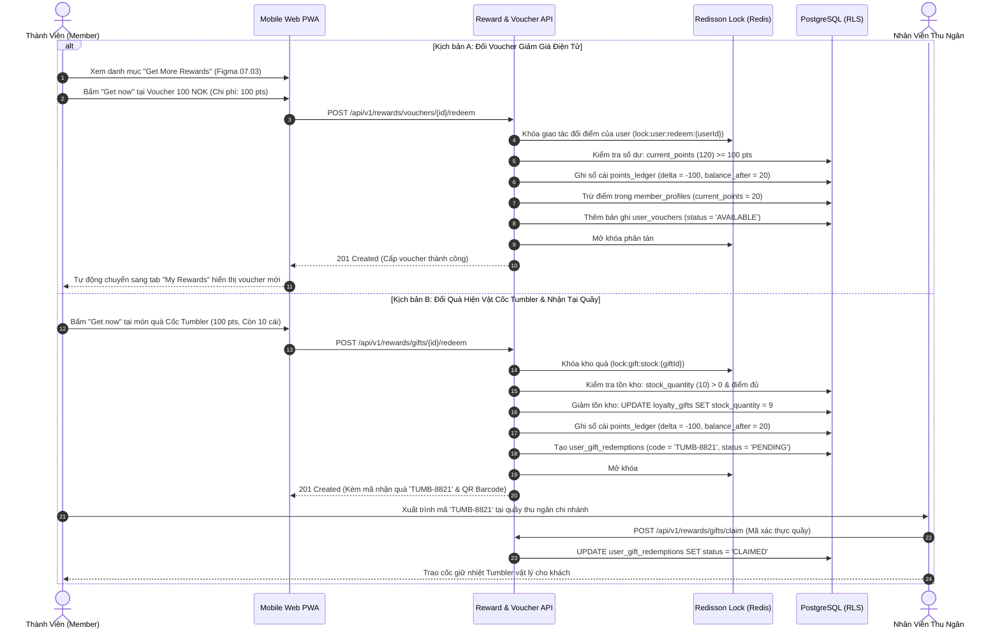

# BF-05: Đổi Thưởng Điểm (Voucher / Quà Tumbler) & Quản Lý Ví Ưu Đãi
## Ordera Multi-Tenant Loyalty & Ordering Platform

> **Phân Hệ Nghiệp Vụ:** Ví Ưu Đãi Thành Viên, Đổi Điểm Lấy Voucher & Quà Hiện Vật (Rewards & Physical Gifts)  
> **Ánh xạ Màn hình Figma:** Nhóm 07 (`07.01` Rewards Hub, `07.02` My Rewards Tab, `07.03` Get More Rewards Tab, `07.07` Modal Voucher, `07.08` Voucher In-Use, `07.09` Modal Cốc Tumbler)  
> **API Contracts Liên Quan:** `05-reward-and-voucher-api.md`  
> **CSDL Liên Quan:** `vouchers`, `user_vouchers`, `loyalty_gifts`, `user_gift_redemptions`, `points_ledger`

---

## 1. Thông Tin Định Nghĩa Nghiệp Vụ

| Thuộc Tính | Mô Tả Chi Tiết |
|:---|:---|
| **Mã Luồng (ID)** | `BF-05` |
| **Mục Tiêu Nghiệp Vụ** | Cho phép thành viên sử dụng điểm tích lũy khả dụng (`current_points`) để đổi lấy các ưu đãi điện tử (Voucher 100 NOK, Giảm 30%) hoặc đổi quà tặng hiện vật phiên bản giới hạn (Cốc giữ nhiệt Tumbler), quản lý kho voucher và đối soát trao quà tại quầy. |
| **Trigger (Kích hoạt)** | Khách hàng mở tab Rewards và bấm nút "Get now" tại một voucher hoặc món quà trong kho đổi thưởng. |
| **Tác Nhân (Actors)** | Thành viên (Member), Nhân viên Quầy (Cashier), Backend Reward Service, Redisson Distributed Lock, CSDL PostgreSQL. |
| **Tiền Điều Kiện** | 1. Khách hàng đã đăng nhập tài khoản thành viên. 2. Số dư điểm khả dụng $\ge$ số điểm yêu cầu (`current_points >= points_cost`). 3. Đối với quà hiện vật: Số lượng tồn kho còn lại $> 0$ (`stock_quantity > 0`). |
| **Kết Quả Đạt Được** | 1. Điểm khả dụng bị trừ và ghi vết bất biến vào `points_ledger` (`transaction_type = 'VOUCHER_REDEEM'` hoặc `'GIFT_REDEEM'`). 2. Voucher mới xuất hiện trong ví `My Rewards` ở trạng thái `AVAILABLE`. 3. Hoặc sinh mã nhận quà 8 ký tự duy nhất để nhận cốc Tumbler tại quầy. |

---

## 2. Sơ Đồ Luồng Nghiệp Vụ (Business Workflow Diagram)

---

## 3. Bảng Phân Tích Chi Tiết Từng Bước Nghiệp Vụ

| Bước | Tác Nhân (Actor) | Hành Động & Mô Tả Chi Tiết | Hệ Thống / Thành Phần | Mã Tính Năng | Quy Tắc Nghiệp Vụ (Business Rules) | Xử Lý Ngoại Lệ & Rủi Ro |
|:---:|:---|:---|:---|:---:|:---|:---|
| **1** | Thành viên | Mở mục "Rewards" trên thanh điều hướng chân trang (Bottom Navigation), chọn tab "Get More Rewards" (Figma 07.03). | Frontend PWA | `REW-01`, `REW-02` | Tự động đồng bộ số dư điểm khả dụng hiện có (`120 pts`) từ máy chủ để hiển thị trên thanh header. | Nếu khách vãng lai: Hiển thị giao diện rỗng (Figma 07.06) kèm nút "Đăng nhập để xem kho quà". |
| **2** | Thành viên | Xem danh sách các gói quà:  
- *Voucher Name 100 NOK* (Cần 100 Points, Đơn tối thiểu 250 Kr).  
- *Voucher Name -30%* (Cần 1,000 Points, Đơn tối thiểu 0 Kr).  
- *Gift Name Cốc Tumbler Hồng* (Cần 100 Points, Còn 10 cái). | Frontend PWA | `REW-02`, `REW-03` | Nút "Get now" chỉ hiển thị trạng thái kích hoạt nếu `current_points >= points_cost`. Nếu không đủ điểm: Nút chuyển màu xám (disabled). | Không có ngoại lệ. |
| **3** | Thành viên | Chạm vào thẻ Voucher 100 NOK để xem chi tiết điều kiện (Figma 07.07), sau đó bấm nút xác nhận "Get now". | Frontend PWA | `REW-02` | Hiển thị hộp thoại xác nhận (Confirmation Dialog): *"Bạn có chắc chắn muốn dùng 100 điểm để đổi voucher này?"* | Nếu khách bấm "Hủy bỏ": Đóng hộp thoại, giữ nguyên trạng thái màn hình. |
| **4** | Hệ thống | Nhận yêu cầu đổi thưởng và kích hoạt khóa phân tán **Redisson Distributed Lock**: `lock:user:redeem:{userId}` (TTL 5s). | Backend Reward Service, Redis | `REW-02` | **BR-RED-01:** Chống hành vi bấm liên tiếp (Double-tap) hoặc gửi request đồng thời từ 2 tab trình duyệt để gian lận nhân đôi voucher. | Nếu không lấy được khóa phân tán: Trả về lỗi `409 CONCURRENT_TRANSACTION_LOCK`. |
| **5** | Hệ thống | Kiểm tra số dư điểm khả dụng trong cơ sở dữ liệu: `current_points = 120 >= 100`. | PostgreSQL Database | `REW-02` | **BR-POINTS-01:** Chỉ được trừ trên cột `current_points`. Tuyệt đối không được trừ trên `lifetime_points` (điểm xét hạng thẻ của khách không bị giảm). | Nếu số điểm không đủ (do vừa đổi quà khác trước đó): Trả lỗi `422 POINTS_INSUFFICIENT`. |
| **6** | Hệ thống | Trừ 100 điểm khả dụng và ghi bút toán trừ điểm vào sổ cái: | PostgreSQL Database | `LOY-01` | **Ghi nhận `points_ledger`:**  
- `transaction_type = 'VOUCHER_REDEEM'`  
- `points_delta = -100`  
- `balance_after = 20`  
- `description = 'Đổi Voucher Name 100 NOK'` | Thực hiện trong cùng 1 Database Transaction với lệnh tạo voucher cá nhân. |
| **7** | Hệ thống | Tạo bản ghi sở hữu voucher trong bảng `user_vouchers`: | PostgreSQL Database | `REW-01` | Cấp bản ghi mới với trạng thái ban đầu là `status = 'AVAILABLE'`, hạn sử dụng tính theo cấu hình của voucher gốc (ví dụ: `3 dec 2025`). | Nếu lỗi chèn CSDL: Rollback toàn bộ, hoàn trả điểm cho khách. |
| **8** | Thành viên | Màn hình tự động chuyển sang tab "My Rewards" (Figma 07.02): Voucher mới xuất hiện đầu danh sách với huy hiệu "New". | Frontend PWA | `REW-01` | Voucher hiển thị nút "Use now" dẫn thẳng tới Giỏ hàng để khách tiến hành mua sắm ngay lập tức. | Nếu mạng chập chờn: PWA cập nhật Optimistic UI trước khi nhận response từ server. |
| **9a** | Hệ thống | **Trường hợp Đổi Cốc Tumbler (Quà hiện vật):** Kiểm tra số lượng tồn kho `stock_quantity`. | Backend Reward Service | `REW-03` | **BR-GIFT-01:** Quà hiện vật bị giới hạn số lượng. Lệnh trừ tồn kho phải dùng điều kiện nguyên tử:  
`UPDATE loyalty_gifts SET stock_quantity = stock_quantity - 1 WHERE id = ... AND stock_quantity > 0` | Nếu `stock_quantity <= 0`: Trả mã lỗi `409 GIFT_OUT_OF_STOCK` và không trừ điểm của khách. |
| **9b** | Hệ thống | Trừ điểm, giảm tồn kho từ 10 xuống 9 chiếc và sinh mã nhận quà 8 ký tự duy nhất: `TUMB-8821`. | PostgreSQL Database | `REW-03` | Tạo bản ghi trong `user_gift_redemptions` với `status = 'PENDING'` kèm mã vạch Barcode/QR Code để nhân viên quầy quét. | Đảm bảo tính độc nhất của mã nhận quà bằng ràng buộc `UNIQUE (redemption_code)`. |
| **10** | Thu ngân & Khách | Khách đến quầy thu ngân xuất trình mã `TUMB-8821`. Thu ngân đối soát trên POS và bấm "Xác nhận đã trao quà". | Cashier Terminal, Backend | `REW-04` | Chuyển trạng thái quà sang `status = 'CLAIMED'`, lưu thời gian `claimed_at = now()`. | Nếu mã đã bị dùng trước đó (`status = 'CLAIMED'`): Báo động đỏ "Mã quà tặng đã được nhận trước đó!". |
