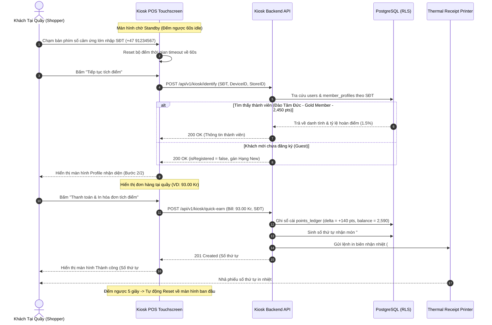

# BF-06: Kiosk POS Tự Phục Vụ, Nhận Diện SĐT & Tích Điểm Tại Quầy
## Ordera Multi-Tenant Loyalty & Ordering Platform

> **Phân Hệ Nghiệp Vụ:** Trạm Cảm Ứng Tự Phục Vụ Tại Quầy Thu Ngân (Self-Service Kiosk POS & Fast Accrual)  
> **Ánh xạ Màn hình Frontend:** `frontend/src/pages/KioskPage.tsx`  
> **API Contracts Liên Quan:** `07-kiosk-pos-api.md`  
> **CSDL Liên Quan:** `stores`, `users`, `member_profiles`, `orders`, `order_items`, `points_ledger`

---

## 1. Thông Tin Định Nghĩa Nghiệp Vụ

| Thuộc Tính | Mô Tả Chi Tiết |
|:---|:---|
| **Mã Luồng (ID)** | `BF-06` |
| **Mục Tiêu Nghiệp Vụ** | Cung cấp trải nghiệm cảm ứng toàn màn hình tại quầy thu ngân để khách hàng tự nhập số điện thoại tích điểm nhanh (Fast Accrual) cho hóa đơn giấy mà không cần mật khẩu, hoặc tự chọn món và quẹt thẻ thanh toán; tự động bảo mật xóa phiên sau 60 giây không có tương tác. |
| **Trigger (Kích hoạt)** | Khách hàng chạm tay vào màn hình cảm ứng Kiosk POS đặt tại quầy thu ngân chi nhánh. |
| **Tác Nhân (Actors)** | Khách hàng tại quầy (Kiosk Shopper), Nhân viên Quầy (Cashier), Ứng dụng Kiosk POS, Backend Kiosk API, Máy in nhiệt biên nhận. |
| **Tiền Điều Kiện** | 1. Thiết bị Kiosk đã được cấu hình và gán vào chi nhánh (`kiosk-pos-sentrum-01`). 2. Cửa hàng đang trong trạng thái hoạt động tiếp nhận giao dịch. |
| **Kết Quả Đạt Được** | 1. Khách hàng được nhận diện tức thì (Tên, Hạng thẻ, Điểm khả dụng). 2. Điểm tích lũy từ đơn được ghi trực tiếp vào sổ cái `points_ledger` (TransactionType = `KIOSK_EARN`). 3. Máy in xuất phiếu số thứ tự lấy món `#A-08` và Kiosk tự động quay về màn hình chờ sau 5 giây. |

---

## 2. Sơ Đồ Luồng Nghiệp Vụ (Business Workflow Diagram)

---

## 3. Bảng Phân Tích Chi Tiết Từng Bước Nghiệp Vụ

| Bước | Tác Nhân (Actor) | Hành Động & Mô Tả Chi Tiết | Hệ Thống / Thành Phần | Mã Tính Năng | Quy Tắc Nghiệp Vụ (Business Rules) | Xử Lý Ngoại Lệ & Rủi Ro |
|:---:|:---|:---|:---|:---:|:---|:---|
| **1** | Khách tại quầy | Tiếp cận trạm Kiosk đặt tại quầy thu ngân, nhìn thấy giao diện chào mời tích điểm (Figma Kiosk Page - Bước 1/2). | Kiosk POS UI | `KSK-01` | Màn hình ở chế độ Fullscreen Kiosk Mode (chặn toàn bộ phím tắt hệ thống và thanh điều hướng trình duyệt). | Nếu mất mạng Internet: Màn hình hiển thị banner vàng "Thiết bị ngoại tuyến, vui lòng liên hệ nhân viên thu ngân". |
| **2** | Khách tại quầy | Chạm các phím số lớn (1, 2, 3... 0) trên bàn phím Touch Numpad để nhập số điện thoại. | Kiosk Touchscreen | `KSK-01` | Mỗi lần chạm vào phím số hoặc nút xóa (Delete), bộ đếm thời gian tự động hủy phiên (Idle countdown) được **reset trở lại 60 giây**. | Giới hạn độ dài tối đa 10 số (theo định dạng số điện thoại di động Na Uy/Quốc tế). |
| **3** | Hệ thống | Bộ đếm thời gian chạy ngầm lùi từng giây: `countdown = countdown - 1` hiển thị góc trên cùng bên phải. | Kiosk Frontend timer | `KSK-03` | **BR-KSK-01 (Tự Hủy Phiên An Toàn):**  
Nếu khách bỏ đi và không có bất kỳ thao tác chạm nào trong vòng **60 giây**:  
$\rightarrow$ Hệ thống tự động kích hoạt `handleStartOver()`, xóa trắng toàn bộ SĐT và đưa về màn hình chào ban đầu. | Bảo vệ dữ liệu cá nhân của khách hàng, ngăn chặn người đứng sau nhìn trộm thông tin hoặc dùng điểm của người trước. |
| **4** | Khách tại quầy | Sau khi nhập đủ từ 8 đến 10 số (nút "Tiếp tục" sáng màu cam), khách bấm "Tiếp tục tích điểm" (hoặc bấm "Bỏ qua - Skip"). | Kiosk Touchscreen | `KSK-01` | Nếu bấm "Bỏ qua (Skip)": Hệ thống gán tạm phiên khách là `Khách tích điểm mới` (Hạng New Member, 0 điểm) để tiếp tục quy trình thanh toán. | Nếu SĐT chưa đủ 8 chữ số: Nút tiếp tục bị khóa (disabled) để tránh gửi dữ liệu rác lên server. |
| **5** | Hệ thống | Gửi lệnh tra cứu định danh `POST /api/v1/kiosk/identify` lên máy chủ đám mây. | Backend Kiosk API, PostgreSQL | `KSK-01`, `LOY-02` | Tra cứu bảng `users` kết hợp `member_profiles` theo số điện thoại trong phạm vi Tenant của chi nhánh này. | Nếu SĐT chưa từng đăng ký: Trả về `isRegistered = false`, tự động tạo phiên tạm để khách không bị gián đoạn trải nghiệm. |
| **6** | Khách tại quầy | Màn hình hiển thị Bước 2/2: Nhận diện thành công khách hàng:  
- Tên khách: *Đào Tâm Đức*  
- Hạng thẻ hiện tại: *Gold Member*  
- Số điểm khả dụng: *2,450 pts* | Kiosk POS UI | `KSK-01`, `LOY-02` | Hiển thị tóm tắt đơn hàng quầy do nhân viên thu ngân vừa đồng bộ (ví dụ: *01 Trà Sữa Ô Long, 01 Bánh Croissant - Tổng: 93.00 Kr*). | Khách kiểm tra thấy sai tên hoặc nhầm SĐT: Bấm nút "Start Over" góc trên để nhập lại số khác. |
| **7** | Khách tại quầy | Bấm nút màu cam lớn "Thanh toán & In hóa đơn tích điểm (+140 pts)". | Kiosk Touchscreen | `KSK-02` | **BR-KSK-02 (Tích Điểm Nhanh):**  
Không yêu cầu nhập mật khẩu hay OTP SMS tại quầy để đảm bảo tốc độ phục vụ hàng đợi nhanh nhất (< 15 giây/khách). | Nghiêm cấm các thao tác nhạy cảm tại Kiosk như Đổi voucher hay Trừ điểm nếu không có mật khẩu. |
| **8** | Hệ thống | Ghi sổ cái tích điểm nhanh `POST /api/v1/kiosk/quick-earn`:  
- `transaction_type = 'KIOSK_EARN'`  
- `points_delta = +140`  
- `balance_after = 2,590` | Backend Kiosk API, PostgreSQL | `LOY-01`, `KSK-02` | Ghi nhận bất biến vào `points_ledger`. Cập nhật số điểm mới cho thành viên ngay trong thời gian thực. | Đảm bảo tính toán đúng tỷ lệ hạng Gold (hoàn 1.5% giá trị hóa đơn 93 Kr). |
| **9** | Hệ thống | Sinh mã đơn hàng và số thứ tự nhận món của trạm quầy: `#A-08`. | Backend Order Engine | `ORD-04` | Số thứ tự quầy gồm tiền tố ký tự trạm (`A`, `B`, `C`) kết hợp số thứ tự tăng dần trong ngày (`01`, `02`, ..., reset lúc 00:00). | Tránh trùng lặp số thứ tự giữa các quầy trong cùng một chi nhánh. |
| **10** | Máy in nhiệt | Máy in nhiệt tích hợp Kiosk tự động in phiếu biên nhận chứa mã `#A-08`, điểm tích lũy và mã QR theo dõi đơn. | Hardware Thermal Printer | `ORD-05` | Gửi lệnh ESC/POS qua cổng USB/LAN tới máy in nhiệt. | Nếu máy in hết giấy hoặc kẹt giấy: Màn hình Kiosk hiển thị cảnh báo và hiển thị số `#A-08` siêu lớn để khách chụp ảnh lại. |
| **11** | Kiosk POS | Màn hình chuyển sang trạng thái Thành công (Bước 3: Success Screen):  
- Hiển thị số thứ tự khổng lồ: `#A-08`  
- Thông báo: *"Đặt đơn thành công! Vui lòng nhận phiếu in. Hệ thống tự động trở về trang chủ sau 5 giây."* | Kiosk Frontend | `KSK-03` | Sau đúng **5 giây đếm ngược**, Kiosk tự động gọi hàm `handleStartOver()` đưa màn hình về trạng thái chờ sẵn sàng đón khách tiếp theo. | Khách có thể chủ động bấm nút "Xong" để trở về màn hình chờ ngay lập tức mà không cần đợi 5 giây. |
