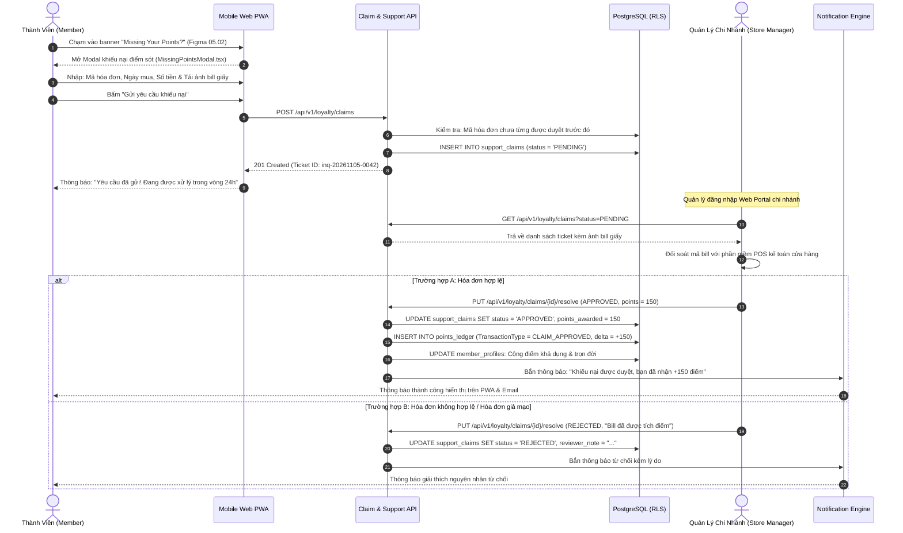

# BF-07: Khiếu Nại Thiếu Điểm & Chăm Sóc Khách Hàng
## Ordera Multi-Tenant Loyalty & Ordering Platform

> **Phân Hệ Nghiệp Vụ:** Tiếp Nhận Yêu Cầu Khiếu Nại, Đối Soát Hóa Đơn & Cộng Bù Điểm (Missing Points Claim)  
> **Ánh xạ Màn hình Figma:** Nhóm 04 & 05 (`MissingPointsModal.tsx`, `NotificationDetailModal.tsx`)  
> **API Contracts Liên Quan:** `04-loyalty-and-tier-api.md`, `08-notification-api.md`  
> **CSDL Liên Quan:** `support_claims`, `points_ledger`, `member_profiles`, `user_notifications`

---

## 1. Thông Tin Định Nghĩa Nghiệp Vụ

| Thuộc Tính | Mô Tả Chi Tiết |
|:---|:---|
| **Mã Luồng (ID)** | `BF-07` |
| **Mục Tiêu Nghiệp Vụ** | Cung cấp kênh tự phục vụ cho thành viên khiếu nại các giao dịch ăn uống tại quán bị sót điểm (do quên đọc số điện thoại hoặc hệ thống bảo trì), tải ảnh hóa đơn giấy làm căn cứ, hỗ trợ Quản lý chi nhánh đối soát kế toán và phê duyệt cộng bù điểm minh bạch vào sổ cái. |
| **Trigger (Kích hoạt)** | Thành viên bấm vào banner "Missing Your Points?" trong Hộp thư thông báo hoặc biểu mẫu khiếu nại trong mục Cá nhân. |
| **Tác Nhân (Actors)** | Thành viên (Member), Quản lý Chi nhánh (Store Manager), Backend Loyalty Claim Service, PostgreSQL Database RLS. |
| **Tiền Điều Kiện** | 1. Khách hàng là thành viên đã đăng nhập tài khoản. 2. Hóa đơn giấy phát sinh trong vòng tối đa **30 ngày** kể từ ngày mua hàng. |
| **Kết Quả Đạt Được** | 1. Phiếu khiếu nại `support_claims` được ghi nhận với trạng thái `PENDING`. 2. Khi Quản lý phê duyệt: Sổ cái `points_ledger` tự động được ghi nhận bút toán `CLAIM_APPROVED` và điểm số của khách được cập nhật ngay lập tức. 3. Thành viên nhận được thông báo giải quyết khiếu nại qua ứng dụng và email. |

---

## 2. Sơ Đồ Luồng Nghiệp Vụ (Business Workflow Diagram)

---

## 3. Bảng Phân Tích Chi Tiết Từng Bước Nghiệp Vụ

| Bước | Tác Nhân (Actor) | Hành Động & Mô Tả Chi Tiết | Hệ Thống / Thành Phần | Mã Tính Năng | Quy Tắc Nghiệp Vụ (Business Rules) | Xử Lý Ngoại Lệ & Rủi Ro |
|:---:|:---|:---|:---|:---:|:---|:---|
| **1** | Thành viên | Mở Hộp thư thông báo (`NotificationListView.tsx`), thấy thông báo tin nhắn: *"Missing Your Points? Hệ thống đã nâng cấp, vui lòng gửi yêu cầu để lấy lại điểm"*. | Frontend PWA | `NTF-01` | Thông báo ghim trên đầu tab Messages với nhãn đỏ "Chưa đọc". | Khách đã đọc: Huy hiệu chưa đọc tự động chuyển sang màu xám. |
| **2** | Thành viên | Bấm nút hành động "Learn more" (Figma 05.02) để mở Modal biểu mẫu khiếu nại (`MissingPointsModal.tsx`). | Frontend PWA | `CLM-01` | Tự động điền trước Họ tên, Email và SĐT từ hồ sơ thành viên hiện tại để giảm bớt thao tác nhập liệu. | Nếu khách muốn khiếu nại bằng SĐT cũ trước khi đổi số: Cho phép nhập ô "Số điện thoại / Email cũ". |
| **3** | Thành viên | Nhập thông tin bắt buộc trên biên lai tính tiền giấy của nhà hàng:  
- Mã hóa đơn: `POS-20261105-0891`  
- Ngày mua hàng: `05/11/2026`  
- Số tiền hóa đơn: `177.00 NOK` | Frontend PWA | `CLM-01` | **BR-CLM-01 (Thời Hạn Khiếu Nại):**  
Ngày mua hàng không được quá **30 ngày** so với ngày gửi khiếu nại. Không chấp nhận hóa đơn quá thời hạn 1 tháng. | Nếu khách chọn ngày trong tương lai: Hệ thống chặn ngay lập tức tại date-picker. |
| **4** | Thành viên | Chụp ảnh hoặc tải tệp ảnh biên lai giấy (`bill_photo_url`): Tệp ảnh định dạng JPG/PNG/HEIC. | Frontend PWA, S3/CDN | `CLM-01` | Dung lượng ảnh tối đa **10 MB**. Ảnh được tải lên lưu trữ an toàn trên AWS S3 Private Bucket. | Nếu tệp không đúng định dạng hoặc vượt quá 10MB: Báo lỗi "Vui lòng chọn ảnh định dạng hợp lệ dưới 10MB". |
| **5** | Thành viên | Tích chọn ô cam kết "Tôi đồng ý với điều khoản xác minh dữ liệu", sau đó bấm "Gửi yêu cầu". | Frontend PWA | `CLM-01` | Bắt buộc phải tích chọn cam kết mới kích hoạt nút gửi (Submit button). | Không có ngoại lệ. |
| **6** | Hệ thống | Kiểm tra tính duy nhất của mã hóa đơn: Đối chiếu bảng `support_claims` trong phạm vi Tenant. | Backend Claim Service, PostgreSQL | `CLM-01` | **BR-CLM-02 (Chống Trùng Lặp Hóa Đơn):**  
Một mã hóa đơn giấy chỉ được chấp nhận tạo khiếu nại 1 lần duy nhất để tránh việc nhiều người cùng nhặt 1 tờ bill giấy để khiếu nại gian lận. | Nếu mã hóa đơn đã có phiếu đang `PENDING` hoặc `APPROVED`: Báo lỗi `409 RECEIPT_ALREADY_CLAIMED`. |
| **7** | Hệ thống | Tạo bản ghi khiếu nại mới trong bảng `support_claims`:  
- `status = 'PENDING'`  
- `points_awarded = null`  
- `ticketId = 'inq-20261105-0042'` | PostgreSQL Database | `CLM-01` | Trả về mã phiếu `ticketId` và thời gian dự kiến xử lý (trong vòng 24 giờ làm việc). | Nếu lỗi máy chủ: Trả lỗi `500 INTERNAL_SERVER_ERROR` kèm Correlation ID để tra vết. |
| **8** | Quản lý Chi nhánh | Đăng nhập cổng quản trị chi nhánh, mở danh mục "Xử lý Khiếu nại Điểm thưởng", xem danh sách các phiếu `PENDING`. | Web Portal Chi Nhánh | `CLM-02` | Màn hình hiển thị ảnh chụp bill phóng to, thông tin đối chiếu với báo cáo ca bán hàng POS nội bộ. | Chỉ Quản lý chi nhánh sở hữu hóa đơn đó mới có quyền xem và xử lý (RLS Security). |
| **9a** | Quản lý Chi nhánh | **Trường hợp Chấp thuận (Approve):** Quản lý xác nhận bill chuẩn, nhập số điểm phê duyệt (ví dụ: `+150 pts`), bấm "Duyệt yêu cầu". | Web Portal Chi Nhánh | `CLM-02` | Cập nhật `status = 'APPROVED'`, `resolved_at = now()`, lưu vết tài khoản quản lý đã ký duyệt. | Bắt buộc nhập số điểm hợp lệ tương ứng với giá trị bill ($\text{Bill} \times \text{Tỷ lệ}$). |
| **9b** | Hệ thống | Tự động kích hoạt ghi nhận bất biến vào sổ cái `points_ledger`:  
- `transaction_type = 'CLAIM_APPROVED'`  
- `points_delta = +150`  
- `reference_type = 'SUPPORT_CLAIMS'`  
- `reference_id = 'inq-20261105-0042'` | PostgreSQL Database | `LOY-01`, `CLM-02` | Đồng thời cộng dồn 150 điểm vào cả `current_points` (điểm đổi quà) và `lifetime_points` (điểm xét hạng thẻ). | Đảm bảo tính toán lại cấp bậc thành viên ngay lập tức nếu 150 điểm này giúp khách cán mốc thăng hạng. |
| **10a** | Hệ thống | Gửi thông báo thành công: Tạo bản ghi trong `user_notifications` và gửi email thông báo:  
*"Khiếu nại điểm cho hóa đơn POS-0891 đã được phê duyệt. Bạn đã được cộng +150 điểm vào tài khoản!"* | Notification Engine | `NTF-01` | Khách mở app PWA thấy điểm số nhảy lên ngay lập tức và xem được dòng biến động trong Lịch sử điểm. | Không có ngoại lệ. |
| **10b** | Quản lý & Hệ thống | **Trường hợp Từ chối (Reject):** Quản lý chọn lý do: *"Hóa đơn mờ không rõ số tiền"* hoặc *"Hóa đơn đã được tích điểm trực tiếp tại quầy"*. | Web Portal, Notification Engine | `CLM-02`, `NTF-01` | Cập nhật `status = 'REJECTED'`, `reviewer_note = '...'`. Gửi email giải thích rõ ràng lý do cho khách hàng. | Khách hàng có thể đọc phản hồi của quản lý và được phép gửi lại khiếu nại mới nếu chụp lại ảnh rõ nét hơn. |
