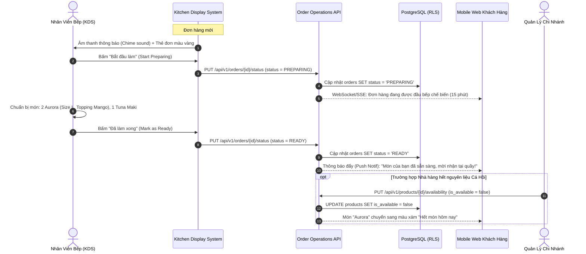

# BF-08: Vận Hành Bếp, Quản Trị Cửa Hàng & Báo Cáo
## Ordera Multi-Tenant Loyalty & Ordering Platform

> **Phân Hệ Nghiệp Vụ:** Vận Hành Màn Hình Bếp (KDS), Cập Nhật Trạng Thái Món & Báo Cáo Doanh Thu Điểm  
> **Ánh xạ Màn hình:** Màn hình KDS Bếp, Cổng Quản lý Chi nhánh & Báo cáo Thống kê  
> **API Contracts Liên Quan:** `01-tenant-and-store-api.md`, `02-catalog-and-menu-api.md`, `06-order-and-checkout-api.md`  
> **CSDL Liên Quan:** `orders`, `order_items`, `products`, `loyalty_gifts`, `user_gift_redemptions`, `points_ledger`

---

## 1. Thông Tin Định Nghĩa Nghiệp Vụ

| Thuộc Tính | Mô Tả Chi Tiết |
|:---|:---|
| **Mã Luồng (ID)** | `BF-08` |
| **Mục Tiêu Nghiệp Vụ** | Chuẩn hóa quy trình vận hành nội bộ tại nhà hàng: Nhân viên bếp tiếp nhận đơn và chuyển trạng thái chế biến theo thời gian thực (KDS), Quản lý chi nhánh bật/tắt trạng thái còn/hết món (Stock management), Thu ngân xác nhận trao quà hiện vật và Quản trị viên xem báo cáo kế toán thuế VAT 15% cùng số liệu phát hành/thu hồi điểm thưởng. |
| **Trigger (Kích hoạt)** | Đơn hàng mới thanh toán thành công, hoặc Chi nhánh hết nguyên vật liệu chế biến, hoặc Quản trị viên cần trích xuất báo cáo ca bán hàng. |
| **Tác Nhân (Actors)** | Nhân viên Bếp (Kitchen Staff), Thu ngân (Cashier), Quản lý Chi nhánh (Store Manager), Quản trị viên Thương hiệu (Tenant Admin), Hệ thống KDS. |
| **Tiền Điều Kiện** | Nhân viên và Quản lý đã đăng nhập đúng tài khoản với Role tương ứng (`STORE_STAFF`, `AGENCY_ADMIN`). |
| **Kết Quả Đạt Được** | 1. Món ăn được chế biến đúng tuần tự và trạng thái đơn hàng trên app khách hàng tự động nhảy từ `PREPARING` sang `READY`. 2. Món hết nguyên liệu bị chặn đặt hàng tức thì trên Mobile Web PWA và Kiosk POS. 3. Báo cáo doanh thu, thuế VAT 15% và công nợ điểm thưởng được kết xuất minh bạch. |

---

## 2. Sơ Đồ Luồng Nghiệp Vụ (Business Workflow Diagram)

---

## 3. Bảng Phân Tích Chi Tiết Từng Bước Nghiệp Vụ

| Bước | Tác Nhân (Actor) | Hành Động & Mô Tả Chi Tiết | Hệ Thống / Thành Phần | Mã Tính Năng | Quy Tắc Nghiệp Vụ (Business Rules) | Xử Lý Ngoại Lệ & Rủi Ro |
|:---:|:---|:---|:---|:---:|:---|:---|
| **1** | Hệ thống | Đơn hàng sau khi thanh toán thành công (`BF-03`) tự động được gửi tới Màn hình Bếp (Kitchen Display System - KDS) qua giao thức WebSocket thời gian thực. | KDS Service, WebSockets | `ORD-04` | Phát âm thanh chuông báo (Chime) để thu hút sự chú ý của đầu bếp. Thẻ đơn hiển thị mã số `#A-08`, giờ đặt và phân loại: *Takeaway* hoặc *Table 05*. | Nếu kết nối mạng bếp bị đứt: KDS tự động chuyển sang chế độ Long-polling thử lại mỗi 3 giây. |
| **2** | Nhân viên Bếp | Đọc chi tiết từng dòng món ăn, số lượng và các tùy chọn modifier:  
- *02 x Aurora (Size L, Mango Popping, Less ice)*  
- *01 x Tuna Maki (Ghi chú: Không mù tạt Wasabi)* | Màn hình KDS | `CAT-02`, `ORD-04` | Các ghi chú đặc biệt về dị ứng thực phẩm (`allergies`) được làm nổi bật bằng chữ màu đỏ viền vàng để chống nhầm lẫn. | Không có ngoại lệ. |
| **3** | Nhân viên Bếp | Chạm vào thẻ đơn hàng trên màn hình KDS, bấm "Bắt đầu làm" (Start Prep). | Màn hình KDS | `ORD-04` | Thẻ đơn chuyển từ màu Vàng (*Pending*) sang màu Xanh Dương (*Preparing*). Đồng hồ bấm giờ bắt đầu đếm ngược 15 phút. | Nếu quá 20 phút chưa xong: Thẻ đơn nhấp nháy đỏ báo hiệu đơn hàng bị trễ giờ (Overdue alert). |
| **4** | Hệ thống | Cập nhật trạng thái đơn hàng sang `PREPARING` trong cơ sở dữ liệu và đồng bộ trạng thái tới ứng dụng Mobile PWA của khách. | Backend Order API, PostgreSQL | `ORD-04` | Khách hàng mở mục "Đơn hàng đang phục vụ" (Figma Active Orders View) thấy biểu tượng bếp đang nấu kèm thời gian dự kiến. | Không có ngoại lệ. |
| **5** | Nhân viên Bếp | Hoàn tất chế biến, đóng gói món ăn vào túi mang đi hoặc đặt lên khay phục vụ, bấm nút "Sẵn sàng nhận món" (Mark as Ready). | Màn hình KDS | `ORD-04` | Thẻ đơn chuyển sang màu Xanh Lá (*Ready*). Hệ thống gửi thông báo đẩy (Web Push Notification) tới điện thoại của khách hàng. | Bảng điện tử tại quầy thu ngân tự động hiển thị số `#A-08` lên màn hình gọi số lấy món. |
| **6** | Thu ngân / Khách | Khách đến quầy xuất trình mã đơn `#A-08`, nhận đồ ăn. Nhân viên thu ngân bấm nút "Hoàn tất bàn giao" (Complete Order). | POS Terminal / PWA | `ORD-04` | Đơn hàng chuyển sang trạng thái `COMPLETED`, lưu thời điểm `completed_at = now()`. Đơn được lưu vào Lịch sử đơn hàng (Order History). | Nếu khách không đến nhận sau 60 phút: Đơn được chuyển sang trạng thái hủy do quá giờ (`EXPIRED_UNCLAIMED`). |
| **7** | Quản lý Chi nhánh | **Xử lý Hết Nguyên Liệu:** Chi nhánh hết nguyên liệu làm món Aurora (Cá hồi Na Uy). Quản lý mở menu quản trị và gạt nút tắt khả dụng của món. | Web Portal Quản lý | `CAT-01` | **BR-CAT-01:** Cập nhật ngay lập tức `is_available = false` trong CSDL. Toàn bộ Mobile PWA và trạm Kiosk POS tự động vô hiệu hóa nút đặt món này. | Nếu trong giỏ hàng của khách đang có món vừa hết: Khi bấm Checkout, hệ thống sẽ cảnh báo "Món Aurora vừa hết hàng, vui lòng bỏ khỏi giỏ". |
| **8** | Quản lý Chi nhánh | **Điều Chỉnh Bàn Ăn:** Bàn số 05 có khách ngồi hoặc chuyển đổi vị trí: Cập nhật trạng thái `is_occupied = true` hoặc in mã QR mới cho bàn. | Web Portal Quản lý | `STR-02` | Quản lý có thể tải file PDF vector mã QR code của từng bàn để in dán trực tiếp lên mặt bàn ăn. | Mỗi bàn có 1 mã `qr_code_token` ngẫu nhiên bảo mật chống việc khách tự đoán số bàn của nhau. |
| **9** | Quản trị viên | **Kết Xuất Báo Cáo Doanh Thu & Thuế VAT:** Cuối ngày, Quản trị viên chi nhánh xuất báo cáo tổng kết ca bán hàng: | Web Portal Báo Cáo | `ORD-02`, `LOY-01` | **Các chỉ tiêu báo cáo chuẩn:**  
1. Tổng doanh thu bán hàng (Gross Revenue).  
2. Tiền thuế VAT 15% phải nộp theo quy định Na Uy.  
3. Tổng tiền tip cho nhân viên.  
4. Tổng số điểm thưởng đã phát hành (`ORDER_EARN`).  
5. Tổng số điểm đã bị khách tiêu dùng (`VOUCHER_REDEEM`, `GIFT_REDEEM`). | Báo cáo cho phép xuất tệp Excel (`.xlsx`) hoặc tệp PDF đã ký số điện tử để gửi cho cơ quan thuế và bộ phận kế toán. |

