# Sổ Tay Luồng Nghiệp Vụ & Biểu Đồ Trình Tự: Phân Hệ Auth & Identity
## Business & Sequence Flows Guide (Clean Architecture & Dark Mode Mermaid)

> **Dành cho:** Kỹ sư phần mềm, Kiến trúc sư giải pháp, QA và thành viên dự án Ordera.  
> **Mục tiêu:** Cung cấp tài liệu trực quan hóa toàn diện về luồng nghiệp vụ xác thực OTP không mật khẩu, đăng ký thành viên 2 bước, cấp phát và xoay vòng JWT HMAC-SHA512, quản lý Cooldown 120s, ngưỡng khóa 5 lần nhập sai, và thu hồi token vào Redis Blacklist theo Clean Architecture 4 lớp.

---

## 📑 Mục Lục
1. [Mô hình Luồng 4 Lớp Clean Architecture & Bảng Mã Lỗi (Quick Reference)](#1-mô-hình-luồng-4-lớp-clean-architecture--bảng-mã-lỗi)
2. [Use Case 1: Gửi Mã OTP Đăng Nhập (`SendOtpUseCase`)](#use-case-1-gửi-mã-otp-đăng-nhập-sendotpusecase)
3. [Use Case 2: Xác Thực Mã OTP Đăng Nhập (`VerifyOtpUseCase`)](#use-case-2-xác-thực-mã-otp-đăng-nhập-verifyotpusecase)
4. [Use Case 3: Đăng Ký Hội Viên & Kích Hoạt Thẻ New Member (`RegisterMemberUseCase`)](#use-case-3-đăng-ký-hội-viên--kích-hoạt-thẻ-new-member-registermemberusecase)
5. [Use Case 4: Cấp Lại Token - Xoay Vòng Refresh Token (`RefreshTokenUseCase`)](#use-case-4-cấp-lại-token---xoay-vòng-refresh-token-refreshtokenusecase)
6. [Use Case 5: Đăng Xuất & Thu Hồi Token Vào Redis Blacklist (`LogoutUseCase`)](#use-case-5-đăng-xuất--thu-hồi-token-vào-redis-blacklist-logoutusecase)

---

## 1. Mô hình Luồng 4 Lớp Clean Architecture & Bảng Mã Lỗi

### Kiến trúc Phân Tầng Clean Architecture
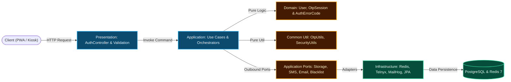

### Bảng Mã Lỗi Chuẩn (`AuthErrorCode`)
| HTTP Status | ErrorCode Enum | Ý nghĩa nghiệp vụ |
| :---: | :--- | :--- |
| `400` | `TENANT_HEADER_MISSING` | Thiếu hoặc không hợp lệ header `X-Tenant-ID`. |
| `400` | `OTP_INVALID` | Mã OTP không chính xác, kèm số lần thử còn lại. |
| `400` | `OTP_EXPIRED` | Mã OTP đã quá thời hạn 120 giây. |
| `401` | `INVALID_CREDENTIALS` | Thông tin đăng nhập không hợp lệ. |
| `401` | `TOKEN_EXPIRED` | Access Token đã hết hạn. |
| `401` | `TOKEN_REVOKED` | Token nằm trong Redis Blacklist (đã đăng xuất). |
| `401` | `REFRESH_TOKEN_EXPIRED` | Refresh Token đã quá hạn, yêu cầu xác thực lại. |
| `404` | `USER_NOT_FOUND` | Không tìm thấy tài khoản người dùng theo định danh. |
| `409` | `PHONE_ALREADY_EXISTS` | Số điện thoại đã được đăng ký trong thương hiệu. |
| `409` | `USER_ALREADY_EXISTS` | Số điện thoại hoặc Email đã được đăng ký. |
| `422` | `VALIDATION_FAILED` | Dữ liệu đầu vào sai định dạng (ví dụ: số điện thoại không chuẩn E.164). |
| `429` | `OTP_COOLDOWN_ACTIVE` | Yêu cầu gửi lại khi chưa hết 120s cooldown. |
| `429` | `OTP_MAX_ATTEMPTS_EXCEEDED`| Nhập sai quá 5 lần, phiên bị khóa 15 phút. |

---

## Use Case 1: Gửi Mã OTP Đăng Nhập (`SendOtpUseCase`)

- **API:** `POST /api/v1/auth/otp/send`
- **Mục tiêu:** Kiểm tra Cooldown 120s, sinh OTP 6 số, băm SHA-256 lưu DB audit log, gửi SMS viễn thông.

### 1. Biểu đồ Luồng Nghiệp Vụ (Flowchart)
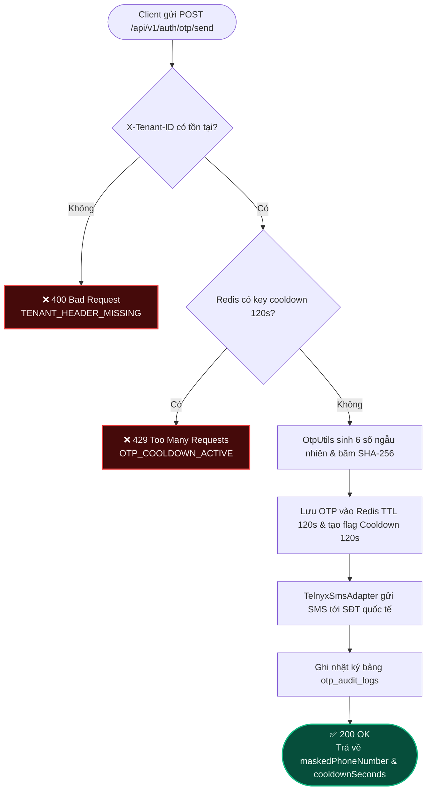

### 2. Biểu đồ Trình Tự Clean Architecture (Sequence Diagram)
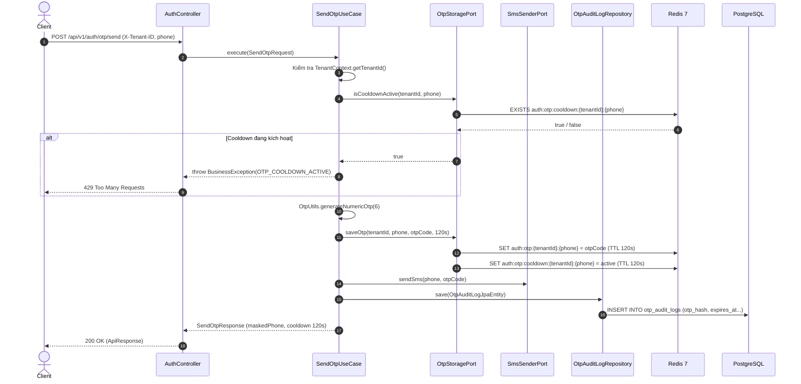

---

## Use Case 2: Xác Thực Mã OTP Đăng Nhập (`VerifyOtpUseCase`)

- **API:** `POST /api/v1/auth/otp/verify`
- **Mục tiêu:** Kiểm tra số lần nhập sai, đối soát mã OTP, cấp phát JWT nếu đã có profile, hoặc trả về `isProfileComplete = false`.

### 1. Biểu đồ Luồng Nghiệp Vụ (Flowchart)
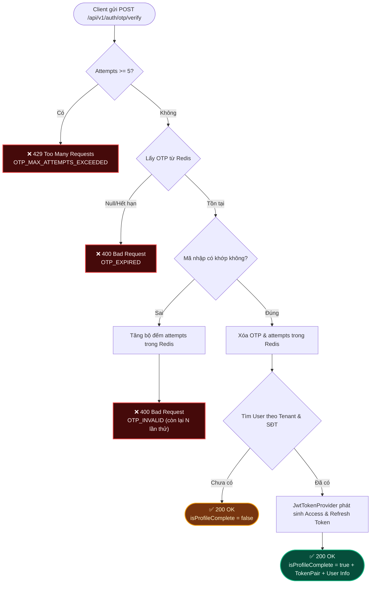

### 2. Biểu đồ Trình Tự Clean Architecture (Sequence Diagram)
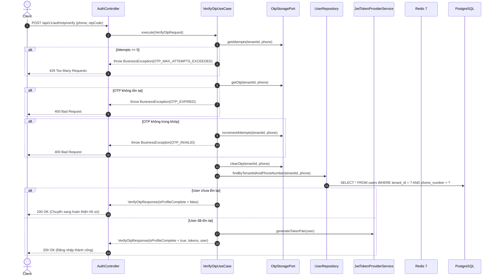

---

## Use Case 3: Đăng Ký Hội Viên & Kích Hoạt Thẻ New Member (`RegisterMemberUseCase`)

- **API:**
  - `POST /api/v1/auth/register/otp/send` (Gửi OTP qua SMS hoặc Email)
  - `POST /api/v1/auth/register/otp/verify` (Xác thực OTP & tạo User + MemberProfile)
- **Mục tiêu:** Tạo đồng thời tài khoản `users` và hồ sơ `member_profiles` với hạng New Member (0 điểm) trong 1 Transaction ACID.

### 1. Biểu đồ Luồng Nghiệp Vụ (Flowchart)
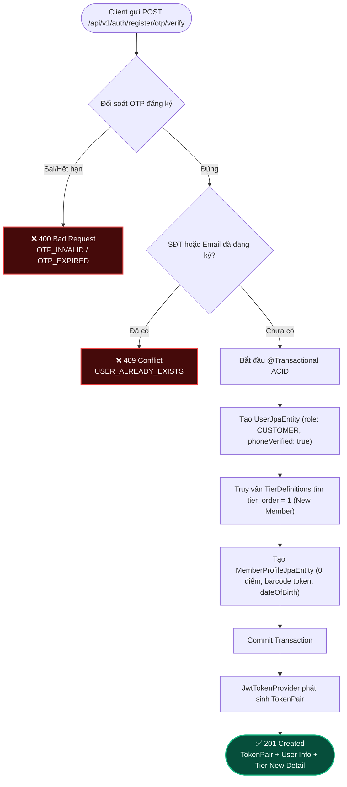

### 2. Biểu đồ Trình Tự Clean Architecture (Sequence Diagram)
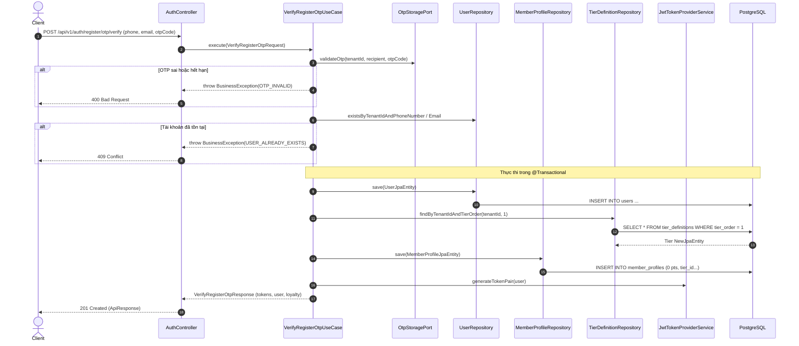

---

## Use Case 4: Cấp Lại Token - Xoay Vòng Refresh Token (`RefreshTokenUseCase`)

- **API:** `POST /api/v1/auth/refresh-token`
- **Mục tiêu:** Kiểm tra Refresh Token JWT hợp lệ, đối soát Redis Blacklist, cấp phát cặp Access Token và Refresh Token mới (Token Rotation).

### 1. Biểu đồ Luồng Nghiệp Vụ (Flowchart)
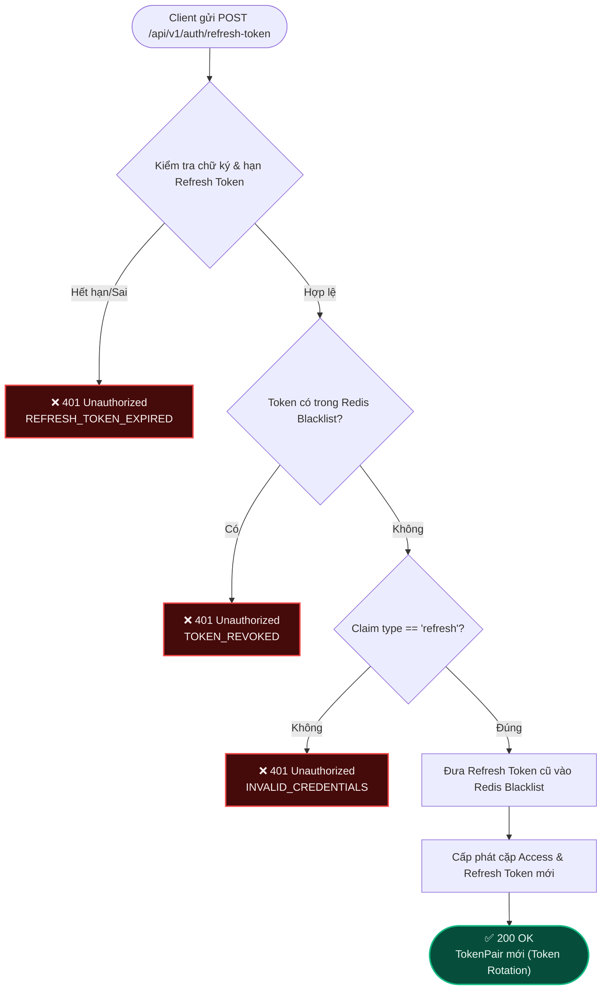

### 2. Biểu đồ Trình Tự Clean Architecture (Sequence Diagram)
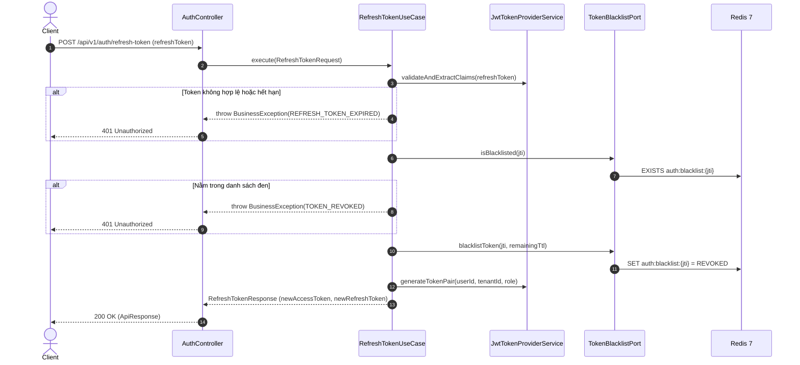

---

## Use Case 5: Đăng Xuất & Thu Hồi Token Vào Redis Blacklist (`LogoutUseCase`)

- **API:** `POST /api/v1/auth/logout`
- **Mục tiêu:** Thu hồi Access Token và Refresh Token ngay lập tức bằng cách ghi `jti` vào Redis Blacklist.

### 1. Biểu đồ Luồng Nghiệp Vụ (Flowchart)
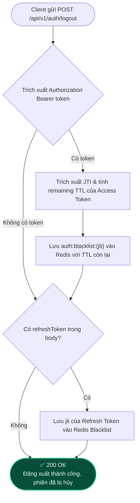

### 2. Biểu đồ Trình Tự Clean Architecture (Sequence Diagram)
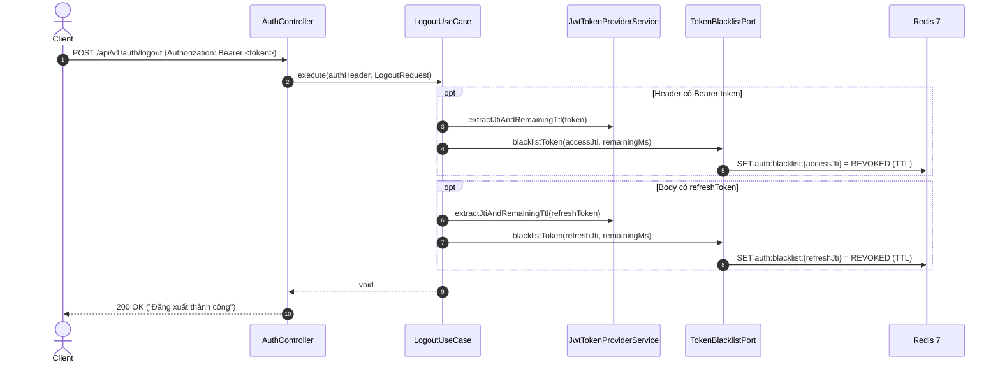

