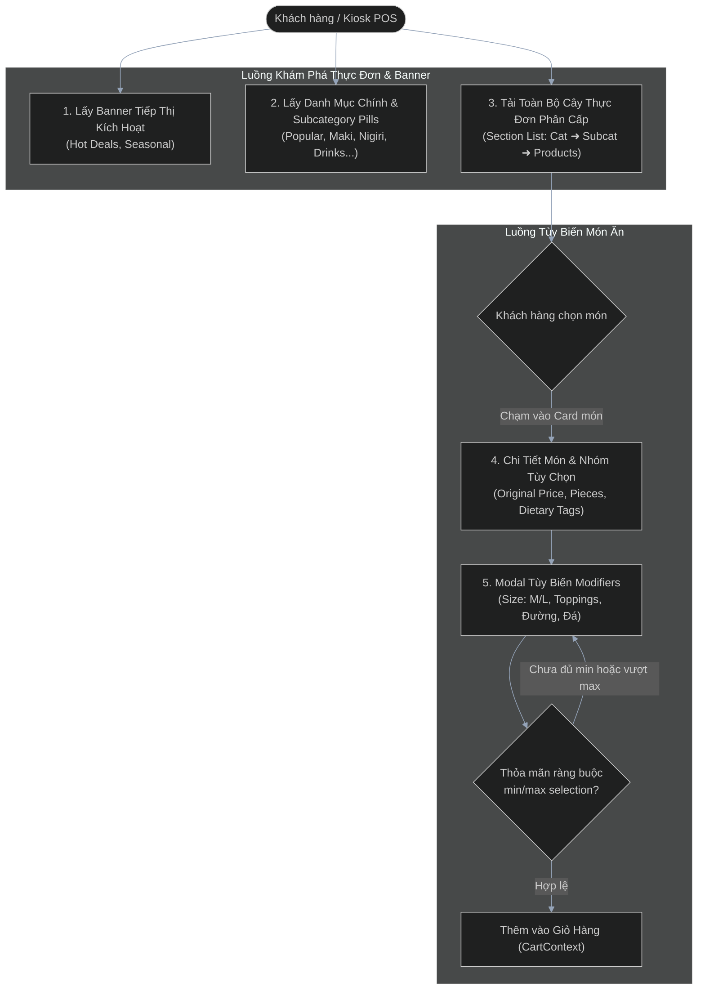
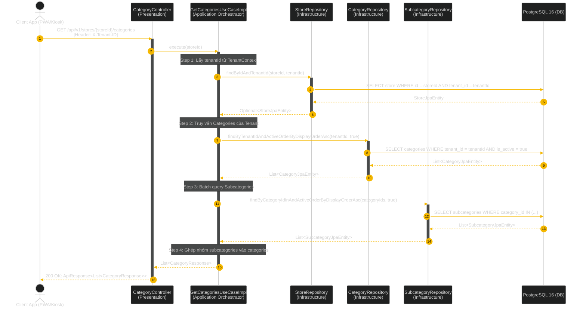
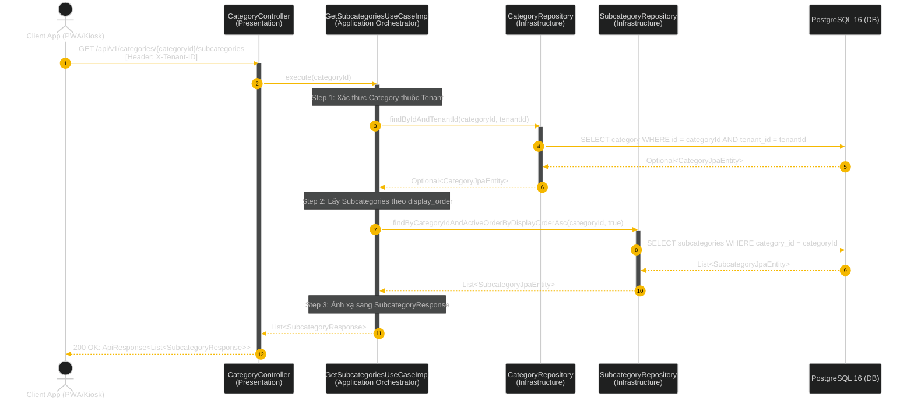
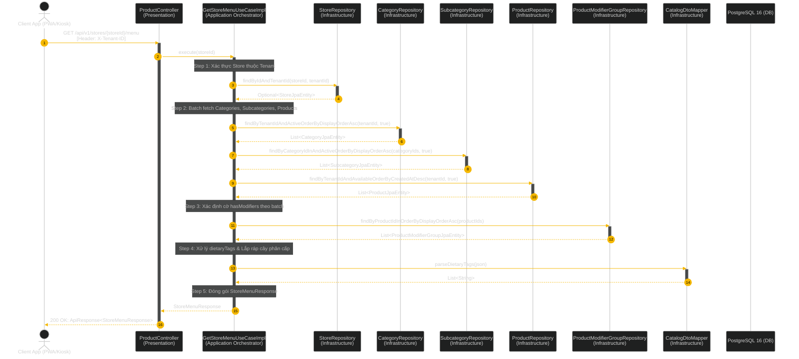
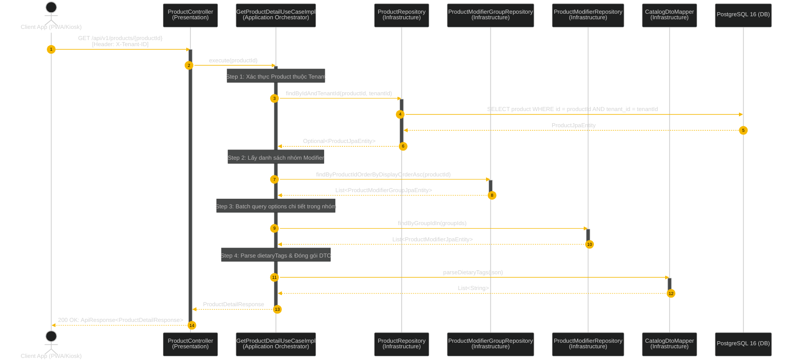
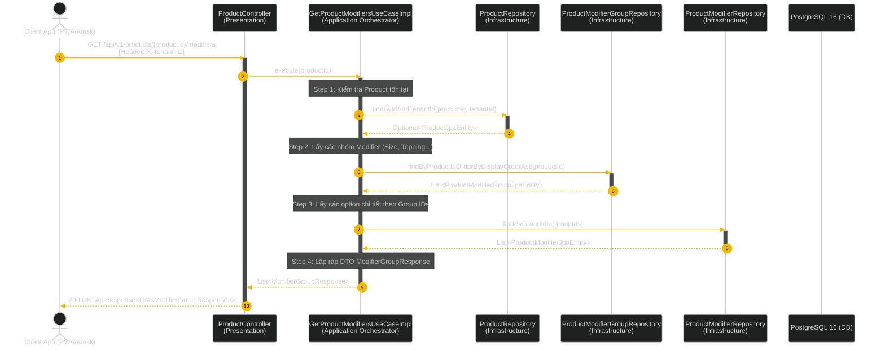
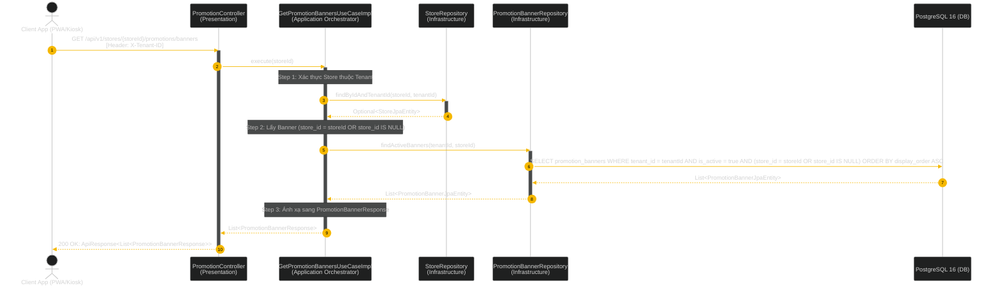

# Business Flows & Architecture Sequences: Catalog & Menu Engine

Tài liệu thiết kế luồng nghiệp vụ (Business Flowcharts) và biểu đồ tương tác 4 lớp Clean Architecture (Sequence Diagrams) cho Phân hệ Thực Đơn, Món Ăn, Nhóm Tùy Chọn Modifier & Banner Khuyến Mãi (Catalog Module).

---

## 1. Tổng quan Luồng Nghiệp vụ Catalog (End-to-End Business Flowchart)

Biểu đồ Flowchart tổng thể mô tả hành trình khám phá thực đơn, lọc danh mục, duyệt cây phân cấp, xem chi tiết món ăn kèm tùy chọn modifier và hiển thị banner chiến dịch tiếp thị.

---

## 2. Sequence Diagram Clean Architecture: 6 Use Cases

### UC-2.1: Lấy Danh Mục Chính Kèm Subcategories
**Endpoint:** `GET /api/v1/stores/{storeId}/categories`  
**Mô tả:** Trả về danh sách danh mục phân loại thực đơn chính kèm theo các nút pill nhóm con phục vụ thanh cuộn ngang.

---

### UC-2.2: Lấy Danh Mục Con Theo Danh Mục Chính
**Endpoint:** `GET /api/v1/categories/{categoryId}/subcategories`  
**Mô tả:** Trả về danh sách nhóm con (Subcategory pills) của một danh mục chỉ định.

---

### UC-2.3: Lấy Cây Thực Đơn Đầy Đủ (Get Store Menu)
**Endpoint:** `GET /api/v1/stores/{storeId}/menu`  
**Mô tả:** Trả về cây thực đơn phân cấp hoàn chỉnh (Categories ➜ Subcategories ➜ Products) dạng Section List cho màn hình Menu.

---

### UC-2.4: Lấy Chi Tiết Món Ăn (Get Product Detail)
**Endpoint:** `GET /api/v1/products/{productId}`  
**Mô tả:** Lấy thông tin chi tiết một món ăn kèm originalPrice, piecesText, dietaryTags và toàn bộ các nhóm modifier (bắt buộc / tùy chọn).

---

### UC-2.5: Lấy Nhóm Tùy Chọn Modifiers Của Món
**Endpoint:** `GET /api/v1/products/{productId}/modifiers`  
**Mô tả:** Lấy riêng danh sách các nhóm tùy chọn (Size, Topping, Mức ngọt, Lượng đá) phục vụ Modal tùy biến trên Frontend.

---

### UC-2.6: Lấy Banner Khuyến Mãi Tiếp Thị
**Endpoint:** `GET /api/v1/stores/{storeId}/promotions/banners`  
**Mô tả:** Lấy danh sách banner chiến dịch tiếp thị đang kích hoạt cho chi nhánh hoặc áp dụng toàn chuỗi.

