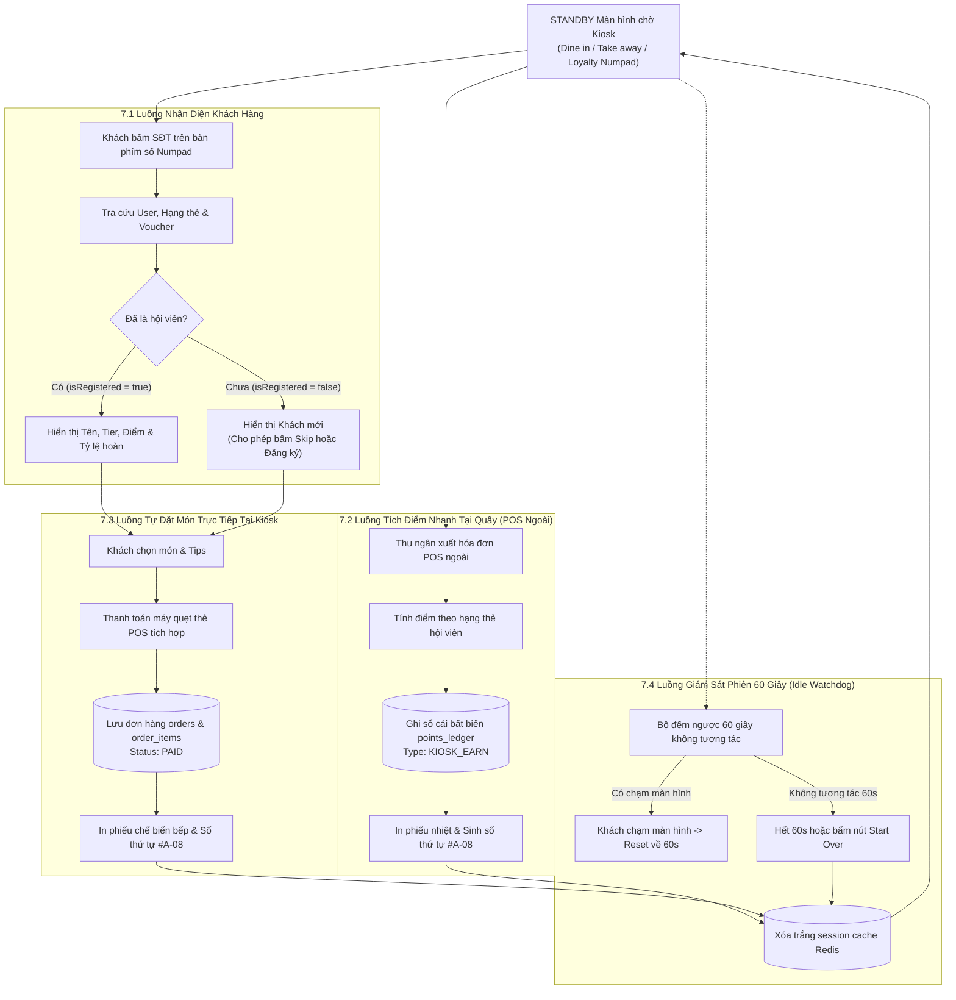
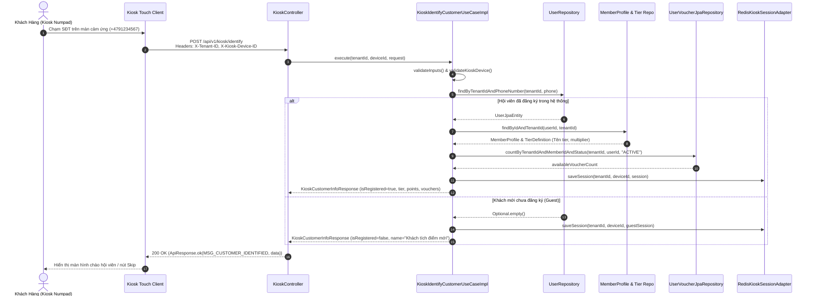
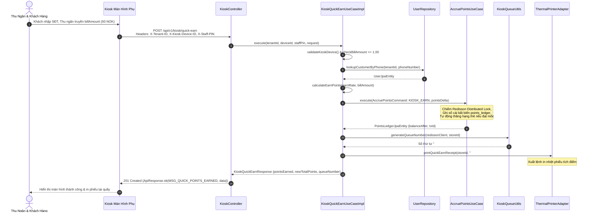
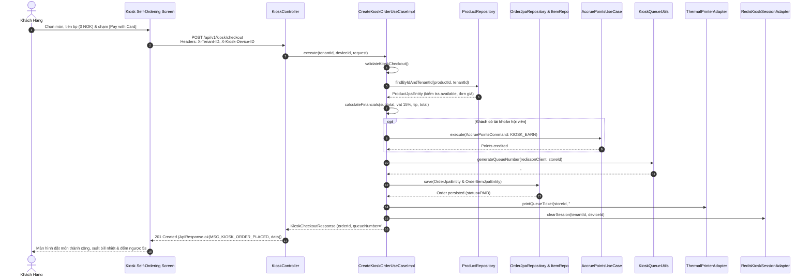
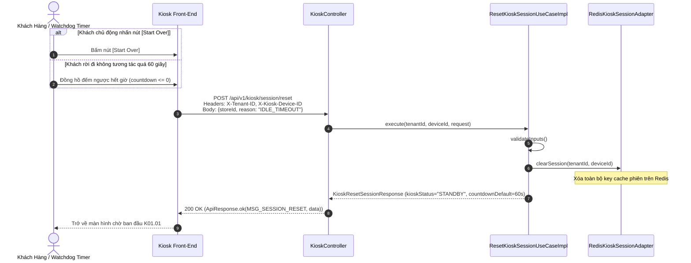
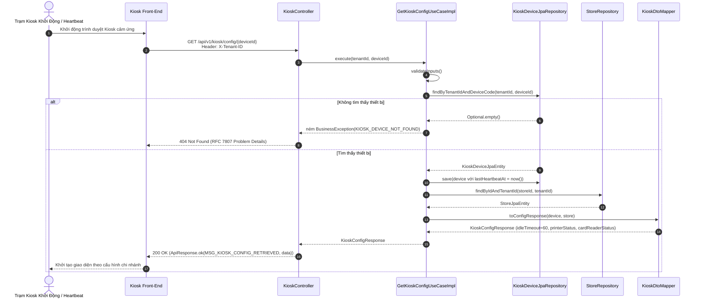

# Tài Liệu Luồng Nghiệp Vụ & Kiến Trúc Phân Hệ Kiosk POS (Business Flows & Architecture)

> **Tài liệu đặc tả các luồng nghiệp vụ và tương tác 4 lớp Clean Architecture**  
> **Ánh xạ Use Cases:** 7.1 Tra cứu SĐT, 7.2 Tích điểm nhanh, 7.3 Tự đặt món, 7.4 Reset phiên 60s, 7.5 Cấu hình thiết bị trạm  
> **Module Backend:** `com.ordera.modules.kiosk`  

---

## 1. Sơ Đồ Tổng Quan Trạng Thái & Điều Khiển Trạm Kiosk (Kiosk State Machine Flow)

---

## 2. Sequence Diagrams 4 Lớp Clean Architecture (5 Use Cases)

### 2.1. Use Case 7.1: Tra Cứu & Nhận Diện Khách Hàng Qua Số Điện Thoại (`KioskIdentifyCustomerUseCase`)

---

### 2.2. Use Case 7.2: Tích Điểm Nhanh Tại Quầy Không Cần Đặt Món (`KioskQuickEarnUseCase`)

---

### 2.3. Use Case 7.3: Khách Tự Đặt Món & Thanh Toán Trực Tiếp (`CreateKioskOrderUseCase`)

---

### 2.4. Use Case 7.4: Reset Phiên Làm Việc Kiosk Về Màn Hình Chờ (`ResetKioskSessionUseCase`)

---

### 2.5. Use Case 7.5: Cấu Hình Thiết Bị & Khởi Tạo Trạm Kiosk (`GetKioskConfigUseCase`)

---

## 3. Bảng Kiểm Tra An Ninh & Phân Lập Đa Thương Hiệu (Security & Multi-Tenant Guard)

| Tiêu chí | Cơ chế thực thi trong Kiosk Module |
|---|---|
| **Multi-Tenant Isolation** | Header bắt buộc `X-Tenant-ID`, giải quyết qua `TenantContextHolder`, mọi câu lệnh JPA đều chứa `tenant_id` |
| **Thiết bị hợp lệ** | Header bắt buộc `X-Kiosk-Device-ID`, đối soát duy nhất theo cặp `(tenant_id, device_code)` |
| **Bảo vệ mật mã thu ngân** | Header `X-Staff-PIN` bảo vệ thao tác tích điểm nhanh tại quầy |
| **Chống Race Condition** | Khóa phân tán Redisson Distributed Lock cho phiên giao dịch và tích lũy điểm thưởng |
| **Sổ cái điểm kép bất biến** | Không cho phép cập nhật điểm thủ công, toàn bộ giao dịch được ghi nối đuôi vào bảng phân vùng `points_ledger` |

