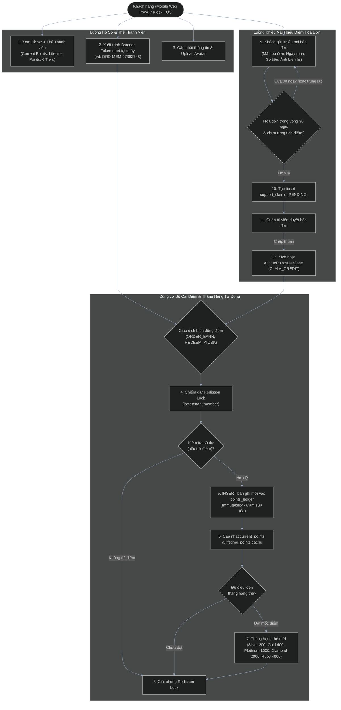
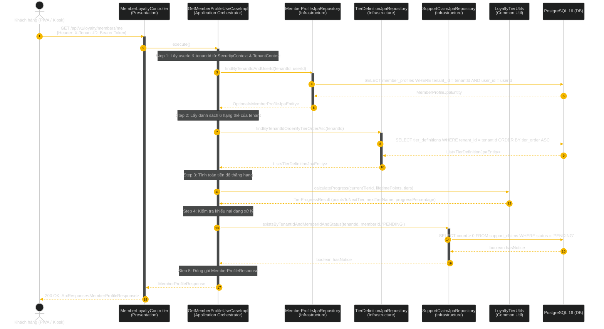
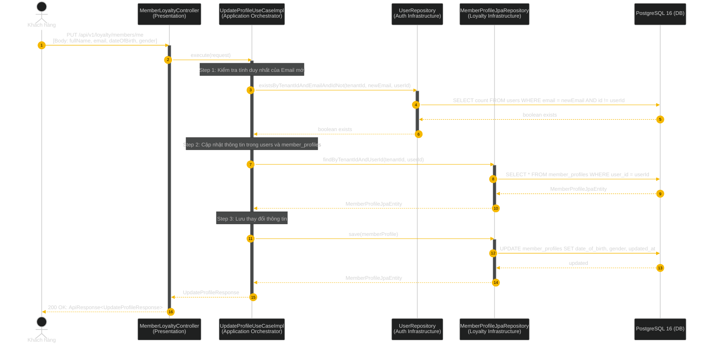
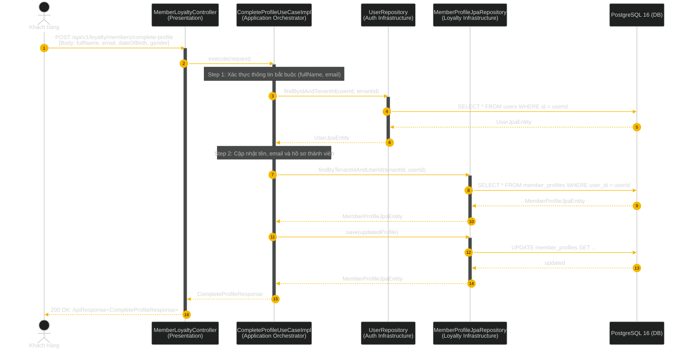
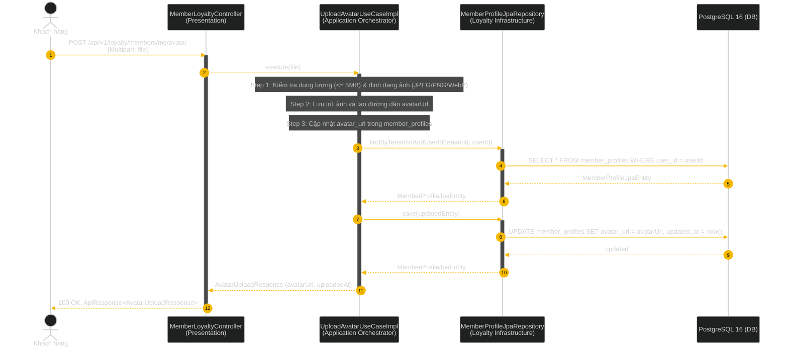
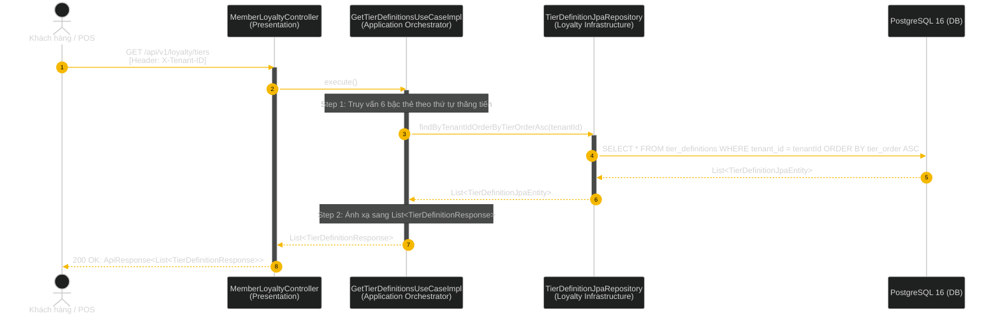
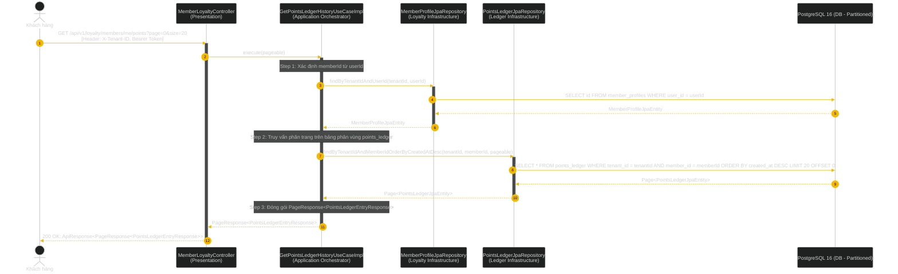
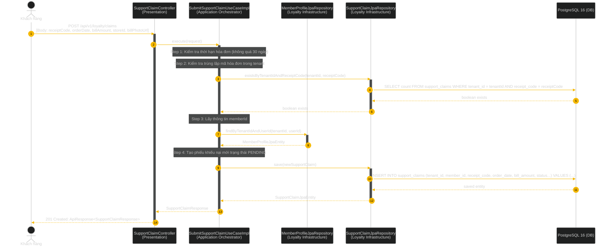
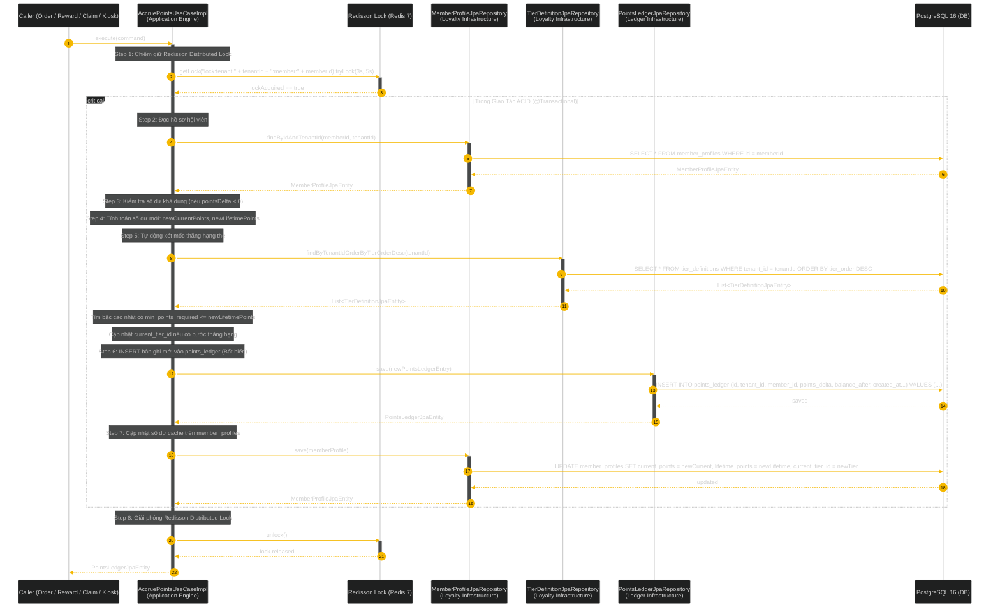

# Business Flows & Architecture Sequences: Loyalty & Immutable Points Ledger Engine

Tài liệu thiết kế luồng nghiệp vụ (Business Flowcharts) và biểu đồ tương tác 4 lớp Clean Architecture (Sequence Diagrams) cho Phân hệ Hồ sơ Khách hàng, 6 Cấp bậc Thẻ (New $\rightarrow$ Ruby), Động cơ Sổ cái Điểm Bất biến (Points Ledger) & Khiếu nại Thiếu điểm Hóa đơn.

---

## 1. Tổng quan Luồng Nghiệp vụ Loyalty & Sổ cái Điểm (End-to-End Business Flowchart)

Biểu đồ Flowchart tổng thể mô tả hành trình từ lúc khách hàng tra cứu thẻ thành viên, trình mã Barcode tích điểm tại quầy/Kiosk, động cơ khóa phân tán Redisson thực thi ghi nhận sổ cái điểm bất biến và tự động thăng hạng thẻ, đến luồng khiếu nại bù điểm hóa đơn bị sót.

---

## 2. Sequence Diagram Clean Architecture: 7 Use Cases & Core Engine

---

### UC-1: Xem Hồ sơ & Thẻ Hội viên Tổng quan
**Endpoint:** `GET /api/v1/loyalty/members/me`  
**Mô tả:** Trả về toàn bộ hồ sơ hội viên, điểm khả dụng, điểm trọn đời, thông tin hạng thẻ hiện tại, tiến độ lên hạng kế tiếp và các bộ đếm hành động nhanh.

---

### UC-2: Cập nhật Thông tin Cá nhân
**Endpoint:** `PUT /api/v1/loyalty/members/me`  
**Mô tả:** Chỉnh sửa họ tên, email, ngày sinh, giới tính của hội viên.

---

### UC-3: Hoàn thiện Hồ sơ Sau Xác thực OTP
**Endpoint:** `POST /api/v1/loyalty/members/complete-profile`  
**Mô tả:** Kích hoạt tài khoản và bổ sung họ tên, email sau khi đăng nhập SĐT lần đầu.

---

### UC-4: Tải Lên Ảnh Đại Diện Hội Viên
**Endpoint:** `POST /api/v1/loyalty/members/me/avatar`  
**Mô tả:** Khách hàng upload ảnh đại diện (giới hạn $\le 5\text{MB}$, định dạng JPEG, PNG, WebP).

---

### UC-5: Danh sách 6 Cấp Bậc Thẻ & Đặc Quyền
**Endpoint:** `GET /api/v1/loyalty/tiers`  
**Mô tả:** Lấy danh sách toàn bộ 6 cấp bậc thành viên (New $\rightarrow$ Silver $\rightarrow$ Gold $\rightarrow$ Platinum $\rightarrow$ Diamond $\rightarrow$ Ruby) kèm quyền lợi và mốc điểm.

---

### UC-6: Lịch Sử Sổ Cái Biến Động Điểm Phân Trang
**Endpoint:** `GET /api/v1/loyalty/members/me/points`  
**Mô tả:** Truy vấn phân trang lịch sử cộng/trừ điểm từ bảng phân vùng `points_ledger` theo thời gian giảm dần.

---

### UC-7: Gửi Khiếu Nại Thiếu Điểm Hóa Đơn
**Endpoint:** `POST /api/v1/loyalty/claims`  
**Mô tả:** Khách hàng gửi yêu cầu cộng bù điểm cho hóa đơn tại quầy trong vòng 30 ngày kèm mã hóa đơn và ảnh chụp biên lai.

---

### Core Engine: Động Cơ Tích Điểm, Khóa Phân Tán Redisson & Thăng Hạng Thẻ (AccruePointsUseCase)
**Mô tả:** Động cơ lõi nội bộ phục vụ cộng/trừ điểm từ mọi nguồn (`ORDER_EARN`, `VOUCHER_REDEEM`, `GIFT_REDEEM`, `CLAIM_CREDIT`, `KIOSK_EARN`).

