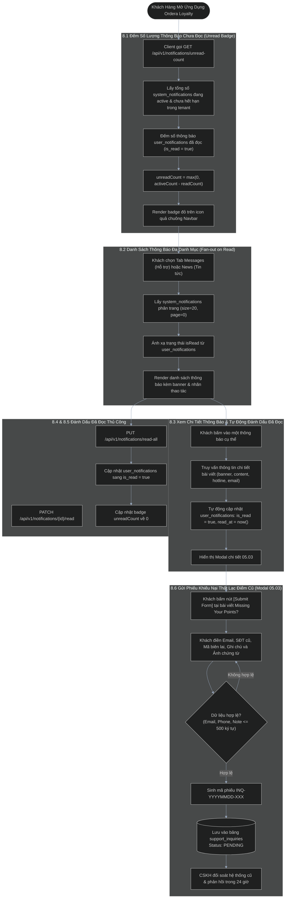
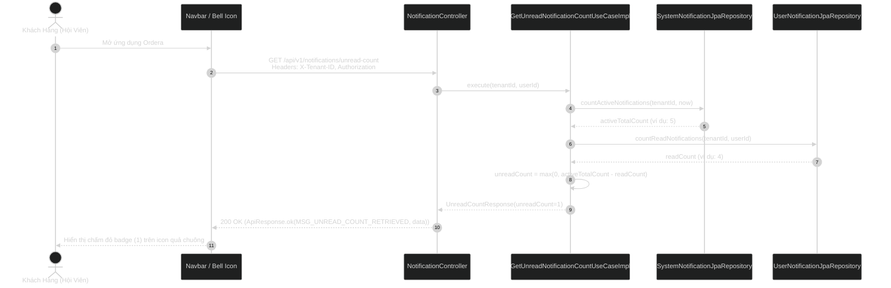
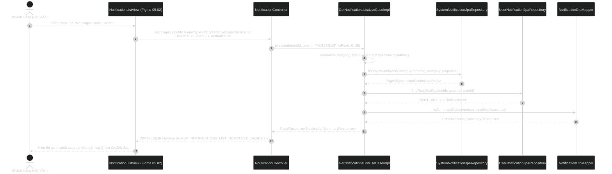
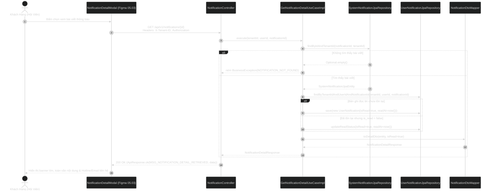
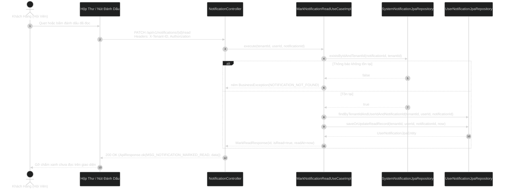
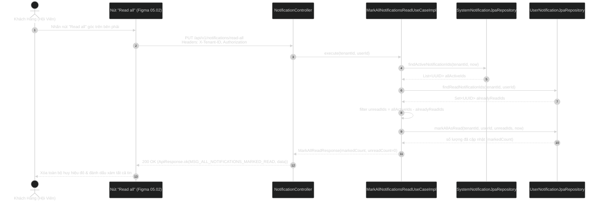
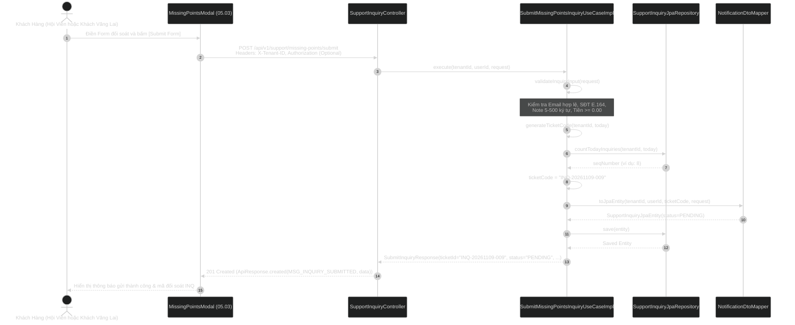

# Tài Liệu Luồng Nghiệp Vụ & Kiến Trúc Phân Hệ Hộp Thư Thông Báo & Hỗ Trợ Khách Hàng (Business Flows & Architecture)

> **Tài liệu đặc tả luồng nghiệp vụ và tương tác 4 lớp Clean Architecture**  
> **Ánh xạ Use Cases:** 8.1 Đếm chưa đọc, 8.2 Danh sách đa danh mục, 8.3 Chi tiết thông báo, 8.4 Đánh dấu 1 tin đã đọc, 8.5 Đánh dấu tất cả đã đọc, 8.6 Gửi phiếu hỗ trợ thiếu điểm  
> **Module Backend:** `com.ordera.modules.notification`  

---

## 1. Sơ Đồ Tổng Quan Luồng Nghiệp Vụ Hộp Thư & Hỗ Trợ (Notification & Support Flowchart)

---

## 2. Sequence Diagrams 4 Lớp Clean Architecture (6 Use Cases)

### 2.1. Use Case 8.1: Lấy Số Lượng Thông Báo Chưa Đọc (`GetUnreadNotificationCountUseCase`)

---

### 2.2. Use Case 8.2: Danh Sách Thông Báo Đa Danh Mục Phân Trang (`GetNotificationsListUseCase`)

---

### 2.3. Use Case 8.3: Chi Tiết Thông Báo & Tự Động Đánh Dấu Đã Đọc (`GetNotificationDetailUseCase`)

---

### 2.4. Use Case 8.4: Đánh Dấu Một Thông Báo Đã Đọc (`MarkNotificationReadUseCase`)

---

### 2.5. Use Case 8.5: Đánh Dấu Tất Cả Thông Báo Đã Đọc (`MarkAllNotificationsReadUseCase`)

---

### 2.6. Use Case 8.6: Tiếp Nhận Phiếu Khiếu Nại Thiếu Điểm Cũ (`SubmitMissingPointsInquiryUseCase`)

