# Business Flows & Architecture Sequences: Order, Checkout & E-Receipt Module

Tài liệu thiết kế luồng nghiệp vụ tổng thể (Business Flowcharts) và biểu đồ tương tác 4 lớp Clean Architecture (Sequence Diagrams) cho Phân Hệ Giỏ Hàng, Đặt Món, Tính Thuế VAT 15%, Tips, Checkout & Hóa Đơn E-Receipt (Order Module).

---

## 1. Tổng quan Luồng Nghiệp vụ Order & Checkout (End-to-End Business Flowchart)

Biểu đồ Flowchart tổng thể mô tả hành trình từ lúc khách hàng duyệt giỏ hàng, tùy chỉnh số lượng / ghi chú dị ứng, dự toán bảng tính chi phí (VAT 15%, voucher, tip), chốt đơn thanh toán an toàn qua Redisson Distributed Lock và Idempotency, theo dõi đơn tại bếp, đến xuất hóa đơn điện tử E-Receipt PDF.

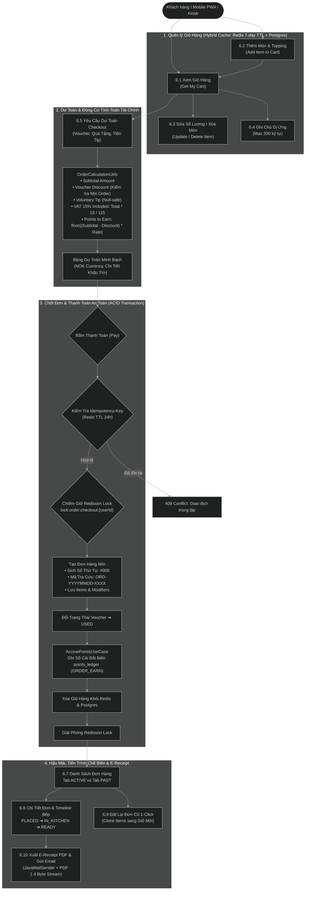

---

## 2. Sequence Diagram Clean Architecture: 10 Use Cases

### UC-6.1: Lấy Giỏ Hàng Hiện Tại (Get My Cart)
**Endpoint:** `GET /api/v1/cart`  
**Mô tả:** Lấy danh sách món ăn, số lượng, tùy chọn modifier, ghi chú dị ứng và tổng tiền tạm tính từ Redis Cache (với database fallback).

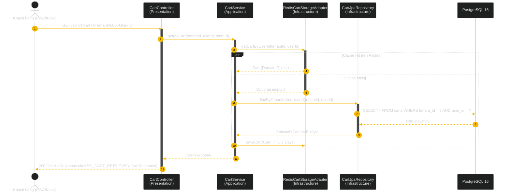

---

### UC-6.2: Thêm Món Vào Giỏ Hàng Kèm Modifier (Add Item to Cart)
**Endpoint:** `POST /api/v1/cart/items`  
**Mô tả:** Thêm món ăn và tùy chọn modifier vào giỏ. Nếu cùng bộ tùy chọn thì cộng dồn số lượng.

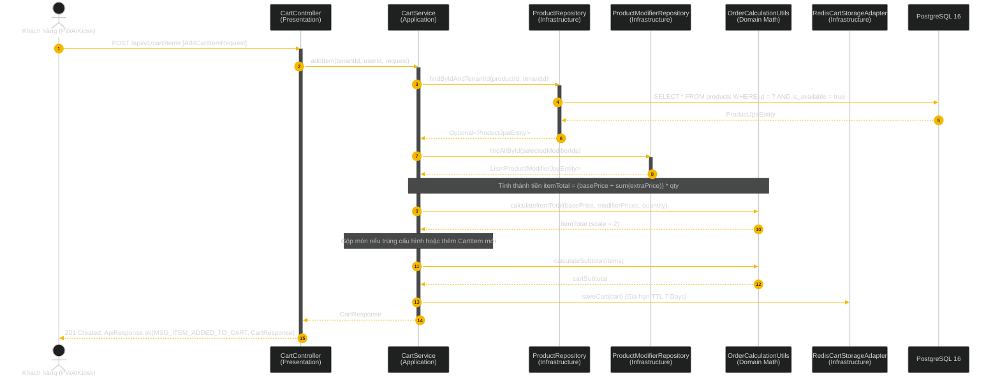

---

### UC-6.3: Cập Nhật Số Lượng / Xóa Món Khỏi Giỏ (Update / Delete Cart Item)
**Endpoint:** `PATCH /api/v1/cart/items/{itemId}` hoặc `DELETE /api/v1/cart/items/{itemId}`  
**Mô tả:** Tăng/giảm số lượng hoặc xóa bỏ dòng món ăn khỏi giỏ hàng.

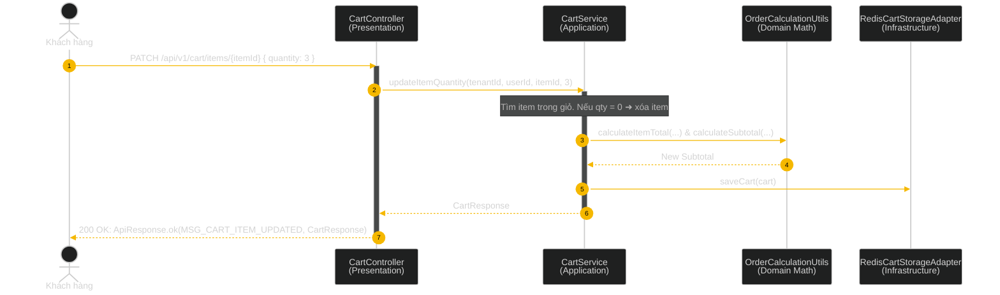

---

### UC-6.4: Cập Nhật Ghi Chú Đơn Hàng / Dị Ứng (Update Cart Comment)
**Endpoint:** `PUT /api/v1/cart/comment`  
**Mô tả:** Cập nhật yêu cầu đặc biệt hoặc thông tin dị ứng với độ dài tối đa 200 ký tự.

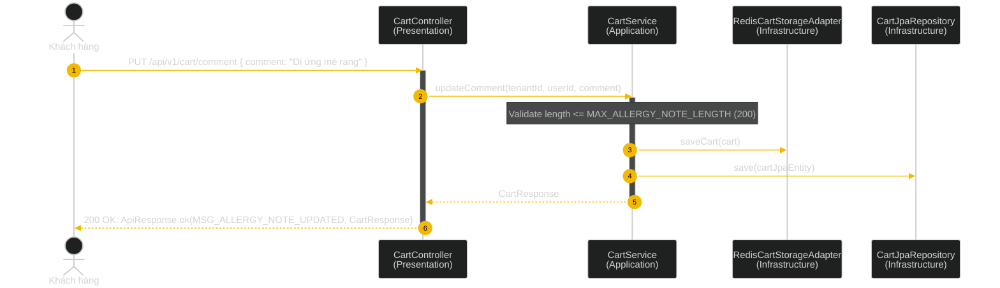

---

### UC-6.5: Dự Toán Bảng Tính Checkout (Preview Checkout Calculation)
**Endpoint:** `POST /api/v1/orders/checkout/preview`  
**Mô tả:** Dự toán Subtotal, Discount, Tip, VAT 15% (đã bao gồm trong giá), Total và Điểm tích lũy dự kiến (+170 pts).

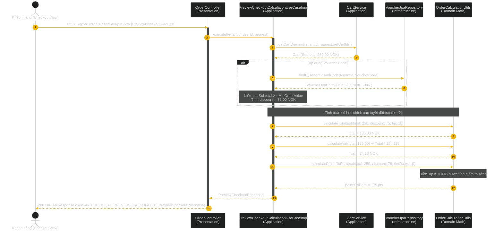

---

### UC-6.6: Khởi Tạo Đơn Hàng & Thanh Toán (Checkout Order Orchestrator)
**Endpoint:** `POST /api/v1/orders/checkout`  
**Mô tả:** Chốt đơn thanh toán an toàn qua Redisson Lock, kiểm tra Idempotency 24h, tạo đơn hàng (#005, ORD-20261105-0891), khóa Voucher sang USED, tự động ghi sổ cái points_ledger (ORDER_EARN), và dọn dẹp giỏ hàng.

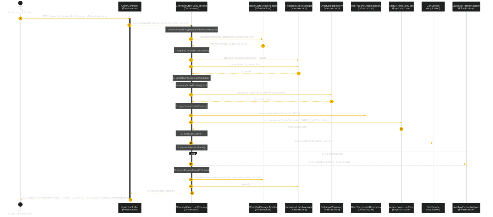

---

### UC-6.7: Danh Sách Đơn Hàng Của Tôi (List My Orders)
**Endpoint:** `GET /api/v1/orders`  
**Mô tả:** Lấy danh sách lịch sử đơn hàng phân chia theo 2 tab `ACTIVE` (đang xử lý) hoặc `PAST` (đã hoàn tất/hủy) có phân trang.

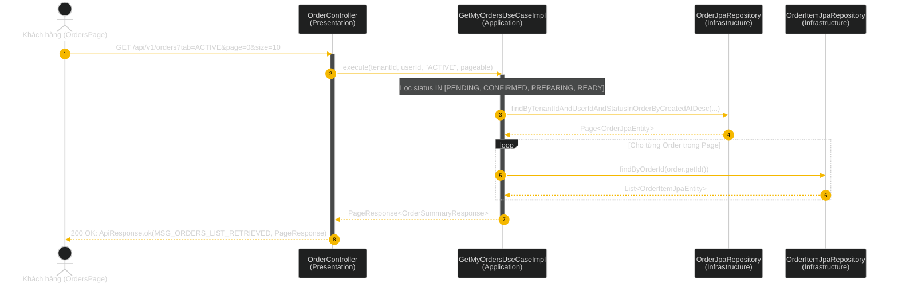

---

### UC-6.8: Chi Tiết Đơn Hàng & Tiến Trình Bếp (Get Order Details)
**Endpoint:** `GET /api/v1/orders/{orderId}`  
**Mô tả:** Trả về thông tin chi tiết đơn hàng, số thứ tự nhận món (#005), 3 bước tiến trình bếp (PLACED, IN_KITCHEN, READY_FOR_PICKUP) và tóm tắt tài chính.

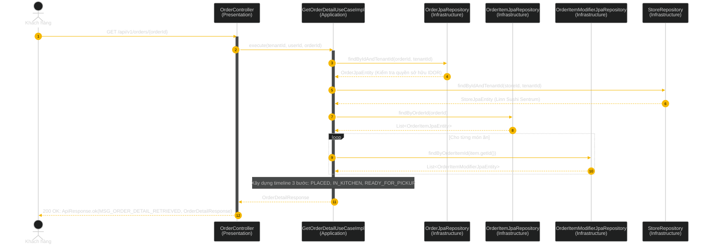

---

### UC-6.9: Đặt Lại Đơn Hàng Nhanh 1-Click (Reorder Past Order)
**Endpoint:** `POST /api/v1/orders/{orderId}/reorder`  
**Mô tả:** Sao chép các món ăn từ đơn hàng cũ vào giỏ hàng mới của khách hàng.

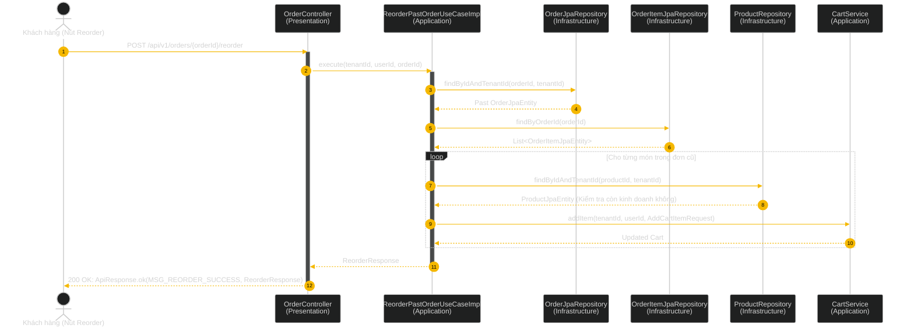

---

### UC-6.10: Gửi Biên Nhận Điện Tử E-Receipt qua Email (Send E-Receipt PDF)
**Endpoint:** `POST /api/v1/orders/{orderId}/receipt/send-email`  
**Mô tả:** Sinh file hóa đơn điện tử PDF chuẩn (PDF 1.4 byte stream) và gửi đính kèm tới địa chỉ Email của khách qua JavaMailSender.

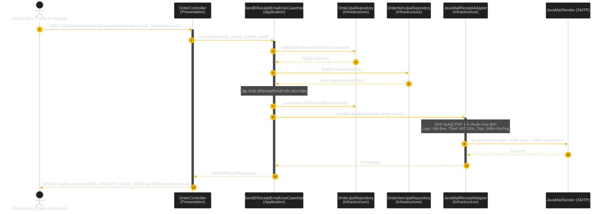

