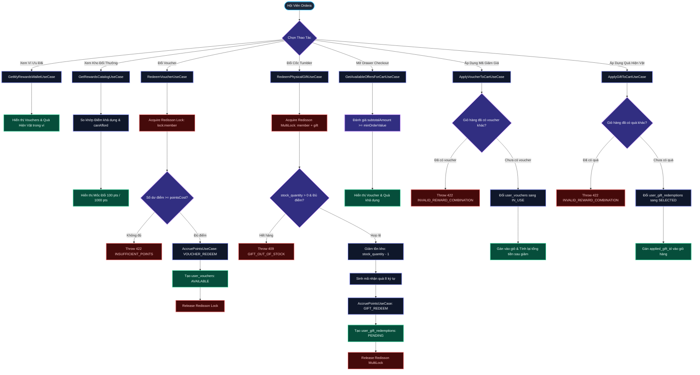
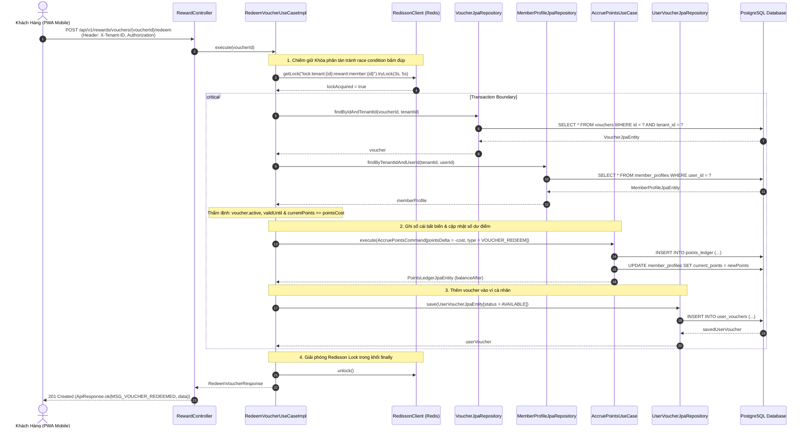
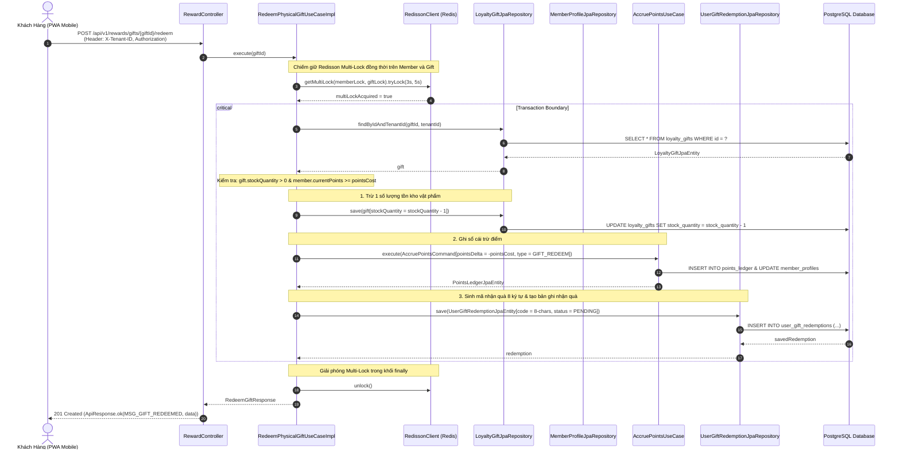
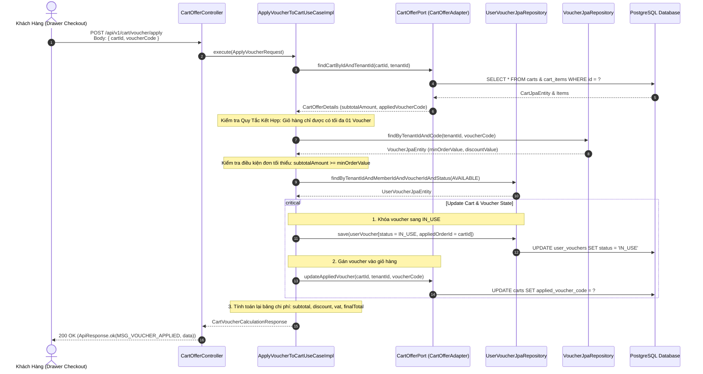
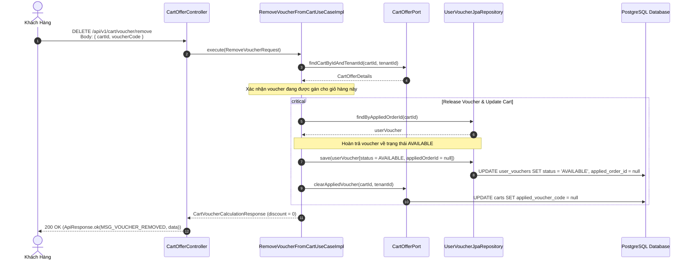
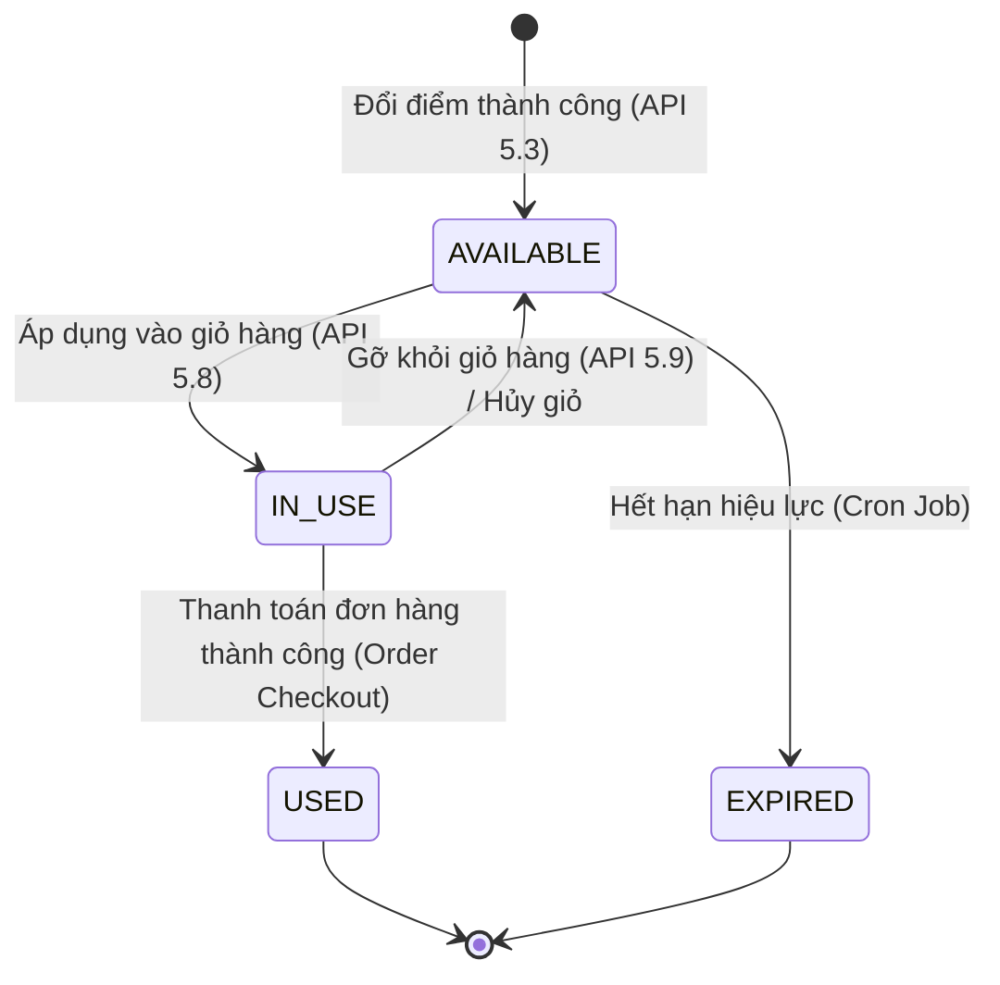
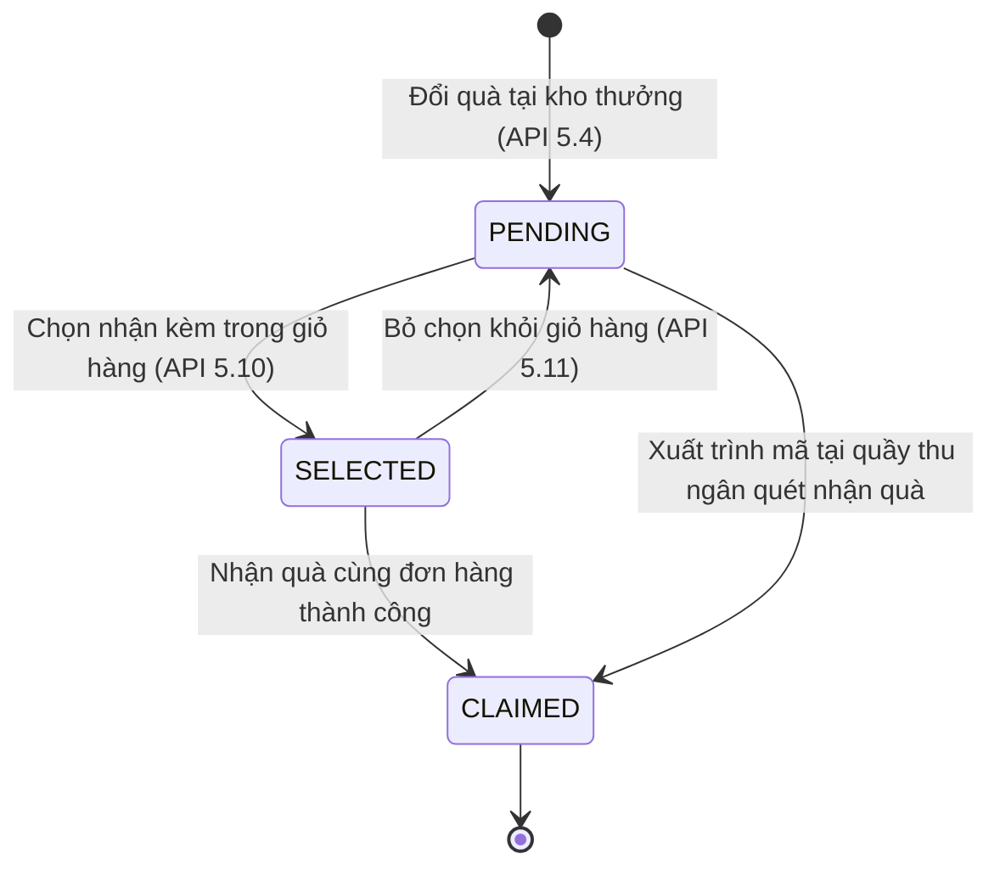

# Phân Hệ Ví Voucher, Đổi Thưởng & Ưu Đãi Giỏ Hàng — Sơ Đồ Nghiệp Vụ & Kiến Trúc (Business Flows & Architecture)

> **Tài liệu đặc tả luồng xử lý và kiến trúc Clean Architecture 4 lớp cho Phân hệ Reward & Voucher**  
> **Ánh xạ Prototype:** Figma Nhóm 07 (`07.01` - `07.08`), Figma Nhóm 08 (`08.01` - `08.12`)  
> **Chuẩn hiển thị:** Dark Mode & Clean Architecture Tracing

---

## 1. Toàn Cảnh Nghiệp Vụ Phân Hệ (Business Workflow Flowchart)

---

## 2. Sequence Diagram 1: Đổi Điểm Lấy Mã Voucher (API 5.3)

Biểu đồ tuần tự Clean Architecture mô tả luồng đổi voucher với cơ chế khóa phân tán Redisson và ghi sổ cái điểm kép bất biến.

---

## 3. Sequence Diagram 2: Đổi Quà Hiện Vật Cốc Tumbler (API 5.4)

Biểu đồ mô tả quy trình Redisson Multi-Lock đồng thời kiểm tra tồn kho vật lý và số dư điểm để phòng chống bán vượt tồn kho.

---

## 4. Sequence Diagram 3: Áp Dụng Mã Voucher Vào Giỏ Hàng (API 5.8)

Mô tả sự phối hợp giữa UseCase, Port & Adapter Giỏ Hàng, và bảo toàn quy tắc kết hợp (Combination Rules).

---

## 5. Sequence Diagram 4: Gỡ Bỏ Voucher Khỏi Giỏ Hàng (API 5.9)

---

## 6. Tổng Kết Quy Tắc Kết Hợp & Trạng Thái (State Machines)

### Vòng đời trạng thái Voucher (`user_vouchers.status`)

### Vòng đời trạng thái Quà Hiện Vật (`user_gift_redemptions.status`)

