# Sổ Tay Luồng Nghiệp Vụ & Biểu Đồ Trình Tự: Phân Hệ Tenant & Store
## Business & Sequence Flows Guide (Clean Architecture & Mermaid Visualizations)

> **Dành cho:** Thành viên mới (Developer, Solution Architect, Business Analyst, QA)  
> **Mục đích:** Giúp người mới nắm bắt toàn bộ luồng nghiệp vụ thực tế, quy tắc đa thương hiệu (Multi-Tenant Isolation) và thứ tự tương tác giữa các tầng Clean Architecture qua biểu đồ trực quan trong vòng 5–10 phút mà không cần phải đọc từng dòng mã nguồn.

---

## 📑 Mục Lục
1. [Tổng Quan Kiến Trúc & Bảng Mã Lỗi (Quick Reference)](#1-tổng-quan-kiến-trúc--bảng-mã-lỗi)
2. [Use Case 1: Lấy Cấu hình Thương hiệu Hiện tại (`GetTenantInfoUseCase`)](#use-case-1-lấy-cấu-hình-thương-hiệu-hiện-tại-gettenantinfousecase)
3. [Use Case 2: Tìm kiếm & Sắp xếp Chi nhánh theo GPS (`GetStoresListUseCase`)](#use-case-2-tìm-kiếm--sắp-xếp-chi-nhánh-theo-gps-getstoreslistusecase)
4. [Use Case 3: Xem Chi tiết một Chi nhánh Cửa hàng (`GetStoreDetailUseCase`)](#use-case-3-xem-chi-tiết-một-chi-nhánh-cửa-hàng-getstoredetailusecase)
5. [Use Case 4: Lấy Danh sách Bàn ăn tại Chi nhánh (`GetStoreTablesUseCase`)](#use-case-4-lấy-danh-sách-bàn-ăn-tại-chi-nhánh-getstoretablesusecase)
6. [Use Case 5: Quét & Phân giải Mã QR Bàn ăn 3 Tầng (`ResolveTableQrUseCase`)](#use-case-5-quét--phân-giải-mã-qr-bàn-ăn-3-tầng-resolvetableqrusecase)
7. [Use Case 6: Tùy chọn Nhận hàng & Tự động sinh Khung giờ (`GetFulfillmentOptionsUseCase`)](#use-case-6-tùy-chọn-nhận-hàng--tự-động-sinh-khung-giờ-getfulfillmentoptionsusecase)
8. [Use Case 7: Lưu & Bỏ Chi nhánh Yêu thích (`ToggleFavoriteStoreUseCase`)](#use-case-7-lưu--bỏ-chi-nhánh-yêu-thích-togglefavoritestoreusecase)
9. [Use Case 8: Danh sách Chi nhánh Yêu thích của Hội viên (`GetFavoriteStoresUseCase`)](#use-case-8-danh-sách-chi-nhánh-yêu-thích-của-hội-viên-getfavoritestoresusecase)

---

## 1. Tổng Quan Kiến Trúc & Bảng Mã Lỗi

### Mô hình Luồng 4 Lớp Clean Architecture
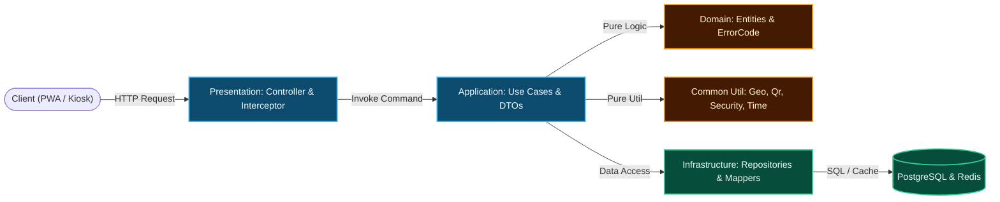

### Bảng Mã Lỗi Chuẩn (TenantErrorCode)
| HTTP Status | ErrorCode Enum | Ý nghĩa nghiệp vụ |
| :---: | :--- | :--- |
| `400` | `TENANT_HEADER_MISSING` | Thiếu hoặc rỗng header định danh thương hiệu `X-Tenant-ID`. |
| `400` | `INVALID_QUERY_PARAM` | Tham số query sai định dạng (ví dụ: `fulfillmentType` không thuộc ALL, DINE_IN, TAKEAWAY, DELIVERY). |
| `400` | `INVALID_QR_TOKEN` | Mã token QR bàn ăn bị rỗng hoặc không phân giải được ra bàn nào trong chi nhánh. |
| `401` | `UNAUTHORIZED` | Yêu cầu đăng nhập hội viên (thiếu `X-User-ID` hoặc Spring Security `Principal`). |
| `404` | `TENANT_NOT_FOUND` | ID thương hiệu trong header không tồn tại trong cơ sở dữ liệu. |
| `404` | `STORE_NOT_FOUND` | Cửa hàng không tồn tại hoặc không thuộc quyền sở hữu của thương hiệu hiện tại. |
| `404` | `TABLE_NOT_FOUND` | Bàn ăn chỉ định không tồn tại. |

---

## Use Case 1: Lấy Cấu hình Thương hiệu Hiện tại (GetTenantInfoUseCase)

- **API:** `GET /api/v1/tenants/current`
- **Use Case:** `GetTenantInfoUseCase`

### 1. Biểu đồ Luồng Nghiệp Vụ (Flowchart)
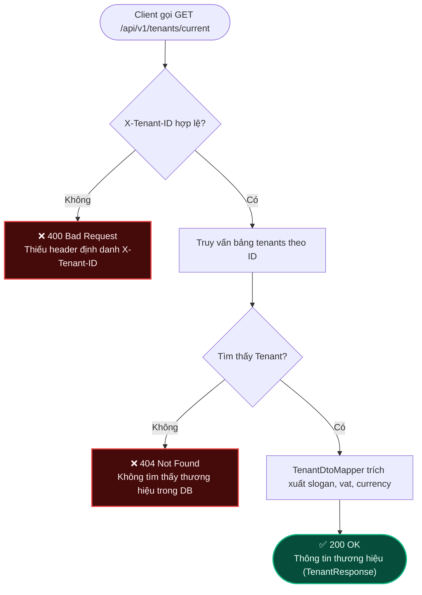

### 2. Biểu đồ Trình Tự Tương Tác (Sequence Diagram)
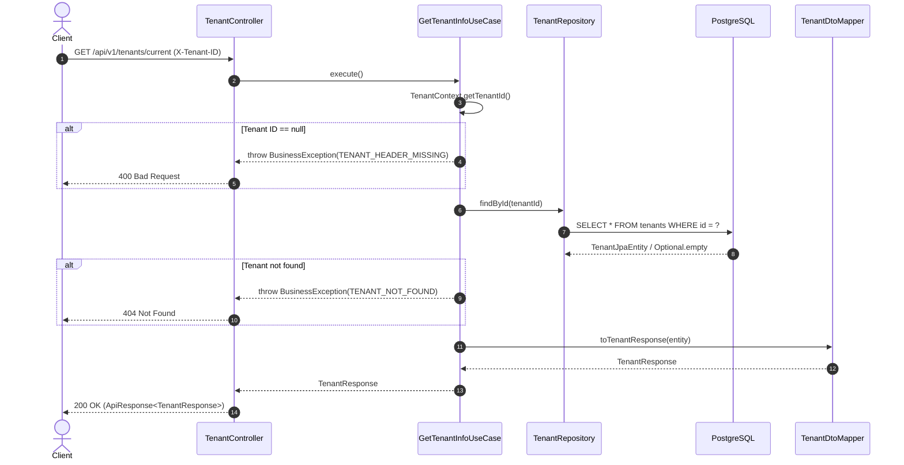

---

## Use Case 2: Tìm kiếm & Sắp xếp Chi nhánh theo GPS (GetStoresListUseCase)

- **API:** `GET /api/v1/stores?keyword=...&fulfillmentType=...&latitude=...&longitude=...`
- **Use Case:** `GetStoresListUseCase`
- **Util:** `GeoUtils.calculateDistanceKm`

### 1. Biểu đồ Luồng Nghiệp Vụ (Flowchart)
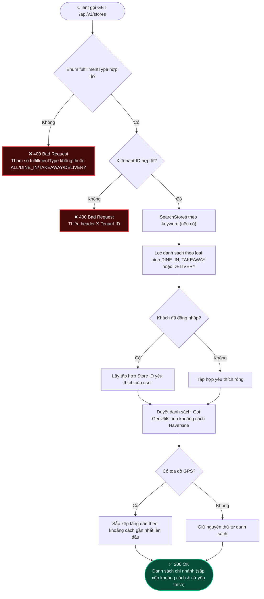

### 2. Biểu đồ Trình Tự Tương Tác (Sequence Diagram)
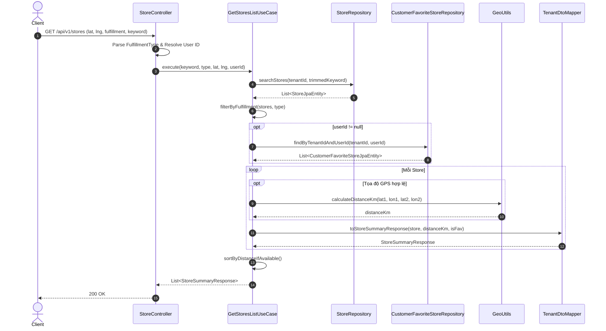

---

## Use Case 3: Xem Chi tiết một Chi nhánh Cửa hàng (GetStoreDetailUseCase)

- **API:** `GET /api/v1/stores/{storeId}`
- **Use Case:** `GetStoreDetailUseCase`

### 1. Biểu đồ Luồng Nghiệp Vụ (Flowchart)
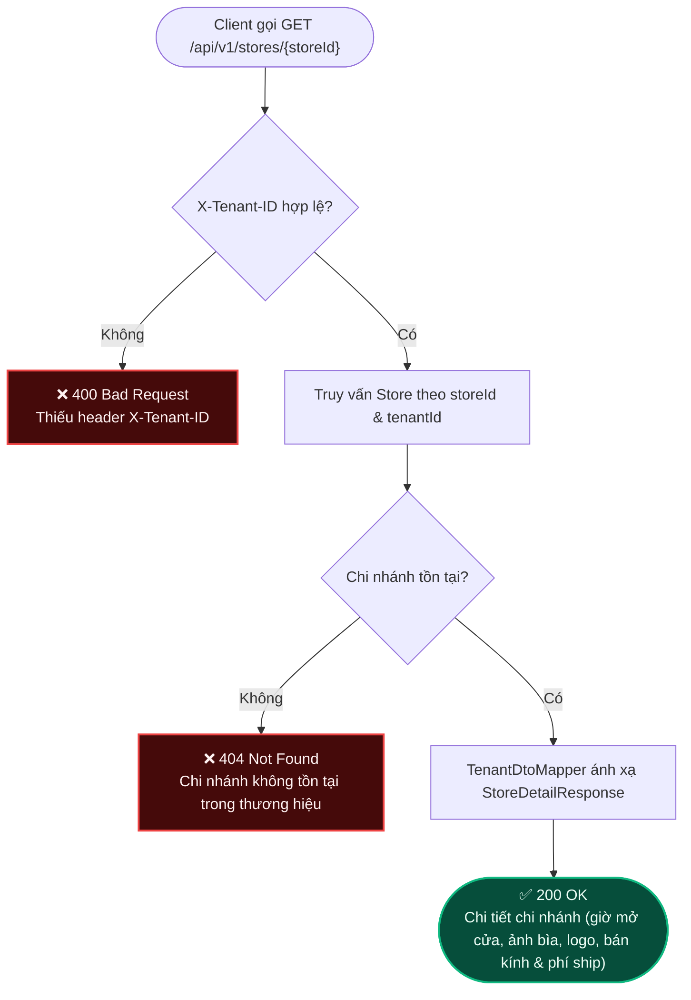

### 2. Biểu đồ Trình Tự Tương Tác (Sequence Diagram)
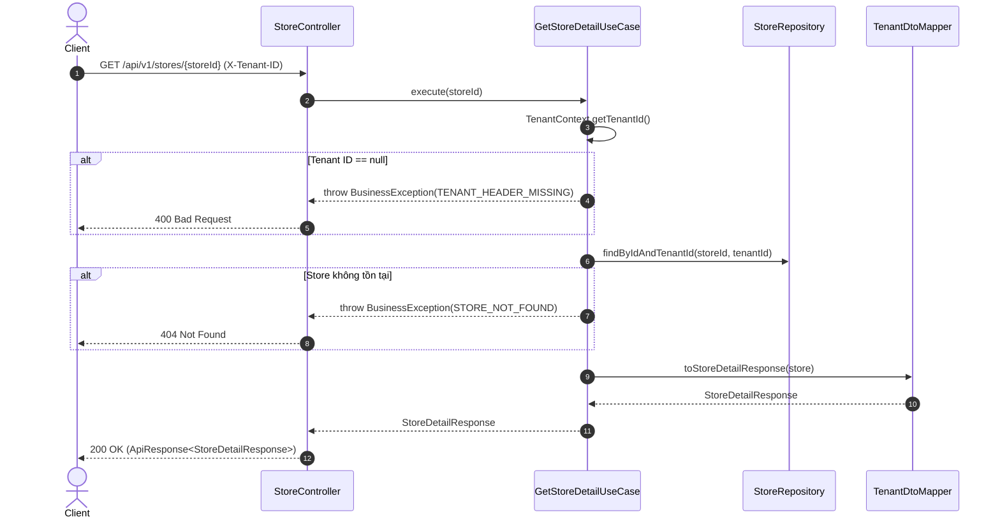

---

## Use Case 4: Lấy Danh sách Bàn ăn tại Chi nhánh (GetStoreTablesUseCase)

- **API:** `GET /api/v1/stores/{storeId}/tables`
- **Use Case:** `GetStoreTablesUseCase`

### 1. Biểu đồ Luồng Nghiệp Vụ (Flowchart)
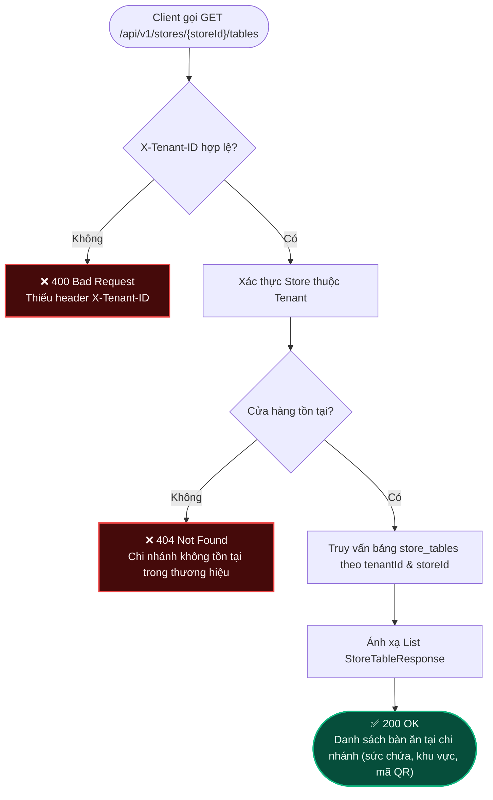

### 2. Biểu đồ Trình Tự Tương Tác (Sequence Diagram)
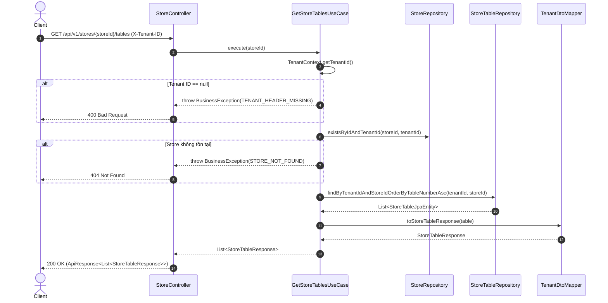

---

## Use Case 5: Quét & Phân giải Mã QR Bàn ăn 3 Tầng (ResolveTableQrUseCase)

- **API:** `GET /api/v1/stores/tables/qr/{qrToken}`
- **Use Case:** `ResolveTableQrUseCase`
- **Util:** `QrCodeUtils`

### 1. Biểu đồ Luồng Nghiệp Vụ (Flowchart)
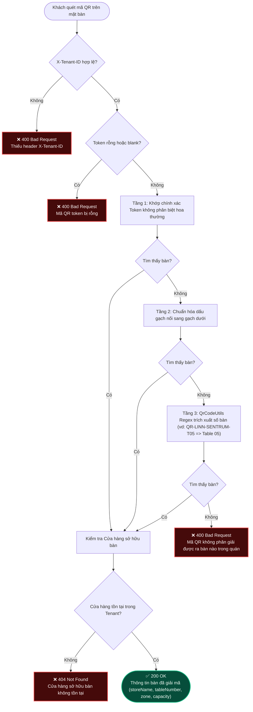

### 2. Biểu đồ Trình Tự Tương Tác (Sequence Diagram)
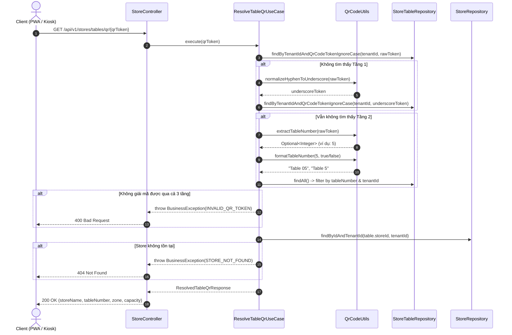

---

## Use Case 6: Tùy chọn Nhận hàng & Tự động sinh Khung giờ (GetFulfillmentOptionsUseCase)

- **API:** `GET /api/v1/stores/fulfillment-options?storeId=...`
- **Use Case:** `GetFulfillmentOptionsUseCase`
- **Util:** `DateTimeUtils.generateTimeSlots`

### 1. Biểu đồ Luồng Nghiệp Vụ (Flowchart)
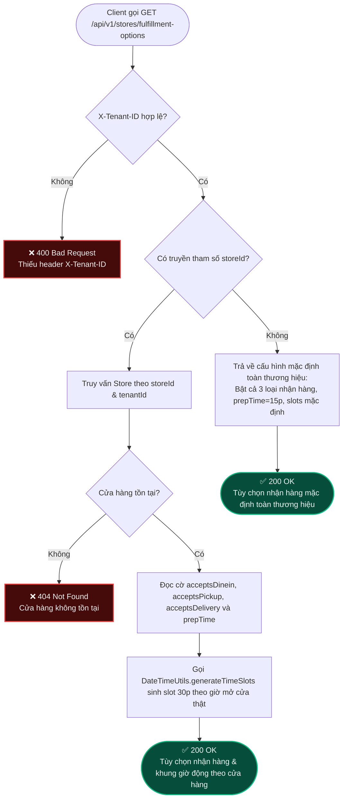

### 2. Biểu đồ Trình Tự Tương Tác (Sequence Diagram)
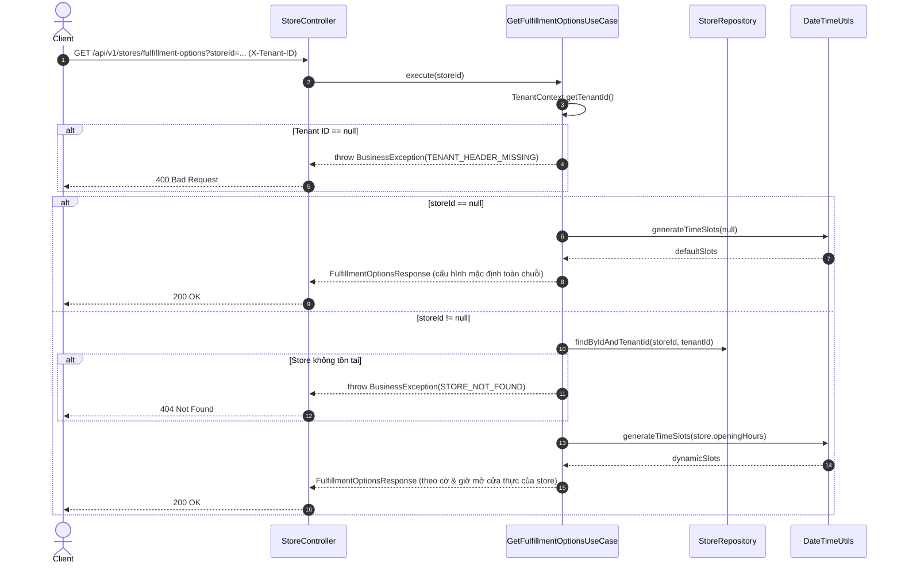

---

## Use Case 7: Lưu & Bỏ Chi nhánh Yêu thích (ToggleFavoriteStoreUseCase)

- **API:** `POST & DELETE /api/v1/stores/{storeId}/favorite`
- **Use Case:** `ToggleFavoriteStoreUseCase`
- **Util:** `SecurityUtils.resolveCurrentUserId`

### 1. Biểu đồ Luồng Nghiệp Vụ (Flowchart)
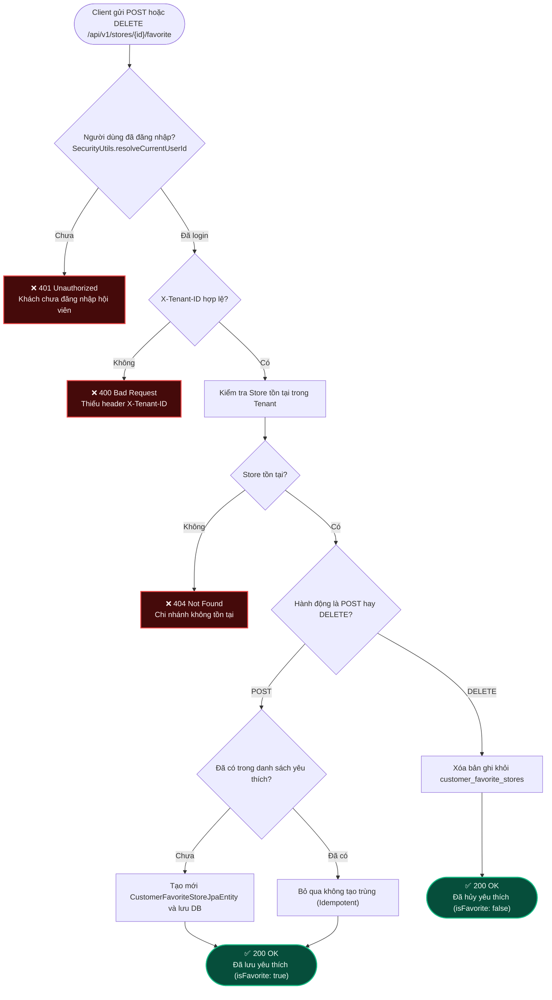

### 2. Biểu đồ Trình Tự Tương Tác (Sequence Diagram)
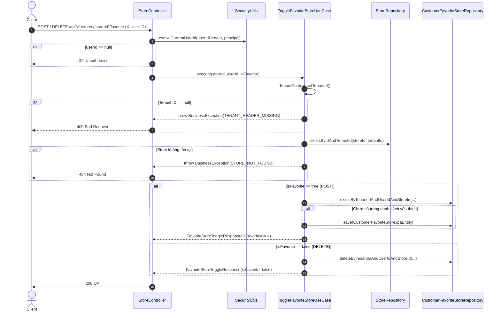

---

## Use Case 8: Danh sách Chi nhánh Yêu thích của Hội viên (GetFavoriteStoresUseCase)

- **API:** `GET /api/v1/stores/favorites?latitude=...&longitude=...`
- **Use Case:** `GetFavoriteStoresUseCase`
- **Util:** `SecurityUtils`, `GeoUtils`

### 1. Biểu đồ Luồng Nghiệp Vụ (Flowchart)
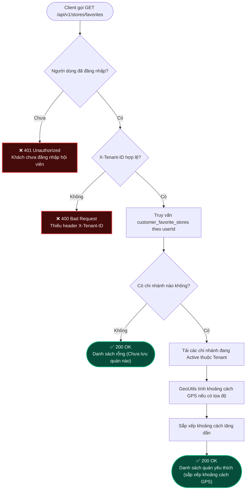

### 2. Biểu đồ Trình Tự Tương Tác (Sequence Diagram)
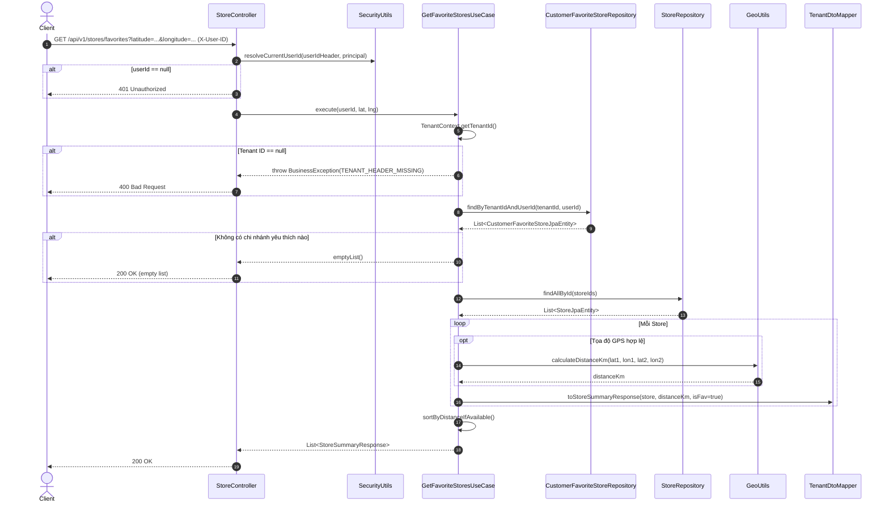
