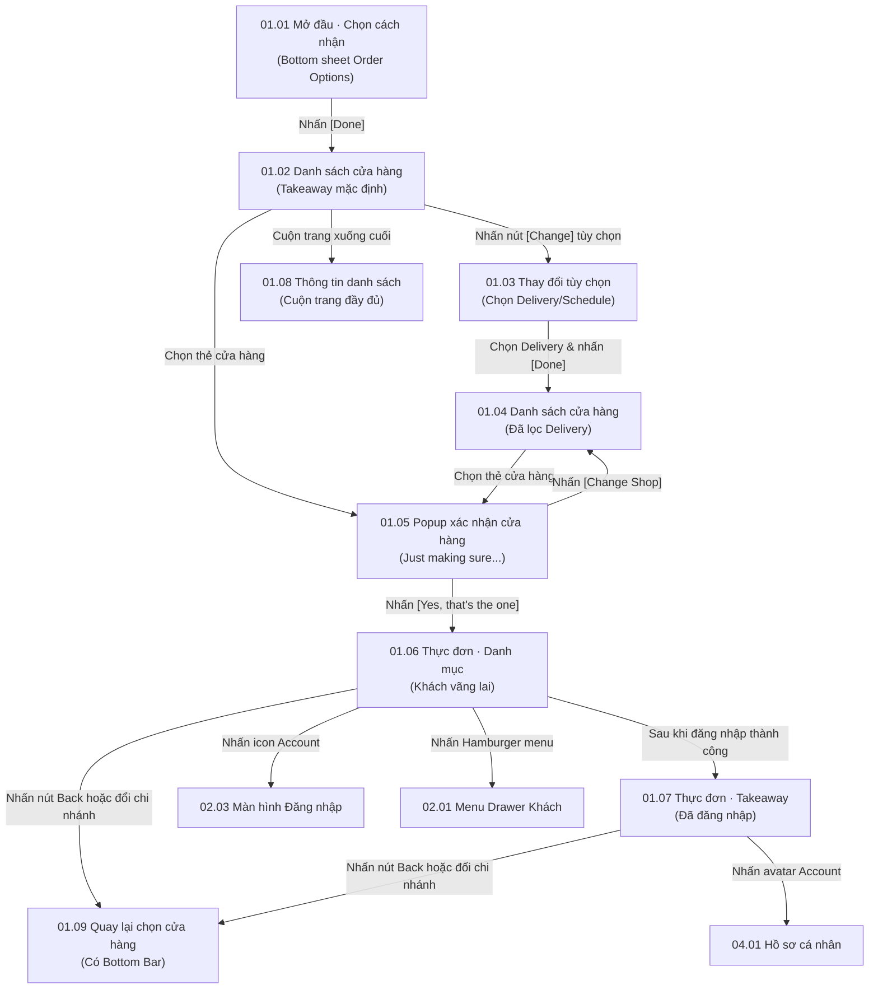

# Phân hệ 01: Khám phá & Chọn cửa hàng (Store Discovery & Menu Browsing)

## 1. Giới thiệu tổng quan (Overview)
Phân hệ **01 - Khám phá & Chọn cửa hàng** là điểm chạm đầu tiên (entry point) của khách hàng trên nền tảng Ordera PWA. Phân hệ này cho phép người dùng:
1. Thiết lập hình thức nhận hàng (**Dine In** - Dùng tại bàn, **Takeaway** - Mang đi, **Delivery** - Giao hàng) và thời gian mong muốn (**As soon as possible** hoặc **Schedule**).
2. Tìm kiếm, duyệt danh sách cửa hàng/chi nhánh thuộc thương hiệu với thông tin giờ mở cửa, khoảng cách, dịch vụ hỗ trợ và thời gian chuẩn bị món.
3. Xác nhận chọn cửa hàng trước khi bắt đầu đặt món nhằm tránh nhầm lẫn chi nhánh.
4. Duyệt thực đơn theo danh mục (Category), nhóm món con (Subcategory pill), xem chi tiết món ăn (ảnh, tên, giá, huy hiệu "Popular", nhãn ăn kiêng/dị ứng) và thêm nhanh vào giỏ hàng.

---

## 2. Danh mục ảnh Prototype (Prototype Inventory)

| STT | Tên file ảnh | Mã màn hình | Tên màn hình | Trạng thái hiển thị |
|---|---|---|---|---|
| 1 | `1-1-mo-dau-va-chon-cach-nhan.png` | **01.01** | Mở đầu · Chọn cách nhận | Bottom sheet "Change Order Options" mở trên nền danh sách cửa hàng. |
| 2 | `1-2-danh-sach-cua-hang.png` | **01.02** | Danh sách cửa hàng | Danh sách chi nhánh phục vụ Takeaway ("As soon as possible"). |
| 3 | `1-3-thay-doi-tuy-chon-dat-mon.png` | **01.03** | Thay đổi tùy chọn đặt món | Bottom sheet thay đổi phương thức nhận sang "Delivery". |
| 4 | `1-4-chon-cua-hang.png` | **01.04** | Chọn cửa hàng · Delivery | Danh sách chi nhánh cập nhật theo bộ lọc Delivery. |
| 5 | `1-5-xac-nhan-cua-hang.png` | **01.05** | Xác nhận cửa hàng | Dialog popup "Just making sure..." xác nhận chi nhánh được chọn. |
| 6 | `1-6-thuc-don-danh-muc.png` | **01.06** | Thực đơn · Danh mục | Trang menu chi nhánh: Banner khuyến mãi, thanh danh mục, món ăn (Chế độ Khách vãng lai). |
| 7 | `1-7-thuc-don-takeaway.png` | **01.07** | Thực đơn · Takeaway | Trang menu chi nhánh khi khách đã đăng nhập (Hiển thị avatar thành viên). |
| 8 | `1-8-thong-tin-danh-sach-cua-hang.png` | **01.08** | Thông tin danh sách cửa hàng | Toàn cảnh cuộn trang danh sách chi nhánh (bao gồm chi nhánh Closed và footer Ordera). |
| 9 | `1-9-quay-lai-chon-cua-hang.png` | **01.09** | Quay lại chọn cửa hàng | Danh sách cửa hàng có thanh điều hướng đáy (Bottom Navigation Bar). |

---

## 3. Luồng chuyển hướng & Tương tác chi tiết (Screen Flow & Interactions)

### Chi tiết các màn hình:
- **01.01 Mở đầu · Chọn cách nhận:**
  - **Hiển thị:** Header Logo thương hiệu, slogan. Modal sheet bo tròn góc chứa 3 tabs nhận hàng (`Dine In`, `Takeaway`, `Delivery`). Lựa chọn thời gian: `As soon as possible` (mặc định 15 phút) hoặc `Schedule` (chọn khung giờ). Nút CTA `[Done]`.
  - **Tương tác:** Khách click chọn tab và thời gian. Khi bấm `[Done]`, lưu tùy chọn vào session/client state và đóng sheet, chuyển sang **01.02**.
- **01.02 & 01.04 Danh sách cửa hàng (Store List):**
  - **Hiển thị:** Thanh tóm tắt tùy chọn đặt món (`Takeaway · As soon as possible` kèm nút `[Change]`). Danh sách các thẻ cửa hàng gồm ảnh bìa, nút yêu thích (Heart), tên chi nhánh, địa chỉ, giờ mở cửa (`Open 9:00 - 23:00`), các hình thức phục vụ hỗ trợ và thời gian ước tính (`Preparing time: 15 Min`).
  - **Tương tác:** Nhấn nút `[Change]` mở lại sheet **01.03**. Nhấn vào một thẻ cửa hàng sẽ kích hoạt popup **01.05**.
- **01.05 Xác nhận cửa hàng (Store Confirmation):**
  - **Hiển thị:** Popup dialog làm mờ nền: *"Just making sure... You've selected Shop Name (Shop's Address) for your order. Is this the restaurant/shop you want to order from?"*.
  - **Hành động:** 
    - `[Yes, that's the one]`: Lưu `store_id` vào Cart context, chuyển đến trang Thực đơn **01.06** hoặc **01.07**.
    - `[Change Shop]`: Đóng dialog, giữ nguyên tại danh sách cửa hàng **01.04** để khách chọn lại.
- **01.06 & 01.07 Thực đơn theo danh mục (Store Menu View):**
  - **Hiển thị:** 
    - Top bar: Nút Hamburger (mở side drawer **02.01**), Dropdown tùy chọn nhận món (`Takeaway`/`Delivery`), nút Search tìm món, cờ ngôn ngữ (EN/NO), và icon tài khoản (khách chưa đăng nhập: icon User outline **01.06**; đã đăng nhập: avatar tròn **01.07**).
    - Banner thương hiệu/chi nhánh và thông tin chi nhánh (giờ mở cửa, thời gian chuẩn bị).
    - Banner chiến dịch marketing: *"Summer Sales: 20% Off"* kèm nút `[Learn more]`.
    - Thanh trượt danh mục món ăn (Category tab: *Popular, Maki, Nigiri, Drinks, Hot Food*).
    - Nhóm con (Subcategory pill: *Fresh maki, Fried maki...*).
    - Danh sách sản phẩm: ảnh món ăn, tên món (*Laks Maki, Tuna Maki*), giá (kèm giá gạch bỏ nếu giảm giá), badge `Popular`, mô tả nguyên liệu, icon dị ứng/chế độ ăn và nút tròn `[+]` thêm nhanh vào giỏ.
- **01.08 & 01.09 Cuộn thông tin & Điều hướng quay lại:**
  - **01.08:** Thể hiện trạng thái chi nhánh đóng cửa (`Closed · Open 13:00 Fri`) và logo chân trang *"Powered by Ordera.me"*.
  - **01.09:** Thanh điều hướng chân trang (Bottom Bar) gồm 2 mục chính: `[Linn Sushi]` (Menu/Home) và `[Account]` (Tài khoản cá nhân).

---

## 4. Bảng ánh xạ Màn hình - API chi tiết (Screen-to-API Mapping)

| Màn hình | API Endpoint | Method | Header bắt buộc | Request Query / Body | Mục đích nghiệp vụ |
|---|---|---|---|---|---|
| **01.01 & 01.03** | `/api/v1/stores/fulfillment-options` | `GET` | `X-Tenant-ID` | `?latitude=...&longitude=...` | Lấy danh sách các hình thức nhận món được cấu hình cho tenant (Dine In, Takeaway, Delivery) và thời gian chuẩn bị tối thiểu. |
| **01.02 & 01.04** | `/api/v1/stores` | `GET` | `X-Tenant-ID` | `?fulfillment_type=TAKEAWAY` hoặc `DELIVERY` `&status=OPEN` | Lấy danh sách các chi nhánh đang hoạt động, lọc theo hình thức nhận hàng đã chọn. |
| **01.05** | `/api/v1/stores/{storeId}` | `GET` | `X-Tenant-ID` | Path variable: `storeId` | Lấy chi tiết thông tin cửa hàng được chọn (tên, địa chỉ chính xác, chính sách phụ phí) để hiển thị trong popup xác nhận. |
| **01.06 & 01.07** | `/api/v1/stores/{storeId}/banners` | `GET` | `X-Tenant-ID` | Path variable: `storeId` | Lấy danh sách banner chiến dịch marketing đang kích hoạt (e.g. "Summer Sales: 20% Off"). |
| **01.06 & 01.07** | `/api/v1/stores/{storeId}/categories` | `GET` | `X-Tenant-ID` | Path variable: `storeId` | Lấy danh mục thực đơn (Popular, Maki, Nigiri, Drinks, Hot Food) kèm danh sách nhóm con (subcategory pills). |
| **01.06 & 01.07** | `/api/v1/stores/{storeId}/products` | `GET` | `X-Tenant-ID` | `?category_id=...&is_popular=true` | Lấy danh sách món ăn kèm giá, ảnh, trạng thái còn món, huy hiệu và nhãn cảnh báo dị ứng. |
| **01.06 & 01.07** | `/api/v1/cart/items` | `POST` | `X-Tenant-ID`, `Authorization` *(Tùy chọn)* | `{"storeId": "...", "productId": "...", "quantity": 1, "customizations": []}` | Thêm món ăn vào giỏ hàng khi người dùng nhấn nút `[+]` trên từng thẻ món. |

---

## 5. Xử lý ngoại lệ & Trạng thái biên (Edge Cases & Fallbacks)
1. **Chi nhánh đóng cửa (Store Closed):**
   - Thẻ cửa hàng hiển thị tag màu xám/đỏ: `Closed · Open 13:00 Fri`.
   - Khi người dùng bấm vào chi nhánh đóng cửa, hiển thị thông báo: *"Cửa hàng hiện đang tạm đóng. Bạn có thể lên lịch hẹn giờ (Schedule) hoặc chọn chi nhánh khác."*
2. **Khách đổi hình thức giao hàng (Delivery):**
   - Nếu địa chỉ của khách nằm ngoài bán kính giao hàng của chi nhánh đã chọn, API `/api/v1/stores` sẽ ẩn hoặc gắn cờ `delivery_available: false`.
3. **Món ăn hết hàng (Out of stock):**
   - Nút `[+]` chuyển sang trạng thái disabled màu xám kèm nhãn *"Sold Out"*, chặn gọi API thêm vào giỏ.
