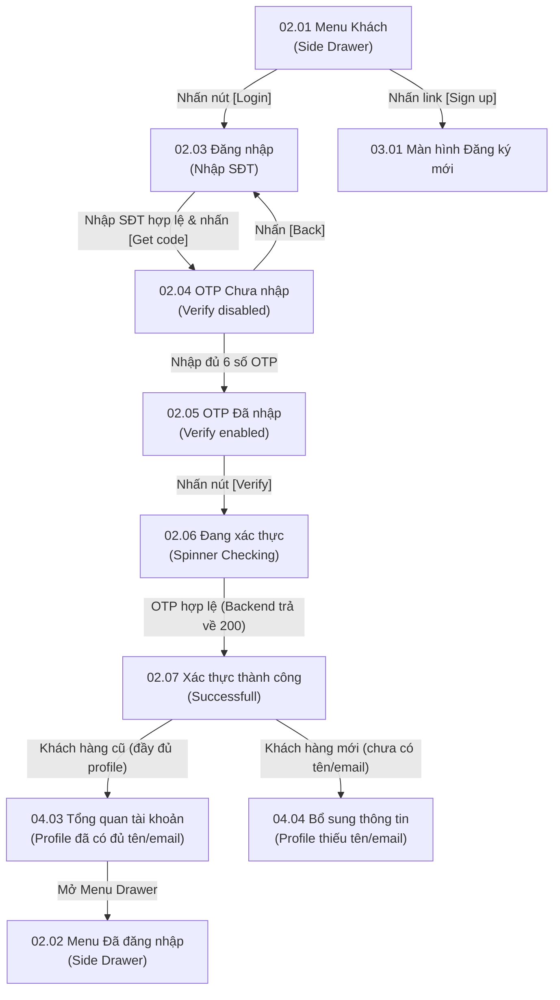

# Phân hệ 02: Đăng nhập & Truy cập tài khoản (Login & Account Access)

## 1. Giới thiệu tổng quan (Overview)
Phân hệ **02 - Đăng nhập & Truy cập tài khoản** quản lý toàn bộ luồng đăng nhập nhanh và bảo mật của khách hàng qua phương thức xác thực không mật khẩu (Passwordless Authentication) sử dụng **Mã OTP** gửi qua SMS hoặc Email.
Mục tiêu nghiệp vụ:
1. Đơn giản hóa tối đa quy trình tiếp cận: Khách hàng chỉ cần nhập Số điện thoại (kèm mã quốc gia như `+47` Na Uy) để nhận mã OTP.
2. Kiểm soát phiên đăng nhập qua JWT Token (`access_token`, `refresh_token`), liên kết danh tính người dùng với dữ liệu hội viên của thương hiệu.
3. Điều hướng thông minh sau khi xác thực:
   - Nếu hồ sơ đã đầy đủ thông tin (Họ tên, email): Chuyển thẳng về **04.03 Tổng quan tài khoản (Profile)** hoặc quay lại giỏ hàng đang dở dang.
   - Nếu hồ sơ mới hoặc thiếu thông tin: Chuyển sang màn hình **04.04 Bổ sung thông tin** để hoàn thiện profile.

---

## 2. Danh mục ảnh Prototype (Prototype Inventory)

| STT | Tên file ảnh | Mã màn hình | Tên màn hình | Trạng thái hiển thị |
|---|---|---|---|---|
| 1 | `2-1-menu-khach.png` | **02.01** | Menu · Khách | Side drawer menu dành cho khách chưa đăng nhập: Nút [See All Shop], [Login], link [Sign up]. |
| 2 | `2-2-menu-da-dang-nhap.png` | **02.02** | Menu · Đã đăng nhập | Side drawer menu dành cho thành viên: Nút [See All Shop], [My Profile]. |
| 3 | `2-3-dang-nhap.png` | **02.03** | Đăng nhập | Form đăng nhập: Chọn mã vùng `+47`, ô nhập số điện thoại, nút `[Get code]`. |
| 4 | `2-4-otp-chua-nhap.png` | **02.04** | OTP · Chưa nhập | Popup nhập mã OTP: Hiển thị số điện thoại nhận mã (`** ***748`), ô nhập trống, nút `[Verify]` mờ/disabled. |
| 5 | `2-5-otp-da-nhap.png` | **02.05** | OTP · Đã nhập | Đã nhập đủ 6 chữ số OTP (ví dụ `387505`), nút `[Verify]` sáng màu vàng sẵn sàng kích hoạt. |
| 6 | `2-6-dang-xac-thuc.png` | **02.06** | Đang xác thực | Trạng thái loading quay vòng (Spinner checking) trong khi Backend xác thực mã OTP. |
| 7 | `2-7-xac-thuc-thanh-cong.png` | **02.07** | Xác thực thành công | Popup hiển thị icon tích xanh/vàng, thông báo chào mừng hội viên thành công. |

---

## 3. Luồng chuyển hướng & Tương tác chi tiết (Screen Flow & Interactions)



### Chi tiết các màn hình:
- **02.01 Menu Khách (Guest Drawer):**
  - Mở ra khi bấm nút Hamburger tại trang chủ/menu.
  - Chứa Logo và Slogan thương hiệu, nút `[See All Shop]` (về danh sách cửa hàng **01.02**), nút chính màu vàng `[Login]` (chuyển sang **02.03**), link *"Don't have account? Sign up"* (chuyển sang **03.01**).
  - Khối danh mục thông tin hỗ trợ: `Shop Information`, `Setting`, `Help`, `Terms & Policies`.
- **02.02 Menu Đã đăng nhập (Member Drawer):**
  - Tương tự như 02.01 nhưng nút `[Login]` được thay thế bằng nút `[My Profile]`, dẫn trực tiếp vào trang hồ sơ thành viên **04.01 / 04.03**.
- **02.03 Màn hình Đăng nhập (Log In Form):**
  - Nút `< Back` góc trên bên trái quay về trang trước đó.
  - Ô chọn mã quốc gia (mặc định `+47` cho Na Uy, cho phép mở danh sách cờ quốc tế).
  - Ô nhập số điện thoại (`Enter your phone number`).
  - Nút `[Get code]`: Ban đầu mờ/disabled; khi người dùng nhập đúng định dạng số điện thoại, nút sáng màu vàng. Khi click: Gửi yêu cầu sinh OTP qua SMS.
  - Link điều hướng phụ: *"Don't have account? Sign up"* chuyển sang **03.01**.
- **02.04 & 02.05 Popup nhập OTP:**
  - Dialog modal làm mờ toàn màn hình. Tiêu đề: *"Verify OTP code"*.
  - Dòng text thông báo che số: *"OTP number has been sent to \*\* \*\*\*748"*.
  - Ô nhập OTP 6 chữ số: Tự động focus, chỉ nhận ký tự số.
  - Nút `[Back]`: Đóng popup và quay lại form nhập số điện thoại **02.03**.
  - Nút `[Verify]`: Kích hoạt gọi API xác thực khi đã điền đủ 6 số.
- **02.06 Trạng thái Đang kiểm tra:**
  - Hiển thị spinner chuyển động màu vàng kèm dòng chữ *"Checking..."*. Các nút bấm bị khóa tạm thời để ngăn ngừa double submit.
- **02.07 Màn hình Xác thực thành công:**
  - Biểu tượng tích chữ V màu vàng trên nền tròn.
  - Tiêu đề: *"Successfull"*.
  - Lời chào: *"Welcome to Ordera's Merchants membership. You can sign in now to redeem voucher and gifts."*
  - Tự động chuyển trang sau 1.5 giây hoặc khi bấm vào màn hình:
    - Nếu `is_profile_complete == true`: Chuyển đến **04.03 Tổng quan tài khoản**.
    - Nếu `is_profile_complete == false`: Chuyển đến **04.04 Bổ sung thông tin**.

---

## 4. Bảng ánh xạ Màn hình - API chi tiết (Screen-to-API Mapping)

| Màn hình | API Endpoint | Method | Header bắt buộc | Request Body / Query | Mục đích nghiệp vụ |
|---|---|---|---|---|---|
| **02.03** | `/api/v1/auth/otp/send` | `POST` | `X-Tenant-ID` | `{"channel": "SMS", "phoneNumber": "+4797362748"}` | Sinh mã OTP 6 số ngẫu nhiên, lưu cache Redis (TTL 120s), gửi SMS qua Telnyx/Twilio. Trả về cooldown 120s. |
| **02.05 & 02.06** | `/api/v1/auth/otp/verify` | `POST` | `X-Tenant-ID` | `{"phoneNumber": "+4797362748", "otpCode": "387505"}` | Kiểm tra tính hợp lệ của mã OTP. Nếu đúng, cấp cặp JWT (`accessToken`, `refreshToken`) và trả về cờ `isProfileComplete`. |
| **02.07** | `/api/v1/profile` | `GET` | `X-Tenant-ID`, `Authorization: Bearer <token>` | Không | Lấy dữ liệu hồ sơ cá nhân để kiểm tra và render ngay lập tức thông tin hạng thẻ và số điểm hiện có. |
| **02.02** | `/api/v1/auth/logout` | `POST` | `X-Tenant-ID`, `Authorization: Bearer <token>` | `{"refreshToken": "..."}` | Thu hồi token, đưa JWT vào danh sách đen (Blacklist) trong Redis để đăng xuất an toàn. |

---

## 5. Xử lý ngoại lệ & Trạng thái lỗi (Error Handling & Edge Cases)

1. **OTP sai hoặc hết hạn (Invalid / Expired OTP):**
   - Backend trả về mã lỗi HTTP `400 Bad Request` hoặc `422 Unprocessable`:
     ```json
     {
       "error": {
         "code": "INVALID_OTP",
         "message": "Mã xác thực không chính xác hoặc đã hết hạn sau 120 giây. Vui lòng kiểm tra lại."
       }
     }
     ```
   - Giao diện: Rung nhẹ ô nhập mã OTP (shake animation), viền đổi màu đỏ, hiển thị thông báo lỗi bên dưới ô nhập.
2. **Spam yêu cầu gửi OTP (Rate Limiting / Cooldown):**
   - Nếu người dùng bấm gửi liên tục, Backend trả về HTTP `429 Too Many Requests`:
     ```json
     {
       "error": {
         "code": "OTP_COOLDOWN_ACTIVE",
         "message": "Vui lòng đợi 120 giây trước khi yêu cầu mã mới.",
         "retryAfterSeconds": 105
       }
     }
     ```
   - Giao diện đếm ngược đồng hồ `Resend code in (105s)`.
3. **Mất kết nối mạng khi đang xác thực:**
   - Hiển thị Toast notification cảnh báo mất mạng, giữ nguyên giá trị mã đã điền trên popup để khách không phải gõ lại khi kết nối phục hồi.
