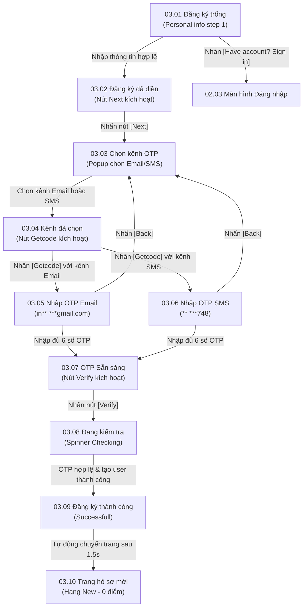

# Phân hệ 03: Đăng ký & Xác thực thành viên (Member Registration & Multi-Channel Verification)

## 1. Giới thiệu tổng quan (Overview)
Phân hệ **03 - Đăng ký & Xác thực thành viên** hỗ trợ khách hàng mới tạo lập tài khoản hội viên thân thiết (Loyalty Member) của thương hiệu qua luồng 2 bước trực quan (2-step Stepper):
1. **Bước 1 (Personal Info):** Thu thập các thông tin cá nhân cần thiết gồm: Họ tên (`Your name`), Email, Số điện thoại (`Phone number`), và Ngày sinh (`Date of birth` - dùng để tự động tặng voucher sinh nhật).
2. **Bước 2 (Verify Account):** Người dùng có quyền lựa chọn kênh nhận mã OTP xác thực linh hoạt: qua **Email** hoặc qua tin nhắn **SMS**.
3. Sau khi xác thực thành công, tài khoản mới được khởi tạo ở cấp bậc **MEMBER New** với 0 điểm tích lũy và tiến độ thăng hạng cấp tiếp theo (cần 200 điểm để lên Silver).

---

## 2. Danh mục ảnh Prototype (Prototype Inventory)

| STT | Tên file ảnh | Mã màn hình | Tên màn hình | Trạng thái hiển thị |
|---|---|---|---|---|
| 1 | `3-1-dang-ky-bieu-mau-trong.png` | **03.01** | Đăng ký · Biểu mẫu trống | Form đăng ký rỗng, thanh tiến trình hiển thị Bước 1 (Personal info), nút [Next] bị vô hiệu hóa. |
| 2 | `3-2-dang-ky-da-dien.png` | **03.02** | Đăng ký · Đã điền | Biểu mẫu đã điền thông tin hợp lệ (ABY TRAN, abytran@ordera.no, +47 97362748, 23/08/2000), nút [Next] sáng vàng. |
| 3 | `3-3-chon-kenh-email.png` | **03.03** | Chọn kênh · Email | Modal popup "Verify Account" yêu cầu chọn phương thức nhận mã: [Email OTP] hoặc [SMS OTP]. |
| 4 | `3-4-chon-kenh-sms.png` | **03.04** | Chọn kênh · SMS | Đã chọn kênh nhận mã (ví dụ Email hoặc SMS), nút [Getcode] sáng màu vàng. |
| 5 | `3-5-nhap-otp-mail.png` | **03.05** | Nhập OTP · Email | Popup xác thực mã OTP gửi về địa chỉ email che tên (`in** ***gmail.com`). |
| 6 | `3-6-nhap-otp-sms.png` | **03.06** | Nhập OTP · SMS | Popup xác thực mã OTP gửi về số điện thoại che số (`** ***748`). |
| 7 | `3-7-otp-san-sang-xac-thuc.png` | **03.07** | OTP · Sẵn sàng xác thực | Ô nhập đã điền đủ 6 số OTP (387505), nút [Verify] màu vàng sẵn sàng gửi. |
| 8 | `3-8-dang-ky-dang-kiem-tra.png` | **03.08** | Đăng ký · Đang kiểm tra | Spinner xoay vòng kèm chữ "Checking" đang xử lý đăng ký tài khoản. |
| 9 | `3-9-dang-ky-thanh-cong.png` | **03.09** | Đăng ký · Thành công | Biểu tượng checkmark hoàn tất đăng ký thành viên. |
| 10 | `3-10-tai-khoan-moi.png` | **03.10** | Tài khoản mới | Trang hồ sơ thành viên mới: Hạng New, 0 điểm, thanh tiến trình 6 bậc thẻ (0/200 điểm lên Silver). |

---

## 3. Luồng chuyển hướng & Tương tác chi tiết (Screen Flow & Interactions)



### Chi tiết các màn hình:
- **03.01 & 03.02 Biểu mẫu đăng ký (Registration Form):**
  - **Thanh tiến trình (Stepper):** Bước 1 (Personal info - vòng tròn vàng có tick), Bước 2 (Verify account - vòng tròn số 2).
  - **Trường nhập liệu:**
    - `Your name *`: Tên đầy đủ của khách hàng (VD: ABY TRAN).
    - `Email *`: Địa chỉ email để nhận e-receipt và khuyến mãi (VD: abytran@ordera.no).
    - `Phone number *`: Mã quốc gia (`+47`) và số điện thoại di động (VD: 97362748).
    - `Date of birth (recommend)`: Ngày sinh định dạng `DD/MM/YYYY` kèm icon lịch picker.
  - **Tương tác:** Nút `[Next]` tự động chuyển từ trạng thái xám (disabled) sang vàng (enabled) ngay khi các trường bắt buộc có dấu `*` được nhập đúng định dạng.
- **03.03 & 03.04 Modal Lựa chọn kênh xác thực (Verify Account Channel Picker):**
  - Tiêu đề popup: *"Verify Account - Choose how to receive your OTP: Email or SMS"*.
  - Hai nút chọn kênh: `[Email OTP]` và `[SMS OTP]`.
  - Nút `[Back]` quay lại form đăng ký; nút `[Getcode]` sáng màu vàng khi người dùng đã chọn một trong hai kênh.
- **03.05, 03.06 & 03.07 Nhập mã OTP:**
  - Tiêu đề: *"Verify OTP code"*.
  - Nội dung mô tả đích gửi: *"OTP number has been sent to in\*\* \*\*\*gmail.com"* (nếu chọn Email) hoặc *"OTP number has been sent to \*\* \*\*\*748"* (nếu chọn SMS).
  - Ô nhập 6 chữ số: Tự động format, giới hạn 6 ký tự.
  - Nút `[Verify]` kích hoạt khi nhập đủ 6 số.
- **03.08 & 03.09 Xử lý & Kết quả thành công:**
  - Màn hình 03.08 khóa tương tác, hiển thị icon spinner quay.
  - Màn hình 03.09 hiển thị huy hiệu xanh/vàng thông báo tài khoản đã sẵn sàng.
- **03.10 Tổng quan hồ sơ thành viên mới (New Member Home):**
  - Header: Nút back `< ABY TRAN`, icon chuông thông báo (Bell), icon tài khoản.
  - Thẻ hạng hội viên: Nền màu xanh lá cây, chữ `MEMBER New`, `Current Point: 0`.
  - Dòng chỉ dẫn tiến độ: *"Lifetime Points: 0 points. You need 200 points to go to the next level of membership"*.
  - Stepper 6 bậc: `N` (0), `S` (200), `G` (400), `P` (1000), `D` (2000), `R` (4000).
  - 3 ô điều hướng nhanh (Quick Actions): `[Voucher]`, `[Loyalty Gift]`, `[Orders]`.
  - Danh mục quản trị: `Personal Information`, `Setting`, `Help`, `Terms & Policies`.

---

## 4. Bảng ánh xạ Màn hình - API chi tiết (Screen-to-API Mapping)

| Màn hình | API Endpoint | Method | Header bắt buộc | Request Body / Query | Mục đích nghiệp vụ |
|---|---|---|---|---|---|
| **03.02 & 03.04** | `/api/v1/auth/register/otp/send` | `POST` | `X-Tenant-ID` | `{"fullName": "ABY TRAN", "email": "abytran@ordera.no", "phoneNumber": "+4797362748", "dateOfBirth": "2000-08-23", "channel": "SMS"}` (hoặc `"EMAIL"`) | Kiểm tra tính duy nhất của email/SĐT trên hệ thống tenant, sinh mã OTP và gửi qua kênh tương ứng. |
| **03.07 & 03.08** | `/api/v1/auth/register/otp/verify` | `POST` | `X-Tenant-ID` | `{"phoneNumber": "+4797362748", "email": "abytran@ordera.no", "otpCode": "387505"}` | Xác thực mã OTP, tạo bản ghi khách hàng trong bảng `customers`, tạo ví điểm trong `customer_loyalty_tiers` (hạng New), và cấp JWT token. |
| **03.10** | `/api/v1/profile` | `GET` | `X-Tenant-ID`, `Authorization: Bearer <token>` | Không | Lấy dữ liệu hồ sơ vừa tạo (Tên ABY TRAN, hạng New, 0 điểm, mốc 200 điểm lên hạng Silver). |
| **03.10** | `/api/v1/loyalty/tiers` | `GET` | `X-Tenant-ID` | Không | Lấy cấu hình 6 hạng thẻ của thương hiệu (điểm sàn, hệ số tích điểm, màu sắc thẻ, quyền lợi). |

---

## 5. Xử lý ngoại lệ & Trạng thái lỗi (Error Handling & Edge Cases)

1. **Số điện thoại hoặc Email đã được đăng ký trước đó:**
   - Khi bấm `[Next]` hoặc `[Getcode]`, Backend trả về HTTP `409 Conflict`:
     ```json
     {
       "error": {
         "code": "ACCOUNT_ALREADY_EXISTS",
         "message": "Số điện thoại hoặc email này đã tồn tại trong hệ thống. Vui lòng đăng nhập.",
         "details": [{"field": "phoneNumber", "code": "duplicate"}]
       }
     }
     ```
   - Giao diện hiển thị cảnh báo đỏ kèm nút liên kết: *"Chuyển sang màn hình Đăng nhập ngay"*.
2. **Khách hàng nhập sai định dạng Email hoặc Ngày sinh không hợp lệ:**
   - Frontend validation kích hoạt trước khi gửi API (zod / regex), viền ô nhập đổi màu đỏ kèm thông điệp hướng dẫn rõ ràng bên dưới.
3. **Mã OTP sai quá 5 lần liên tiếp:**
   - Khóa phiên nhập mã trong 15 phút để phòng chống tấn công brute-force.
