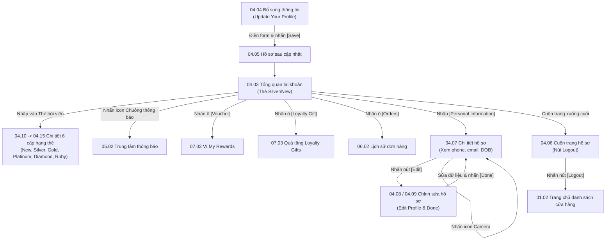

# Phân hệ 04: Hồ sơ & Hạng thành viên (Profile & 6-Tier Loyalty Program)

## 1. Giới thiệu tổng quan (Overview)
Phân hệ **04 - Hồ sơ & Hạng thành viên** là trung tâm quản lý quyền lợi hội viên và thông tin tài khoản cá nhân của khách hàng.
Mục tiêu nghiệp vụ:
1. Hiển thị động cơ 6 cấp bậc thành viên độc quyền của Ordera:
   - **New** (0 - 199 điểm, hệ số 1.0x, thẻ xanh lục `Green`)
   - **Silver** (200 - 399 điểm, hệ số 1.2x, thẻ xanh dương `Blue/Cyan`)
   - **Gold** (400 - 999 điểm, hệ số 1.5x, thẻ vàng `Gold`)
   - **Platinum** (1,000 - 1,999 điểm, hệ số 1.8x, thẻ đỏ cam `Platinum`)
   - **Diamond** (2,000 - 3,999 điểm, hệ số 2.0x, thẻ xanh tím `Diamond`)
   - **Ruby** (4,000+ điểm, hệ số 2.5x, thẻ đỏ ngọc `Ruby`)
2. Hiển thị số điểm khả dụng hiện tại (**Current Point**), tổng điểm tích lũy trọn đời (**Lifetime Points**), và thanh tiến trình thăng hạng (**Progress Stepper**) cho biết số điểm cần tích lũy thêm để lên bậc tiếp theo.
3. Cho phép khách hàng hoàn thiện hồ sơ (Bổ sung thông tin sau xác thực), xem chi tiết thông tin cá nhân, tải ảnh đại diện và chỉnh sửa thông tin (Họ tên, Email, Ngày sinh).
4. Cung cấp nút Đăng xuất (**Logout**) an toàn kèm cơ chế thu hồi token.

---

## 2. Danh mục ảnh Prototype (Prototype Inventory)

| STT | Tên file ảnh | Mã màn hình | Tên màn hình | Trạng thái hiển thị |
|---|---|---|---|---|
| 1 | `4-1-ho-so-thanh-vien-moi.png` | **04.01** | Hồ sơ · Thành viên mới | Khách hàng mới (ABY TRAN): Hạng New (xanh lục), 0 điểm khả dụng. |
| 2 | `4-2-ho-so-silver.png` | **04.02** | Hồ sơ · Silver | Khách hàng hạng Silver (David Nguyen): 120 điểm khả dụng, 300 điểm trọn đời, cần 100 điểm để lên Gold. |
| 3 | `4-3-tong-quan-tai-khoan.png` | **04.03** | Tổng quan tài khoản | Màn hình Account chính với thẻ thành viên, tiến độ và danh mục chức năng. |
| 4 | `4-4-bo-sung-thong-tin.png` | **04.04** | Bổ sung thông tin | Form "Update Your Profile" xuất hiện sau khi đăng nhập tài khoản chưa đủ họ tên/email. |
| 5 | `4-5-ho-so-sau-cap-nhat.png` | **04.05** | Hồ sơ sau cập nhật | Trang tổng quan tài khoản sau khi hoàn thiện form bổ sung. |
| 6 | `4-6-menu-tai-khoan-mo-rong.png` | **04.06** | Menu tài khoản · Mở rộng | Trạng thái cuộn xuống dưới cùng của trang hồ sơ, hiển thị nút viền đỏ/đen [Logout]. |
| 7 | `4-7-chi-tiet-ho-so.png` | **04.07** | Chi tiết hồ sơ | Màn hình "Profile": Ảnh đại diện có nút chụp ảnh camera, Họ tên, Phone, Email, Ngày sinh, nút [Edit]. |
| 8 | `4-8-chinh-sua-ho-so-A.png` | **04.08** | Chỉnh sửa hồ sơ · A | Form "Edit Profile", nút [Done] ở trạng thái chưa thay đổi (disabled). |
| 9 | `4-9-chinh-sua-ho-so-B.png` | **04.09** | Chỉnh sửa hồ sơ · B | Form "Edit Profile" khi người dùng đã nhập thay đổi, nút [Done] sáng vàng sẵn sàng lưu. |
| 10 | `4-10-hang-new.png` | **04.10** | Hạng New | Thẻ thành viên cấp 1: New Member (0 điểm). |
| 11 | `4-11-hang-silver.png` | **04.11** | Hạng Silver | Thẻ thành viên cấp 2: Silver Member (200 điểm mốc). |
| 12 | `4-12-hang-gold.png` | **04.12** | Hạng Gold | Thẻ thành viên cấp 3: Gold Member (400 điểm mốc, thẻ màu vàng). |
| 13 | `4-13-hang-platinum.png` | **04.13** | Hạng Platinum | Thẻ thành viên cấp 4: Platinum Member (1,000 điểm mốc). |
| 14 | `4-14-hang-dimond.png` | **04.14** | Hạng Dimond | Thẻ thành viên cấp 5: Diamond Member (2,000 điểm mốc). |
| 15 | `4-15-hang-ruby.png` | **04.15** | Hạng Ruby | Thẻ thành viên cấp 6: Ruby Member (4,000 điểm mốc - cấp tối cao). |

---

## 3. Luồng chuyển hướng & Tương tác chi tiết (Screen Flow & Interactions)



### Chi tiết các tương tác:
- **04.03 Tổng quan tài khoản (Account Dashboard):**
  - **Thẻ thành viên:** Render gradient theo màu hạng (`Green` cho New, `Cyan` cho Silver, `Yellow` cho Gold, `Orange` cho Platinum, `Purple/Blue` cho Diamond, `Crimson` cho Ruby). Hiển thị tên hạng (`MEMBER Silver`), số điểm khả dụng lớn ở góc phải (`Current Point: 120`).
  - **Thanh tiến độ (Progress Stepper):** Hiển thị tổng điểm trọn đời (`Lifetime Points: 300 points`) và số điểm còn thiếu (`You need 100 points to go to the next level of membership`). 6 điểm mốc: `N (0)`, `S (200)`, `G (400)`, `P (1000)`, `D (2000)`, `R (4000)` với chấm vàng thể hiện vị trí hiện tại.
  - **3 nút tác vụ nhanh (Quick Actions):**
    - `[Voucher]`: Có huy hiệu số lượng voucher đang có (VD: 2) -> Mở tab Voucher trong **07.03**.
    - `[Loyalty Gift]`: Có huy hiệu số quà (VD: 1) -> Mở tab Quà tặng trong **07.03**.
    - `[Orders]`: Có huy hiệu đơn hàng đang chạy (VD: 1) -> Mở lịch sử đơn hàng **06.02**.
- **04.04 Bổ sung thông tin (Update Profile):**
  - Mở ra khi khách đăng nhập lần đầu qua số điện thoại chưa cập nhật tên và email.
  - Nhập `Your name *`, `Email *`, `Date of birth (recommend)`. Bấm `[Save]` sẽ gọi API cập nhật hồ sơ và chuyển về trang tổng quan **04.05**.
- **04.07 & 04.08 / 04.09 Chi tiết & Chỉnh sửa hồ sơ:**
  - **04.07 Profile:** Hiển thị avatar tròn lớn, icon camera nhỏ màu vàng để đổi ảnh, Họ tên, Phone (có tích xanh đã xác thực), Email, Ngày sinh (`23/08/2000`). Nút `[Edit]` trên header.
  - **04.08 & 04.09 Edit Profile:** Cho phép sửa Họ tên, Email, Ngày sinh. Nút `[Done]` ban đầu mờ; khi có bất kỳ thay đổi hợp lệ nào sẽ sáng màu vàng. Khi bấm `[Done]`, gọi API PUT cập nhật và quay lại **04.07** với dữ liệu mới.
- **04.06 Đăng xuất (Logout):**
  - Nút viền chữ nhật `[Logout]` đặt ở đáy trang.
  - Khi bấm: Hiển thị popup xác nhận đăng xuất. Nếu đồng ý: Gọi API revoke token, xóa LocalStorage/Cookies, chuyển về trạng thái khách vãng lai **01.02**.

---

## 4. Bảng ánh xạ Màn hình - API chi tiết (Screen-to-API Mapping)

| Màn hình | API Endpoint | Method | Header bắt buộc | Request Body / Query | Mục đích nghiệp vụ |
|---|---|---|---|---|---|
| **04.01, 04.02, 04.03** | `/api/v1/profile` | `GET` | `X-Tenant-ID`, `Authorization` | Không | Lấy dữ liệu hồ sơ hội viên: Họ tên, điểm khả dụng (`currentPoints`), điểm trọn đời (`lifetimePoints`), hạng thẻ (`currentTier`), điểm cần để lên hạng tiếp theo (`pointsToNextTier`), số lượng voucher/quà/đơn hàng đang hoạt động để hiển thị huy hiệu đỏ. |
| **04.04** | `/api/v1/profile/complete` | `POST` | `X-Tenant-ID`, `Authorization` | `{"fullName": "David Nguyen", "email": "info@ordera.no", "dateOfBirth": "2000-08-23"}` | Hoàn thiện thông tin tài khoản cho người dùng mới sau khi xác thực OTP. |
| **04.07** | `/api/v1/profile` | `GET` | `X-Tenant-ID`, `Authorization` | Không | Lấy chi tiết thông tin tài khoản đầy đủ để hiển thị tại trang Profile. |
| **04.07** | `/api/v1/profile/avatar` | `POST` | `X-Tenant-ID`, `Authorization` | `multipart/form-data: file` | Tải ảnh đại diện người dùng lên hệ thống lưu trữ S3/CDN và cập nhật URL ảnh đại diện trong database. |
| **04.08 & 04.09** | `/api/v1/profile` | `PUT` | `X-Tenant-ID`, `Authorization` | `{"fullName": "David Nguyen", "email": "info@ordera.no", "dateOfBirth": "2000-08-23"}` | Cập nhật thông tin cá nhân của người dùng. |
| **04.10 -> 04.15** | `/api/v1/loyalty/tiers` | `GET` | `X-Tenant-ID`, `Authorization` | Không | Lấy thông tin cấu hình 6 hạng thẻ của thương hiệu: mốc điểm, hệ số nhân tích điểm (1.0x - 2.5x), mã màu sắc thẻ và danh sách quyền lợi đặc quyền. |
| **04.06** | `/api/v1/auth/logout` | `POST` | `X-Tenant-ID`, `Authorization` | `{"refreshToken": "..."}` | Đăng xuất, hủy phiên làm việc và thu hồi JWT tokens. |

---

## 5. Xử lý ngoại lệ & Trạng thái lỗi (Error Handling & Edge Cases)

1. **Email trùng lặp khi chỉnh sửa hồ sơ:**
   - Nếu khách hàng cập nhật email trùng với tài khoản khác trong cùng tenant, Backend trả về HTTP `409 Conflict`:
     ```json
     {
       "error": {
         "code": "EMAIL_ALREADY_EXISTS",
         "message": "Địa chỉ email này đã được sử dụng bởi một tài khoản khác."
       }
     }
     ```
   - Giao diện báo lỗi đỏ tại trường Email, giữ nguyên dữ liệu đã nhập.
2. **Tải ảnh đại diện vượt quá kích thước cho phép:**
   - Giới hạn file ảnh tối đa 5MB, hỗ trợ định dạng PNG, JPG, WEBP. Nếu vượt quá, hiển thị thông báo lỗi client-side: *"Dung lượng ảnh không được vượt quá 5MB."*
3. **Phiên đăng nhập hết hạn (401 Unauthorized):**
   - Khi token hết hạn và không thể refresh bằng refresh token, tự động xóa phiên làm việc và điều hướng người dùng về màn hình đăng nhập **02.03**.
