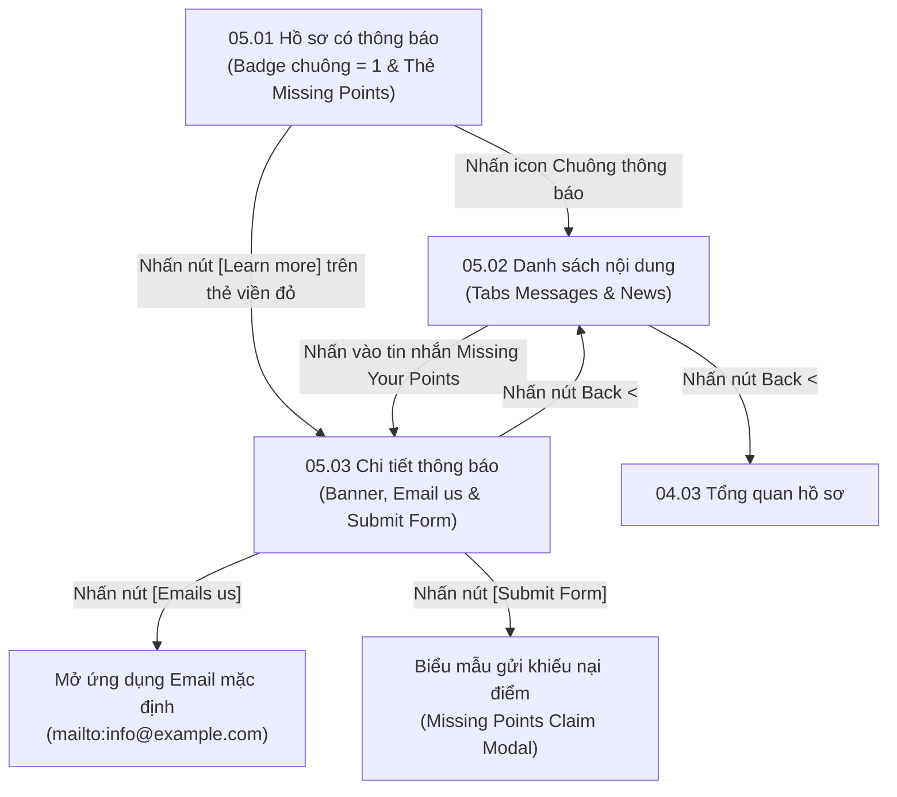

# Phân hệ 05: Thông báo & Hỗ trợ thiếu điểm (Notifications & Missing Points Claim)

## 1. Giới thiệu tổng quan (Overview)
Phân hệ **05 - Thông báo & Hỗ trợ thiếu điểm** đảm bảo trải nghiệm liền mạch cho hội viên khi xảy ra các vấn đề liên quan đến việc đồng bộ dữ liệu điểm thưởng hoặc cập nhật hệ thống của nhà hàng/thương hiệu.
Mục tiêu nghiệp vụ:
1. **Trung tâm thông báo (Notification Center):** Phân loại thông báo thành 2 luồng rõ ràng:
   - **Messages (Tin nhắn riêng / Hỗ trợ kỹ thuật):** Các thông báo trực tiếp liên quan đến tài khoản, đơn hàng, hoặc hỗ trợ tra cứu điểm.
   - **News (Tin tức / Chiến dịch):** Các chương trình khuyến mãi, cập nhật thực đơn hoặc sự kiện của thương hiệu.
2. **Cơ chế khiếu nại thiếu điểm (Missing Points Claim):**
   - Khi hệ thống nâng cấp hoặc khách hàng giao dịch tại quầy/kiosk mà chưa kịp tích điểm, banner cảnh báo *"Missing Your Points?"* hiển thị nổi bật trên trang hồ sơ và trong hộp thư đến.
   - Cho phép khách hàng gửi yêu cầu hỗ trợ trực tiếp qua form (`[Submit Form]`) kèm mã hóa đơn/ảnh biên lai hoặc liên hệ nhanh qua email (`[Emails us]`).

---

## 2. Danh mục ảnh Prototype (Prototype Inventory)

| STT | Tên file ảnh | Mã màn hình | Tên màn hình | Trạng thái hiển thị |
|---|---|---|---|---|
| 1 | `5-1-ho-so-co-thong bao.png` | **05.01** | Hồ sơ · Có thông báo | Icon chuông trên hồ sơ có chấm đỏ đếm số 1 (`Badge 1`). Bên dưới thanh tiến trình xuất hiện thẻ viền đỏ *"Missing Your Points?"*. |
| 2 | `5-2-danh-sach-noi-dung.png` | **05.02** | Danh sách nội dung | Màn hình "Content for you" gồm 2 tabs: `Messages` (đang kích hoạt) và `News`. Thẻ tin nhắn hỗ trợ điểm hiển thị kèm nút [Learn more]. |
| 3 | `5-3-chi-tiet-thong-bao.png` | **05.03** | Chi tiết thông báo | Chi tiết bài viết hỗ trợ: Banner hình ảnh, nội dung giải thích, email hỗ trợ, cùng 2 nút hành động `[Emails us]` và `[Submit Form]`. |

---

## 3. Luồng chuyển hướng & Tương tác chi tiết (Screen Flow & Interactions)



### Chi tiết các màn hình:
- **05.01 Hồ sơ có thông báo (Profile with Notification):**
  - **Dấu hiệu nhận biết:** Huy hiệu tròn đỏ có số `1` xuất hiện tại icon quả chuông góc trên bên phải thanh header.
  - **Thẻ viền đỏ nổi bật:** Nằm ngay dưới thanh 6 cấp bậc thẻ thành viên.
    - Tiêu đề đỏ: *"Missing Your Points?"*.
    - Nội dung: *"We've upgraded our system to improve your experience. If you don't see your loyalty points, please contact us or submit a request — we'll help you retrieve them!"*.
    - Nút bấm vàng: `[Learn more]`.
- **05.02 Danh sách nội dung (Content for You):**
  - **Header:** Nút back `<`, tiêu đề *"Content for you"*, avatar người dùng góc phải.
  - **Tabs:** `Messages` (gạch chân vàng - số lượng tin chưa đọc) và `News`.
  - **Danh sách tin nhắn:** Hiển thị thẻ thông báo hỗ trợ thiếu điểm. Khi nhấn vào thẻ hoặc nút `[Learn more]` sẽ điều hướng sang trang chi tiết **05.03**.
- **05.03 Chi tiết thông báo (Message Detail View):**
  - **Header:** Nút back `<`, tiêu đề *"Messages"*, avatar góc phải.
  - **Banner truyền thông:** Ảnh đồ ăn chất lượng cao (Burger, gà rán, lon Coca-Cola).
  - **Khối nội dung:** Tiêu đề đậm, văn bản hướng dẫn chi tiết quy trình kiểm tra hóa đơn và thông tin liên hệ nhà hàng (`Contact us: Email: info@example.com`).
  - **Hai nút thao tác chính ở chân trang:**
    - Nút viền trắng `[Emails us]`: Mở trình gửi mail mặc định của thiết bị với subject *"Inquiry: Missing Loyalty Points - [Tên khách]"*.
    - Nút vàng `[Submit Form]`: Mở modal form khiếu nại để khách điền Mã đơn hàng / Ngày mua / Số tiền và tải ảnh biên lai tính tiền.

---

## 4. Bảng ánh xạ Màn hình - API chi tiết (Screen-to-API Mapping)

| Màn hình | API Endpoint | Method | Header bắt buộc | Request Body / Query | Mục đích nghiệp vụ |
|---|---|---|---|---|---|
| **05.01** | `/api/v1/notifications/unread-count` | `GET` | `X-Tenant-ID`, `Authorization` | Không | Lấy số lượng thông báo chưa đọc để hiển thị chấm đỏ trên icon chuông (`{"unreadCount": 1}`). |
| **05.02** | `/api/v1/notifications` | `GET` | `X-Tenant-ID`, `Authorization` | `?type=MESSAGE&is_read=false&page=0&size=10` | Lấy danh sách tin nhắn hoặc tin tức thuộc tab đang chọn. |
| **05.03** | `/api/v1/notifications/{id}` | `GET` | `X-Tenant-ID`, `Authorization` | Path variable: `id` | Lấy chi tiết thông báo, hình ảnh banner, nội dung chỉ dẫn và metadata hỗ trợ. |
| **05.03** | `/api/v1/notifications/{id}/read` | `PATCH` | `X-Tenant-ID`, `Authorization` | Path variable: `id` | Đánh dấu thông báo đã đọc, tự động giảm bộ đếm unread count của chuông về 0. |
| **05.03** | `/api/v1/loyalty/claims` | `POST` | `X-Tenant-ID`, `Authorization` | `{"receiptNumber": "REC-907", "orderDate": "2025-03-17", "amount": 290.0, "storeId": "...", "receiptImageUrl": "..."}` | Gửi phiếu khiếu nại thiếu điểm lên hệ thống CRM để nhân viên/Admin đối soát và cộng bù điểm vào `points_ledger`. |

---

## 5. Xử lý ngoại lệ & Trạng thái biên (Edge Cases & Fallbacks)

1. **Khiếu nại trùng lặp biên nhận (Duplicate Receipt Claim):**
   - Nếu mã hóa đơn đã từng được tích điểm thành công hoặc đã có phiếu khiếu nại đang chờ xử lý, Backend trả về HTTP `409 Conflict`:
     ```json
     {
       "error": {
         "code": "RECEIPT_ALREADY_CLAIMED",
         "message": "Hóa đơn này đã được tích điểm hoặc đang trong tiến trình xử lý đối soát."
       }
     }
     ```
2. **Khách hàng không có thông báo mới (Empty State):**
   - Nếu danh sách tin rỗng, hiển thị hình ảnh minh họa chiếc hộp thư trống cùng thông điệp: *"Bạn chưa có thông báo mới. Chúng tôi sẽ thông báo cho bạn ngay khi có ưu đãi đặc biệt!"*.
