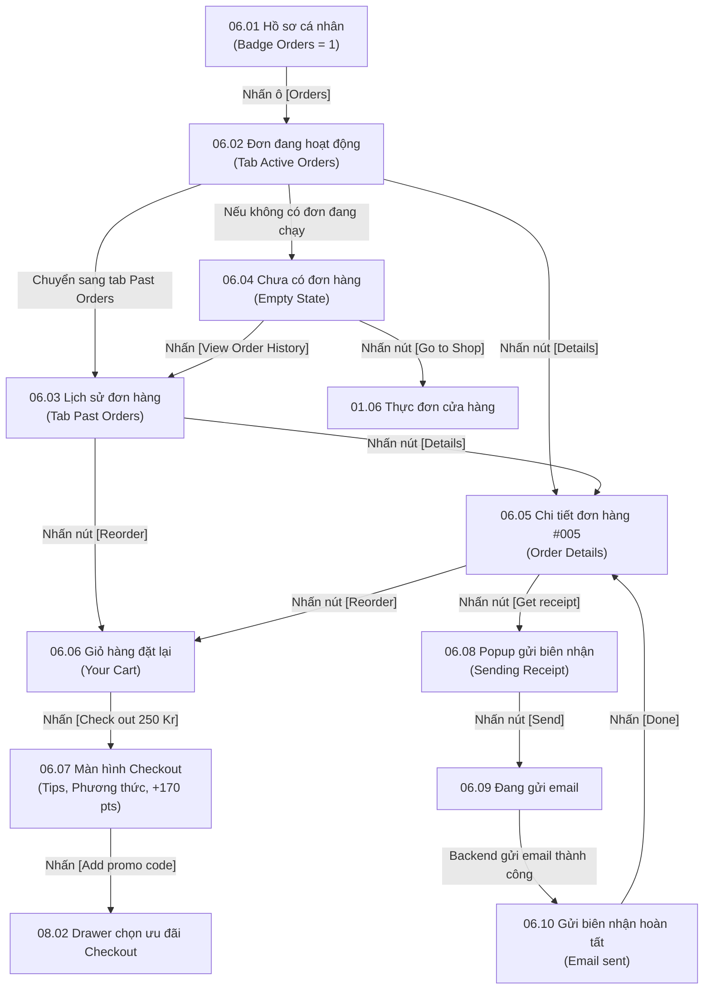

# Phân hệ 06: Giỏ hàng, Đơn hàng & Biên nhận điện tử (Cart, Orders & E-Receipt)

## 1. Giới thiệu tổng quan (Overview)
Phân hệ **06 - Giỏ hàng, Đơn hàng & Biên nhận điện tử** là xương sống của luồng thương mại điện tử trên Ordera.
Mục tiêu nghiệp vụ:
1. **Quản lý đơn hàng (Order History):**
   - Phân chia 2 danh mục: **Active Orders** (Đơn hàng đang chế biến/đang giao) và **Past Orders** (Đơn hàng đã hoàn tất/hủy).
   - Cho phép đặt lại đơn hàng nhanh chóng chỉ với 1 click (**Reorder Flow**), tự động nạp lại toàn bộ món và tùy chọn vào giỏ hàng.
2. **Chi tiết đơn hàng & E-Receipt:**
   - Xem mã số đơn hàng, chi tiết món ăn, VAT, hình thức nhận và trạng thái thanh toán.
   - Gửi hóa đơn điện tử (**Get Receipt**) tới địa chỉ Email của khách hàng theo thời gian thực.
   - Viết đánh giá chất lượng món ăn và dịch vụ của cửa hàng (`[Review]`).
3. **Giỏ hàng & Checkout toàn diện:**
   - Điều chỉnh số lượng món, ghi chú đơn hàng (dị ứng, yêu cầu đặc biệt tối đa 200 ký tự).
   - Lựa chọn hình thức nhận: **Pickup at Counter** (Tại quầy) hoặc **Table** (Tại bàn ăn).
   - Lựa chọn thời gian lấy: **As soon as possible** (Chuẩn bị 15 phút) hoặc **Schedule** (Hẹn giờ).
   - Tùy chọn tiền boa (**Tips**): `5%`, `10%`, `15%`, `Roundup` (Làm tròn số), hoặc `Not today`.
   - Xem điểm thưởng dự kiến tích lũy được khi hoàn tất thanh toán (Ví dụ: `+170 points`).

---

## 2. Danh mục ảnh Prototype (Prototype Inventory)

| STT | Tên file ảnh | Mã màn hình | Tên màn hình | Trạng thái hiển thị |
|---|---|---|---|---|
| 1 | `6-1-tai-khoan-co-don-hang.png` | **06.01** | Tài khoản · Có đơn hàng | Trang hồ sơ hiển thị huy hiệu đếm số `1` trên ô tác vụ [Orders]. |
| 2 | `6-2-don-dang-hoat-dong.png` | **06.02** | Đơn đang hoạt động | Tab "Active Orders": Đơn hàng #907 tại Shop 1 (290 NOK) đang xử lý. |
| 3 | `6-3-lich-su-don-hang.png` | **06.03** | Lịch sử đơn hàng | Tab "Past Orders": Danh sách các đơn cũ (#897, #447, #834) kèm nút [Details] và [Reorder]. |
| 4 | `6-4-chua-co-don-hang.png` | **06.04** | Chưa có đơn hàng | Trạng thái rỗng (Empty State) kèm nút [Go to Shop] và [View Order History]. |
| 5 | `6-5-chi-tiet-don-hang.png` | **06.05** | Chi tiết đơn hàng | Màn hình Order Details: Thẻ mã #005, thông tin tổng tiền 250 NOK, nút [Get receipt], [Review], [Reorder]. |
| 6 | `6-6-gio-hang-dat-lai.png` | **06.06** | Giỏ hàng · Đặt lại | Trang giỏ hàng 3 món: Tùy biến topping, ô ghi chú 0/200, nút [Check out 250 Kr]. |
| 7 | `6-7-checkout-co-ban.png` | **06.07** | Checkout · Cơ bản | Màn hình thanh toán đầy đủ: Pickup method, Pickup time, Tips, Người nhận, badge +170 points, nút [Pay 267 Kr]. |
| 8 | `6-8-gui-bien-nhan-nhap-email.png` | **06.08** | Gửi biên nhận · Nhập email | Popup "Sending Receipt" cho phép nhập/xác nhận địa chỉ email nhận biên nhận. |
| 9 | `6-9-gui-bien-nhan-dang-gui.png` | **06.09** | Gửi biên nhận · Đang gửi | Trạng thái spinner đang gửi email hóa đơn. |
| 10 | `6-10-gui-bien-nhan-hoan-tat.png` | **06.10** | Gửi biên nhận · Hoàn tất | Popup tích tròn vàng "Email sent. The receipt is sent to the email." kèm nút [Done]. |

---

## 3. Luồng chuyển hướng & Tương tác chi tiết (Screen Flow & Interactions)



### Chi tiết các tương tác:
- **06.02 & 06.03 Danh sách đơn hàng:**
  - Header: Nút back `<`, tiêu đề *"Order History"*, avatar cá nhân.
  - Tabs phân loại: `Active Orders` (đang thực hiện) và `Past Orders` (đã xong).
  - Thẻ đơn hàng: Ảnh cover chi nhánh, tên chi nhánh (*Shop 1*), mã đơn (*Order number: #907*), thời gian đặt (*17 mar 2025, 17:01*), tổng giá trị (*290 NOK*), và tóm tắt danh sách món.
  - Nút bấm:
    - Tại Active: Nút `[Details]` dẫn đến **06.05**.
    - Tại Past: Nút `[Details]` và nút vàng `[Reorder]` (kích hoạt luồng nạp giỏ hàng).
- **06.05 Chi tiết đơn hàng (Order Details Screen):**
  - Card số thứ tự nổi bật: `#005` (dùng để khách nhận món tại quầy).
  - Bảng thông tin: Mã đơn đầy đủ (*Naomi - #005*), Thời gian đặt, Chi nhánh, Phương thức nhận (*Takeaway*), Tổng tiền bao gồm thuế VAT (*250,00 NOK*), Chi tiết từng món ăn (3 món).
  - Nút bấm:
    - `[Get receipt]`: Mở popup gửi email biên nhận **06.08**.
    - `[Review]`: Mở form đánh giá sao và bình luận về cửa hàng.
    - `[Reorder]`: Tạo giỏ hàng mới và chuyển sang **06.06**.
- **06.06 Giỏ hàng (Cart View):**
  - Thanh tiến trình: `(1) Menu > (2) Cart (active) > (3) Checkout`.
  - Danh sách món trong giỏ: Tên món (*Aurora, Tuna Maki*), Size (*L*), Toppings (*Mango Popping, Strawberry Popping, Tapioca*), Mức ngọt (*Standard*), Mức đá (*Less Ice*).
  - Nút tăng/giảm số lượng `[-]`, `[+]`, nút icon chỉnh sửa bút chì, giá từng mục.
  - Ô nhập ghi chú: *"Add a comment for your order"* (bộ đếm ký tự 0/200).
  - Khối thanh toán: Tạm tính (*Subtotal included VAT: 250 Kr*), nút CTA vàng `[(3) Check out 250 Kr]`.
- **06.07 Màn hình Checkout:**
  - **Pickup Method:** Hai lựa chọn lớn dạng thẻ: `Pickup at Counter` (nhận tại quầy) vs `Table` (dùng tại bàn, có ô chọn số bàn hoặc quét mã QR bàn).
  - **Pickup Time:** `As soon as possible` (15 phút) vs `Schedule` (hẹn giờ).
  - **Tips:** Các nút chọn nhanh: `5%`, `10%`, `15%`, `Roundup` (làm tròn số thập phân), hoặc radio `Not today`.
  - **My Offers:** Nút mở drawer voucher/quà tặng `Add promo code >` (chuyển sang Phân hệ 08).
  - **Thông tin người nhận (Who will pickup the order?):**
    - Tên khách hàng (David Nguyen).
    - Số điện thoại (+47 97362748).
    - Checkbox: *"Agree to register a loyalty account & Terms of Services"* (áp dụng khi khách là guest để tích điểm).
  - **Tổng tiền & Huy hiệu điểm thưởng:**
    - Tạm tính: `267 Kr`.
    - Dòng tổng tiền: `Total: 267 Kr` kèm huy hiệu nổi bật màu đỏ cam: `+170 points` thể hiện số điểm thưởng khách sẽ nhận được vào tài khoản sau đơn này.
    - Nút CTA lớn: `[(3) Pay 267 Kr]`.
- **06.08, 06.09 & 06.10 Gửi biên nhận điện tử qua Email:**
  - Khách bấm `[Get receipt]` -> Popup mở ra tự động điền email của khách (`info@ordera.no`).
  - Bấm `[Send]` -> Hiển thị spinner "Sending..." -> Thông báo `Email sent. The receipt is sent to the email.` kèm nút `[Done]` để quay lại chi tiết đơn.

---

## 4. Bảng ánh xạ Màn hình - API chi tiết (Screen-to-API Mapping)

| Màn hình | API Endpoint | Method | Header bắt buộc | Request Body / Query | Mục đích nghiệp vụ |
|---|---|---|---|---|---|
| **06.02 & 06.03** | `/api/v1/orders` | `GET` | `X-Tenant-ID`, `Authorization` | `?status_group=ACTIVE` (hoặc `PAST`)`&page=0&size=10` | Lấy danh sách đơn hàng của khách hàng theo tab phân loại Active hoặc Past. |
| **06.05** | `/api/v1/orders/{orderId}` | `GET` | `X-Tenant-ID`, `Authorization` | Path variable: `orderId` | Lấy toàn bộ chi tiết đơn hàng: số thứ tự quầy (#005), chi tiết món ăn, VAT, tiền tip, phương thức nhận, trạng thái chế biến. |
| **06.05 & 06.03** | `/api/v1/orders/{orderId}/reorder` | `POST` | `X-Tenant-ID`, `Authorization` | Path variable: `orderId` | Nhân bản các món và tùy chọn của đơn hàng cũ vào giỏ hàng hiện tại, kiểm tra tính khả dụng của món ăn ở thời điểm hiện tại. |
| **06.06** | `/api/v1/cart` | `GET` | `X-Tenant-ID`, `Authorization` | Không | Lấy dữ liệu giỏ hàng hiện tại của khách hàng. |
| **06.06** | `/api/v1/cart/items/{itemId}` | `PATCH` | `X-Tenant-ID`, `Authorization` | `{"quantity": 2, "note": "Không cay"}` | Điều chỉnh số lượng hoặc cập nhật ghi chú của từng món trong giỏ. |
| **06.07** | `/api/v1/orders/checkout/preview` | `POST` | `X-Tenant-ID`, `Authorization` *(Tùy chọn)* | `{"storeId": "...", "items": [...], "pickupMethod": "COUNTER", "tipPercentage": 10, "voucherCode": "..."}` | Tính toán bảng dự toán thanh toán: Tạm tính, Thuế VAT, Tiền boa Tips, Giảm giá voucher, và tính trước số điểm thưởng sẽ nhận được (`estimatedPointsEarned: 170`). |
| **06.07** | `/api/v1/orders/checkout` | `POST` | `X-Tenant-ID`, `Authorization` *(Tùy chọn)* | `{"storeId": "...", "pickupMethod": "COUNTER", "tableNumber": null, "pickupTimeType": "ASAP", "tipAmount": 17.0, "customerName": "David Nguyen", "customerPhone": "+4797362748", "paymentMethod": "VIPPS"}` | Tạo đơn hàng chính thức, trừ điểm/voucher nếu có, tạo giao dịch thanh toán hoặc điều hướng sang cổng Vipps / Stripe. |
| **06.08 & 06.09** | `/api/v1/orders/{orderId}/receipt/send-email` | `POST` | `X-Tenant-ID`, `Authorization` | `{"email": "info@ordera.no"}` | Tạo file PDF hóa đơn điện tử E-Receipt chuẩn hóa và gửi qua hệ thống SMTP / SendGrid tới email của khách. |

---

## 5. Xử lý ngoại lệ & Trạng thái lỗi (Error Handling & Edge Cases)

1. **Món ăn trong đơn cũ bị ngưng phục vụ khi Reorder:**
   - Nếu một hoặc nhiều món trong đơn hàng cũ đã hết hàng hoặc bị ẩn, Backend trả về cảnh báo:
     ```json
     {
       "warning": {
         "code": "SOME_ITEMS_UNAVAILABLE",
         "message": "Món 'Aurora' hiện đã hết hàng và không thể thêm vào giỏ. Các món còn lại đã được đặt vào giỏ hàng.",
         "unavailableItems": ["Aurora"]
       }
     }
     ```
2. **Gửi hóa đơn thất bại do sai định dạng email:**
   - Client kiểm tra regex email trước; nếu phía SMTP từ chối, Backend trả về HTTP `422 Unprocessable` kèm thông báo lỗi cụ thể để khách đổi địa chỉ email khác.
3. **Giỏ hàng rỗng khi vào màn hình Checkout:**
   - Tự động chuyển hướng về màn hình rỗng **06.04** hoặc trang thực đơn **01.06**.
