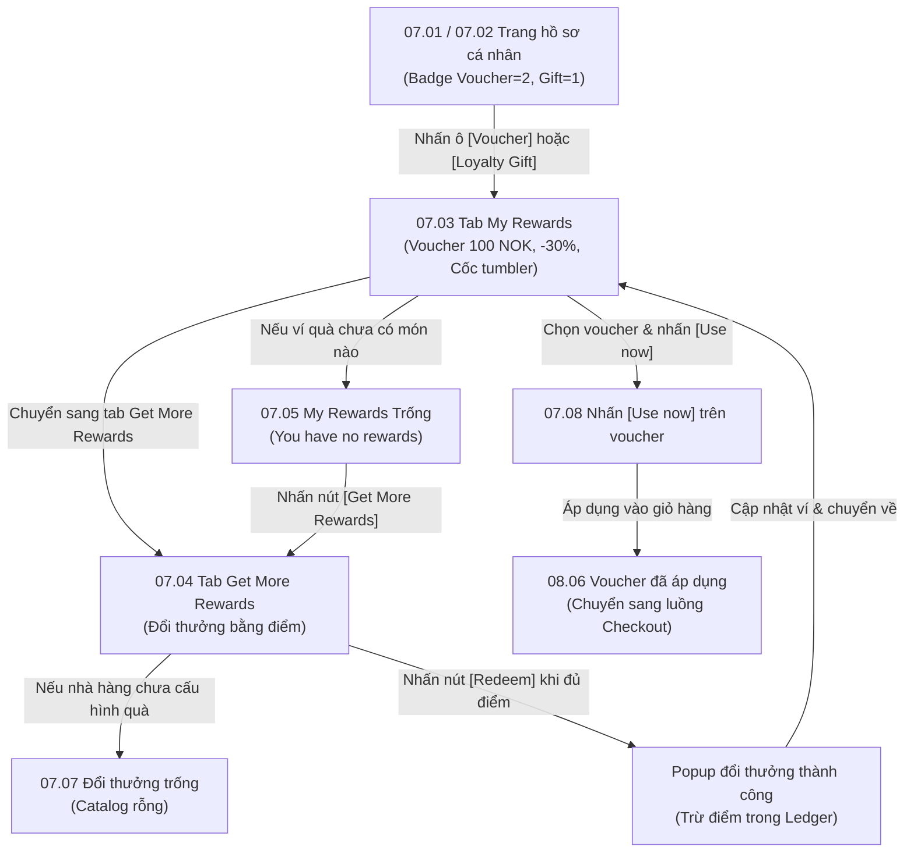

# Phân hệ 07: Ví ưu đãi & Đổi quà thưởng (Rewards Wallet & Point Redemption)

## 1. Giới thiệu tổng quan (Overview)
Phân hệ **07 - Ví ưu đãi & Đổi quà thưởng** là nơi hội viên quản lý các quyền lợi giảm giá và quà tặng đạt được qua chương trình khách hàng thân thiết.
Mục tiêu nghiệp vụ:
1. **Ví ưu đãi cá nhân (My Rewards):**
   - Quản lý các voucher giảm giá và quà tặng hội viên mà khách hàng đang sở hữu (được tặng nhân dịp sinh nhật, thăng hạng, hoặc đổi bằng điểm).
   - Cho phép kích hoạt nhanh voucher/quà vào giỏ hàng qua nút `[Use now]` hoặc nhận quà tại quầy qua `[Get now]`.
2. **Kho đổi thưởng bằng điểm (Get More Rewards):**
   - Danh mục các phần thưởng mà khách hàng có thể dùng điểm tích lũy (**Current Points**) để đổi lấy (ví dụ: Voucher 100 NOK tốn 100 điểm, Voucher giảm 30% tốn 1,000 điểm, Cốc giữ nhiệt Tumbler tốn 100 điểm).
   - Kiểm soát tính hợp lệ: Nút `[Redeem]` chỉ kích hoạt khi khách hàng có đủ số điểm cần thiết; nếu thiếu điểm, nút sẽ chuyển sang trạng thái disabled mờ.
3. **Quản lý trạng thái rỗng (Empty States):**
   - Hướng dẫn điều hướng trực quan khi khách hàng chưa có ưu đãi nào: Hiển thị hình ảnh huy chương sao rỗng kèm nút dẫn sang tab đổi thưởng `[Get More Rewards]`.

---

## 2. Danh mục ảnh Prototype (Prototype Inventory)

| STT | Tên file ảnh | Mã màn hình | Tên màn hình | Trạng thái hiển thị |
|---|---|---|---|---|
| 1 | `7-1-tai-khoan-loi-vao-uu-dai.png` | **07.01** | Tài khoản · Lối vào ưu đãi | Màn hình Account chính với 2 ô lối vào [Voucher] và [Loyalty Gift]. |
| 2 | `7-2-tai-khoan-bo-dem-uu-dai.png` | **07.02** | Tài khoản · Bộ đếm ưu đãi | Hiển thị huy hiệu số lượng quà đang có: Voucher (badge 2), Loyalty Gift (badge 1). |
| 3 | `7-3-my-rewards.png` | **07.03** | My Rewards | Tab "My Rewards": Danh sách voucher sở hữu (100 NOK, -30%) và quà tặng vật phẩm (Cốc giữ nhiệt). |
| 4 | `7-4-get-more-rewards.png` | **07.04** | Get More Rewards | Tab "Get More Rewards": Danh mục đổi thưởng bằng điểm tích lũy kèm nút [Redeem]. |
| 5 | `7-5-my-rewards-trong.png` | **07.05** | My Rewards · Trống | Trạng thái rỗng "You have no rewards" kèm nút bấm chuyển sang tab "Get More Rewards". |
| 6 | `7-7-doi-thuong-trong.png` | **07.07** | Đổi thưởng · Trống | Trạng thái không có phần thưởng khả dụng để đổi trong catalog của nhà hàng. |
| 7 | `7-8-use-now-truoc-khi-chon.png` | **07.08** | Use now · Trước khi chọn | Thao tác người dùng chuẩn bị nhấn nút [Use now] trên một voucher cụ thể để áp dụng vào đơn hàng. |

---

## 3. Luồng chuyển hướng & Tương tác chi tiết (Screen Flow & Interactions)



### Chi tiết các màn hình:
- **07.03 My Rewards (Ví voucher & quà của tôi):**
  - **Header:** Nút back `<`, tiêu đề *"Voucher & Loyalty Gifts"*, avatar cá nhân.
  - **Tabs chính:** `My Rewards` (gạch chân vàng - đang chọn) và `Get More Rewards`.
  - **Filter Pills:** `Voucher` (nền vàng bo tròn) và `Loyalty Gifts`.
  - **Danh sách Voucher:**
    - Icon vé vàng có dấu `$`: Tên voucher (*Voucher Name*), Giá trị (*100 NOK*), Mô tả (*Giảm 100 NOK giá trị cho Order của bạn*), Điều kiện (*Minimum Order Value: 250 NOK*), Hạn dùng (*Expired date: 3 dec 2025*), nút chữ xanh lá `[Use now]`.
    - Icon vé vàng có dấu `%`: Giảm giá phần trăm (*-30%*), Điều kiện (*Minimum Order Value: 0 NOK*), Hạn dùng, nút `[Use now]`.
  - **Danh sách Loyalty Gifts:**
    - Ảnh sản phẩm quà tặng (Cốc giữ nhiệt tumbler hồng).
    - Tên quà (*Gift Name*), mô tả chi tiết, số lượng còn lại (*Quantity left: 10 Pieces*), nút chữ xanh lá `[Get now]` (nhận tại quầy).
- **07.04 Get More Rewards (Đổi thưởng bằng điểm):**
  - Cấu trúc tương tự tab My Rewards nhưng kèm chi phí điểm:
    - Thẻ voucher 100 NOK: Cần `100 Points`, nút vàng `[Redeem]`.
    - Thẻ voucher 30%: Cần `1000 Points`, nếu khách chỉ có 120 điểm thì nút `[Redeem]` bị vô hiệu hóa (màu xám).
    - Thẻ quà tặng cốc giữ nhiệt: Cần `100 Points`, nút vàng `[Redeem]`.
  - Khi bấm `[Redeem]`: Hiển thị popup xác nhận: *"Bạn có muốn dùng 100 điểm để đổi phần thưởng này không?"*. Nếu đồng ý: Gọi API trừ điểm và thêm voucher/quà vào ví `My Rewards`.
- **07.05 Trạng thái rỗng (Empty State):**
  - Hình minh họa dải ruy băng và ngôi sao may mắn.
  - Văn bản: *"You have no rewards"*.
  - Nút bấm lớn màu trắng viền đen: `[Get More Rewards]` kèm mũi tên chỉ dẫn lên tab trên cùng để khuyến khích hội viên dùng điểm đổi thưởng.

---

## 4. Bảng ánh xạ Màn hình - API chi tiết (Screen-to-API Mapping)

| Màn hình | API Endpoint | Method | Header bắt buộc | Request Body / Query | Mục đích nghiệp vụ |
|---|---|---|---|---|---|
| **07.01 & 07.02** | `/api/v1/rewards/summary` | `GET` | `X-Tenant-ID`, `Authorization` | Không | Lấy tổng số lượng voucher khả dụng và số lượng quà tặng chưa nhận để hiển thị huy hiệu đỏ trên trang hồ sơ. |
| **07.03** | `/api/v1/rewards/my-wallet` | `GET` | `X-Tenant-ID`, `Authorization` | `?type=ALL` (hoặc `VOUCHER`, `GIFT`) | Lấy danh sách toàn bộ các voucher và quà tặng đang có hiệu lực trong ví cá nhân của hội viên. |
| **07.04** | `/api/v1/rewards/catalog` | `GET` | `X-Tenant-ID`, `Authorization` | Không | Lấy danh mục các phần thưởng cho phép đổi bằng điểm, kèm điều kiện điểm yêu cầu (`requiredPoints`), số lượng tồn kho (`stockQuantity`), và cờ `canRedeem` (dựa trên số điểm hiện tại của khách). |
| **07.04** | `/api/v1/rewards/{rewardId}/redeem` | `POST` | `X-Tenant-ID`, `Authorization` | Path variable: `rewardId` | Đổi điểm lấy phần thưởng: Trừ điểm trong `points_ledger` (loại giao dịch `REDEEM`), sinh mã voucher mới vào bảng `vouchers` gán cho khách hàng. |
| **07.08** | `/api/v1/cart/voucher/apply` | `POST` | `X-Tenant-ID`, `Authorization` | `{"voucherCode": "GIAM100NOK"}` | Kích hoạt mã voucher vào giỏ hàng hiện tại, kiểm tra điều kiện giá trị đơn tối thiểu (MOV). |

---

## 5. Xử lý ngoại lệ & Trạng thái lỗi (Error Handling & Edge Cases)

1. **Không đủ điểm để đổi thưởng:**
   - Nếu khách hàng can thiệp gửi API trực tiếp khi điểm không đủ, Backend trả về HTTP `422 Unprocessable`:
     ```json
     {
       "error": {
         "code": "INSUFFICIENT_POINTS",
         "message": "Số điểm tích lũy của bạn không đủ để đổi phần thưởng này (Yêu cầu: 1000 điểm, Hiện có: 120 điểm)."
       }
     }
     ```
2. **Vật phẩm quà tặng hết hàng trong kho (Out of Stock):**
   - Khi quà tặng có `quantity_left == 0`, nút `[Redeem]` chuyển sang trạng thái disabled hiển thị nhãn *"Out of Stock"*. Nếu có tranh chấp đồng thời (concurrency), Redisson distributed lock sẽ ngăn chặn ghi đè và báo lỗi hết hàng an toàn.
3. **Voucher hết hạn sử dụng (Expired Voucher):**
   - Hệ thống tự động lọc bỏ hoặc đưa các voucher có `expired_date < now()` vào mục lưu trữ (Archived/Expired), không cho phép nhấn nút `[Use now]`.
