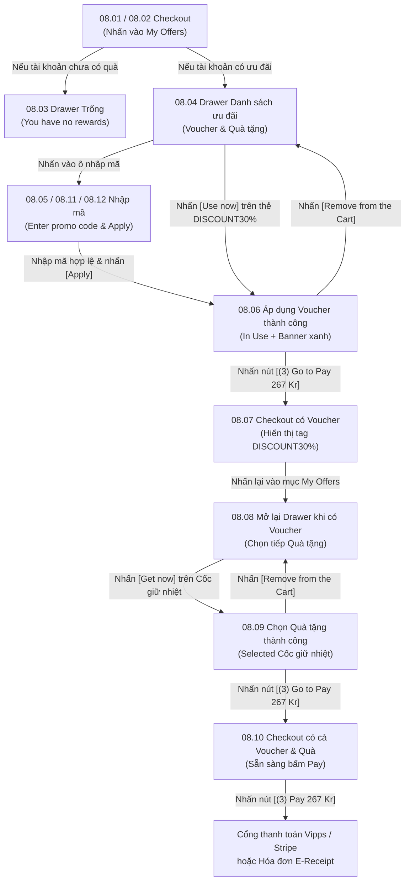

# Phân hệ 08: Áp mã ưu đãi & Quà tặng trong Checkout (Checkout Offers & Gift Selection)

## 1. Giới thiệu tổng quan (Overview)
Phân hệ **08 - Áp mã ưu đãi & Quà tặng trong Checkout** là một trong những tính năng tương tác phức tạp và tinh tế nhất của nền tảng Ordera.
Mục tiêu nghiệp vụ:
1. **Lồng ghép linh hoạt ưu đãi vào luồng thanh toán:**
   - Khách hàng không cần rời khỏi màn hình Checkout để tìm mã giảm giá hay quà tặng; một Drawer trượt (`Bottom Sheet Drawer` hoặc `Full Overlay`) sẽ mở ra ngay trong quy trình thanh toán.
2. **Hỗ trợ đa phương thức kích hoạt ưu đãi:**
   - Chọn trực tiếp từ ví voucher sẵn có trong tài khoản (**My Rewards**).
   - Đổi nhanh quà/voucher bằng điểm ngay trong lúc thanh toán (**Get More Rewards**).
   - Nhập thủ công mã khuyến mãi dạng văn bản (**Promo / Gift Code Input**) thông qua bàn phím ảo.
3. **Kết hợp đồng thời Voucher giảm tiền & Quà tặng vật phẩm:**
   - Hệ thống cho phép áp dụng đồng thời **01 Voucher giảm giá** (theo số tiền hoặc %) và **01 Quà tặng tri ân** (Loyalty Gift, ví dụ: Cốc giữ nhiệt Tumbler) trong cùng một đơn hàng.
   - Hiển thị trạng thái áp dụng rõ ràng (`In Use`, `Selected`) kèm nút gỡ bỏ thuận tiện (`[Remove from the Cart]`).
   - Cập nhật tức thời dòng tạm tính, số tiền giảm, phí phụ thu và số điểm thưởng dự kiến nhận được trên nút thanh toán `[(3) Pay]`.

---

## 2. Danh mục ảnh Prototype (Prototype Inventory)

| STT | Tên file ảnh | Mã màn hình | Tên màn hình | Trạng thái hiển thị |
|---|---|---|---|---|
| 1 | `8-1-checkout-bien-the-A.png` | **08.01** | Checkout · Biến thể A | Màn hình Checkout có ô "My Offers: Add promo code or get rewards >". |
| 2 | `8-2-checkout-mo-my-offers.png` | **08.02** | Checkout · Mở My Offers | Ô "My Offers" có huy hiệu đỏ báo `3` ưu đãi sẵn có trong tài khoản. |
| 3 | `8-3-my-offers-trong.png` | **08.03** | My Offers · Trống | Drawer mở ra khi tài khoản khách chưa có ưu đãi nào ("You have no rewards"). |
| 4 | `8-4-danh-sach-uu-dai.png` | **08.04** | Danh sách ưu đãi | Drawer mở hiển thị ô nhập mã phía trên và danh sách voucher/quà tặng của khách. |
| 5 | `8-5-nhap-ma-uu-dai.png` | **08.05** | Nhập mã ưu đãi | Thao tác nhập ký tự mã khuyến mãi vào ô input. |
| 6 | `8-6-voucher-da-ap-dung.png` | **08.06** | Voucher · Đã áp dụng | Áp dụng voucher DISCOUNT30% thành công: Huy hiệu xanh `In Use`, nút `[Remove from the Cart]`, banner xanh thông báo, nút vàng `[(3) Go to Pay 267 Kr]`. |
| 7 | `8-7-checkout-co-voucher.png` | **08.07** | Checkout · Có voucher | Quay lại màn hình Checkout: Mục My Offers hiển thị tag `% DISCOUNT30% >` và huy hiệu đỏ giảm về `2`. |
| 8 | `8-8-uu-dai-da-su-dung.png` | **08.08** | Ưu đãi · Đang sử dụng | Mở lại drawer khi voucher đang kích hoạt, cho phép chọn thêm quà tặng vật phẩm. |
| 9 | `8-9-qua-da-chon.png` | **08.09** | Quà · Đã chọn | Chọn thêm Cốc giữ nhiệt thành công: Huy hiệu xanh `Selected`, banner xanh "Loyalty Gift added successfully", nút vàng `[(3) Go to Pay]`. |
| 10 | `8-10-checkout-voucher-qua.png` | **08.10** | Checkout · Voucher & quà | Màn hình Checkout hiển thị cả 2 ưu đãi: `% DISCOUNT30%` và `Cốc giữ nhiệt` trong cùng một đơn hàng. |
| 11 | `8-11-nhap-ma-bien-the-A.png` | **08.11** | Nhập mã · Biến thể A | Giao diện pop-up nhập mã độc lập kèm bàn phím ảo, nút `[Apply]` và `[Cancel]`. |
| 12 | `9-12-nhap-ma-bien-the-B.png` | **08.12** | Nhập mã · Biến thể B | Biến thể khi con trỏ đang focus trực tiếp vào ô input. |

---

## 3. Luồng chuyển hướng & Tương tác chi tiết (Screen Flow & Interactions)



### Chi tiết các màn hình & Tương tác:
- **08.01 & 08.02 Lối vào My Offers trong Checkout:**
  - Khối chữ nhật bo góc viền cam/vàng: Tiêu đề `My Offers`, kèm huy hiệu tròn đỏ thể hiện số ưu đãi khả dụng (`Badge 3`).
  - Dòng chỉ dẫn: `Add promo code or get rewards >`.
  - Khi click: Mở Drawer trượt lên từ chân màn hình **08.04**.
- **08.04 & 08.05 / 08.11 / 08.12 Nhập mã thủ công & Chọn ưu đãi:**
  - **Ô nhập mã ở trên cùng:** Nền vàng nhạt bo góc: *"Enter promo or gift code here"*.
  - Khi người dùng chạm vào ô nhập: Bàn phím ảo xuất hiện (**08.11 & 08.12**). Có nút `[Apply]` (sáng khi có chữ) và nút `[Cancel]`.
  - **Danh sách Voucher & Quà tặng:** Hiển thị tương tự phân hệ 07 với các điều kiện đơn hàng tối thiểu.
  - Khi bấm `[Use now]` trên một voucher: Gọi API kiểm tra điều kiện giỏ hàng. Nếu thỏa mãn: Chuyển sang **08.06**.
- **08.06 Áp dụng Voucher thành công:**
  - Thẻ voucher DISCOUNT30% hiển thị nhãn xanh lá: `✔ In Use`.
  - Xuất hiện nút viền bo tròn: `[Remove from the Cart]`.
  - Thanh thông báo màu xanh nhạt nổi bật phía trên nút thanh toán: `✔ Voucher added successfully`.
  - Nút CTA dưới cùng đổi thành: `[(3) Go to Pay 267 Kr]`. Nhấn vào sẽ đóng Drawer và trở về màn hình Checkout **08.07**.
- **08.07 Checkout hiển thị Voucher đã chọn:**
  - Mục `My Offers` cập nhật giao diện:
    - Huy hiệu đỏ giảm từ 3 xuống `2` (do 1 voucher đã được đưa vào giỏ).
    - Hiển thị tag cam có icon phần trăm: `% DISCOUNT30% >`.
    - Dòng tổng tiền và điểm tích lũy được tính toán lại: `Total: 267 Kr (+170 points)`.
- **08.08, 08.09 & 08.10 Áp dụng đồng thời Quà tặng hội viên (Loyalty Gift):**
  - Khách hàng bấm lại vào mục `My Offers` (**08.08**).
  - Chọn tiếp quà tặng *"Cốc giữ nhiệt"* -> Bấm `[Get now]`.
  - Thẻ quà tặng chuyển trạng thái: `✔ Selected` kèm nút `[Remove from the Cart]` (**08.09**).
  - Thanh thông báo cập nhật: `✔ Loyalty Gift added successfully`.
  - Bấm `[Go to Pay]` quay lại Checkout: Cả voucher `% DISCOUNT30%` và icon hộp quà `Cốc giữ nhiệt` cùng xuất hiện trong thẻ `My Offers` (**08.10**).
  - Bấm `[(3) Pay 267 Kr]` để tiến hành thanh toán đơn hàng.

---

## 4. Bảng ánh xạ Màn hình - API chi tiết (Screen-to-API Mapping)

| Màn hình | API Endpoint | Method | Header bắt buộc | Request Body / Query | Mục đích nghiệp vụ |
|---|---|---|---|---|---|
| **08.02 & 08.04** | `/api/v1/cart/available-offers` | `GET` | `X-Tenant-ID`, `Authorization` *(Tùy chọn)* | `?cart_id=...&store_id=...` | Lấy danh sách toàn bộ voucher và quà tặng mà khách có thể áp dụng cho giỏ hàng hiện tại (kèm cờ `isApplicable`, lý do không áp dụng được nếu đơn chưa đủ MOV). |
| **08.05 & 08.11** | `/api/v1/cart/promo/validate` | `POST` | `X-Tenant-ID`, `Authorization` *(Tùy chọn)* | `{"code": "DISCOUNT30", "cartId": "..."}` | Kiểm tra mã khuyến mãi nhập tay qua bàn phím: tính hợp lệ, thời hạn, giới hạn số lần sử dụng và chiết khấu tương ứng. |
| **08.06 & 08.07** | `/api/v1/cart/voucher/apply` | `POST` | `X-Tenant-ID`, `Authorization` *(Tùy chọn)* | `{"voucherCode": "DISCOUNT30", "cartId": "..."}` | Áp dụng mã voucher vào giỏ hàng, tính toán lại tổng tiền khấu trừ và điểm thưởng dự kiến. |
| **08.06 & 08.08** | `/api/v1/cart/voucher/remove` | `DELETE` | `X-Tenant-ID`, `Authorization` *(Tùy chọn)* | `{"voucherCode": "DISCOUNT30", "cartId": "..."}` | Gỡ bỏ mã voucher khỏi giỏ hàng khi người dùng nhấn nút `[Remove from the Cart]`. |
| **08.09 & 08.10** | `/api/v1/cart/gift/apply` | `POST` | `X-Tenant-ID`, `Authorization` | `{"rewardGiftId": "GIFT-TUMBLER-01", "cartId": "..."}` | Thêm quà tặng tri ân vật phẩm vào giỏ hàng với giá 0 NOK. |
| **08.09** | `/api/v1/cart/gift/remove` | `DELETE` | `X-Tenant-ID`, `Authorization` | `{"rewardGiftId": "GIFT-TUMBLER-01", "cartId": "..."}` | Gỡ bỏ quà tặng tri ân khỏi giỏ hàng. |
| **08.10** | `/api/v1/orders/checkout/preview` | `POST` | `X-Tenant-ID`, `Authorization` | `{"cartId": "...", "voucherCode": "DISCOUNT30", "giftId": "GIFT-TUMBLER-01", "tipAmount": 0}` | Trả về bảng tổng kết tiền chi tiết trước khi bấm Pay (đảm bảo hiển thị đúng số tiền trừ và quà tặng kèm). |

---

## 5. Xử lý ngoại lệ & Trạng thái lỗi (Error Handling & Edge Cases)

1. **Voucher không thỏa mãn giá trị đơn hàng tối thiểu (MOV Not Met):**
   - Nếu đơn hàng có giá trị 200 NOK nhưng voucher yêu cầu MOV 250 NOK (như voucher 100 NOK trong prototype), nút `[Use now]` bị mờ (disabled) kèm dòng thông báo: *"Cần thêm 50 NOK để có thể áp dụng voucher này"*.
   - Nếu gọi API trực tiếp, Backend trả về HTTP `422 Unprocessable`:
     ```json
     {
       "error": {
         "code": "MINIMUM_ORDER_VALUE_NOT_MET",
         "message": "Đơn hàng chưa đạt giá trị tối thiểu 250 NOK.",
         "details": [{"requiredAmount": 250.0, "currentSubtotal": 200.0, "missingAmount": 50.0}]
       }
     }
     ```
2. **Áp dụng trùng lặp loại voucher:**
   - Hệ thống áp dụng quy tắc nghiệp vụ: Mỗi đơn hàng chỉ được sử dụng tối đa **01 Voucher giảm giá**. Nếu người dùng chọn voucher mới trong khi voucher cũ đang `In Use`, hiển thị thông báo: *"Áp dụng voucher này sẽ thay thế voucher DISCOUNT30% hiện tại. Bạn có muốn tiếp tục?"*.
3. **Mã nhập tay không hợp lệ hoặc đã hết lượt sử dụng:**
   - Khi nhấn `[Apply]`, nếu mã sai chính tả hoặc hết hạn, hiển thị text đỏ dưới ô input: *"Mã ưu đãi không hợp lệ hoặc đã hết lượt sử dụng."* (HTTP 404 / 400).
