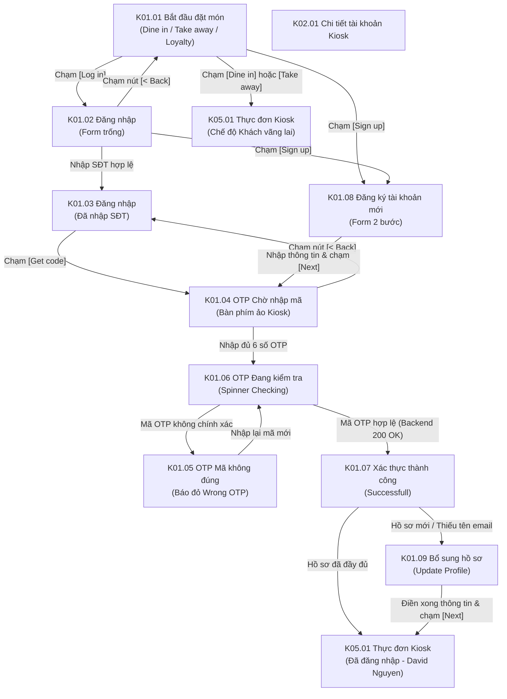

# Phân hệ Kiosk 01: Bắt đầu & Xác thực tài khoản (Kiosk Entry & Authentication)

## 1. Giới thiệu tổng quan (Overview)
Phân hệ **Kiosk 01 - Bắt đầu & Xác thực tài khoản** là cửa ngõ tương tác đầu tiên (Entry Point) của khách hàng trên trạm Kiosk POS màn hình cảm ứng đặt tại quầy thu ngân của nhà hàng/cửa hàng F&B. Phân hệ phục vụ hai luồng nghiệp vụ chính:
1. **Khách hàng bắt đầu đặt món trực tiếp (Order Entry):** Khách chọn ngay hình thức phục vụ mong muốn (**Dine In** - Dùng tại bàn hoặc **Take Away** - Mang đi).
2. **Đăng nhập & Đăng ký Loyalty Account:** Khách hàng có thể đăng nhập tài khoản thành viên bằng Số điện thoại (kèm mã quốc gia như `+47` Na Uy) hoặc Email để nhận diện hạng thẻ, tra cứu số điểm và đổi quà thưởng trước khi đặt món.
3. **Đặc thù trải nghiệm Kiosk màn hình chạm (Touch Screen Ergonomics):**
   - Sử dụng bàn phím ảo (Virtual On-Screen Touch Keyboard / Numpad) tích hợp trực tiếp trên giao diện màn hình lớn, không phụ thuộc bàn phím cơ bên ngoài.
   - Cơ chế bảo mật phiên công cộng: Hiển thị OTP bảo mật, che số điện thoại (`*** *** *567`), đếm ngược thời gian gửi lại OTP (Resend cooldown 30s-120s).
   - Tự động phân nhánh: Nếu tài khoản đã hoàn thiện hồ sơ thì vào thẳng màn hình thực đơn hoặc tài khoản; nếu là tài khoản mới đăng ký hoặc hồ sơ còn thiếu thông tin thì điều hướng đến biểu mẫu bổ sung hồ sơ trực quan.

---

## 2. Danh mục ảnh Prototype (Prototype Inventory)

| STT | Tên file ảnh | Mã màn hình | Tên màn hình | Trạng thái hiển thị |
|---|---|---|---|---|
| 1 | `1-1-bat-dau-dat-mon.png` | **K01.01** | Bắt đầu đặt món · Chọn hình thức | Màn hình chờ: Logo, chọn ngôn ngữ (EN/NO), 2 nút cảm ứng lớn `Dine in` / `Take away`, khối đăng nhập Loyalty Account. |
| 2 | `1-2-dang-nhap-chua-nhap-thong-tin.png` | **K01.02** | Đăng nhập · Chưa nhập SĐT | Form đăng nhập Kiosk: Mã vùng `+47`, ô nhập SĐT trống, nút `[Get code]` mờ/disabled, link `Sign up`. |
| 3 | `1-3-dang-nhap-da-nhap-sdt.png` | **K01.03** | Đăng nhập · Đã nhập SĐT | Đã chuyển tab `By phone number`, đã nhập SĐT (`97371618`), nút `[Get code]` sáng màu vàng sẵn sàng kích hoạt. |
| 4 | `1-4-otp-cho-nhap-ma.png` | **K01.04** | OTP · Chờ nhập mã | Modal xác thực OTP 6 ô trống, bàn phím số cảm ứng nổi lên, dòng thông báo gửi mã tới số ẩn, nút `Resend OTP (30)`. |
| 5 | `1-5-otp-ma-khong-dung.png` | **K01.05** | OTP · Mã không đúng | Trạng thái lỗi: 6 ô OTP viền đỏ chứa mã sai (`2 2 0 9 8 1`), cảnh báo đỏ `⚠ Wrong OTP number, try again`. |
| 6 | `1-6-otp-dang-kiem-tra.png` | **K01.06** | OTP · Đang kiểm tra | Modal hiển thị spinner màu vàng quay vòng kèm dòng chữ `Checking` trong lúc gọi Backend kiểm tra OTP. |
| 7 | `1-7-otp-xac-thuc-thanhcong.png` | **K01.07** | OTP · Xác thực thành công | Icon tích chữ V màu vàng trên nền tròn, tiêu đề `Successfull`, lời chào mừng hội viên Ordera. |
| 8 | `1-8-nhanh-dang-ky-tai-khoan-moi.png` | **K01.08** | Đăng ký tài khoản mới | Tiến trình 2 bước (Personal info -> Verify account), các ô nhập: Họ tên, SĐT, Email, Ngày sinh (DOB). |
| 9 | `1-9-nhanh-bo-sung-ho-so-con-thieu.png` | **K01.09** | Bổ sung hồ sơ còn thiếu | Màn hình `Update your profile`: SĐT đã khóa (disabled/prefilled), người dùng điền Họ tên, Email, Ngày sinh. |

---

## 3. Luồng chuyển hướng & Tương tác chi tiết (Screen Flow & Interactions)

### Chi tiết các màn hình:
- **K01.01 Bắt đầu đặt món · Chọn hình thức (Kiosk Idle / Standby Screen):**
  - **Hiển thị:** Top bar chứa Logo hình vuông bo tròn màu vàng, tên cửa hàng (`SHOP NAME`), cờ chuyển đổi ngôn ngữ Anh / Na Uy (`UK / NO`), nút `[Log in]` góc phải. Khu vực trung tâm hiển thị tiêu đề *"Please select your order option"* với 2 khối cảm ứng kích thước lớn:
    - Khối `Dine in` (Icon muỗng nĩa màu vàng): Đặt món dùng tại quán.
    - Khối `Take away` (Icon túi mua sắm màu vàng): Đặt món mang đi.
  - Phía dưới là khối tiếp cận hội viên *"Loyalty Account: Log in to your account to track rewards, redeem points, and enjoy exclusive perks"* cùng 2 nút: `[Log in]` (viền vàng) và `[Sign up]` (viền xám). Footer hiển thị bản quyền Ordera.
  - **Tương tác:** Chạm vào `Dine in` hoặc `Take away` để vào thẳng thực đơn chọn món **K05.01** (dưới danh nghĩa khách vãng lai). Chạm vào `[Log in]` mở **K01.02**; chạm `[Sign up]` mở **K01.08**.
- **K01.02 & K01.03 Màn hình Đăng nhập (Kiosk Log In Screen):**
  - **Hiển thị:** Nút `< Back` góc trên bên trái quay lại **K01.01**. Card đăng nhập trung tâm có tab chuyển đổi `By Email` và `By phone number` (đang active). Ô chọn mã quốc gia `+47`, ô nhập số điện thoại *"Enter your phone number"*. Nút `[Get code]` ban đầu mờ/disabled (**K01.02**); khi khách chạm bàn phím số ảo nhập đủ số điện thoại hợp lệ (VD: `97371618`), nút `[Get code]` chuyển sang màu vàng tươi (**K01.03**).
  - Phía dưới có link phụ: *"Don't have account? Sign up"* chuyển hướng sang **K01.08**.
- **K01.04 & K01.05 Modal Xác thực OTP (Verify OTP Number):**
  - **Hiển thị:** Tiêu đề *"Verify OTP number"*, dòng thông báo ẩn số: *"OTP number has been sent to \*\*\* \*\*\* \*567"*. 6 ô vuông nhập từng số OTP.
  - Bàn phím số ảo hiển thị ở nửa dưới màn hình cảm ứng để khách thao tác ngón tay dễ dàng.
  - Nút `Resend OTP (30)` đếm ngược 30 giây trước khi cho phép gửi lại mã mới.
  - **Trạng thái lỗi (K01.05):** Khi mã OTP gửi lên Backend bị sai, 6 ô vuông lập tức chuyển viền màu đỏ đậm, hiển thị thông báo lỗi màu đỏ ngay dưới ô nhập: `⚠ Wrong OTP number, try again`. Khách có thể chạm phím delete để sửa lại.
- **K01.06 & K01.07 Trạng thái Xác thực & Thành công:**
  - **K01.06:** Hiển thị spinner chuyển động màu vàng với thông báo `Checking` trong lúc chờ Backend xác minh chữ ký OTP.
  - **K01.07:** Hiển thị biểu tượng tích chữ V màu vàng trên nền tròn cùng thông báo: *"Successfull - Welcome to Ordera's Merchants membership. You can sign in now to redeem voucher and gifts."* Hệ thống tự động chuyển trang sau 1.5 giây.
- **K01.08 Đăng ký tài khoản mới (Register Account):**
  - Hiển thị thanh tiến trình 2 bước: Bước 1 `Personal info` (đang thực hiện), Bước 2 `Verify account`.
  - Các trường bắt buộc: `Your name *`, `Phone number * (+47)`, `Email *`, và trường không bắt buộc `Date of birth (recommend)` kèm icon lịch chọn ngày tháng năm sinh (phục vụ tặng voucher sinh nhật). Nút `[Next]` chuyển sang bước nhập OTP **K01.04**.
- **K01.09 Bổ sung hồ sơ còn thiếu (Update your profile):**
  - Màn hình dành cho khách hàng đã có SĐT trong hệ thống nhưng chưa hoàn tất hồ sơ (thiếu tên/email). Trường SĐT được hiển thị sẵn và ở trạng thái chỉ đọc (`+47 97371618`), khách chỉ cần bổ sung Họ tên, Email, Ngày sinh rồi nhấn `[Next]` để cập nhật và vào thực đơn.

---

## 4. Bảng ánh xạ Màn hình - API chi tiết (Screen-to-API Mapping)

| Màn hình | API Endpoint | Method | Header bắt buộc | Request Body / Query | Mục đích nghiệp vụ |
|---|---|---|---|---|---|
| **K01.01** | `/api/v1/kiosk/config/{deviceId}` | `GET` | `X-Tenant-ID` | Path: `deviceId` | Tải thông tin chi nhánh, logo thương hiệu, cài đặt timeout và trạng thái thiết bị Kiosk. |
| **K01.03** | `/api/v1/auth/otp/send` | `POST` | `X-Tenant-ID`, `X-Kiosk-Device-ID` | `{"channel": "SMS", "phoneNumber": "+4797371618"}` | Sinh mã OTP 6 chữ số, lưu tạm Redis với TTL 120s, gửi tin nhắn SMS tới điện thoại khách. |
| **K01.04 & K01.06** | `/api/v1/auth/otp/verify` | `POST` | `X-Tenant-ID`, `X-Kiosk-Device-ID` | `{"phoneNumber": "+4797371618", "otpCode": "220981"}` | Kiểm tra mã OTP. Nếu hợp lệ trả về bộ JWT token (`accessToken`, `refreshToken`) và cờ `isProfileComplete`. |
| **K01.08** | `/api/v1/auth/register` | `POST` | `X-Tenant-ID`, `X-Kiosk-Device-ID` | `{"fullName": "...", "phoneNumber": "+47...", "email": "...", "dob": "YYYY-MM-DD"}` | Đăng ký thành viên mới từ Kiosk, kích hoạt gửi OTP xác thực. |
| **K01.09** | `/api/v1/profile` | `PUT` | `X-Tenant-ID`, `Authorization: Bearer <token>` | `{"fullName": "...", "email": "...", "dob": "YYYY-MM-DD"}` | Bổ sung các thông tin còn thiếu của hồ sơ khách hàng. |

---

## 5. Xử lý ngoại lệ & Trạng thái biên (Edge Cases & Fallbacks)
1. **Khách rời khỏi Kiosk khi đang ở giữa màn hình đăng nhập (Idle Watchdog):**
   - Nếu không có bất kỳ thao tác chạm màn hình nào trong 60 giây, Kiosk tự động đếm ngược 10 giây cuối kèm âm thanh bíp nhẹ. Nếu không ai tương tác, Kiosk tự động hủy phiên và quay về màn hình chờ **K01.01**.
2. **Nhập sai OTP quá 5 lần (Brute-force Protection):**
   - Hệ thống khóa tạm thời việc thử lại trong 15 phút, hiển thị thông báo: *"Bạn đã nhập sai mã quá số lần quy định. Vui lòng thử lại sau 15 phút hoặc liên hệ nhân viên quầy."*
3. **Mất kết nối Internet / SMS Gateway trục trặc:**
   - Kiosk hiển thị cảnh báo: *"Không thể gửi tin nhắn SMS lúc này. Vui lòng chuyển sang đăng nhập bằng Email hoặc quét mã QR trên điện thoại."*

