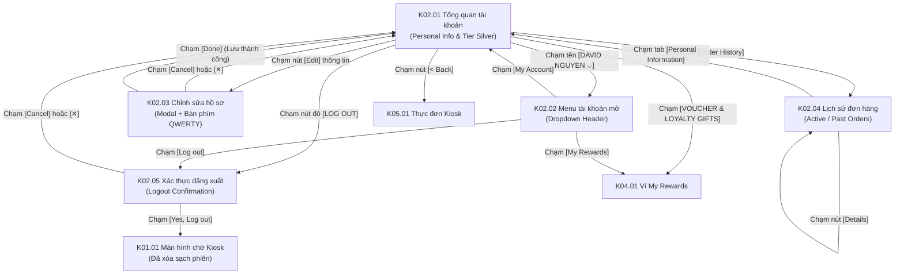

# Phân hệ Kiosk 02: Tài khoản, Lịch sử đơn hàng & Đăng xuất (Account, Order History & Logout)

## 1. Giới thiệu tổng quan (Overview)
Phân hệ **Kiosk 02 - Tài khoản, Lịch sử đơn hàng & Đăng xuất** quản lý trung tâm dữ liệu thành viên (Member Dashboard) trên trạm cảm ứng Kiosk POS. Đây là nơi hội viên xem xét và kiểm soát mọi thông tin cá nhân, cấp bậc loyalty và các đơn hàng gần đây:
1. **Tổng quan thông tin cá nhân & Thẻ thành viên:** Hiển thị thẻ thành viên điện tử (Thẻ `Silver`, số điểm khả dụng `120 points`, điểm tích lũy trọn đời `300 points`), khoảng cách điểm cần đạt để thăng hạng kế tiếp (`100 points`), cùng thanh tiến trình trực quan qua 6 bậc (`New` -> `Silver` -> `Gold` -> `Platinum` -> `Diamond` -> `Ruby`).
2. **Chỉnh sửa hồ sơ cá nhân ngay tại Kiosk:** Mở modal `Edit Profile` cho phép cập nhật Họ tên, Email, Ngày sinh với bàn phím cảm ứng QWERTY toàn màn hình được tối ưu cho ngón tay người dùng.
3. **Tra cứu lịch sử đơn hàng tại trạm Kiosk:** Xem danh sách đơn hàng đang thực hiện (`Active Orders`) và đơn hàng quá khứ (`Past Orders`) kèm mã đơn (`Order number: #907`), tổng tiền (`290 NOK`), thời gian đặt và danh sách món ăn.
4. **Cơ chế xác thực đăng xuất an toàn (Safe Public Logout):** Đảm bảo khách hàng hoàn tất giao dịch hoặc kiểm tra thông tin có thể đăng xuất ngay lập tức qua modal xác nhận `Logout Confirmation` ("Are you sure you want to logout?"), triệt tiêu hoàn toàn rủi ro rò rỉ phiên làm việc công cộng cho người đứng sau.

---

## 2. Danh mục ảnh Prototype (Prototype Inventory)

| STT | Tên file ảnh | Mã màn hình | Tên màn hình | Trạng thái hiển thị |
|---|---|---|---|---|
| 1 | `2-1-tong-quan-tai-khoan-va-hang-thanh-vien.png` | **K02.01** | Tổng quan tài khoản & Hạng thẻ | Bố cục Kiosk 2 cột: Sidebar trái (My Account active), Card Personal Information và Card thẻ thành viên Silver 120 điểm. |
| 2 | `2-2-menu-tai-khoan-dang-mo.png` | **K02.02** | Menu tài khoản đang mở | Dropdown menu góc trên mở ra: `My Account`, `My Rewards`, và nút đỏ `Log out`. |
| 3 | `2-3-chinh-sua-ho-so.png` | **K02.03** | Chỉnh sửa hồ sơ · Bàn phím ảo | Modal `Edit Profile` mở trên nền mờ, bàn phím QWERTY cảm ứng kích thước lớn xuất hiện ở nửa dưới màn hình. |
| 4 | `2-4-lich-su-don-hang.png` | **K02.04** | Lịch sử đơn hàng Kiosk | Tab `Active Orders` hiển thị thẻ đơn hàng: Shop 1, 290 NOK, Order number #907, thời gian đặt, nút `Details`. |
| 5 | `2-5-xac-thuc-dang-xuat.png` | **K02.05** | Xác thực đăng xuất Kiosk | Popup xác nhận `Logout Confirmation` làm mờ toàn màn hình: nút `[Cancel]` và nút đỏ `[Yes, Log out]`. |

---

## 3. Luồng chuyển hướng & Tương tác chi tiết (Screen Flow & Interactions)

### Chi tiết các màn hình:
- **K02.01 Tổng quan tài khoản & Hạng thẻ thành viên (Account Overview):**
  - **Top Bar:** Nút `< Back` góc trái quay về màn hình Thực đơn đặt món **K05.01**. Cờ ngôn ngữ UK/NO. Dropdown định danh góc phải hiển thị icon User và tên in hoa: `DAVID NGUYEN ⌵`.
  - **Sidebar điều hướng trái:**
    - Khối `MY ACCOUNT` (nền vàng nhạt làm nổi bật): 3 mục con gồm `Personal Information` (đang chọn), `Membership Tier`, và `Order History`.
    - Khối `VOUCHER & LOYALTY GIFTS`: Dẫn vào kho quà và voucher **K04.01**.
    - Nút đỏ nổi bật ở chân trang: `[LOG OUT]` (viền đỏ bo tròn).
  - **Khối nội dung chính (2 Cards lớn):**
    1. *Personal Information Card:* Avatar David Nguyen dạng tròn, Tên (`David Nguyen`), Số điện thoại (`+47 97362748` kèm huy hiệu tích xanh xác minh), Email (`info@ordera.no`), Ngày sinh (`23/08/2000`). Nút `Edit` màu vàng ở góc trên bên phải.
    2. *Membership Tier Card:* 
       - Thẻ đồ họa màu xanh lam cyan: Nhãn `MEMBER`, tên hạng `Silver`, điểm hiện tại `Current Point 120`.
       - Dữ liệu thăng hạng: Điểm tích lũy trọn đời `Lifetime Points: 300 points`, thông báo thăng hạng: *"You need 100 points to go to the next level of member"*.
       - Thanh tiến trình 6 bậc: `N` (0) -> `S` (200 - điểm nút hiện tại) -> `G` (400) -> `P` (1000) -> `D` (2000) -> `R` (4000).
- **K02.02 Menu Dropdown tài khoản (Account Header Menu):**
  - Mở ra khi chạm vào khu vực tên người dùng trên Top Bar.
  - Menu dạng popover màu trắng có mũi tên chỉ lên, gồm 3 mục:
    - Icon User `My Account`: Dẫn về trang tổng quan tài khoản **K02.01**.
    - Icon Star `My Rewards`: Dẫn về trang ví ưu đãi **K04.01**.
    - Icon Log out màu đỏ `Log out`: Kích hoạt popup xác nhận đăng xuất **K02.05**.
- **K02.03 Chỉnh sửa hồ sơ cá nhân (Edit Profile Modal):**
  - Modal bo tròn hiển thị tiêu đề `Edit Profile` kèm nút đóng `[✕]`.
  - 4 ô nhập thông tin: Họ tên, Số điện thoại (chỉ đọc/bảo vệ danh tính), Email, Ngày sinh (`23/08/2000`).
  - Bàn phím cảm ứng ảo QWERTY hiển thị ở nửa dưới màn hình với đầy đủ phím ký tự, số, dấu câu, phím cách và phím xóa lớn.
  - Nút `[Cancel]` hủy chỉnh sửa; nút `[Done]` lưu thông tin vào CSDL qua API.
- **K02.04 Lịch sử đơn hàng (Order History):**
  - Hiển thị 2 tab lớn: `Active Orders` (đang có đơn) và `Past Orders`.
  - Thẻ đơn hàng bao gồm: Ảnh đại diện cửa hàng (`Shop 1 Cover`), tên cửa hàng (`Shop 1`), tổng giá tiền (`290 NOK`), mã số đơn hàng (`Order number: #907`), thời gian tạo đơn (`Placed at 17 mar 2025, 17:01`), tóm tắt tên món (`Dish name 1; Dish name 2`), và nút bấm `[Details]` để xem chi tiết đơn.
- **K02.05 Xác thực đăng xuất (Logout Confirmation Dialog):**
  - Dialog cảnh báo làm mờ toàn bộ giao diện phía sau.
  - Tiêu đề: `Logout Confirmation`.
  - Thông điệp cảnh báo: *"You're about to logout this user account. Are you sure you want to logout?"*
  - Hành động:
    - `[Cancel]`: Giữ nguyên phiên làm việc, đóng modal.
    - `[Yes, Log out]` (Nút màu đỏ đậm): Gọi API đăng xuất, xóa toàn bộ Access/Refresh token và cache trên Kiosk, đưa màn hình trở về trạng thái chờ mặc định **K01.01**.

---

## 4. Bảng ánh xạ Màn hình - API chi tiết (Screen-to-API Mapping)

| Màn hình | API Endpoint | Method | Header bắt buộc | Request Body / Query | Mục đích nghiệp vụ |
|---|---|---|---|---|---|
| **K02.01** | `/api/v1/profile` | `GET` | `X-Tenant-ID`, `Authorization: Bearer <token>` | Không | Lấy dữ liệu hồ sơ cá nhân, hạng thẻ hiện tại, số điểm tích lũy và tiến độ thăng bậc. |
| **K02.03** | `/api/v1/profile` | `PUT` | `X-Tenant-ID`, `Authorization: Bearer <token>` | `{"fullName": "David Nguyen", "email": "info@ordera.no", "dob": "2000-08-23"}` | Cập nhật thông tin hồ sơ thành viên qua modal Edit Profile. |
| **K02.04** | `/api/v1/orders` | `GET` | `X-Tenant-ID`, `Authorization: Bearer <token>` | `?status=ACTIVE` hoặc `PAST` `&page=0&size=10` | Lấy danh sách lịch sử đơn hàng của khách để hiển thị tại tab tương ứng. |
| **K02.05** | `/api/v1/auth/logout` | `POST` | `X-Tenant-ID`, `X-Kiosk-Device-ID`, `Authorization: Bearer <token>` | `{"refreshToken": "..."}` | Thu hồi token, đưa vào blacklist Redis, hủy phiên khách hàng trên Kiosk. |
| **K02.05** | `/api/v1/kiosk/session/reset` | `POST` | `X-Tenant-ID`, `X-Kiosk-Device-ID` | `{"storeId": "...", "reason": "USER_MANUAL_RESET"}` | Đặt lại trạm Kiosk về chế độ chờ (Standby) sau khi đăng xuất thành công. |

---

## 5. Xử lý ngoại lệ & Trạng thái biên (Edge Cases & Fallbacks)
1. **Khách hàng quên bấm Đăng xuất khi rời khỏi quầy (Public Terminal Privacy):**
   - Trạm Kiosk được trang bị bộ giám sát phiên tự động (Watchdog Timer 60s). Nếu không phát hiện tương tác chạm sau 60 giây, hệ thống tự động gọi API `resetKioskSession` với lý do `IDLE_TIMEOUT` để dọn sạch dữ liệu cá nhân, ngăn chặn triệt để nguy cơ người dùng tiếp theo sử dụng tài khoản hoặc tiêu điểm của khách trước.
2. **Lỗi mạng khi lưu cập nhật hồ sơ (Edit Profile Failure):**
   - Nút `[Done]` hiển thị spinner loading; nếu kết nối thất bại, hiển thị thông báo lỗi màu đỏ ngay trong modal: *"Không thể lưu thông tin lúc này. Vui lòng kiểm tra lại kết nối mạng."*
3. **Không có đơn hàng nào trong lịch sử (Empty Order History):**
   - Tab hiển thị hình minh họa trống kèm dòng chữ: *"You have no active orders. Start ordering now to earn more loyalty points!"* kèm nút điều hướng nhanh về thực đơn **K05.01**.

