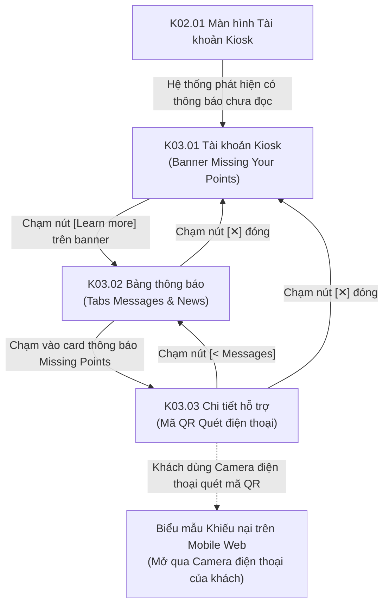

# Phân hệ Kiosk 03: Hỗ trợ thiếu điểm Loyalty & Bảng thông báo (Missing Points & Announcements)

## 1. Giới thiệu tổng quan (Overview)
Phân hệ **Kiosk 03 - Hỗ trợ thiếu điểm Loyalty & Bảng thông báo** xử lý nhu cầu hỗ trợ khách hàng và giải quyết khiếu nại đối soát điểm tích lũy ngay tại trạm Kiosk công cộng:
1. **Tiếp cận thông báo trực quan (Missing Your Points Banner):** Khi khách hàng xem hồ sơ tài khoản hoặc vừa nâng cấp phiên bản hệ thống, một banner nổi bật với viền đỏ nhạt *"Missing Your Points?"* xuất hiện để nhắc nhở khách hàng về chính sách bảo toàn điểm thưởng.
2. **Hộp thư tin nhắn & Tin tức Kiosk (Messages & News Modal):** Cho phép xem các tin nhắn hệ thống thông báo nâng cấp nền tảng và các chương trình tri ân khách hàng.
3. **Giải pháp quét mã QR giải quyết khiếu nại thông minh (Cross-Device Mobile QR Claim):**
   - Thay vì bắt khách hàng phải đứng tại quầy Kiosk công cộng để gõ thủ công từng hóa đơn giấy cũ (gây ùn tắc hàng chờ), Kiosk hiển thị một **Mã QR Code độc quyền** (`Submit Form`).
   - Khách hàng chỉ cần giơ điện thoại cá nhân lên quét mã QR để mở ngay biểu mẫu gửi hóa đơn đối soát trên điện thoại của mình trong lúc di chuyển hoặc về chỗ ngồi thưởng thức món ăn.

---

## 2. Danh mục ảnh Prototype (Prototype Inventory)

| STT | Tên file ảnh | Mã màn hình | Tên màn hình | Trạng thái hiển thị |
|---|---|---|---|---|
| 1 | `3-1-tai-khoan-thong-bao-thieu-diem.png` | **K03.01** | Tài khoản có banner thiếu điểm | Màn hình tài khoản thành viên hiển thị banner viền đỏ nhạt: *"Missing Your Points? ... [Learn more]"* dưới thẻ hạng thẻ. |
| 2 | `3-2-bang-thongbao.png` | **K03.02** | Bảng thông báo Messages | Modal hộp thư mở ra với 2 tabs `Messages` và `News`. Thẻ thông báo thiếu điểm xuất hiện ở đầu danh sách. |
| 3 | `3-3-chi-tiet-ho-tro-khoi-phuc-diem.png` | **K03.03** | Chi tiết hỗ trợ khôi phục điểm | Modal chi tiết: Nút `< Messages`, ảnh minh họa, email hỗ trợ `info@example.com`, và Mã QR `Submit Form` cho khách quét điện thoại. |

---

## 3. Luồng chuyển hướng & Tương tác chi tiết (Screen Flow & Interactions)

### Chi tiết các màn hình:
- **K03.01 Tài khoản hiển thị banner thiếu điểm (Account View with Missing Points Callout):**
  - **Vị trí hiển thị:** Nằm ở khu vực bên dưới Card hạng thẻ thành viên `Membership Tier` trên màn hình tài khoản chính **K02.01**.
  - **Nội dung:** Khối thông báo viền đỏ nhạt bo góc:
    - Tiêu đề đỏ nổi bật: `Missing Your Points?`
    - Mô tả: *"We've upgraded our system to improve your experience. If you don't see your loyalty points, please contact us or submit a request - we'll help you retrieve them!"*
    - Nút bấm hành động: `[Learn more]` (màu vàng bo tròn).
  - **Tương tác:** Chạm `[Learn more]` mở ra modal Bảng thông báo **K03.02**.
- **K03.02 Bảng thông báo Kiosk (Messages & News Modal):**
  - Modal làm mờ toàn màn hình với nút đóng `[✕]` ở góc trên bên phải.
  - Hai tab lựa chọn: `Messages` (đang active, có gạch chân vàng) và `News`.
  - Bên trong tab `Messages` hiển thị danh sách các thông điệp hệ thống. Mục đầu tiên là thông báo hỗ trợ điểm tích lũy kèm nút vàng `[Learn more]`.
- **K03.03 Chi tiết hỗ trợ khôi phục điểm & Quét mã QR (Missing Points Support Detail):**
  - Tiêu đề phụ góc trái: Nút quay lại `<` kèm nhãn `Messages` để quay lại danh sách thông báo. Nút `[✕]` đóng nhanh modal.
  - Tiêu đề chính: `Missing Your Points?` màu đỏ.
  - Bố cục chia 2 nửa:
    - **Nửa bên trái:** Ảnh minh họa ẩm thực chất lượng cao. Đoạn văn bản hướng dẫn chi tiết về quy trình phục hồi điểm do nâng cấp hệ thống, thông tin kênh hỗ trợ chính thức (`Email: info@example.com`).
    - **Nửa bên phải:**
      - Khối `Emails us`: Hiển thị địa chỉ email tiếp nhận `info@example.com`.
      - Khối `Submit Form`: Hiển thị một **Mã QR Code chuẩn định dạng** rõ nét. Khách hàng sử dụng ứng dụng Camera hoặc Zalo trên điện thoại cá nhân quét mã này để truy cập thẳng vào trang đối soát hóa đơn trên trình duyệt điện thoại cá nhân (liên kết tới `https://ordera.me/support/claim-points?userId=...&storeId=...`).

---

## 4. Bảng ánh xạ Màn hình - API chi tiết (Screen-to-API Mapping)

| Màn hình | API Endpoint | Method | Header bắt buộc | Request Body / Query | Mục đích nghiệp vụ |
|---|---|---|---|---|---|
| **K03.01 & K03.02** | `/api/v1/notifications` | `GET` | `X-Tenant-ID`, `Authorization: Bearer <token>` | `?category=system&unread_only=false` | Lấy danh sách các thông báo hệ thống và tin tức dành cho tài khoản thành viên. |
| **K03.02** | `/api/v1/notifications/{notificationId}/read` | `PATCH` | `X-Tenant-ID`, `Authorization: Bearer <token>` | Path: `notificationId` | Đánh dấu thông báo đã đọc khi khách hàng chạm mở xem chi tiết. |
| **K03.03** | `/api/v1/support/inquiries/qr-token` | `POST` | `X-Tenant-ID`, `X-Kiosk-Device-ID`, `Authorization: Bearer <token>` | `{"inquiryType": "MISSING_POINTS"}` | Sinh URL và mã QR ngắn hạn có chữ ký bảo mật để khách quét mở form trên điện thoại. |

---

## 5. Xử lý ngoại lệ & Trạng thái biên (Edge Cases & Fallbacks)
1. **Kiosk không thể tạo mã QR do mất kết nối mạng cục bộ:**
   - Thay thế mã QR bằng hiển thị số hotline tổng đài hỗ trợ và địa chỉ email in đậm, kèm thông báo: *"Vui lòng gửi ảnh chụp hóa đơn giấy của bạn tới email hỗ trợ để nhân viên cộng điểm thủ công."*
2. **Khách hàng không mang điện thoại để quét mã QR:**
   - Cho phép khách hàng báo trực tiếp với nhân viên thu ngân tại quầy bằng cách cung cấp số điện thoại đã đăng ký và hóa đơn giấy cũ để thu ngân tra cứu trên POS.
3. **Mã QR hết hạn (Token Expiry):**
   - Mã QR có thời hạn 15 phút. Nếu khách quét sau 15 phút, trang web di động sẽ yêu cầu nhập lại mã OTP để xác minh danh tính chủ tài khoản.

