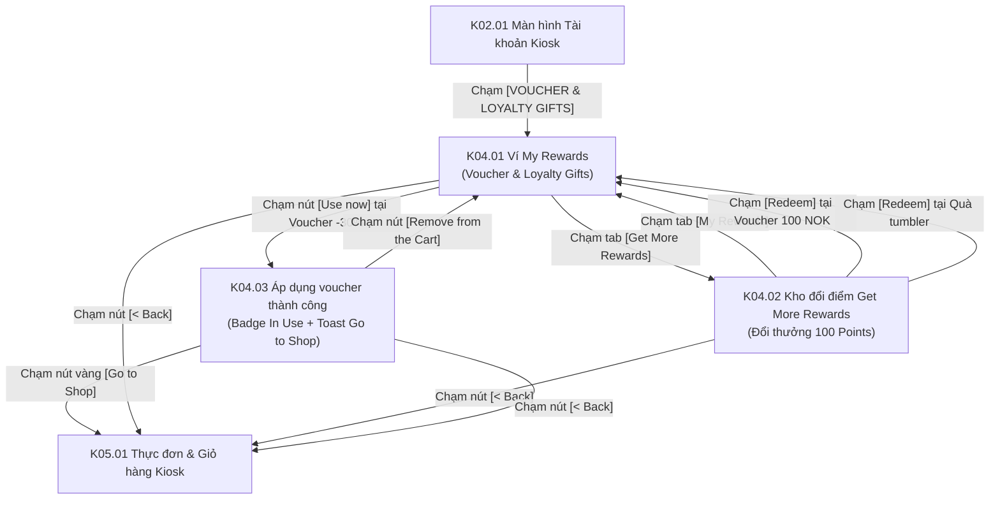

# Phân hệ Kiosk 04: Ví ưu đãi & Kho đổi thưởng điểm tích lũy (Rewards & Redemption Store)

## 1. Giới thiệu tổng quan (Overview)
Phân hệ **Kiosk 04 - Ví ưu đãi & Kho đổi thưởng điểm tích lũy** mang lại trải nghiệm gamification và kích thích lòng trung thành của khách hàng ngay trên trạm cảm ứng Kiosk POS:
1. **Ví ưu đãi cá nhân (`My Rewards`):** Lưu trữ các mã giảm giá (Vouchers) và phiếu quà tặng hiện vật (Loyalty Gifts) mà khách hàng đã sở hữu (hoặc được cấp tự động từ chính sách hạng thẻ/sinh nhật). Khách có thể chạm `[Use now]` để gắn thẳng ưu đãi vào đơn hàng hiện tại.
2. **Kho đổi điểm lấy thưởng (`Get More Rewards`):** Sử dụng điểm tích lũy hiện có (`Current Point 120`) để đổi lấy các phần thưởng có giá trị:
   - Voucher tiền mặt (`100 NOK` - 100 điểm).
   - Voucher phần trăm (`-30%` - 1000 điểm: tự động làm mờ và khóa nút nếu khách không đủ điểm).
   - Quà tặng hiện vật thương hiệu: Cốc giữ nhiệt tumbler (`100 Points`, số lượng tồn kho hiển thị minh bạch `Quantity left: 10 Pieces`).
3. **Cơ chế phản hồi thời gian thực trên màn hình Kiosk:** Khi áp dụng thành công mã ưu đãi, thẻ voucher đổi trạng thái thành `✓ In Use`, xuất hiện nút gỡ bỏ `[Remove from the Cart]` và thanh toast nổi màu xanh `✓ Voucher added successfully` kèm nút điều hướng nhanh `[Go to Shop]`.

---

## 2. Danh mục ảnh Prototype (Prototype Inventory)

| STT | Tên file ảnh | Mã màn hình | Tên màn hình | Trạng thái hiển thị |
|---|---|---|---|---|
| 1 | `4-1-my-rewards.png` | **K04.01** | Ví My Rewards | Mục My Rewards active: 2 Voucher (100 NOK, -30% với nút `Use now`), 2 Loyalty Gifts (Cốc tumbler với nút `Get now`). |
| 2 | `4-2-get-more-rewards-doi-diem.png` | **K04.02** | Kho đổi điểm Get More Rewards | Mục Get More Rewards active: Voucher 100 NOK (100 Points, nút Redeem vàng), Voucher -30% (1000 Points, nút Redeem xám disabled), Quà tumbler (100 Points, nút Redeem vàng). |
| 3 | `4-3-ap-dung-voucher-tu-rewards.png` | **K04.03** | Áp dụng voucher từ Rewards | Voucher -30% hiển thị badge `✓ In Use` và nút `Remove from the Cart`. Banner toast `✓ Voucher added successfully` kèm nút vàng `[Go to Shop]`. |

---

## 3. Luồng chuyển hướng & Tương tác chi tiết (Screen Flow & Interactions)

### Chi tiết các màn hình:
- **K04.01 Ví My Rewards (Personal Rewards Wallet):**
  - **Sidebar điều hướng trái:** Khối `VOUCHER & LOYALTY GIFTS` có nền vàng nhạt, mục `My Rewards` đang được chọn màu vàng đậm. Chân trang có nút đỏ `[LOG OUT]`.
  - **Khu vực nội dung chính chia 2 nhóm rõ ràng:**
    1. *Nhóm Voucher:* Hiển thị thẻ đồ họa hình vé coupon màu vàng.
       - Thẻ 1: Icon đồng đô la `$`, Tên `Voucher Name`, Giá trị `100 NOK`, Mô tả *"Giảm 100 NOK giá trị cho Order của bạn"*, điều kiện *"Minimum Order Value: 250 NOK"*, hạn dùng *"Expired date: 3 dec 2025"*, nút chữ xanh `Use now`.
       - Thẻ 2: Icon phần trăm `%`, Giá trị `-30%`, Mô tả *"Giảm 30% giá trị cho đơn hàng của bạn"*, điều kiện *"Minimum Order Value: 0 NOK"*, hạn dùng *"Expired date: 3 dec 2025"*, nút chữ xanh `Use now`.
    2. *Nhóm Loyalty Gifts (Quà hiện vật):*
       - Ảnh thực tế cốc giữ nhiệt Tumbler màu hồng sang trọng. Tên `Gift Name`, mô tả lưu ý của Admin, tồn kho khả dụng `Quantity left: 10 Pieces`, nút chữ xanh `Get now`.
- **K04.02 Kho đổi điểm Get More Rewards (Points Redemption Catalog):**
  - Mục `Get More Rewards` trên sidebar được kích hoạt.
  - Mỗi phần thưởng hiển thị rõ mức điểm quy đổi:
    - *Voucher 100 NOK:* Giá `100 Points`. Vì tài khoản có 120 điểm (> 100), nút `[Redeem]` màu vàng rực rỡ, sẵn sàng cho phép khách đổi ngay.
    - *Voucher -30%:* Giá `1000 Points`. Vì 120 điểm < 1000 điểm, nút `[Redeem]` tự động bị vô hiệu hóa (màu xám, không thể bấm), đồng thời hiển thị mức điểm đỏ `1000 Points` để khách biết cần tích lũy thêm.
    - *Quà cốc Tumbler:* Giá `100 Points`. Nút `[Redeem]` màu vàng enabled, cho phép đổi quà và hệ thống sẽ xuất phiếu nhận quà kèm theo hóa đơn in.
- **K04.03 Trạng thái Áp dụng thành công & Điều hướng quay lại Menu (Voucher Applied State):**
  - Khi khách hàng chạm `Use now` trên Voucher `-30%`:
    - Thẻ voucher lập tức xuất hiện huy hiệu nền xanh lá bo tròn có dấu tích `✓ In Use`.
    - Nút `Use now` được thay thế bằng nút `[Remove from the Cart]` (viền xám bo tròn), cho phép khách hủy áp dụng bất kỳ lúc nào nếu đổi ý.
    - Một thanh thông báo dạng Toast nổi bật xuất hiện ở góc dưới bên phải màn hình: Nền xanh pastel `✓ Voucher added successfully` cùng nút bấm lớn màu vàng `[Go to Shop]` để dẫn khách thẳng vào thực đơn tiếp tục chọn món.

---

## 4. Bảng ánh xạ Màn hình - API chi tiết (Screen-to-API Mapping)

| Màn hình | API Endpoint | Method | Header bắt buộc | Request Body / Query | Mục đích nghiệp vụ |
|---|---|---|---|---|---|
| **K04.01** | `/api/v1/rewards/my-rewards` | `GET` | `X-Tenant-ID`, `Authorization: Bearer <token>` | `?status=AVAILABLE` | Lấy danh sách voucher và quà tặng hiện vật đang có trong ví của hội viên. |
| **K04.02** | `/api/v1/rewards/catalog` | `GET` | `X-Tenant-ID`, `Authorization: Bearer <token>` | `?category=ALL` | Lấy danh mục các phần thưởng đang mở đổi điểm, số điểm yêu cầu và số lượng tồn kho. |
| **K04.02** | `/api/v1/rewards/redeem` | `POST` | `X-Tenant-ID`, `Authorization: Bearer <token>` | `{"rewardId": "...", "rewardType": "VOUCHER"}` | Trừ điểm trên `points_ledger` và cấp voucher mới vào ví người dùng. |
| **K04.03** | `/api/v1/cart/apply-voucher` | `POST` | `X-Tenant-ID`, `Authorization: Bearer <token>` | `{"voucherCode": "DISCOUNT30"}` | Gắn mã voucher vào giỏ hàng Kiosk hiện tại, cập nhật lại tổng tiền tạm tính. |
| **K04.03** | `/api/v1/cart/remove-voucher` | `DELETE` | `X-Tenant-ID`, `Authorization: Bearer <token>` | `{"voucherCode": "DISCOUNT30"}` | Gỡ bỏ mã voucher khỏi giỏ hàng khi khách bấm Remove from the Cart. |

---

## 5. Xử lý ngoại lệ & Trạng thái biên (Edge Cases & Fallbacks)
1. **Không đủ điểm đổi quà (Insufficient Points):**
   - Nút `[Redeem]` bị disabled màu xám; nếu cố tình click, hiển thị tooltip cảnh báo: *"Bạn còn thiếu 880 điểm để đổi phần thưởng này. Hãy tiếp tục tích điểm qua các đơn hàng nhé!"*
2. **Quà hiện vật hết hàng trong kho (`Quantity left: 0 Pieces`):**
   - Huy hiệu `Sold Out` màu đỏ thay thế cho giá điểm, nút đổi quà chuyển sang trạng thái tạm khóa để tránh phát sinh khiếu nại tại quầy.
3. **Đơn hàng chưa đạt giá trị tối thiểu của Voucher (Minimum Order Constraint):**
   - Nếu giỏ hàng hiện tại chưa đủ 250 NOK khi áp dụng Voucher 100 NOK, hệ thống vẫn cho phép gắn voucher nhưng hiển thị dòng nhắc nhở trong giỏ: *"Cần mua thêm 80 NOK để kích hoạt giảm giá 100 NOK."*
