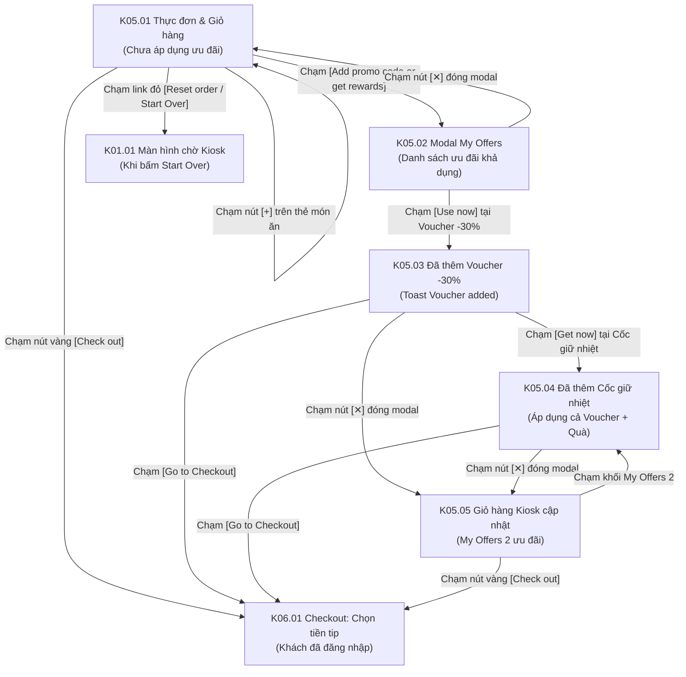

# Phân hệ Kiosk 05: Đặt món, Giỏ hàng Kiosk & Chọn ưu đãi My Offers (Ordering, Cart & Offers Drawer)

## 1. Giới thiệu tổng quan (Overview)
Phân hệ **Kiosk 05 - Đặt món, Giỏ hàng Kiosk & Chọn ưu đãi My Offers** là giao diện trung tâm điều hành trải nghiệm ẩm thực (Core Ordering Experience) trên màn hình cảm ứng rộng của trạm Kiosk POS:
1. **Bố cục chia đôi tối ưu chạm (Split Screen Touch Layout):**
   - **Khu vực Thực đơn (chiếm 2/3 màn hình bên trái):** Duyệt món theo khung giờ ăn (`Lunch menu`, `Dinner menu`, `Holiday menu`, `Special VIP`), bộ lọc danh mục hình ảnh trực quan (`🔥 Popular`, `🍕 Pizza`, `🍔 Burger`, `🍗 Chicken`, `🍚 Rice`, `🥤 Soft drinks`), thẻ món ăn có ảnh sắc nét, huy hiệu `NEW`/`POPULAR`, số lượt thích tim, giá bán, giá gạch bỏ và nút thêm nhanh `[+]`.
   - **Khu vực Giỏ hàng cố định (chiếm 1/3 màn hình bên phải):** Luôn hiển thị trực quan các món đã chọn, tùy chọn điều chỉnh số lượng `[-] 1 [+]`, mô tả modifier tùy biến, tạm tính tiền, thuế VAT gộp và điểm thưởng dự kiến nhận được (`+170 points`).
2. **Khối ưu đãi thông minh tích hợp trong Giỏ hàng (`My Offers`):**
   - Nút bấm trực tiếp `Add promo code or get rewards >` kèm badge đếm số ưu đãi khả dụng (VD: `4`).
   - Mở modal popup chọn ưu đãi ngay trên màn hình đặt món mà không làm gián đoạn hay mất trạng thái giỏ hàng.
3. **Quy tắc áp dụng đồng thời (Dual Benefit Rule):**
   - Kiosk hỗ trợ áp dụng song song **01 Voucher giảm giá** (VD: `-30%`) VÀ **01 Quà tặng hiện vật Loyalty Gift** (VD: `Cốc giữ nhiệt`) trong cùng một đơn hàng, tối đa hóa quyền lợi thành viên.

---

## 2. Danh mục ảnh Prototype (Prototype Inventory)

| STT | Tên file ảnh | Mã màn hình | Tên màn hình | Trạng thái hiển thị |
|---|---|---|---|---|
| 1 | `5-1-thuc-don-va-gio-hang-chua-ap-dung-uu-dai.png` | **K05.01** | Thực đơn & Giỏ hàng cơ bản | Màn hình đặt món chia đôi: Lưới món ăn bên trái, giỏ hàng có 1 bánh Pizza Saigon Mania 170 Kr, khối `My Offers ❹` chưa chọn ưu đãi. |
| 2 | `5-2-my-offers-chon-uu-dai-trong-don.png` | **K05.02** | Modal My Offers chọn ưu đãi | Popup làm mờ thực đơn, hiển thị 2 tab `My Rewards` và `Get More Rewards`, danh sách Voucher và Quà tặng hiện vật. |
| 3 | `5-3-my-offers-da-them-voucher.png` | **K05.03** | My Offers đã chọn voucher | Voucher -30% hiển thị `✓ In Use`, xuất hiện toast `✓ Voucher added successfully` kèm nút vàng `[Go to Checkout]`. |
| 4 | `5-4-my-offers-da-them-qua.png` | **K05.04** | My Offers đã chọn cả quà | Áp dụng đồng thời cả Voucher (-30%) và Cốc giữ nhiệt (`✓ Selected`), toast `✓ Loyalty Gift added successfully`. |
| 5 | `5-5-gio-hang-da-co-uu-dai.png` | **K05.05** | Giỏ hàng Kiosk đã gắn ưu đãi | Giỏ hàng cập nhật khối `My Offers ❷` hiển thị `🏷 DISCOUNT30%` và `🎁 Cốc giữ nhiệt`. Nút `[Check out]` sẵn sàng. |

---

## 3. Luồng chuyển hướng & Tương tác chi tiết (Screen Flow & Interactions)

### Chi tiết các màn hình:
- **K05.01 Thực đơn & Giỏ hàng cơ bản (Kiosk Split Menu & Cart):**
  - **Top Bar:** Logo cửa hàng, tên `Shop Name`, cờ EN/NO, menu tài khoản `DAVID NGUYEN ⌵`, thanh tìm kiếm món nhanh `🔍 Search item`.
  - **Thực đơn ẩm thực (Cột trái & giữa):**
    - Thanh tab thực đơn thời gian: `Lunch menu` (đang kích hoạt, có mũi tên vàng), `Dinner menu`, `Holiday menu`, `Special VIP`.
    - Thanh danh mục trượt ngang: `🔥 Popular` (nền vàng), `🍕 Pizza`, `🍔 Burger`, `🍗 Chicken`, `🍚 Rice`, `🥤 Soft drinks`, nút cuộn `>`.
    - Lưới món ăn 6 món:
      - `PIZZA NEW YORK CHEESESTEAK`: Badge `NEW`, tag chữ `MỚI`, tim `♥ 320`, giá đỏ `1000 Kr` (gạch bỏ `1200 Kr`), nút `[+]`.
      - `PIZZA OCEAN MANIA`: Tim `♥ 320`, giá `1000 Kr` (gạch bỏ `1200 Kr`), nút `[+]`.
      - `PIZZA SAIGON MANIA`: Badge `POPULAR`, tim `♥ 300`, giá `1000 Kr`, nút đã thêm thành công (hình vuông xanh lá).
      - `SPECIAL CHEESE CHICKEN BURGER`: Badge tròn `100% Australian Beef`, nút `[+]`.
      - `9 PIECES OF FRIED CHICKEN`: Badge `POPULAR`, nút `[+]`.
      - `6 PIECES CHICKEN NUGGETS`: Nút `[+]`.
  - **Cột Giỏ hàng Kiosk (Cột phải):**
    - Tiêu đề: `Your cart` kèm link đỏ `Reset order` và `hide`.
    - Số lượng món: `1 item`.
    - Chi tiết món: Ảnh đại diện bánh pizza, tên `PIZZA SAIGON MANIA`, cụm tăng giảm `[-] 1 [+]`, giá `170 Kr`. Mô tả nguyên liệu: *"Handtossed crust, 7 inch, sausage, double cheese"*.
    - Khối ưu đãi: `My Offers` kèm huy hiệu đỏ tròn `4` (4 ưu đãi khả dụng), dòng hướng dẫn `🏷 Add promo code or get rewards >`.
    - Tổng tiền tạm tính: `Subtotal (included VAT): 170 Kr`, `Discount: 0 Kr`, `Total: 170 Kr` kèm badge đỏ hồng tích điểm: `+170 points`.
    - Nút bấm chính: `[Check out]` (màu vàng toàn chiều rộng giỏ hàng).
- **K05.02 Modal chọn ưu đãi My Offers (Offers Selection Drawer):**
  - Mở ra đè lên thực đơn khi khách bấm vào khối My Offers trong giỏ hàng.
  - Tab `My Rewards` hiển thị các Voucher và Quà tặng có sẵn trong tài khoản của David Nguyen.
- **K05.03 & K05.04 Áp dụng Voucher & Quà tặng hiện vật:**
  - **K05.03 (Thêm voucher):** Khách chạm `Use now` ở Voucher `-30%`. Thẻ chuyển sang `✓ In Use` và nút `Remove from the Cart`. Banner toast màu xanh lá pastel xuất hiện: `✓ Voucher added successfully` cùng nút vàng `[Go to Checkout]`.
  - **K05.04 (Thêm quà hiện vật):** Khách tiếp tục chạm `Get now` ở Cốc giữ nhiệt Tumblr. Thẻ quà chuyển sang huy hiệu màu xanh lá `✓ Selected` và nút `Remove from the Cart`. Toast thông báo cập nhật: `✓ Loyalty Gift added successfully` cùng nút `[Go to Checkout]`.
- **K05.05 Giỏ hàng Kiosk sau khi áp dụng đầy đủ ưu đãi:**
  - Trở về giao diện giỏ hàng sau khi đóng modal.
  - Khối ưu đãi cập nhật thành: `My Offers ❷` (nền vàng nhạt nổi bật có viền vàng):
    - `🏷 DISCOUNT30%` (màu vàng đậm)
    - `🎁 Cốc giữ nhiệt` (màu vàng đậm)
    - Mũi tên điều hướng `>` để mở lại chỉnh sửa ưu đãi.
  - Link thao tác trên đỉnh giỏ hàng chuyển thành `Start Over` (màu đỏ) cho phép khách xóa nhanh toàn bộ giỏ để đặt lại từ đầu.

---

## 4. Bảng ánh xạ Màn hình - API chi tiết (Screen-to-API Mapping)

| Màn hình | API Endpoint | Method | Header bắt buộc | Request Body / Query | Mục đích nghiệp vụ |
|---|---|---|---|---|---|
| **K05.01** | `/api/v1/stores/{storeId}/categories` | `GET` | `X-Tenant-ID` | Path: `storeId` | Lấy danh mục thực đơn theo khung giờ (Lunch, Dinner, Holiday) và phân loại món. |
| **K05.01** | `/api/v1/stores/{storeId}/products` | `GET` | `X-Tenant-ID` | `?category_id=...&meal_period=LUNCH` | Lấy danh sách món ăn, giá bán, lượt yêu thích, badge món và trạng thái phục vụ. |
| **K05.01** | `/api/v1/cart/items` | `POST` | `X-Tenant-ID`, `X-Kiosk-Device-ID`, `Authorization` *(Tùy chọn)* | `{"productId": "...", "quantity": 1, "customizations": [...]}` | Thêm món ăn vào giỏ hàng Kiosk hoặc cập nhật số lượng khi bấm `[+]`/`[-]`. |
| **K05.02** | `/api/v1/rewards/my-rewards` | `GET` | `X-Tenant-ID`, `Authorization: Bearer <token>` | `?status=AVAILABLE` | Lấy danh sách ưu đãi trong ví hội viên để render trong modal My Offers. |
| **K05.03** | `/api/v1/cart/apply-voucher` | `POST` | `X-Tenant-ID`, `Authorization: Bearer <token>` | `{"voucherCode": "DISCOUNT30"}` | Kiểm tra điều kiện đơn hàng và áp dụng mã giảm giá 30%. |
| **K05.04** | `/api/v1/cart/apply-gift` | `POST` | `X-Tenant-ID`, `Authorization: Bearer <token>` | `{"giftId": "tumbler-01"}` | Đăng ký nhận quà hiện vật cốc giữ nhiệt tặng kèm đơn hàng. |
| **K05.05** | `/api/v1/cart` | `GET` | `X-Tenant-ID`, `Authorization: Bearer <token>` | Không | Lấy dữ liệu giỏ hàng mới nhất bao gồm voucher, quà tặng và tính lại tổng tiền. |

---

## 5. Xử lý ngoại lệ & Trạng thái biên (Edge Cases & Fallbacks)
1. **Áp dụng quà tặng khi hết tồn kho tại quầy (Gift Stock Depleted):**
   - Nếu trong lúc khách đang đặt món mà nhân viên quầy vừa phát hết cốc giữ nhiệt cuối cùng, API trả về `409 Conflict (GIFT_OUT_OF_STOCK)`. Kiosk hiển thị popup: *"Món quà này vừa hết tại chi nhánh. Bạn có thể chọn món quà khác hoặc tích điểm để nhận vào lần sau."*
2. **Khách bấm nút Reset Order / Start Over:**
   - Hệ thống hiển thị popup xác nhận: *"Bạn có chắc chắn muốn xóa toàn bộ món trong giỏ hàng và đặt lại từ đầu?"*. Nếu khách đồng ý, gọi API xóa giỏ hàng và trả về menu trắng.
3. **Món ăn hết hàng trong lúc đang xem (Real-time Stock Sync):**
   - Thẻ món tự động mờ đi, nút `[+]` chuyển thành `Sold Out`, không thể click thêm vào giỏ.
