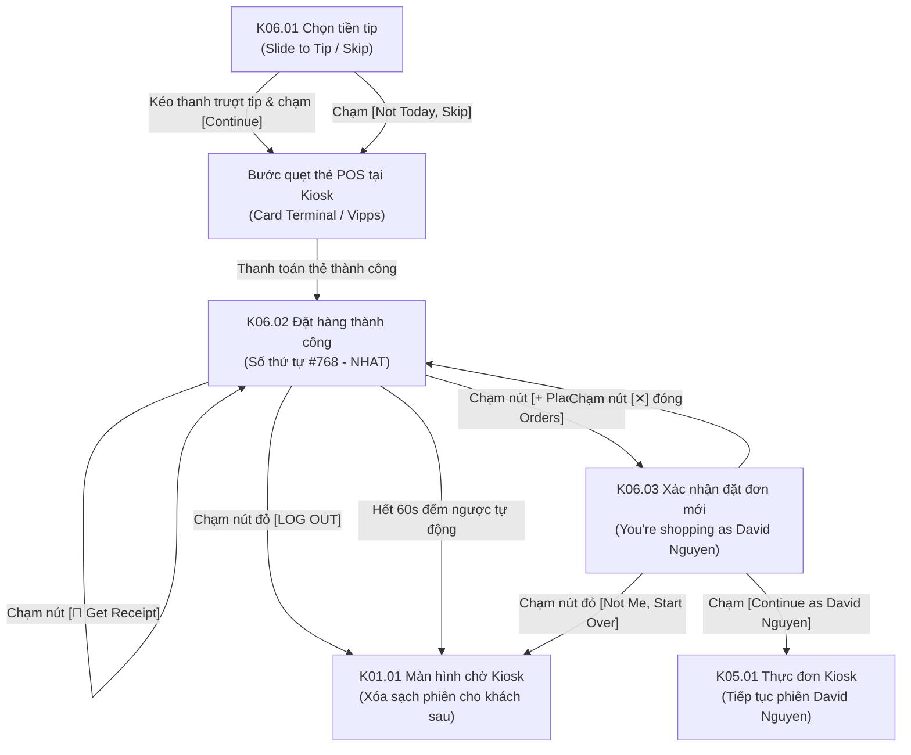

# Phân hệ Kiosk 06: Checkout khách đã đăng nhập & Kết thúc phiên an toàn (Member Checkout & Session Completion)

## 1. Giới thiệu tổng quan (Overview)
Phân hệ **Kiosk 06 - Checkout khách đã đăng nhập & Kết thúc phiên an toàn** xử lý các bước thanh toán cuối cùng và hoàn tất vòng đời giao dịch của khách hàng thành viên tại trạm cảm ứng Kiosk POS:
1. **Lựa chọn tiền tip chạm trượt độc đáo (Slide to Tip with Heart Slider):**
   - Thay vì các nút phần trăm gượng gạo, Kiosk mang đến thanh trượt cảm ứng mềm mại với con trỏ hình trái tim (`❤️`) cho phép khách tùy ý kéo trượt mức tiền tip thể hiện sự hài lòng với dịch vụ.
   - Nút lựa chọn nhanh `[Not Today, Skip]` giúp khách không bị áp lực phải tip khi không có nhu cầu.
2. **Màn hình thành công & Cấp số thứ tự lấy món (Queue Ticket & Electronic Receipt):**
   - Hiển thị nổi bật số thứ tự nhận món tại quầy: `Your Order Number: #768 - NHAT`.
   - Thời gian ước tính nhà bếp chuẩn bị: `Preparing time: 15 Min`.
   - Nút bấm `[🧾 Get Receipt]` gửi hóa đơn điện tử qua email hoặc kích hoạt máy in nhiệt Kiosk nhả bill giấy.
3. **Bảo mật phiên công cộng & Tiếp nhận khách kế tiếp (Kiosk Session Sanitization):**
   - Nút `[LOG OUT]` màu đỏ viền cho phép kết thúc phiên làm việc ngay khi thanh toán xong.
   - Khi bấm `[+ Place New Orders]`, hệ thống bật modal xác nhận danh tính: *"You're shopping as David Nguyen"*:
     - Nếu là chính khách hàng muốn gọi thêm món: Chọn `[Continue as David Nguyen]`.
     - Nếu là khách hàng mới đứng sau trong hàng đợi: Chọn `[Not Me, Start Over]` để xóa sạch token và trả Kiosk về màn hình ban đầu.

---

## 2. Danh mục ảnh Prototype (Prototype Inventory)

| STT | Tên file ảnh | Mã màn hình | Tên màn hình | Trạng thái hiển thị |
|---|---|---|---|---|
| 1 | `6-1-chon-tien-tip-khach-da-dang-nhap.png` | **K06.01** | Chọn tiền tip · Thành viên | Tiến trình 3 bước: Menu & Cart (xong) -> Tips (đang chọn) -> Payment. Thanh trượt Slide to Tip hình trái tim. |
| 2 | `6-2-dat-hang-thanh-cong-va-nhan-hoa-don.png` | **K06.02** | Đặt hàng thành công & Số thứ tự | Icon tích xanh tỏa sáng, thời gian 15 phút, số thứ tự `#768 - NHAT`, nút Get Receipt, Log Out, Place New Orders. |
| 3 | `6-3-dat-don-moi-xac-nhan-nguoi-dung.png` | **K06.03** | Đặt đơn mới · Xác nhận người dùng | Modal bảo vệ tài khoản: "You're shopping as David Nguyen", nút đỏ `[Not Me, Start Over]` và nút vàng `[Continue as David Nguyen]`. |

---

## 3. Luồng chuyển hướng & Tương tác chi tiết (Screen Flow & Interactions)

### Chi tiết các màn hình:
- **K06.01 Màn hình Chọn tiền tip cho thành viên (Slide to Tip Screen):**
  - **Top Bar:** Nút `< Back` góc trái quay về giỏ hàng **K05.05**. Thanh tiến trình 3 bước:
    1. `Menu & Cart` (vòng tròn vàng có dấu tích).
    2. `Tips` (vòng tròn viền vàng đang chọn).
    3. `Payment` (vòng tròn xám chưa kích hoạt).
  - **Nội dung trung tâm:**
    - Tiêu đề: *"Would you like to leave a tip?"*
    - Nhãn phụ màu hồng đỏ: *"Slide to Tip"*.
    - Thanh trượt nằm ngang với con trỏ cảm ứng hình trái tim màu đỏ tươi (`❤️`). Khách vuốt ngón tay từ trái sang phải để tăng số tiền tip (VD: 10 NOK, 20 NOK, 50 NOK...).
  - **Nút hành động:**
    - `[Not Today, Skip]` (nền trắng viền xám): Không tip, giữ nguyên tổng tiền ban đầu.
    - `[Continue]` (nền xám khi tip = 0, sáng màu vàng khi khách đã chọn số tiền tip): Chuyển sang bước thanh toán qua máy quẹt thẻ gắn trên Kiosk.
- **K06.02 Màn hình Đặt hàng thành công & Số thứ tự (Order Success & Pick-up Ticket):**
  - **Đồ họa trung tâm:** Vòng tròn màu xanh lá cây có dấu tích trắng lớn, bao quanh bởi các ánh sao tỏa sáng (`✦`).
  - Lời cảm ơn: *"Thank you for your purchasing. Your order is being prepared"*.
  - Thời gian dự kiến: *"Preparing time: 15 Min"* (màu xanh dương).
  - Số thứ tự in đậm màu vàng kích thước siêu lớn:
    $$\mathbf{\#768 - NHAT}$$
    (Giúp khách hàng dễ dàng theo dõi trên màn hình gọi số của nhà bếp).
  - **3 nút hành động chiến lược:**
    1. `[🧾 Get Receipt]` (nút vàng nổi bật): Cho phép khách nhập email nhận hóa đơn điện tử E-Receipt hoặc in hóa đơn giấy ngay tại khe nhả giấy Kiosk.
    2. `[LOG OUT]` (nút viền đỏ bo tròn): Đăng xuất ngay lập tức, trả Kiosk về trạng thái sạch cho khách hàng tiếp theo.
    3. `[+ Place New Orders]` (nút viền vàng bo tròn): Kích hoạt modal gọi thêm món **K06.03**.
- **K06.03 Modal Xác nhận người dùng khi đặt đơn mới (Identity Confirmation Guard):**
  - Ngăn ngừa tình trạng khách hàng tiếp theo vô tình đặt món trên tài khoản và điểm của khách hàng trước.
  - Tiêu đề modal: `Place new Orders`.
  - Dòng nhắc nhở rõ ràng: *"You're shopping as David Nguyen"*.
  - Hai nút phân luồng rành mạch:
    - `[Not Me, Start Over]` (Viền đỏ đậm): Nếu bạn không phải David Nguyen, hệ thống sẽ đăng xuất toàn bộ tài khoản, xóa sạch giỏ và đưa Kiosk về màn hình chờ ban đầu **K01.01**.
    - `[Continue as David Nguyen]` (Nút màu vàng đặc): Nếu chính là David Nguyen muốn đặt thêm đồ uống/tráng miệng, tiếp tục giữ phiên đăng nhập và đưa về thực đơn **K05.01**.

---

## 4. Bảng ánh xạ Màn hình - API chi tiết (Screen-to-API Mapping)

| Màn hình | API Endpoint | Method | Header bắt buộc | Request Body / Query | Mục đích nghiệp vụ |
|---|---|---|---|---|---|
| **K06.01** | `/api/v1/kiosk/checkout` | `POST` | `X-Tenant-ID`, `X-Kiosk-Device-ID`, `Authorization: Bearer <token>` | `{"storeId": "...", "tipAmount": 20.00, "paymentMethod": "CARD", "items": [...]}` | Thực hiện đặt hàng và kích hoạt tiến trình xử lý thanh toán thẻ tại trạm Kiosk. |
| **K06.02** | `/api/v1/orders/{orderId}/e-receipt` | `POST` | `X-Tenant-ID`, `Authorization: Bearer <token>` | `{"email": "info@ordera.no"}` | Gửi hóa đơn điện tử chi tiết vào hòm thư cá nhân của David Nguyen. |
| **K06.02** | `/api/v1/kiosk/session/reset` | `POST` | `X-Tenant-ID`, `X-Kiosk-Device-ID` | `{"reason": "TRANSACTION_COMPLETED"}` | Gọi khi bấm nút LOG OUT hoặc khi hết 60s đếm ngược, đưa Kiosk về màn hình chờ. |
| **K06.03** | `/api/v1/auth/logout` | `POST` | `X-Tenant-ID`, `X-Kiosk-Device-ID`, `Authorization: Bearer <token>` | `{"refreshToken": "..."}` | Xóa bỏ phiên David Nguyen khi bấm nút Not Me, Start Over. |

---

## 5. Xử lý ngoại lệ & Trạng thái biên (Edge Cases & Fallbacks)
1. **Khách hàng rời đi ngay sau khi màn hình hiển thị số đơn (No Touch Timeout):**
   - Màn hình **K06.02** chạy bộ đếm ngược 60 giây hiển thị ở góc màn hình. Khi đồng hồ về 0, hệ thống tự động đăng xuất tài khoản David Nguyen và trở về màn hình chờ **K01.01**, đảm bảo an toàn 100% dữ liệu.
2. **Kẹt giấy hoặc hết giấy in hóa đơn:**
   - Khi bấm `[🧾 Get Receipt]`, nếu máy in Kiosk báo cờ `printerPaperStatus = 'OUT_OF_PAPER'`, hệ thống tự động chuyển sang mở popup nhập email nhận E-Receipt và thông báo cho khách hàng: *"Máy in tạm hết giấy, hóa đơn chi tiết đã được gửi vào email của bạn."*
3. **Thẻ ngân hàng bị từ chối (Card Payment Declined):**
   - Kiosk hiển thị màn hình thông báo lỗi quẹt thẻ: *"Giao dịch không thành công. Vui lòng kiểm tra lại thẻ hoặc chọn phương thức thanh toán khác."* kèm nút bấm `[Thử lại]` mà không làm mất món trong giỏ hàng.

