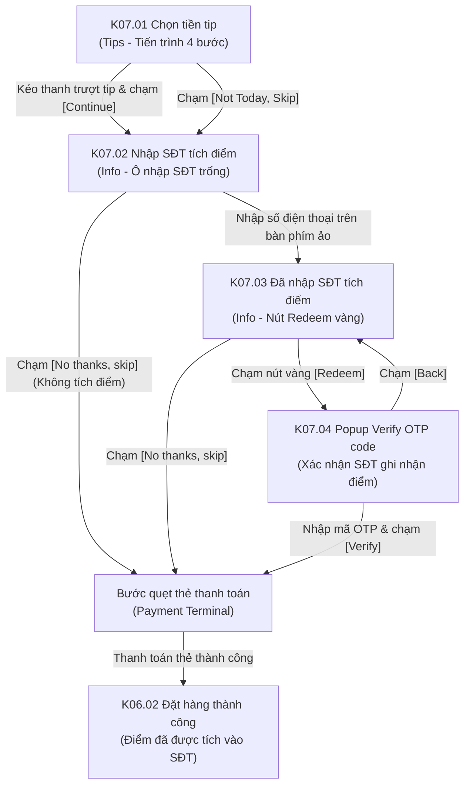

# Phân hệ Kiosk 07: Khách chưa đăng nhập & Xác thực tích điểm tại Checkout (Guest Points Accrual & On-the-fly Verification)

## 1. Giới thiệu tổng quan (Overview)
Phân hệ **Kiosk 07 - Khách chưa đăng nhập & Xác thực tích điểm tại Checkout** được thiết kế riêng cho lượng lớn khách hàng vãng lai (Guest Users) vào quầy tự đặt món mà không đăng nhập từ đầu:
1. **Tiến trình thanh toán bổ sung bước Info (4-Step Checkout Flow):**
   - Thay vì chỉ có 3 bước như thành viên đã đăng nhập, luồng của khách vãng lai gồm 4 bước rõ ràng:
     $$\text{Menu \& Cart} \longrightarrow \text{Tips} \longrightarrow \mathbf{Info} \longrightarrow \text{Payment}$$
2. **Kích hoạt động lực tích lũy điểm thưởng (Points Accrual Incentive):**
   - Tại bước `Info`, Kiosk hiển thị nổi bật mức điểm thưởng khách hàng sẽ nhận được ngay trong đơn này: `You will earned +150 points` (huy hiệu màu đỏ hồng thu hút sự chú ý).
   - Dòng kêu gọi hành động: *"Input information to register loyalty account & redeem points"*.
3. **Tra cứu SĐT & Xác thực OTP nhanh bằng bàn phím cảm ứng (Touch Numpad & Quick OTP):**
   - Khách hàng chỉ cần nhập số điện thoại qua bàn phím cảm ứng ảo.
   - Nếu muốn bỏ qua, khách bấm `[No thanks, skip]` để sang thẳng bước quẹt thẻ thanh toán mà không tích điểm.
   - Nếu bấm `[Redeem]`, hệ thống gửi mã OTP xác nhận về điện thoại để vừa ghi nhận điểm thưởng vào sổ cái `points_ledger` vừa kích hoạt tài khoản thành viên mới mà không làm đứt quãng luồng thanh toán.

---

## 2. Danh mục ảnh Prototype (Prototype Inventory)

| STT | Tên file ảnh | Mã màn hình | Tên màn hình | Trạng thái hiển thị |
|---|---|---|---|---|
| 1 | `7-1-chon-tien-tip-khach-chua-dang-nhap.png` | **K07.01** | Chọn tiền tip · Khách vãng lai | Tiến trình 4 bước: Menu & Cart (xong) -> Tips (đang chọn) -> Info -> Payment. Nút Log in góc phải trên cùng. |
| 2 | `7-2-tich-diem-nhap-sdt.png` | **K07.02** | Nhập SĐT tích điểm (Trống) | Bước Info: Tiêu đề `Redeem loyalty points`, badge `+150 points`, ô SĐT `+47` trống, nút `[No thanks, skip]` và `[Redeem]` mờ. |
| 3 | `7-3-tich-diem-dang-nhap-thong-tin.png` | **K07.03** | Nhập SĐT tích điểm (Đã điền) | Đã nhập SĐT (`91910125`), nút `[Redeem]` sáng màu vàng rực rỡ sẵn sàng gửi mã OTP. |
| 4 | `7-4-xac-nhan-de-ghi-nhan-diem.png` | **K07.04** | Xác nhận OTP ghi nhận điểm | Modal `Verify OTP code` gửi tới `** ***1618`, ô nhập mã OTP, đếm ngược `Resend a new OTP in 90s`, nút `[Back]` và `[Verify]`. |

---

## 3. Luồng chuyển hướng & Tương tác chi tiết (Screen Flow & Interactions)

### Chi tiết các màn hình:
- **K07.01 Màn hình Chọn tiền tip cho khách vãng lai (Guest Tip Selection):**
  - **Top Bar:** Nút `< Back` quay lại giỏ hàng. Nút `Log in` ở góc trên bên phải (khách có thể đăng nhập bất kỳ lúc nào nếu muốn dùng thẻ cũ).
  - **Thanh tiến trình 4 bước:**
    1. `Menu & Cart` (đã xong, dấu tích vàng).
    2. `Tips` (vòng tròn viền vàng đang kích hoạt).
    3. `Info` (vòng tròn xám - bước thu thập SĐT tích điểm kế tiếp).
    4. `Payment` (vòng tròn xám - bước quẹt thẻ).
  - **Khu vực trung tâm:** Câu hỏi *"Would you like to leave a tip?"*, nhãn *"Slide to Tip"*, thanh trượt cảm ứng với con trỏ hình trái tim (`❤️`). Nút `[Not Today, Skip]` và nút `[Continue]`.
- **K07.02 & K07.03 Bước nhập SĐT tích lũy điểm thưởng (Loyalty Accrual Info Step):**
  - Bước `Info` trên thanh tiến trình chuyển sang màu vàng kích hoạt.
  - **Tiêu đề:** `Redeem loyalty points`.
  - **Huy hiệu điểm thưởng:** `You will earned` kèm badge nền đỏ chữ đỏ nổi bật: `+150 points`.
  - **Dòng hướng dẫn:** *"Input information to register loyalty account & redeem points"*.
  - **Khung nhập liệu:** Mã quốc gia `+47` (Na Uy), ô nhập `|Phone number` có nút xóa nhanh `(✕)`. Bàn phím số ảo hiển thị phía dưới màn hình cảm ứng.
  - **Hai tùy chọn cho khách:**
    - `[No thanks, skip]` (Nút màu trắng viền xám): Khách hàng không có nhu cầu tích điểm hoặc vội thanh toán có thể bấm để bỏ qua bước này và chuyển thẳng sang bước quẹt thẻ `Payment`.
    - `[Redeem]`: Ban đầu mờ/disabled (**K07.02**). Khi khách nhập đủ số điện thoại hợp lệ (VD: `91910125` tại **K07.03**), nút chuyển sang màu vàng tươi. Khi click sẽ gọi API kích hoạt OTP gửi về máy khách.
- **K07.04 Popup Xác nhận mã OTP ghi nhận điểm (Verify OTP Code Dialog):**
  - Modal bo tròn làm mờ nền trung tâm Kiosk.
  - Tiêu đề: `Verify OTP code`.
  - Dòng thông báo che số: *"OTP number has been sent to \*\* \*\*\*1618"*.
  - Ô nhập mã OTP với con trỏ nhấp nháy, hỗ trợ nhập nhanh từ bàn phím cảm ứng.
  - Đồng hồ đếm ngược: *"Resend a new OTP in 90s"*.
  - Nút bấm:
    - `[Back]`: Quay lại form nhập SĐT **K07.03** nếu khách gõ nhầm số.
    - `[Verify]`: Khi đã nhập mã OTP, nút kích hoạt để xác thực. Sau khi xác thực thành công, hệ thống liên kết SĐT với đơn hàng, chuyển ngay sang bước `Payment` và tự động tích 150 điểm vào sổ cái `points_ledger` ngay khi quẹt thẻ thành công.

---

## 4. Bảng ánh xạ Màn hình - API chi tiết (Screen-to-API Mapping)

| Màn hình | API Endpoint | Method | Header bắt buộc | Request Body / Query | Mục đích nghiệp vụ |
|---|---|---|---|---|---|
| **K07.01** | `/api/v1/kiosk/checkout/calculate-tip` | `POST` | `X-Tenant-ID`, `X-Kiosk-Device-ID` | `{"subtotal": 170.00, "tipAmount": 15.00}` | Tính lại tổng số tiền đơn hàng bao gồm tiền tip và thuế VAT. |
| **K07.02 & K07.03** | `/api/v1/kiosk/identify` | `POST` | `X-Tenant-ID`, `X-Kiosk-Device-ID` | `{"phoneNumber": "+4791910125", "storeId": "..."}` | Tra cứu xem SĐT đã là thành viên chưa; nếu chưa, chuẩn bị phiên tích điểm mới. |
| **K07.03** | `/api/v1/auth/otp/send` | `POST` | `X-Tenant-ID`, `X-Kiosk-Device-ID` | `{"channel": "SMS", "phoneNumber": "+4791910125"}` | Gửi mã xác thực OTP 6 số tới SĐT của khách, trả về thời gian chờ 90s. |
| **K07.04** | `/api/v1/auth/otp/verify` | `POST` | `X-Tenant-ID`, `X-Kiosk-Device-ID` | `{"phoneNumber": "+4791910125", "otpCode": "..."}` | Xác minh mã OTP và tạo tài khoản thành viên hạng New tự động cho khách. |
| **K07.04** | `/api/v1/kiosk/checkout` | `POST` | `X-Tenant-ID`, `X-Kiosk-Device-ID` | `{"storeId": "...", "customerPhone": "+4791910125", "items": [...]}` | Thực hiện thanh toán thẻ và tự động ghi sổ cái `points_ledger` cộng điểm tích lũy. |

---

## 5. Xử lý ngoại lệ & Trạng thái biên (Edge Cases & Fallbacks)
1. **Khách hàng đổi ý không muốn nhận OTP:**
   - Khách có thể chạm nút `[Back]` trên modal hoặc bấm `[No thanks, skip]` để bỏ qua hoàn toàn bước tích điểm và tiếp tục thanh toán đơn hàng bình thường.
2. **Khách hàng không nhận được SMS tại vùng sóng yếu:**
   - Sau khi đếm ngược 90 giây kết thúc, dòng *"Resend a new OTP in 90s"* chuyển thành nút bấm vàng: `[Resend OTP via SMS]` hoặc tùy chọn `[Bỏ qua tích điểm & Thanh toán ngay]`.
3. **Số điện thoại nhập sai định dạng:**
   - Hệ thống hiển thị cảnh báo đỏ ngay dưới ô nhập SĐT: *"Vui lòng nhập đúng số điện thoại (tối thiểu 8 chữ số)."* và khóa nút `[Redeem]`.
