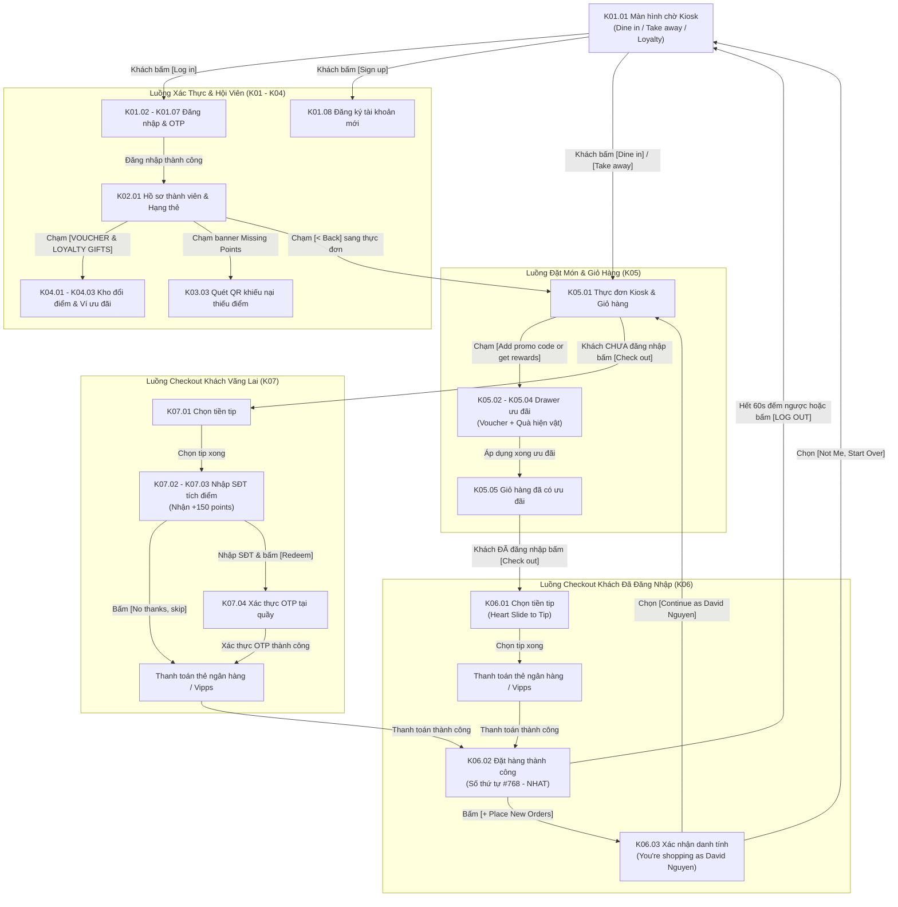

# Tài liệu Phân tích Prototype Kiosk POS (Kiosk Touch Terminal UI/UX Specification)
## Trạm Đặt Món & Tích Điểm Tự Phục Vụ Tại Quầy Thu Ngân

Tài liệu này tổng hợp toàn bộ 7 phân hệ màn hình cảm ứng tự phục vụ (**Kiosk POS Touch Terminal**) được thiết kế chuyên biệt cho nền tảng **Ordera Multi-Tenant Loyalty & Ordering Platform**.

Trạm Kiosk được lắp đặt trực tiếp tại quầy gọi món của nhà hàng/cửa hàng F&B (ví dụ: Linn Sushi Sentrum), phục vụ 2 nhóm khách hàng:
- **Khách hàng tự đặt món (Self-Ordering):** Khách chọn món dùng tại bàn (`Dine in`) hoặc mang đi (`Take away`), áp dụng voucher & quà tặng, chọn tiền tip và thanh toán thẻ.
- **Khách hàng tích điểm nhanh tại quầy (Points Accrual):** Khách thanh toán tại quầy với thu ngân, sau đó nhập số điện thoại trên màn hình Kiosk phụ để tích điểm vào tài khoản hội viên.

---

## 📑 Danh mục 7 Phân hệ Prototype Kiosk POS

| Phân hệ | Thư mục | Số lượng màn hình | Mã màn hình | Mô tả nghiệp vụ cốt lõi |
|---|---|:---:|:---:|---|
| **K01** | [`1-bat-dau-va-xac-thuc-tai-khoan/`](./1-bat-dau-va-xac-thuc-tai-khoan/README.md) | 9 | `K01.01` - `K01.09` | Chọn hình thức phục vụ (Dine In / Take Away), đăng nhập SĐT/Email, bàn phím số cảm ứng, xác thực OTP 6 số, đăng ký thành viên mới và bổ sung thông tin hồ sơ. |
| **K02** | [`2-tai-khoan-lich-su-va-dang-xuat/`](./2-tai-khoan-lich-su-va-dang-xuat/README.md) | 5 | `K02.01` - `K02.05` | Hồ sơ David Nguyen, thẻ Silver (120 pts), thanh tiến trình 6 bậc, chỉnh sửa hồ sơ qua bàn phím ảo QWERTY, lịch sử đơn hàng (Active/Past) và popup xác nhận đăng xuất an toàn. |
| **K03** | [`3-nhanh-ho-tro-thieu-diem-loyalty/`](./3-nhanh-ho-tro-thieu-diem-loyalty/README.md) | 3 | `K03.01` - `K03.03` | Banner thiếu điểm ("Missing Your Points?"), hộp thư Messages & News, giải pháp hiển thị **Mã QR quét trên điện thoại cá nhân** để điền form khiếu nại đối soát hóa đơn cũ. |
| **K04** | [`4-kho-doi-diem/`](./4-kho-doi-diem/README.md) | 3 | `K04.01` - `K04.03` | Ví `My Rewards` (Voucher 100 NOK, -30%, Quà cốc tumbler), kho đổi điểm `Get More Rewards` (đổi thưởng 100 pts), và trạng thái áp dụng thành công (`In Use` + Toast). |
| **K05** | [`5-dat-mon-gio-hang-my-offers/`](./5-dat-mon-gio-hang-my-offers/README.md) | 5 | `K05.01` - `K05.05` | Thực đơn chia đôi (Menu bên trái, Giỏ hàng bên phải), tùy chọn khung giờ (Lunch/Dinner/Holiday), modal `My Offers` áp dụng song song cả Voucher (-30%) và Quà hiện vật (Cốc giữ nhiệt). |
| **K06** | [`6-khach-da-dang-nhap-chekout-va-ket-thuc-phien/`](./6-khach-da-dang-nhap-chekout-va-ket-thuc-phien/README.md) | 3 | `K06.01` - `K06.03` | Tiến trình 3 bước (Menu -> Tips -> Payment), thanh trượt tiền tip hình trái tim (`❤️`), số thứ tự lớn (`#768 - NHAT`), nhận hóa đơn điện tử E-Receipt, và modal bảo vệ tài khoản khi đặt đơn mới. |
| **K07** | [`7-khach-hang-chua-dang-nhap-xac-thuc-de-tich-diem/`](./7-khach-hang-chua-dang-nhap-xac-thuc-de-tich-diem/README.md) | 4 | `K07.01` - `K07.04` | Luồng thanh toán 4 bước cho khách vãng lai (Menu -> Tips -> Info -> Payment), nhập SĐT trên bàn phím ảo để nhận `+150 points`, xác thực OTP tại chỗ hoặc bỏ qua (`Skip`). |

**Tổng cộng:** **32 màn hình Kiosk độ nét cao** bao phủ 100% các trạng thái từ khách vãng lai, hội viên đăng nhập, tích điểm đến quản trị phiên Kiosk.

---

## 🖥️ Sơ Đồ Kiến Trúc Luồng Nghiệp Vụ Kiosk (Kiosk State Machine Flow)

---

## 🔒 4 Nguyên Tắc Kỹ Thuật & Bảo Mật Đặc Thù Của Trạm Kiosk

1. **Bộ Giám Sát Phiên 60 Giây (60-second Idle Watchdog Timer):**
   - Kiosk là thiết bị công cộng đặt tại quầy. Bất kỳ khi nào khách hàng rời đi mà không tương tác trong vòng 60 giây, bộ đếm ngược sẽ kích hoạt.
   - Khi hết giờ, ứng dụng tự động gọi `POST /api/v1/kiosk/session/reset` với lý do `IDLE_TIMEOUT`, dọn sạch Access Token, Refresh Token, giỏ hàng tạm trong Redis và trở về màn hình chờ ban đầu **K01.01**.
2. **Cơ Chế Bảo Vệ Danh Tính Khi Đặt Thêm Đơn (`Identity Confirmation Guard` - K06.03):**
   - Sau khi hoàn tất đơn hàng **K06.02**, nếu người đứng sau chạm vào nút `[+ Place New Orders]`, hệ thống lập tức hiển thị popup hỏi: *"You're shopping as David Nguyen"*. Người dùng bắt buộc phải chọn `[Not Me, Start Over]` nếu không phải David Nguyen để xóa sạch phiên làm việc cũ.
3. **Bàn Phím Ảo Tích Hợp Trên Màn Cảm Ứng (On-Screen Touch Keyboard & Numpad):**
   - Màn hình Kiosk không yêu cầu bàn phím vật lý. Mọi ô nhập SĐT, mã OTP, họ tên, email đều tự động hiển thị bàn phím ảo tương ứng (bàn phím số Numpad cho SĐT/OTP, bàn phím chữ QWERTY cho họ tên/email).
4. **Giải Quyết Khiếu Nại Bằng Mã QR Điện Thoại (Cross-Device QR Code Claim):**
   - Đối với các khiếu nại phức tạp như đối soát hóa đơn cũ thiếu điểm, trạm Kiosk không bắt khách hàng phải đứng gõ phím tại quầy làm ách tắc hàng dài, mà cung cấp mã QR **K03.03** để khách quét và điền form trên điện thoại cá nhân.

---

## 🔗 Liên Kết Thiết Kế Kỹ Thuật (API & Database Mapping)

- **API Specification:** [`docs/designs/api-design/07-kiosk-pos-api.md`](../designs/api-design/07-kiosk-pos-api.md)
  - `POST /api/v1/kiosk/identify` (Nhận diện hội viên qua SĐT)
  - `POST /api/v1/kiosk/quick-earn` (Tích điểm nhanh tại quầy không cần đặt món)
  - `POST /api/v1/kiosk/checkout` (Tự đặt món và thanh toán thẻ tại Kiosk)
  - `POST /api/v1/kiosk/session/reset` (Đặt lại phiên Kiosk & timeout 60s)
  - `GET /api/v1/kiosk/config/{deviceId}` (Cấu hình thiết bị Kiosk & kết nối máy in/đầu đọc thẻ)
- **Database Specification:** [`docs/designs/db-design/01-tenants-and-stores-db.md`](../designs/db-design/01-tenants-and-stores-db.md)
  - Bảng `kiosk_devices`: Quản lý danh sách phần cứng trạm Kiosk theo chi nhánh, trạng thái máy in và máy quẹt thẻ.
